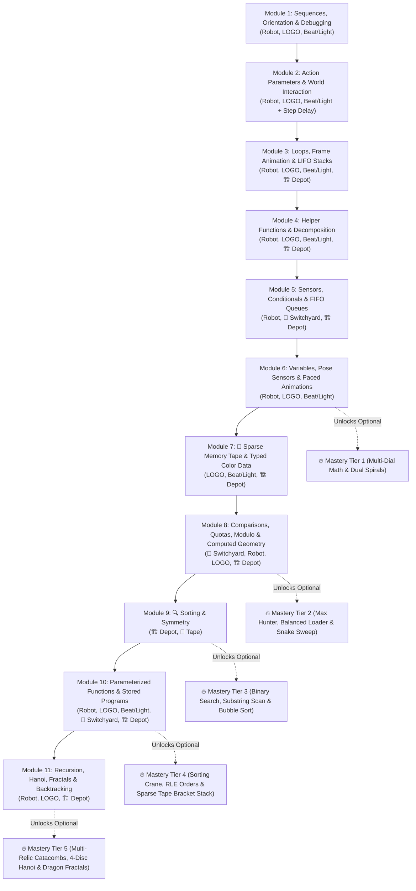

# Programming Curriculum for Complete Newcomers

This document defines the high-level curriculum roadmap for **Robot Emulator (`robotemu`)**, designed to take complete newcomers—with **zero prior programming knowledge** and **minimal-to-zero reading required**—from sequential actions to data structures (stacks, queues, sparse memory tape), typed variables, sorting/searching algorithms, parameterized functions, fractals, and recursive backtracking across **11 progressive modules**.

For detailed specifications of the simulation environments, shared language blocks, animation lessons, and platform infrastructure referenced across this curriculum, see:
- [🛠️ Shared Language, Lesson Mechanics & Platform Requirements](./platform_requirements.md)
- [🏗️ Depot Environment, 📼 Sparse Memory Tape & Typed Variables](./env_depot_and_tape.md)
- [🎬 Animation Features Integration — Lessons & Creative Sandboxes](./env_animation_lessons.md)
- [🎵 Beat & Light Matrix Environment](./env_beat_light.md)
- [🚂 Switchyard / Conveyor Sorter Environment](./env_switchyard.md)
- [🤖 Robot Grid Planned Extensions](./env_robot_extensions.md)

---

## 1. Terminology & Hierarchy

- **Curriculum:** The overall 11-module learning track.
- **Module (`Module 1` – `Module 11`):** A thematic chapter grouping focused lessons around one core programming or data-structure paradigm, ending with 2–3 **Capstones** and awarding a **Module Badge**.
- **Lesson (`1.0`, `1.1`, `2.5a`, …):** A single small-step activity inside a Module (either an interactive **Explanation Lesson**, a validated **Puzzle Lesson**, or an open **Sandbox Lesson**). Sub-letter IDs (`2.5a`, `3.2a`) sort inline directly after their base lesson (`2.5`, `3.2`) and before Module Capstones.
- **Capstone (`1A`, `1B`, … `11B`):** A richer synthesis puzzle or creative showcase at the end of a Module using everything learned in that Module.
- **Mastery Challenge (`Challenge 6.1` – `11.4`):** Fully optional, harder algorithmic challenges unlocked across 5 bonus tiers starting at the end of Module 6, awarding **Challenge Medals**.

---

## 2. Core Pedagogical Principles

1. **Strict One-Concept-Per-Lesson Pacing:**
   - Every lesson teaches **strictly one** new mental model.
   - Whenever a learner meets a brand-new environment (Switchyard, Depot, Memory Tape), world item, timing/animation control, or non-obvious sensor/operator, it is introduced **on its own** (via an interactive `📖 Explanation` lesson and/or using only already-mastered control blocks)—never pairing a new environment with a new control-flow jump.
2. **Zero-Reading Visual Learning:**
   - Objectives, constraints, runtime type/bounds errors, hints, variations, and solutions communicate via **icons, numbers, animations, physical UI slot trays, and rendered previews** rather than paragraphs of text.
3. **Constraint-Driven Discovery (No Brute Force):**
   - Validated puzzles enforce **physical block-slot budgets**, **per-tab slot limits**, or **simultaneous multi-map / multi-stream validation** (`3–4` visible runs) so loops, helper functions, conditionals, variables, and data structures are genuinely required.
4. **Complementary Environment Tracks:**
   - **Constrained Puzzles (🤖 Robot Grid, 🚂 Switchyard & 🏗️ Depot):** Clear pass/fail validation, backed by non-spoiling **Partial Solutions** and guaranteed **Full Working Solutions**.
   - **Creative Sandboxes (🐢 Turtle LOGO & 🎵 Beat & Light Matrix):** No pass/fail anxiety; each lesson pre-loads a **working starter example** alongside **3–4 illustrated/playable variation cards** with **1-tap Copy / Load Code**.

---

## 3. Activity Formats, Solution Length Guardrails & Visual Support

### Five Activity Formats

| Format | Badge | Validation | Purpose |
| :--- | :---: | :--- | :--- |
| **Explanation Lesson (Interactive Demo)** | 📖 | **No Exercise** *(1-tap continue)* | Presents **1–3 runnable, step-able visual examples** with spotlight animations to explain a new environment, interactive object, animation/tape block, sensor (`unvisitedAhead`, `$x`/`$y`), type rule, operator (`<, >, ==`, `%, /`), or control block (`Loop`, `Call F1`, `If/Else`, `While`, variables, sockets, recursion) before asking learners to solve puzzles with it. |
| **Puzzle Lesson** | 🤖 / 🚂 / 🏗️ | **Validated Puzzle** | Focused single-concept puzzle with **Partial + Full Visual Solutions**. |
| **Sandbox Lesson** | 🐢 / 🎵 | **Open Sandbox** | Working starter program + **3–4 illustrated/playable variation cards** with **Copy / Load Code** (and 1-tap Undo). |
| **Module Capstone** | 🏆 / 🎨 | **Puzzle or Sandbox** | Synthesizes everything taught in the current Module into a rewarding milestone. |
| **Optional Mastery Challenge (Module 6+)** | 🔥 | **Bonus Challenge** *(fully optional)* | Unlocks upon finishing Modules 6, 8, 9, 10, and 11. Never blocks progression; explores deeper algorithmic puzzles with multi-tab solutions (**Partial + Full Solutions** included). |

### Solution Length & Map Size Guardrails

To prevent scrolling fatigue on tablets and keep every exercise focused on its core idea, all reference solutions must obey strict physical block-card caps (counting every placed workspace card `1:1` with physical `[■]` slots, including structural delimiter cards such as `Loop End`, `Else`, `End If`, and `End While`):

| Tier | Total Reference Blocks (All Tabs) | Max Blocks in Any Single Tab | Pacing Guardrail |
| :--- | :---: | :---: | :--- |
| **Modules 1–2 Lessons** | **3 – 8 blocks** | **8 blocks** | Keep Module 1 maps compact (`3×3` to `4×4`) before `×N` repeat badges exist so learners never chain 8+ duplicate moves. |
| **Modules 3–11 Lessons** | **4 – 12 blocks** *(up to **20** across helper tabs in M9+)* | **8 blocks** *(up to **11** on 3-way `Else If` / base+recursive branch)* | If a draft puzzle exceeds its single-tab cap, trim map busywork or factor inner passes into a helper tab (`F1`–`F3`). |
| **Sandbox Examples & Variations** | **4 – 14 blocks** *(up to **24** across helper tabs)* | **14 blocks** | Accommodates nested frame-animation loops in `MAIN` (e.g., Module 3 Spinning Windmill before `F1` unlocks in Module 4) while fitting comfortably on screen (up to **16** total in single-tab Capstones). |
| **Module Capstones (🏆)** | **8 – 14 blocks** | **8 blocks** *(up to **14** in 🎨 Sandbox Capstones)* | Difficulty comes from *combining* concepts across tabs, never tedious length. |
| **Mastery Challenges (🔥 Module 6+)** | **12 – 24 blocks** | **10 blocks** | Multi-tab depth (`Main` + `F1`–`F3`) allowed for optional algorithmic challenges. |

### Zero-Reading Support Mechanics

- **Partial + Full Visual Solutions (🤖 Robot, 🚂 Switchyard & 🏗️ Depot):**
  - **Tier 1 — Partial Solution (Scaffold):**
    - *Ultra-short puzzles (1–3 blocks):* **Canvas Ghost-Step Preview** animating the first move/turn on the map without revealing blocks.
    - *Standard/complex puzzles:* **Structural Skeletons** (e.g., `Loop` or `If/Else` brackets pre-placed with `?` placeholder blocks inside, or revealing `F1` while leaving `Main` open). Running a program with a `?` placeholder pauses cleanly on `?`, pulses it amber, and highlights the matching palette category.
  - **Tier 2 — Full Working Solution:** Verified visual block sequence with a one-tap **Load into Workspace** button (protected by 1-tap **Undo** so learner work is never lost).
- **Illustrated / Playable Variation Cards (🐢 LOGO & 🎵 Beat & Light):**
  - Each variation card shows an **auto-rendered image thumbnail** (LOGO — requiring `CLEAR_CANVAS` at the *start* of animation loops so finished thumbnails are never blank; see [env_animation_lessons.md §1](./env_animation_lessons.md)) or an **in-card Play/Listen animated 8×8 preview** (Beat & Light) generated directly from that variation's block code, plus a **Copy / Load Code** button (backed by **Undo**).
- **Non-Verbal Constraint & Type Cues:**
  - **Padlock-Gated Waypoints (`1 → 2 → Goal`):** Later flags stay dimmed/padlocked until earlier flags are collected.
  - **Physical Slot Trays (`[■][■][■][□][□]`):** Block budgets appear as physical workspace slots per tab that cap/shake when full.
  - **Simultaneous Multi-Run Pips (`[1 ✓] [2 ·] [3 ·]`):** Sensor/conditional lessons display all 3–4 test variants from the start so learners see one program must beat all layouts.
  - **Visual Type & Bounds Bounces (Module 7+):** Passing a color into a numeric slot (or stepping the Memory Tape head outside `1..tapeLength`) pauses on the offending block and plays a self-explanatory Watch Tray bounce or rail bumper shake (see [env_depot_and_tape.md §4–§5](./env_depot_and_tape.md)).

---

## 4. Progression Architecture (11 Modules + 5 Mastery Tiers)

---

## 5. Module-by-Module Lesson & Capstone Catalog

### Module 1: First Steps — Sequences, Orientation & Visual Debugging
*Cognitive Goal: Understand top-to-bottom execution order, egocentric rotation vs. movement, tick-by-tick visual debugging, staged sub-goals, and parameterless creative sequencing. Grids stay `3×3`–`4×4`; puzzle solutions `3–6 blocks` (`8–10` in Capstone).*

- **Lesson 1.0 [📖 Explanation — 🤖 Robot] How Programs Run & Robot Point-of-View:** Two runnable visual demos: (1) top-to-bottom block highlighting moving step-by-step, and (2) how `Turn Left` / `Turn Right` rotate in place relative to where the robot's eyes face (North vs. South).
- **Lesson 1.1 [🤖 Robot] Moving Forward & Execution Order:** Chaining `Move Forward` blocks to reach a straight-line goal.
- **Lesson 1.2 [🤖 Robot] Turning in Place (Egocentric Orientation):** Distinguishing rotation (`Turn Left` / `Turn Right`) from movement, including South- and West-facing turns.
- **Lesson 1.3 [🤖 Robot] Stepping Backward:** Using `Move Back` to retreat out of tight 1-tile alcoves without turning around.
- **Lesson 1.4 [🤖 Robot] Visual Step-Debugging:** Using Step-by-Step playback on a 5-block starter program to spot and fix **1 wrong block** (using only `Forward`, `Back`, `Turn`).
- **Lesson 1.5 [🤖 Robot] Ordered Waypoints (`1 → 2 → Goal`):** Planning a route in short stages across padlock-gated numbered flags.
- **Lesson 1.6 [🐢 LOGO] First Continuous Line Drawings:**
  - *Starter Example:* Draws a corner step and a closed square using default `Forward` and `90° Turn`.
  - *Illustrated Copyable Variations:* `[Img 1]` Block letter `L` · `[Img 2]` Hook corner · `[Img 3]` Plus sign `+`.
- **Lesson 1.7 [🐢 LOGO] Lifting & Lowering the Pen (`Pen Up` / `Pen Down`):**
  - *Starter Example:* Draws two separate parallel bars `=`.
  - *Illustrated Copyable Variations:* `[Img 1]` 3-dash line · `[Img 2]` Detached window next to a door · `[Img 3]` Initials `H I`.
- **Lesson 1.8 [🎵 Beat & Light] Meet Beat & Light — Drum Pads & Icon Stamps:**
  - *Starter Example:* 4-beat `Kick–Snare` sequence flashing preset `Heart → Star` LED stamps.
  - *Playable Copyable Variations:* `[Preview 1]` Rock beat + blinking smiley · `[Preview 2]` 3-chime fanfare + sparkle · `[Preview 3]` Clap-clap-stomp groove.
- **🏆 Capstone 1A [🤖 Robot Puzzle] — *The Compact Labyrinth*:** `4×4` 3-flag maze combining South/West turns, `Move Back`, and fixing a broken starter leg (`≤ 10 blocks`).
- **🎨 Capstone 1B [🐢 LOGO Sandbox] — *Postcard Sketch*:** Starter draws a house with a detached floating window; illustrated copyable variations show a boxy robot face, 3-letter word, and twin towers.
- **🎨 Capstone 1C [🎵 Beat & Light Sandbox] — *Sticker & Beat Intro*:** Starter pairs drum hits with 3 animated LED stamps; playable copyable variations show a victory jingle, winking animation, and countdown beat.

---

### Module 2: Action Parameters & World Interaction
*Cognitive Goal: Customize how a single action behaves via visual parameter badges (counts, distances, angles, colors, radii, pitches, step delays) and interact statefully with world objects. Puzzle solutions `4–8 blocks`; Capstone `≤ 12 blocks`.*

- **Lesson 2.1 [🤖 Robot] Action Repeat Badges (`×2`..`×9`):** Compressing straight movements with count badges inside a physical 5-slot tray.
- **Lesson 2.2 [🐢 LOGO] Length & Turn Angle Parameters:**
  - *Starter Example:* Equilateral triangle (`Forward 100`, `Turn 120°`) demonstrating exterior turn angles.
  - *Illustrated Copyable Variations:* `[Img 1]` Steep mountain peak vs. wide roof · `[Img 2]` Tilted diamond (`60°` / `120°`) · `[Img 3]` Open hexagon dish.
- **Lesson 2.3 [🐢 LOGO] Persistent Style State (`Pen Color` & `Pen Width`):**
  - *Starter Example:* Three parallel strokes showing color and width remain active until changed again (including `White` as a selective stroke eraser on the white canvas).
  - *Illustrated Copyable Variations:* `[Img 1]` 5-band rainbow ladder · `[Img 2]` Thick trunk + thin green twigs · `[Img 3]` Tricolor triangle.
- **Lesson 2.4 [🐢 LOGO] Multi-Parameter Actions (`Arc` Radius + Angle):**
  - *Starter Example:* Heart formed from two `180°` arcs and two straight lines.
  - *Illustrated Copyable Variations:* `[Img 1]` Wavy ocean line · `[Img 2]` 3-radius snowman (`25, 50, 75`) · `[Img 3]` Nested rainbow arches.
- **Lesson 2.5 [🎵 Beat & Light] Pitch, Duration & Colored LED Rows:**
  - *Starter Example:* 4-note melody with short/long durations lighting colored LED rows.
  - *Playable Copyable Variations:* `[Preview 1]` Doorbell chime · `[Preview 2]` Traffic-light countdown · `[Preview 3]` Rising color bar + bassline.
- **Lesson 2.5a [📖 Explanation — 🎵 Beat] Speed Control & `SET_BEAT_DELAY`:** *(See [env_animation_lessons.md §2](./env_animation_lessons.md))* Two runnable demos: (1) sequential row lighting (`SET_BEAT_DELAY [1]`) vs. instant frame batching (`SET_BEAT_DELAY [0]` + `WAIT_BEAT`), and (2) assembling a multi-row frame and carving dark stripes with `SET_LED_COLOR [Black]`.
- **Lesson 2.6 [📖 Explanation — 🤖 Robot] Interactive World Items (`Pick Up` & `Use/Drop`):** Three bite-sized runnable demos: (1) `Key` unlocking a gate, (2) `Plank` bridging water, and (3) placing a `Crate` onto a floor switch (with 1-slot backpack indicator).
- **Lesson 2.7 [🤖 Robot] Fetching, Carrying & Using Objects:** Solving compact gate-and-bridge puzzles with `Pick Up`, `Use/Drop`, and repeat badges (`≤ 8 blocks`).
- **🏆 Capstone 2A [🤖 Robot Puzzle] — *The Supply Courier*:** Slot-capped puzzle (`≤ 10 blocks`) combining `×N` badges, a gate key, and a bridge plank.
- **🎨 Capstone 2B [🐢 LOGO Sandbox] — *Emblem & Emoji Studio*:** Starter draws a multi-width colored medal; illustrated copyable variations show a winking emoji, curved-petal flower, and bullseye shield.

---

### Module 3: Loops — Repeating Sequences, Frame Animation & LIFO Stacks
*Cognitive Goal: Spot multi-block repeating motifs, enclose them in `Loop Start` / `Loop End`, nest loops inside loops, animate loop-driven frames (`SET_INSTANT`, `CLEAR_CANVAS`, `WAIT`), and discover **Last-In, First-Out (LIFO)** stack reversal physically in the **🏗️ Depot**. Puzzle solutions `4–9 blocks`; Sandbox examples `≤ 14 blocks`; Capstone `≤ 12 blocks`.*

- **Lesson 3.0 [📖 Explanation — 🤖 Robot] How `Loop Start` & `Loop End` Work:** Side-by-side interactive demo comparing 8 unrolled blocks against `Loop ×4 [2 blocks]`, spotlighting the live iteration counter (`1/4..4/4`) and exit past `Loop End`.
- **Lesson 3.1 [🤖 Robot] Simple Multi-Block Loops:** Wrapping a repeating 2–3 block stair-step motif in `Loop(N)` within a 5-slot tray.
- **Lesson 3.2 [🤖 Robot] Before, Inside, and After the Loop:** Separating one-time setup/finish steps from the loop body (preventing off-by-one / fencepost collisions).
- **Lesson 3.2a [📖 Explanation — 🐢 LOGO] Instant Drawing, Clear & Wait:** *(See [env_animation_lessons.md §2](./env_animation_lessons.md))* Three demos introducing `SET_INSTANT [ON]`, `CLEAR_CANVAS` (at the *start* of frames), `WAIT`, and `Loop Mode ∞`.
- **Lesson 3.3 [🐢 LOGO] Closed Polygons & Star Loops (`v2` w/ animation variation):**
  - *Starter Example:* **5-pointed star** (`Loop 5: Forward, Turn 144°`).
  - *Illustrated Copyable Variations:* `[Img 1]` **6-pointed star** · `[Img 2]` **8-pointed star** (`Turn 135°`) · `[Img 3]` Spiked sun rays · `[Img 4]` Twinkling 2-size star (`v2`).
- **Lesson 3.3a [🐢 LOGO Sandbox] Spinning Windmill:** *(See [env_animation_lessons.md §4](./env_animation_lessons.md))* Nested frame animation (`Loop ×6` outer `15°` steps wrapping `CLEAR_CANVAS` + `Loop ×4` blades + `WAIT [0.25]`, `11 blocks` in `MAIN`); variations show a 6-blade fan, spinning 5-pointed star, and `White`-cutout radar wheel.
- **Lesson 3.4 [🎵 Beat & Light] Rhythm Loops & Chasing Border LEDs (`v2` w/ instant edge flash):**
  - *Starter Example:* Loops a 4-beat groove while advancing the LED cursor around the 8×8 border.
  - *Playable Copyable Variations:* `[Preview 1]` Syncopated clap ostinato · `[Preview 2]` Two-color alternating border · `[Preview 3]` Marquee chase · `[Preview 4]` Instant edge flash (`v2`).
- **Lesson 3.4a [🎵 Beat & Light Sandbox] LED Rain & Smooth Frame Loops:** *(See [env_animation_lessons.md §3](./env_animation_lessons.md))* Zero-delay (`SET_BEAT_DELAY [0]`) cursor frame loop (`8 blocks`); variations show Matrix green rain, blinking `Black`-cutout heart, and Star/Smile flipbook.
- **Lesson 3.5 [🤖 Robot] Loops with Object Workflows:** Repeating fetch-and-place plank/crate cycles across uniform slots.
- **Lesson 3.6 [🤖 Robot] Nested Loops (Loop Inside a Loop):** Navigating 4-wing radial hubs or unidirectional rows (`≤ 8 blocks`).
- **Lesson 3.7 [🐢 LOGO] Nested Loop Rosettes & Spirographs (`v2` w/ spinning rosette):**
  - *Starter Example:* 6 rotated squares (`Loop 6 { Loop 4 { ... } Turn 60° }`).
  - *Illustrated Copyable Variations:* `[Img 1]` 12-petal arc flower · `[Img 2]` Rainbow pinwheel · `[Img 3]` Row of 5 spaced stars · `[Img 4]` Spinning pinwheel rosette (`v2`).
- **Lesson 3.8 [📖 Explanation — 🏗️ Depot] Meet the Depot (Crate Stacks):** *(See [env_depot_and_tape.md §8](./env_depot_and_tape.md))* Two demos: (1) `DEPOT_GRAB` / `DEPOT_PLACE` on Stack 1 (only the top crate glows), and (2) `DEPOT_MOVE_TO` sliding between stations.
- **Lesson 3.9 [🏗️ Depot Puzzle] Stack Transfer — LIFO Discovery:** Move 4 ordered crates `[🟨, 🟩, 🟦, 🟥]` from Stack 1 to Stack 2 in `6 blocks`—visually discovering that stack transfer reverses order.
- **Lesson 3.10 [🏗️ Depot Puzzle] Alternating Stack Unpack:** Interleave top crates from Stack 1 and Stack 2 into Output (`8 blocks`).
- **🏆 Capstone 3A [🤖 Robot Puzzle] — *The Automated Greenhouse*:** Unidirectional multi-row (or 4-wing radial) object harvest & placement in `≤ 10 blocks` using nested loops + clean row resets.
- **🎨 Capstone 3B [🐢 LOGO Sandbox] — *Kaleidoscope Medallion (`v2`)*:** Starter draws a two-layer colored mandala; variations include a snowflake ring, Ferris wheel, honeycomb strip, and rotating kaleidoscope (`v2`).
- **🎨 Capstone 3C [🎵 Beat & Light Sandbox] — *Looping Lightshow (`v2`)*:** Starter layers a beat loop with a nested 8×8 wave sweep; variations include equalizer pulse, radar sweep, arcade loop, and zero-delay frame show (`v2`).

---

### Module 4: Functions — Abstraction, Naming & Decomposition
*Cognitive Goal: Package reusable sub-tasks into `F1`, `F2`, `F3`, maintain "state hygiene" (restoring heading/pen state), combine functions with loops, and compose multi-layer helpers. Puzzle solutions `5–13 blocks` across tabs (`≤ 7 per tab`); Capstone `≤ 14 blocks`.*

- **Lesson 4.0 [📖 Explanation — 🤖 Robot] Jumping to `F1` and Returning:** Stepped animation tracing execution jumping from `Call F1` in `Main` into the `F1` tab, running `F1`, and resuming at the next block in `Main`.
- **Lesson 4.1 [🤖 Robot] Defining & Calling a Helper (`F1`):** Factoring out an identical 3-block maneuver needed at 3 non-adjacent places in `Main` (where differing intermediate steps prevent using a single loop).
- **Lesson 4.2 [🐢 LOGO] Shape Stamps & State Hygiene:**
  - *Starter Example:* `F1` draws a star and restores initial heading/pen state; `Main` jumps with `Pen Up` to stamp 4 stars cleanly.
  - *Illustrated Copyable Variations:* `[Img 1]` House with 4 stamped windows · `[Img 2]` Row of 3 stamped pine trees · `[Img 3]` Big Dipper constellation.
- **Lesson 4.3 [🎵 Beat & Light] Chorus & Verse Composition (`F1`, `F2`):**
  - *Starter Example:* `F1` = chorus groove + light burst, `F2` = melody bridge; `Main` plays `F1, F1, F2, F1`.
  - *Playable Copyable Variations:* `[Preview 1]` `A–B–A–B` dance track · `[Preview 2]` 4-frame sprite animation · `[Preview 3]` Call-and-response melody.
- **Lesson 4.4 [🤖 Robot] Functions + Loops Together:** Putting a branch-clearing loop inside `F1` and calling `F1` from a loop in `Main` (`≤ 8 blocks total`).
- **Lesson 4.5 [🤖 Robot] Layered Composition (`Main → F1 → F2`):** `F2` unlocks a gate mechanism; `F1` clears a room using `F2`; `Main` clears all rooms (`≤ 10 blocks total`).
- **Lesson 4.6 [🏗️ Depot Puzzle] Double Stack Reversal = Original Order:** *(See [env_depot_and_tape.md §9.2](./env_depot_and_tape.md))* `F1` (`6 blocks`) reverses Stack 1 onto Stack 2; `Main` (`7 blocks`) reverses Stack 2 onto Stack 3 so all 4 crates land in their original bottom-to-top order while keeping every tab `≤ 8 blocks`.
- **🏆 Capstone 4A [🤖 Robot Puzzle] — *Modular Station Repair*:** Multi-wing repair puzzle with **5-slot trays per tab**, solved cleanly in `10–14 blocks` across `Main`, `F1`, and `F2`.
- **🎨 Capstone 4B [🐢 LOGO Sandbox] — *Castle Architect*:** Starter composes a castle from `Tower` (`F1`), `Wall` (`F2`), and `Flag` (`F3`); illustrated copyable variations show a city skyline, sailboat fleet, and flower garden.
- **🎨 Capstone 4C [🎵 Beat & Light Sandbox] — *Full Song Choreography*:** Starter arranges `Intro (F1) – Verse (F2) – Chorus (F3)`; playable copyable variations show a chiptune boss theme, fireworks finale, and pixel story.

---

### Module 5: Sensors, Conditionals & FIFO Queues — Adapting to an Unknown World
*Cognitive Goal: Write adaptive rules (`If`, `If/Else`, `While`, boolean combinators) verified simultaneously against **3–4 visible variant maps/streams**, and experience **First-In, First-Out (FIFO)** conveyor queues alongside LIFO stacks in the **🏗️ Depot**. Puzzle solutions `6–11 blocks` per tab; Capstones `≤ 13 blocks`.*

- **Lesson 5.0 [📖 Explanation — 🤖 Robot] Sensors, `If`, and Multi-Map Runs:** Interactive demo showing the sensor beam inspecting tiles across **3 simultaneous hallways**—illustrating why `If (itemHere) { Pick Up }` passes all 3 while fixed sequences fail.
- **Lesson 5.1 [🤖 Robot] Sensing & Simple `If`:** Collecting randomly placed items along corridors using `Loop` + `If (itemHere)` (`≤ 6 blocks`).
- **Lesson 5.2 [📖 Explanation — 🚂 Switchyard] Meet the Switchyard (Scanner, Docks & Scrap Chute):** Pure environment tour using only already-familiar `Loop` and single-branch `If`: watches items roll under the scanner, `SEND_NEXT` deliver intact crates to a painted dock, and `If (itemDamaged) { SCRAP_ITEM }` drop cracked items into the scrap chute.
- **Lesson 5.3 [🚂 Switchyard] Switchyard Warmup — Hazard Filtering (`If`):** Practicing Switchyard controls using only `Loop` + `If (itemDamaged)` before `If / Else` is introduced (`≤ 6 blocks`).
- **Lesson 5.4 [📖 Explanation — 🚂 Switchyard] Two-Way Decisions (`If / Else`):** Dedicated control-flow demo on the now-familiar Switchyard: watches Red crates execute the `If` branch (`Switch Left`) and skip `Else`, while Blue crates jump directly to `Else` (`Switch Right`).
- **Lesson 5.5 [🚂 Switchyard] Binary `If / Else` Sorting:** Routing randomized streams of Red vs. Blue crates into painted twin docks (`≤ 8 blocks`).
- **Lesson 5.6 [🤖 Robot] Spatial `If / Else` & Directional Sensors (`tileColor`, `pathLeft`, `pathRight`):** Reacting to floor beacon colors and side-corridor openings across 3 map variants (`≤ 7 blocks`).
- **Lesson 5.7 [📖 Explanation — 🤖 Robot] `While` Loops vs. Fixed Repeat Counts:** Side-by-side demo showing `While (pathAhead)` stopping cleanly at walls in both 2-tile and 7-tile halls.
- **Lesson 5.8 [🤖 Robot] Conditional Loops (`While`):** Navigating variable-length corridors and tunnels using `While (NOT atGoal)` / `While (pathAhead)` (`≤ 6 blocks`).
- **Lesson 5.9 [🤖 Robot] Boolean Combinators (`NOT`, `AND`, `OR`):** Expressing compound rules like `If (itemHere AND NOT carryingItem)` (`≤ 7 blocks`).
- **Lesson 5.10 [🚂 Switchyard] Chained Multi-Way Routing (`If / Else If / Else`):** Sorting 3 cargo types across two track switches into matching painted docks (`≤ 11 blocks`).
- **Lesson 5.11 [📖 Explanation — 🏗️ Depot] FIFO Conveyor Queue + `If / Else`:** *(See [env_depot_and_tape.md §8](./env_depot_and_tape.md))* Contrasts the front-access FIFO Queue belt directly against LIFO stacks (`$topColor` / `$heldColor`).
- **Lesson 5.12 [🏗️ Depot Puzzle] Binary Queue Color Sort:** Drain randomized 🔴/🔵 crates from the Queue onto Stack 1 and Stack 2 (`9 blocks`, multi-run validated).
- **Lesson 5.13 [🏗️ Depot Puzzle] 3-Way Cargo Sort:** Route 🔴/🔵/🟢 Queue crates onto Stacks 1/2/3 (`11 blocks` w/ `Else If`).
- **Lesson 5.14 [🏗️ Depot Puzzle] Filter & Route:** `Main` (`5 blocks`) loops over the Queue while `F1` (`7 blocks`) scraps damaged crates and sorts intact ones by color.
- **🏆 Capstone 5A [🤖 Robot Multi-Map Puzzle] — *The Autonomous Maze Rover*:** Solve **4 simultaneous maze layouts** in `9–12 blocks` using `While (NOT atGoal)` + front/side wall or beacon sensors.
- **🏆 Capstone 5B [🚂 Switchyard Multi-Stream Puzzle] — *Hazard & Priority Router*:** Divert damaged items (`itemDamaged`) to the scrap chute while routing valid Red/Blue/Green crates cleanly (`10–13 blocks`).

---

### Module 6: Variables, Pose Sensors & Stepping Counters
*Cognitive Goal: Understand variables as named memory boxes—storing constants (`s = 60`), reading world sensors (`a = tileDial`, `a = $x`, `b = $y`), and stepping counters up/down inside loops (`a = a + 1`) to drive staircases, spirals, and multi-frame animations—without mixing in relational comparisons or division yet. Completing Module 6 unlocks **Optional 🔥 Mastery Challenges Tier 1**.*

- **Lesson 6.0 [📖 Explanation — 🐢 / 🤖] Variable Memory Boxes:** Two short demos: (1) setting `s = 60` in the Watch Tray and watching multiple LOGO blocks read `s`, and (2) stepping onto a floor dial (`tileDial`) and watching its number animate into variable box `a`.
- **Lesson 6.1 [🐢 LOGO] Variables as Single-Point Constants:**
  - *Starter Example:* Proportioned house scaled by single variable `s = 60`.
  - *Illustrated Copyable Variations:* `[Img 1]` Tiny vs. giant house · `[Img 2]` Scalable robot head · `[Img 3]` Twin `s` and `s + 40` shapes.
- **Lesson 6.2 [🤖 Robot] Reading & Recalling a Dial Value:** Storing `a = tileDial` in Room 1 and moving/placing `a` times in Room 2 across 3 variant runs (`≤ 6 blocks`).
- **Lesson 6.3 [📖 Explanation — 🤖 Robot] Updating a Variable (`a = a + 1`):** Stepped animation showing `a` reading its current value, adding `1`, and updating its Watch Box on every loop pass (`1 → 2 → 3 → 4`).
- **Lesson 6.4 [🤖 Robot] Stepping Counters & Staircases:** Climbing `1, 2, 3, 4` arithmetic stairs or counting corridor beacons into `c` (`≤ 7 blocks`).
- **Lesson 6.5 [🐢 LOGO] Growing & Shrinking Loops (Spirals):**
  - *Starter Example:* Square spiral (`a = a + 8`, `Turn 90°`).
  - *Illustrated Copyable Variations:* `[Img 1]` Skewed star spiral (`92°` / `122°`) · `[Img 2]` Growing-radius seashell (`Arc`) · `[Img 3]` Shrinking inward tunnel (`a = a - 8`).
- **Lesson 6.5a [📖 Explanation — 🐢 LOGO] `TELEPORT` & Pose Sensors (`$x`, `$y`, `$heading`):** *(See [env_animation_lessons.md §2](./env_animation_lessons.md))* Two demos: (1) jumping without drawing via `TELEPORT`, and (2) bookmarking `(a = $x, b = $y)` in Watch Boxes and snapping back home.
- **Lesson 6.5b [🐢 LOGO Sandbox] Breathing Star:** *(See [env_animation_lessons.md §4](./env_animation_lessons.md))* Multi-frame grow/shrink star pulse (`s = s + 15` / `s = s - 15` across `F1`/`F2`/`F3`); variations show a breathing hexagon, asymmetric heartbeat, and expanding sunburst.
- **Lesson 6.5c [🐢 LOGO Sandbox] Spiral Builder — Paced Drawing:** *(See [env_animation_lessons.md §4](./env_animation_lessons.md))* Incremental drawing (`SET_INSTANT [OFF]` + `WAIT`); variations include a `92°` vortex, nautilus shell, and draw-then-unwind `White` eraser spiral.
- **Lesson 6.6 [🎵 Beat & Light] Sweeping Coordinates & Scales:**
  - *Starter Example:* Increments note pitch `p` and LED column `x` inside a loop.
  - *Playable Copyable Variations:* `[Preview 1]` Diagonal laser sweep · `[Preview 2]` Growing equalizer bars (`1..8`) · `[Preview 3]` Up-and-down siren scale.
- **Lesson 6.6a [🎵 Beat & Light Sandbox] Scanner Bar & Wipe Transitions:** *(See [env_animation_lessons.md §3](./env_animation_lessons.md))* Continuous up/down emerald scanner bar (`SET_BEAT_DELAY [0]`); variations show column color wipe, inward curtain reveal, diagonal pixel bounce, and `Black` eraser wipe.
- **🏆 Capstone 6A [🤖 Robot Multi-Run Puzzle] — *Inventory Quartermaster*:** Survey a warehouse to count damaged nodes into `c`, walk to the supply depot to pick up `c` repair cells, and install them across randomized maps (`10–13 blocks`).
- **🎨 Capstone 6B [🐢 LOGO Sandbox] — *Spiral & Wave Studio*:** Starter pairs growing segment length with shifting turn angles; illustrated copyable variations show a double-ended scroll, shell horn, and pyramid steps.

---

### Module 7 (NEW): 📼 The Sparse Memory Tape & Typed Color Data
*Cognitive Goal: Understand 1-indexed memory cells (`TAPE_SEEK`, `TAPE_STEP`, `TAPE_WRITE`) with strict out-of-bounds checks (`1..$tapeLength`, scaling to `10,000` sparse cells in Sandboxes), distinguish `color` vs. `number` variable types (with visual type-mismatch bounces and `White`/`Black` selective erasing), and build data-driven art, music, and linear-search programs. Introduces **color `==` only**—numeric `<`, `>`, `/`, `%` wait for Module 8. Full specification in [env_depot_and_tape.md](./env_depot_and_tape.md) and [env_animation_lessons.md](./env_animation_lessons.md).*

- **Lesson 7.0 [📖 Explanation — 🐢 LOGO] Meet the Memory Tape & Color Variables:** Three demos: (1) reading numbers (`a = $cellValue`) from the windowed Tape Dock, (2) reading colors (`a = $cellColor` → `SET_PEN_COLOR [a]`), and (3) watching a runtime `TYPE_ERROR` bounce when using a color variable as a `FORWARD` distance.
- **Lesson 7.1 [🐢 LOGO Sandbox] Skyline Generator:** Sparse tape holds building heights (`[30, 50, 20, ...]`); variations show Downtown Skyscrapers, Cozy Village, and Stepped Pyramid City.
- **Lesson 7.2 [🐢 LOGO Sandbox] Rainbow Burst:** Sparse tape holds spoke colors (`a = $cellColor`); variations show Traffic Light Burst, Selective `White` Spoke Eraser, and Ocean Pinwheel.
- **Lesson 7.2a [🐢 LOGO Sandbox] Animated Skyline — Day to Night:** Theme colors (`cells 1..2`) + building heights (`cells 3..10`) animated via `SET_INSTANT [ON]` + `CLEAR_CANVAS` + `WAIT`; variations show a 4-phase Dawn→Midnight cycle, construction time-lapse, and equalizer towers.
- **Lesson 7.3 [🎵 Beat & Light Sandbox] Color Drum Sequencer:** Tape holds color-coded drum triggers (`🔴`=Kick, `🟠`=Snare, `🟣`=Clap, `⚫`=Rest) matched via `If ($cellColor == ...)`; variations show Four-on-the-Floor, Syncopated Breakbeat, and a 16-step festival fill.
- **Lesson 7.4 [🎵 Beat & Light Sandbox] Scale Melody & LED Stripes:** Tape holds scale pitches (`1..8`); variations show 14-note *Twinkle Twinkle*, 16-note *Ode to Joy*, and Selective `Black` LED Mask stripes.
- **Lesson 7.4a [🎵 Beat & Light Sandbox] Animated Tape Equalizer:** 8-column bar heights ripple across frames (`SET_BEAT_DELAY [0]`); variations show flashing rainbow stripes, center-mirrored bass visualizer, and `Black`-decay peak meter.
- **Lesson 7.5 [📖 Explanation — 🏗️ Depot] Scanning & Tape Bounds:** Two demos on the physical Depot Tape rail: (1) `While (NOT $cellColor == Green)` linear scan, and (2) out-of-bounds end-bumper `COLLISION` when stepping past `tape.length`, guarded cleanly via `$headPos < $tapeLength`.
- **Lesson 7.6 [🏗️ Depot Puzzle] Find the Green Beacon:** Linear-search 4 randomized 8-cell tapes to stop `headPos` on 🟢 (`4 blocks`).
- **Lesson 7.7 [🏗️ Depot Puzzle] Count the Reds:** Count 🔴 cells across randomized tapes into `c` and provision `c` crates (`≤ 8 blocks/tab`).
- **Lesson 7.8 [🏗️ Depot Puzzle] Record Queue to Tape:** Drain 6 colored crates from the FIFO Queue onto Tape cells `1..6` in arrival order (`8 blocks`).
- **🏆 Capstone 7A [🏗️ Depot Puzzle] — *The Color Histogram*:** Survey an 8-cell color tape and stack matching crates onto Stacks 1/2/3 (`12 blocks` across `Main` + `F1`).
- **🎨 Capstone 7B [🐢 LOGO Sandbox] — *Tape Art Studio*:** Starter draws shapes from `(length, angle)` recipe pairs; variations show Mountain Range, `White`-Cutout Barcode Ribbon, and Lightning Zigzag.
- **🎨 Capstone 7C [🎵 Beat & Light Sandbox] — *Step Sequencer Studio*:** Dual-region sparse tape (`1..8` colors, `9..16` scale notes); variations show Chiptune Arpeggio, 64-cell (`1..64`) Pixel Art Unveil, and Dual-Track Drum + Bass.

---

### Module 8: Comparisons, Quotas, Modulo & Computed Geometry *(Renumbered from M7)*
*Cognitive Goal: Combine variables with conditionals and arithmetic operators—comparing numeric values (`<`, `>`, `==`, `!=`), finding stack maximums, splitting cycles with modulo (`%`), and computing geometric angles (`360 / n`) and polar orbits. Completing Module 8 unlocks **Optional 🔥 Mastery Challenges Tier 2**.*

- **Lesson 8.0 [📖 Explanation — 🚂 Switchyard] Comparing Numbers (`<`, `>`, `==`):** Interactive demo watching `itemWeight > 10` and `count == dockQuota` evaluate live in the Watch Tray and trigger `If / Else` branches.
- **Lesson 8.1 [🚂 Switchyard] Weight Thresholds & Quotas (`<`, `>`, `==`):** Diverting heavy crates (`itemWeight > 10`) and stopping Dock A fill as soon as `count == dockQuota` (`≤ 8 blocks`).
- **Lesson 8.2 [🤖 Robot] Variable Threshold Checks on the Grid:** Checking `cells == tileDial` or refilling carried planks when `stock == 0` across multi-run maps (`≤ 8 blocks`).
- **Lesson 8.3 [📖 Explanation — 🚂 / 🐢] Division & Remainder Math (`/` and `%`):** Two visual mini-demos: (1) watching `count % 2` alternate `0, 1, 0, 1` like a flip-flop toggle as items pass, and (2) watching `360 / n` slice a circle into `n` equal turn wedges.
- **Lesson 8.4 [🚂 Switchyard] Modulo & Alternating Cycles (`count % 2 == 0`):** Round-robin splitting items evenly between twin docks or inspecting every 3rd crate (`≤ 8 blocks`).
- **Lesson 8.5 [🐢 LOGO] Computed Geometry (`360 / n` & Alternating Colors):**
  - *Starter Example:* Computes `a = 360 / n` from top variable `n` to draw any regular polygon automatically.
  - *Illustrated Copyable Variations:* `[Img 1]` Universal odd `n`-pointed star (`720 / n`) · `[Img 2]` Two-color alternating burst (`i % 2`) · `[Img 3]` Concentric target rings with computed radii.
- **Lesson 8.6 [📖 Explanation — 🏗️ Depot] Comparing Stack Tops:** *(See [env_depot_and_tape.md §8](./env_depot_and_tape.md))* Demo showing non-destructive `$topValue` / `$topColor` peeks compared against `$heldValue`.
- **Lesson 8.7 [🏗️ Depot Puzzle] Count & Provision:** Count Stack 1 crates into `c`, then deliver `c` crates from Input to Output (`≤ 7 blocks/tab`).
- **Lesson 8.8 [🏗️ Depot Puzzle] Maximum Crate Hunter:** Scan Input crates, keeping the running maximum on Stack 1 (`$heldValue > $topValue`) and sending it to Output at the end.
- **Lesson 8.9 [🐢 LOGO Sandbox] Polygon Morphing (`3 → 12` Sides) & Tape Flipbook:** *(See [env_animation_lessons.md §4](./env_animation_lessons.md))* Animates `n = 3..12` regular polygons (`a = 360 / n`); variations show a Tape `(length, angle)` Shape Flipbook, Constant-Perimeter Morph (`240 / n`), and Star Morph (`720 / n`).
- **Lesson 8.10 [🐢 LOGO Sandbox] Orbiting Moons:** *(See [env_animation_lessons.md §4](./env_animation_lessons.md))* Uses `TELEPORT` + `$x`/`$y` polar jumps across 24 frames; variations show Twin Binary Moons, 2-Planet Solar System, and Spirograph Epicycle Trace.
- **🏆 Capstone 8A [🚂 Switchyard Multi-Stream Puzzle] — *Batch Quota Dispatcher*:** Scrap overweight crates (`> limit`), fill Dock A up to its painted quota gauge, and overflow remaining valid crates to Dock B (`10–13 blocks`).
- **🏆 Capstone 8B [🤖 Robot Multi-Run Puzzle] — *Parity & Threshold Maintenance*:** Alternate left/right repair actions by step parity (`% 2`) while respecting energy thresholds (`10–13 blocks`).
- **🎨 Capstone 8C [🐢 LOGO Sandbox] — *Parametric Spirograph & Galaxy*:** Golden-angle flower controlled by 3 top variables; illustrated copyable variations show a spiderweb, optical vortex, and concentric mandala.

---

### Module 9 (NEW): 🔍 Sorting & Symmetry
*Cognitive Goal: Combine comparisons, converging tape pointers, and multi-stack Depot operations to verify symmetry and implement classic sorting algorithms (**Insertion**, **Selection**, and **Two-Way Merge**) within `≤ 8 blocks/tab` using helper tabs. Completing Module 9 unlocks **Optional 🔥 Mastery Challenges Tier 3**. Full specification in [env_depot_and_tape.md §8–§9](./env_depot_and_tape.md).*

- **Lesson 9.0 [📖 Explanation — 🏗️ Depot] Converging Pointers & Sorted Stack Tops:** Two demos: (1) `l` and `h` stepping inward (`1↔8, 2↔7...`) on the Tape rail, and (2) comparing glowing tops of two pre-sorted stacks.
- **Lesson 9.1 [🏗️ Depot Puzzle] Palindrome Gate:** Check whether an 8-number tape is symmetric and route the verdict token to `ACCEPT` or `REJECT` across 4 multi-run variants (`≤ 8 blocks/tab`).
- **Lesson 9.2 [🏗️ Depot Puzzle] Insert into Sorted Stack:** Stack 1 is pre-sorted ascending; insert 1 new crate from Input in sorted position using Stack 2 as temporary storage.
- **Lesson 9.3 [🏗️ Depot Puzzle] Selection Sort:** Sort 4 randomized crates from Stack 1 into ascending Output by calling `F1` (extract-minimum pass via Stack 2).
- **Lesson 9.4 [🏗️ Depot Puzzle] Merge Two Sorted Stacks:** Merge two pre-sorted ascending stacks (`Stack 1` and `Stack 2`) into sorted Output in one pass using parameterized `stationEmpty [Stack 1]` / `[Stack 2]`.
- **🏆 Capstone 9A [🏗️ Depot Puzzle] — *The Sorting Depot*:** Drain a 6-crate randomized Queue and sort ascending into Output across `Main` + `F1` + `F2` (`≤ 8 blocks/tab`).
- **🏆 Capstone 9B [🏗️ Depot Puzzle] — *Symmetric Dedup Filter*:** Copy a sorted Queue onto the Tape skipping consecutive duplicates, then deliver the unique item count.

---

### Module 10: Parameterized Functions & Stored Programs *(Renumbered from M8)*
*Cognitive Goal: Pass values into visual shape sockets (`F1(●)`, `F1(●, ▲)`, `F1(●, ▲, ■)`) with isolated local stack scope—and combine parameterized helpers with the `10,000`-cell sparse tape to build instruction interpreters, shape stampers, arpeggiators, and stack movers (`TransferN`). Completing Module 10 unlocks **Optional 🔥 Mastery Challenges Tier 4**.*

- **Lesson 10.0 [📖 Explanation — 🐢 LOGO] Shape-Socket Inputs (`F1(●)`):** Interactive demo showing `Call F1(30)` and `Call F1(70)` plugging values into `F1`'s local `●` socket while leaving global variable `a` unchanged.
- **Lesson 10.1 [🐢 LOGO] Single-Input Helpers (`F1(●)`):**
  - *Starter Example:* `Circle(●)` stacked into a 3-tier snowman (`25, 45, 70`).
  - *Illustrated Copyable Variations:* `[Img 1]` 4 trees of varied heights · `[Img 2]` Bullseye rings · `[Img 3]` Family of 3 scaled houses.
- **Lesson 10.2 [🤖 Robot] Parameterized Corridor Helpers (`ClearBranch(●)`):** Calling `F1(●)` with different distances and dial-read values across asymmetric rooms (`≤ 8 blocks`).
- **Lesson 10.3 [🚂 Switchyard] Parameterized Batch Subroutines (`FillBatch(●)`):** Fulfilling sequential train orders of varied sizes via `Call F1(●)` (`≤ 9 blocks`).
- **Lesson 10.4 [🐢 LOGO] Two-Socket Toolkits (`F1(●, ▲)` = `Polygon(sides, size)`):**
  - *Starter Example:* Single `Polygon(●, ▲)` helper drawing triangular roofs, square walls, and octagonal signs (`≤ 10 blocks`).
  - *Illustrated Copyable Variations:* `[Img 1]` Scaled solar system · `[Img 2]` Stained-glass polygon mosaic · `[Img 3]` Multi-tooth gear train.
- **Lesson 10.5 [🐢 LOGO Sandbox] Turtle Command Tape (Stored-Program Interpreter):** *(See [env_depot_and_tape.md §10](./env_depot_and_tape.md))* `10,000`-cell sparse tape holds instruction codes (`1`=Forward, `2`=Left, `3`=Right, `4`=PenUp, `5`=PenDown) decoded by `F1(●)`; variations show Staircase Climber, 24-cell Greek Key Meander, and Dashed Secret Code.
- **Lesson 10.6 [🐢 LOGO Sandbox] Multi-Shape Stamp Row:** *(See [env_depot_and_tape.md §10](./env_depot_and_tape.md))* Tape holds polygon side counts stamped by `F1(●)`; variations show Polygon Parade (`3→10`), Concentric Nest, and Vertical Totem Stack.
- **Lesson 10.7 [🐢 LOGO Sandbox] Record & Mirror (Serialization):** *(See [env_depot_and_tape.md §10](./env_depot_and_tape.md))* `F1(●)` draws and writes lengths onto the sparse tape, then `F2` replays backwards mirrored; variations show Butterfly Wing, Mountain Lake Reflection, and Self-Erasing `White` Ghost Trail.
- **Lesson 10.8 [🎵 Beat & Light Sandbox] Tape Arpeggiator:** *(See [env_depot_and_tape.md §10](./env_depot_and_tape.md))* Tape holds chord roots (`1, 4, 5, 1`) played as `●, ●+2, ●+4` triads by `F1(●)`; variations show Rising Triad Cascade, Up-Down Harp Roll, and Kick-Anchored Synth Pad.
- **Lesson 10.9 [🏗️ Depot Puzzle] `TransferN(●, ▲, ■)` Stack Helper:** *(See [env_depot_and_tape.md §8](./env_depot_and_tape.md))* `F1(●, ▲, ■)` moves `●` crates from stack `▲` (`1..3`) to stack `■` (`1..3`), preparing directly for Tower of Hanoi.
- **🏆 Capstone 10A [🤖 Robot Puzzle] — *Asymmetric Reactor Calibration*:** Floor dials encode `(distance, count)` pairs per wing; solved cleanly in `10–13 blocks` with `F1(●, ▲)`.
- **🎨 Capstone 10B [🐢 LOGO Sandbox] — *Procedural City Skyline*:** `Building(●, ▲)` street; illustrated copyable variations show a mountain range, ship fleet, and varied bookshelf.

---

### Module 11: Recursion — Self-Reference, Hanoi, Fractals & Backtracking *(Renumbered from M9)*
*Cognitive Goal: Demystify recursion in gentle, explicit steps: (1) tail call + base case, (2) stack unwinding on return, (3) parameter shrinking, (4) branching fractals & animated depth sweeps, (5) 3-peg **Tower of Hanoi** in the Depot, and (6) footprint-guided cave backtracking. Completing Module 11 unlocks **Optional 🔥 Mastery Challenges Tier 5**.*

- **Lesson 11.0 [📖 Explanation — 🤖 Robot] Self-Calls, Base Cases & Stack Unwinding:** Two visual call-stack demos: (1) watching `F1` stack frames grow until `If (pathAhead)` becomes false, and (2) watching paused `F1` frames wake up in reverse (`3 → 2 → 1`) to execute blocks placed *after* `Call F1`.
- **Lesson 11.1 [🤖 Robot] Tail Recursion & the Base Case:** `If (pathAhead) { Forward, Call F1 }` across variable-length halls (`4 blocks`).
- **Lesson 11.2 [🤖 Robot] Unwinding the Call Stack (Actions *After* `Call F1`):** Walk to an unknown-distance relic via `Call F1` and place `Move Back` *after* `Call F1` to retrace the exact step count home without any counter variable (`5–6 blocks`).
- **Lesson 11.3 [🐢 LOGO] Linear Recursive Shrinking (`F1(●)`):**
  - *Starter Example:* `If (● > 10) { Forward(●), Turn(90°), Call F1(● - 10) }`.
  - *Illustrated Copyable Variations:* `[Img 1]` Rotated square tunnel · `[Img 2]` Recursive star spiral · `[Img 3]` Curved nautilus shell.
- **Lesson 11.4 [🐢 LOGO] Branching Recursion & State Restoration (Fractals):**
  - *Starter Example:* **Symmetric Binary Y-Tree** (`9–11 blocks`) restoring position (`Move Back(●)`), heading, and pen style at each fork.
  - *Illustrated Copyable Variations:* `[Img 1]` **3-branch pine tree** · `[Img 2]` Wind-swept asymmetric tree · `[Img 3]` **Koch** curve / **Sierpinski** triangle.
- **Lesson 11.5 [🤖 Robot] Recursive Fork Probing & Heading Hygiene:** Lighting beacons down a 2-way Y-fork cave and unwinding cleanly to start (`8–10 blocks`).
- **Lesson 11.6 [📖 Explanation — 🤖 Robot] Footprint Breadcrumbs & `unvisitedAhead`:** Two side-by-side cave demos: (1) showing why checking `pathAhead` alone at multi-way junctions loops back onto already-walked tiles, and (2) showing how floor footprints make `unvisitedAhead` light up *only* on fresh, unexplored branches so dead ends unwind cleanly.
- **Lesson 11.7 [🤖 Robot] Multi-Branch Cave Search (`unvisitedAhead`):** Probing `Left / Front / Right` in acyclic caves using `unvisitedAhead` and backing out of dead ends (`10–11 blocks`).
- **Lesson 11.8 [🏗️ Depot Puzzle] Tower of Hanoi (3 Discs):** *(See [env_depot_and_tape.md §9.10](./env_depot_and_tape.md))* Stacks `1, 2, 3` enforce disc size-ordering; `F1(●, ▲, ■)` recursively transfers 3 discs from Stack 1 to Stack 3.
- **Lesson 11.9 [🐢 LOGO Sandbox] Fractal Tree Depth Slideshow:** *(See [env_animation_lessons.md §4](./env_animation_lessons.md))* Animates branching tree generations `d = 1..5` (`SET_INSTANT [ON]` + `CLEAR_CANVAS` + `WAIT [2]`); variations show Green Leaf Tips, Wind-Swept Bonsai, and Koch Snowflake Crystal Slideshow.
- **Lesson 11.10 [🐢 LOGO Sandbox] Koch L-System Depth Animator:** *(See [env_animation_lessons.md §4](./env_animation_lessons.md))* Sweeps recursive rewriting (`F → F+F−F`, scaling `s = s / 3`) across depths `0..3`; variations show Quadratic Box Fractal, Sierpinski Triangle Sweep, and Rainbow Depth Highlighting.
- **🏆 Capstone 11A [🤖 Robot Multi-Map Puzzle] — *Deep Cavern Retrieval*:** Enter 3 unseen branching cave trees, pick up the relic, and unwind all the way back to the entrance pad (`11–14 blocks`).
- **🎨 Capstone 11B [🐢 LOGO Masterpiece Sandbox] — *Fractal Forest & Crystal Showcase*:** Blossom-tipped fractal tree (with pen color/width restoration on unwind); illustrated copyable variations show a **Koch snowflake crystal**, **fractal fern**, and **coral reef**.

---

## 6. Optional Mastery Challenges (Bonus Tiers 1–5 — Module 6+ Only)

**Mastery Challenges** reside in a dedicated **Optional Challenges** drawer separate from the main curriculum path. They **never gate module progression**, unlock progressively across 5 tiers (`M6`, `M8`, `M9`, `M10`, `M11`), support `10,000`-cell sparse tapes where applicable, permit richer multi-tab solutions (**12–24 blocks total**, `≤ 10 per tab`), and include **Partial Scaffolds + Full Working Solutions**.

### 🔥 Tier 1 Mastery Challenges (Unlocked after Module 6 — Variables & Counters)
- **Challenge 6.1 [🤖 Robot] — *The Multi-Dial Vault Combination*:** Read 3 separate floor dials (`a`, `b`, `c`) across chambers and compute compound quantities (`a + b`, `b * 2`) to fetch exact supply counts and pace out unmarked bridge crossings (`~12–16 blocks`).
- **Challenge 6.2 [🐢 LOGO Creative Challenge] — *Counter-Rotating Opposing Spirals*:** Starter demonstrates one variable growing; illustrated copyable challenge targets weave an expanding variable `a` against a shrinking variable `b` into interlocking geometric tapestries (`~12–16 blocks`).

### 🔥 Tier 2 Mastery Challenges (Unlocked after Module 8 — Comparisons, Quotas & Modulo)
- **Challenge 8.1 [🤖 Robot] — *The Max-Vault Hunter*:** Scan a multi-room vault of randomized floor dials to record the maximum value `m`, then fetch `m` energy cells to open the master exit (`~14–18 blocks`).
- **Challenge 8.2 [🚂 Switchyard] — *Balanced Twin-Scale Loader*:** Route incoming crates of varied weights (`1..25`) onto Left vs. Right docks while keeping both docks' **running total weights** balanced (`leftSum <= rightSum`), scrapping damaged crates (`~14–18 blocks`).
- **Challenge 8.3 [🤖 Robot] — *Snake-Plow Warehouse Sweeper*:** Traverse variable `N × M` grids in a true alternating snake pattern (`row % 2` alternating end turns) while refilling plank stock whenever carried planks reach `0` (`~16–20 blocks`).

### 🔥 Tier 3 Mastery Challenges (Unlocked after Module 9 — Sorting & Symmetry)
- **Challenge 9.1 [🏗️ Depot / 📼 Tape] — *Binary Search (Halving Hunt)*:** *(See [env_depot_and_tape.md §9.7](./env_depot_and_tape.md))* Locate a target number on a pre-sorted 16-to-64 cell tape in `≤ 5` seeks using converging `[l, h]` bounds and integer-truncated `TAPE_SEEK [(l + h) / 2]`.
- **Challenge 9.2 [🏗️ Depot / 📼 Tape] — *Substring Pattern Scanner (with Backtracking)*:** *(See [env_depot_and_tape.md §9.8](./env_depot_and_tape.md))* Find a 3-color target sequence inside a randomized 12-cell tape using bounds-safe (`p <= $tapeLength - 2`) backtracking seeks.
- **Challenge 9.3 [🏗️ Depot] — *Two-Stack Bubble Sort*:** Sort 5 numbered crates via repeated adjacent-comparison shuttle passes between Stack 1 and Stack 2 (`~16–22 blocks`).

### 🔥 Tier 4 Mastery Challenges (Unlocked after Module 10 — Parameterized Functions)
- **Challenge 10.1 [🏗️ Depot / 🤖 Robot] — *Physical Sorting Crane*:** Use parameterized shuttle helpers (`F1(●)`) to sort randomized crates into ascending order (`~18–22 blocks`).
- **Challenge 10.2 [🚂 Switchyard] — *Run-Length Order Dispatcher*:** Streams alternate between "order header" cars (target color & count) and mixed cargo cars; use `F1(●, ▲)` helpers to fulfill chained orders while recycling non-matching cars (`~16–22 blocks`).
- **Challenge 10.3 [🏗️ Depot / 📼 Sparse Tape] — *Balanced Brackets via Sparse Tape-as-Stack*:** *(See [env_depot_and_tape.md §9.9](./env_depot_and_tape.md))* Use a `10,000`-cell sparse tape and stack-pointer variable `s` (`push` = write + increment, `pop` = decrement + verify) to validate nested multi-color bracket streams.

### 🔥 Tier 5 Mastery Challenges (Unlocked after Module 11 — Recursion)
- **Challenge 11.1 [🤖 Robot] — *Multi-Relic Catacombs*:** Search a deep acyclic labyrinth containing *multiple* relics and internal locked gates across branches, collecting every relic and unwinding back to the entrance (`~16–22 blocks`).
- **Challenge 11.2 [🏗️ Depot] — *4-Disc Tower of Hanoi*:** Scale recursive `F1(●, ▲, ■)` in the Depot to transfer 4 sized rings (15 moves) across Stacks `1..3` without ever placing a larger ring onto a smaller one (`~14–18 blocks`).
- **Challenge 11.3 [🐢 LOGO Creative Challenge] — *Dual-Rule Dragon Curve (Mutual Recursion)*:** Encode `F → F + G` (`F1(●)`) and `G → F − G` (`F2(●)`) as mutually recursive functions with animated depth variations (`~14–20 blocks`).
- **Challenge 11.4 [🐢 LOGO Creative Challenge] — *Koch Snowflake Island & Sierpinski Carpet*:** Closed 3-edge **Koch Snowflake Island**, **Hilbert Space-Filling Curve**, and **Sierpinski Arrowhead** (`~14–20 blocks`).
