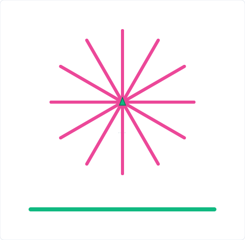
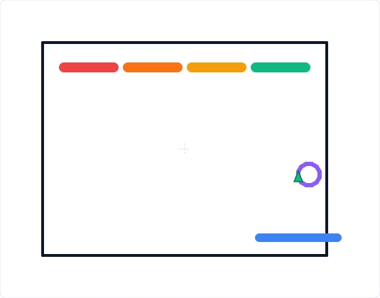
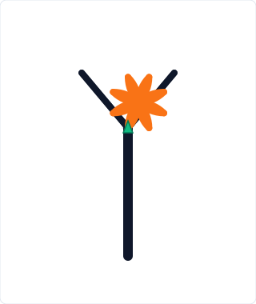
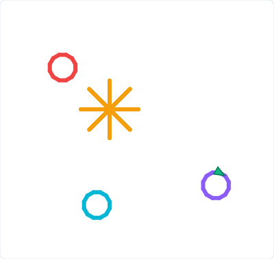

# `anim.A`: Flipbook Story & Physics Showcase (`🏆` Capstone)

- **World:** 🐢 Turtle LOGO — **Flipbook Mode + Sparse Memory Tape** (`ENV_VERSION_TURTLE_V2`)
- **Card Type:** `🏆` Capstone Showcase (`Starter` + `3` Variation Cards)
- **Prerequisite:** [`anim.11`](./lesson_anim_11_bouncing_ball_and_gravity_physics.md)
- **Flipbook Config:** `totalFrames: 16` (`defaultFps: 4`) Starter / `24` (`8 fps`) Var 1 / `4` (`1 fps`) Var 2 / `36` (`12 fps`) Var 3, `clearBetweenFrames: true`, `defaultLoopPlayback: true`
- **Block Budget (Closer-Inclusive):** `Starter: 33` (`Slot Cap: 40`; Var 1: `54 / 60`, Var 2: `22 / 26`, Var 3: `29 / 34`)

> **Guided Co-Pilot Card:**
> Choreograph a **two-act movie** using clock sensor **`$time`** (`🕒 Xs`!): while **`$time < 2`**, launch the rocket upward (`F1`), then burst into a blooming fireworks show (`F2`)! Explore Brick-Breaker, 4-Season Tree, and 3-Planet Orrery cards too.

<details>
<summary>📖 Parent / Teacher Tip — Real-Time Storytelling (`$time`) & Showcase Synthesis</summary>

- **Phased `$time` Switching (`🕒 Xs`, `$time = ($frame - 1) / fps`):** At `defaultFps: 4`, Frames `1..8` span `$time = 0s .. 1.75s` (`$time < 2` triggers Act I: `F1` Rocket Launch with orange exhaust trail), and Frames `9..16` span `$time = 2.0s .. 3.75s` (triggering Act II: `F2` Pink Starburst bloom at `(0, -60)`!). Remember `🕒 Xs` stays strictly distinct from `⏱️` Concurrency Wall-Clock ticks.
- **Showcase Capstones (Variations 1–3):**
  - **Var 1 (`Brick-Breaker`):** Synthesizes Cartesian physics `(x, y, u, v)` (`anim.11`), Tape brick colors (`["red", "orange", "yellow", "green"]`), and a moving blue paddle tracking ball `x` (`p = x - 55`).
  - **Var 2 (`4-Season Tree`):** Tape palette (`pink → green → orange → cyan`) drives Cherry Blossom Spring → Summer → Autumn → Winter canopy cycles (`4 × 90°` curved foliage via `ARC_RIGHT`).
  - **Var 3 (`3-Planet Solar Orrery`):** Stores `(color, radius, angularSpeed)` triples in Tape `[1..9]` so a single loop animates Mercury/Earth/Neptune-style orbits at different speeds!

</details>

---

## Palette & Capabilities

```json
{
  "env": "turtle",
  "flipbookMode": true,
  "totalFrames": 16,
  "defaultFps": 4,
  "clearBetweenFrames": true,
  "defaultLoopPlayback": true,
  "allowVariables": true,
  "varNames": "a..z",
  "allowFunctions": ["F1", "F2", "F3"],
  "allowTape": true,
  "allowedBlocks": [
    "FORWARD", "BACKWARD", "TURN_RIGHT", "TURN_LEFT", "ARC_RIGHT",
    "PEN_UP", "PEN_DOWN", "TELEPORT", "SET_PEN_COLOR", "SET_PEN_WIDTH",
    "LOOP_START", "IF", "CALL_FN", "VAR_ASSIGN", "VAR_OP",
    "TAPE_SEEK", "TAPE_STEP"
  ],
  "allowedSensors": ["$frame", "$time", "$cellColor", "$cellValue"]
}
```

---

## Starter: Two-Act Rocket Launch → Fireworks Show (`33` Flat Blocks)



*Caption: **Selected Frame: #12** (`defaultFps: 4`, `$time = 2.75s` in Act II Starburst phase, `clearBetweenFrames: true`, `inkMaxSpan: 360px (360×350)`).*

```text
// MAIN (9 flat blocks)
TELEPORT [-180, 150, 90]
SET_PEN_COLOR [green]
SET_PEN_WIDTH [8]
FORWARD [360]
If ($time < 2)
  Call F1
Else
  Call F2
End If

// F1 (14 flat blocks)
d = $frame * 25
y = 150 - d
TELEPORT [-18, y, 0]
SET_PEN_COLOR [blue]
SET_PEN_WIDTH [6]
Loop [2]
  FORWARD [70]
  TURN_RIGHT [90]
  FORWARD [36]
  TURN_RIGHT [90]
End Loop
TELEPORT [0, y, 180]
SET_PEN_COLOR [orange]
FORWARD [40]

// F2 (10 flat blocks)
k = $frame - 8
r = k * 35
TELEPORT [0, -60, 0]
SET_PEN_COLOR [pink]
SET_PEN_WIDTH [6]
Loop [12]
  FORWARD [r]
  BACKWARD [r]
  TURN_RIGHT [30]
End Loop
```

```json
{
  "slotCap": 40,
  "totalFrames": 16,
  "defaultFps": 4,
  "clearBetweenFrames": true,
  "defaultLoopPlayback": true,
  "targetFrame": 12,
  "MAIN": [
    { "op": "TELEPORT", "x": -180, "y": 150, "heading": 90 },
    { "op": "SET_PEN_COLOR", "color": "green" },
    { "op": "SET_PEN_WIDTH", "width": 8 },
    { "op": "FORWARD", "length": 360 },
    {
      "op": "IF",
      "cond": { "op": "CMP", "operator": "<", "left": "$time", "right": 2 },
      "then": [{ "op": "CALL_FN", "fn": "F1" }],
      "else": [{ "op": "CALL_FN", "fn": "F2" }]
    }
  ],
  "F1": [
    { "op": "VAR_OP", "target": "d", "operator": "*", "left": "$frame", "right": 25 },
    { "op": "VAR_OP", "target": "y", "operator": "-", "left": 150, "right": "d" },
    { "op": "TELEPORT", "x": -18, "y": "y", "heading": 0 },
    { "op": "SET_PEN_COLOR", "color": "blue" },
    { "op": "SET_PEN_WIDTH", "width": 6 },
    {
      "op": "LOOP_START",
      "count": 2,
      "body": [
        { "op": "FORWARD", "length": 70 },
        { "op": "TURN_RIGHT", "angle": 90 },
        { "op": "FORWARD", "length": 36 },
        { "op": "TURN_RIGHT", "angle": 90 }
      ]
    },
    { "op": "TELEPORT", "x": 0, "y": "y", "heading": 180 },
    { "op": "SET_PEN_COLOR", "color": "orange" },
    { "op": "FORWARD", "length": 40 }
  ],
  "F2": [
    { "op": "VAR_OP", "target": "k", "operator": "-", "left": "$frame", "right": 8 },
    { "op": "VAR_OP", "target": "r", "operator": "*", "left": "k", "right": 35 },
    { "op": "TELEPORT", "x": 0, "y": -60, "heading": 0 },
    { "op": "SET_PEN_COLOR", "color": "pink" },
    { "op": "SET_PEN_WIDTH", "width": 6 },
    {
      "op": "LOOP_START",
      "count": 12,
      "body": [
        { "op": "FORWARD", "length": "r" },
        { "op": "BACKWARD", "length": "r" },
        { "op": "TURN_RIGHT", "angle": 30 }
      ]
    }
  ]
}
```

---

## Variation 1: Auto-Play Brick-Breaker Arena (`54` Flat Blocks)



*Caption: **Selected Frame: #12** (`defaultFps: 8`, `$time = 1.375s`, `clearBetweenFrames: true`, `inkMaxSpan: 415px (415×300)`).*

```text
// MAIN (22 flat blocks)
If ($frame == 1)
  x = -80
  y = -40
  u = 24
  v = 20
End If
x = x + u
y = y + v
If (x > 170)
  u = 0 - u
End If
If (x < -170)
  u = 0 - u
End If
If (y > 100)
  v = 0 - v
End If
If (y < -90)
  v = 0 - v
End If
Call F1
Call F2

// F1 (20 flat blocks)
TELEPORT [-200, -150, 90]
SET_PEN_COLOR [black]
SET_PEN_WIDTH [4]
Loop [2]
  FORWARD [400]
  TURN_RIGHT [90]
  FORWARD [300]
  TURN_RIGHT [90]
End Loop
TAPE_SEEK [1]
b = -170
Loop [4]
  c = $cellColor
  SET_PEN_COLOR [c]
  SET_PEN_WIDTH [14]
  TELEPORT [b, -115, 90]
  FORWARD [70]
  b = b + 90
  TAPE_STEP [RIGHT]
End Loop

// F2 (12 flat blocks)
p = x - 55
TELEPORT [p, 125, 90]
SET_PEN_COLOR [blue]
SET_PEN_WIDTH [12]
FORWARD [110]
TELEPORT [x, y, 0]
SET_PEN_COLOR [purple]
SET_PEN_WIDTH [6]
Loop [12]
  FORWARD [8]
  TURN_RIGHT [30]
End Loop
```

```json
{
  "slotCap": 60,
  "totalFrames": 24,
  "defaultFps": 8,
  "clearBetweenFrames": true,
  "defaultLoopPlayback": true,
  "targetFrame": 12,
  "tape": ["red", "orange", "yellow", "green"],
  "MAIN": [
    {
      "op": "IF",
      "cond": { "op": "CMP", "operator": "==", "left": "$frame", "right": 1 },
      "then": [
        { "op": "VAR_ASSIGN", "var": "x", "value": -80 },
        { "op": "VAR_ASSIGN", "var": "y", "value": -40 },
        { "op": "VAR_ASSIGN", "var": "u", "value": 24 },
        { "op": "VAR_ASSIGN", "var": "v", "value": 20 }
      ]
    },
    { "op": "VAR_OP", "target": "x", "operator": "+", "left": "x", "right": "u" },
    { "op": "VAR_OP", "target": "y", "operator": "+", "left": "y", "right": "v" },
    {
      "op": "IF",
      "cond": { "op": "CMP", "operator": ">", "left": "x", "right": 170 },
      "then": [{ "op": "VAR_OP", "target": "u", "operator": "-", "left": 0, "right": "u" }]
    },
    {
      "op": "IF",
      "cond": { "op": "CMP", "operator": "<", "left": "x", "right": -170 },
      "then": [{ "op": "VAR_OP", "target": "u", "operator": "-", "left": 0, "right": "u" }]
    },
    {
      "op": "IF",
      "cond": { "op": "CMP", "operator": ">", "left": "y", "right": 100 },
      "then": [{ "op": "VAR_OP", "target": "v", "operator": "-", "left": 0, "right": "v" }]
    },
    {
      "op": "IF",
      "cond": { "op": "CMP", "operator": "<", "left": "y", "right": -90 },
      "then": [{ "op": "VAR_OP", "target": "v", "operator": "-", "left": 0, "right": "v" }]
    },
    { "op": "CALL_FN", "fn": "F1" },
    { "op": "CALL_FN", "fn": "F2" }
  ],
  "F1": [
    { "op": "TELEPORT", "x": -200, "y": -150, "heading": 90 },
    { "op": "SET_PEN_COLOR", "color": "black" },
    { "op": "SET_PEN_WIDTH", "width": 4 },
    {
      "op": "LOOP_START",
      "count": 2,
      "body": [
        { "op": "FORWARD", "length": 400 },
        { "op": "TURN_RIGHT", "angle": 90 },
        { "op": "FORWARD", "length": 300 },
        { "op": "TURN_RIGHT", "angle": 90 }
      ]
    },
    { "op": "TAPE_SEEK", "index": 1 },
    { "op": "VAR_ASSIGN", "var": "b", "value": -170 },
    {
      "op": "LOOP_START",
      "count": 4,
      "body": [
        { "op": "VAR_ASSIGN", "var": "c", "value": "$cellColor" },
        { "op": "SET_PEN_COLOR", "color": "c" },
        { "op": "SET_PEN_WIDTH", "width": 14 },
        { "op": "TELEPORT", "x": "b", "y": -115, "heading": 90 },
        { "op": "FORWARD", "length": 70 },
        { "op": "VAR_OP", "target": "b", "operator": "+", "left": "b", "right": 90 },
        { "op": "TAPE_STEP", "direction": "RIGHT" }
      ]
    }
  ],
  "F2": [
    { "op": "VAR_OP", "target": "p", "operator": "-", "left": "x", "right": 55 },
    { "op": "TELEPORT", "x": "p", "y": 125, "heading": 90 },
    { "op": "SET_PEN_COLOR", "color": "blue" },
    { "op": "SET_PEN_WIDTH", "width": 12 },
    { "op": "FORWARD", "length": 110 },
    { "op": "TELEPORT", "x": "x", "y": "y", "heading": 0 },
    { "op": "SET_PEN_COLOR", "color": "purple" },
    { "op": "SET_PEN_WIDTH", "width": 6 },
    {
      "op": "LOOP_START",
      "count": 12,
      "body": [
        { "op": "FORWARD", "length": 8 },
        { "op": "TURN_RIGHT", "angle": 30 }
      ]
    }
  ]
}
```

---

## Variation 2: 4-Season Morphing Tree (`22` Flat Blocks)



*Caption: **Selected Frame: #3** (`orange` autumn canopy, `defaultFps: 1`, `$time = 2.0s`, `clearBetweenFrames: true`, `inkMaxSpan: 229px (116×229)`).*

```text
// MAIN (4 flat blocks)
TAPE_SEEK [$frame]
c = $cellColor
Call F1
Call F2

// F1 (12 flat blocks)
TELEPORT [0, 160, 0]
SET_PEN_COLOR [black]
SET_PEN_WIDTH [12]
FORWARD [160]
SET_PEN_WIDTH [8]
TURN_LEFT [40]
FORWARD [90]
BACKWARD [90]
TURN_RIGHT [80]
FORWARD [90]
BACKWARD [90]
TURN_LEFT [40]

// F2 (6 flat blocks)
SET_PEN_COLOR [c]
SET_PEN_WIDTH [8]
Loop [8]
  ARC_RIGHT [45, 90]
  TURN_RIGHT [135]
End Loop
```

```json
{
  "slotCap": 26,
  "totalFrames": 4,
  "defaultFps": 1,
  "clearBetweenFrames": true,
  "defaultLoopPlayback": true,
  "targetFrame": 3,
  "tape": ["pink", "green", "orange", "cyan"],
  "MAIN": [
    { "op": "TAPE_SEEK", "index": "$frame" },
    { "op": "VAR_ASSIGN", "var": "c", "value": "$cellColor" },
    { "op": "CALL_FN", "fn": "F1" },
    { "op": "CALL_FN", "fn": "F2" }
  ],
  "F1": [
    { "op": "TELEPORT", "x": 0, "y": 160, "heading": 0 },
    { "op": "SET_PEN_COLOR", "color": "black" },
    { "op": "SET_PEN_WIDTH", "width": 12 },
    { "op": "FORWARD", "length": 160 },
    { "op": "SET_PEN_WIDTH", "width": 8 },
    { "op": "TURN_LEFT", "angle": 40 },
    { "op": "FORWARD", "length": 90 },
    { "op": "BACKWARD", "length": 90 },
    { "op": "TURN_RIGHT", "angle": 80 },
    { "op": "FORWARD", "length": 90 },
    { "op": "BACKWARD", "length": 90 },
    { "op": "TURN_LEFT", "angle": 40 }
  ],
  "F2": [
    { "op": "SET_PEN_COLOR", "color": "c" },
    { "op": "SET_PEN_WIDTH", "width": 8 },
    {
      "op": "LOOP_START",
      "count": 8,
      "body": [
        { "op": "ARC_RIGHT", "radius": 45, "angle": 90 },
        { "op": "TURN_RIGHT", "angle": 135 }
      ]
    }
  ]
}
```

---

## Variation 3: Tape-Driven 3-Planet Solar Orrery (`29` Flat Blocks)



*Caption: **Selected Frame: #12** (`defaultFps: 12`, `$time = 0.9167s`, `clearBetweenFrames: true`, `inkMaxSpan: 261px (261×238)`).*

```text
// MAIN (5 flat blocks)
Call F1
TAPE_SEEK [1]
Loop [3]
  Call F2
End Loop

// F1 (7 flat blocks)
TELEPORT [0, 0, 0]
SET_PEN_COLOR [yellow]
Loop [8]
  FORWARD [42]
  BACKWARD [42]
  TURN_RIGHT [45]
End Loop

// F2 (13 flat blocks)
c = $cellColor
TAPE_STEP [RIGHT]
r = $cellValue
TAPE_STEP [RIGHT]
w = $cellValue
TAPE_STEP [RIGHT]
a = $frame * w
TELEPORT [0, 0, a]
PEN_UP
FORWARD [r]
SET_PEN_COLOR [c]
PEN_DOWN
Call F3

// F3 (4 flat blocks)
Loop [12]
  FORWARD [10]
  TURN_RIGHT [30]
End Loop
```

```json
{
  "slotCap": 34,
  "totalFrames": 36,
  "defaultFps": 12,
  "clearBetweenFrames": true,
  "defaultLoopPlayback": true,
  "targetFrame": 12,
  "tape": ["red", 85, 25, "cyan", 135, 15, "purple", 185, 10],
  "MAIN": [
    { "op": "CALL_FN", "fn": "F1" },
    { "op": "TAPE_SEEK", "index": 1 },
    {
      "op": "LOOP_START",
      "count": 3,
      "body": [{ "op": "CALL_FN", "fn": "F2" }]
    }
  ],
  "F1": [
    { "op": "TELEPORT", "x": 0, "y": 0, "heading": 0 },
    { "op": "SET_PEN_COLOR", "color": "yellow" },
    {
      "op": "LOOP_START",
      "count": 8,
      "body": [
        { "op": "FORWARD", "length": 42 },
        { "op": "BACKWARD", "length": 42 },
        { "op": "TURN_RIGHT", "angle": 45 }
      ]
    }
  ],
  "F2": [
    { "op": "VAR_ASSIGN", "var": "c", "value": "$cellColor" },
    { "op": "TAPE_STEP", "direction": "RIGHT" },
    { "op": "VAR_ASSIGN", "var": "r", "value": "$cellValue" },
    { "op": "TAPE_STEP", "direction": "RIGHT" },
    { "op": "VAR_ASSIGN", "var": "w", "value": "$cellValue" },
    { "op": "TAPE_STEP", "direction": "RIGHT" },
    { "op": "VAR_OP", "target": "a", "operator": "*", "left": "$frame", "right": "w" },
    { "op": "TELEPORT", "x": 0, "y": 0, "heading": "a" },
    { "op": "PEN_UP" },
    { "op": "FORWARD", "length": "r" },
    { "op": "SET_PEN_COLOR", "color": "c" },
    { "op": "PEN_DOWN" },
    { "op": "CALL_FN", "fn": "F3" }
  ],
  "F3": [
    {
      "op": "LOOP_START",
      "count": 12,
      "body": [
        { "op": "FORWARD", "length": 10 },
        { "op": "TURN_RIGHT", "angle": 30 }
      ]
    }
  ]
}
```
