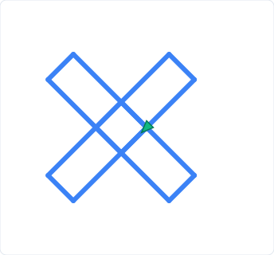
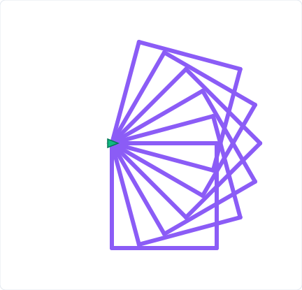

# `anim.0`: Meet LOGO Flipbook Mode! (`📖` Discovery)

- **World:** 🐢 Turtle LOGO — **Flipbook Mode** (`ENV_VERSION_TURTLE_V2`)
- **Card Type:** `📖` Guided Discovery Deck (`3` Interactive Demo Tabs)
- **Prerequisite:** [`tape`](../tape/overview.md)
- **Flipbook Config:** `totalFrames: 12`, `defaultFps: 4`, `clearBetweenFrames: true` (Tab 1–2) / `false` (Tab 3), `defaultLoopPlayback: true`
- **Block Budget (Closer-Inclusive):** `7–11` flat blocks per tab (`Slot Cap: 14`)

> **Guided Co-Pilot Card:**
> Press **Play** and drag the **🎞️ Frame Scrubber** (`1..12`)! In Flipbook Mode, one full run of `Main` paints one frame while variables remember values between frames unless **`🧹 Clear`** is turned `OFF`.

<details>
<summary>📖 Parent / Teacher Tip — Three Core Flipbook Rules</summary>

Each pre-built tab isolates one core animation mechanic before kids code on their own in `anim.2`:
1. **Tab 1 (`$frame` Stateless Motion):** `$frame` starts at `1` and counts to `12`, while `$time = ($frame - 1) / 4` ticks (`🕒 0s .. 2.75s`). At `Selected Frame: #5` (`45° * 5 = 225°`), turning `45°` per frame keeps spinning smoothly without storing variables across frames.
2. **Tab 2 (Persistent Variables):** Variables reset **only** when `⏮ Rewind` is pressed. Checking `If ($frame == 1)` sets starter radius `s = 40`; every frame after adds `20` so Frame 8 reaches radius `180px` (`360px` burst span).
3. **Tab 3 (`🧹 Clear Between Frames: OFF`):** Disabling canvas clear preserves previous frames' ink so `6` rotating squares stack into an instant spirograph blossom. Notice **`⏩ Render All Frames`** pre-bakes all `12` frames so dragging the scrubber is instant!

</details>

---

## Palette & Capabilities

```json
{
  "env": "turtle",
  "flipbookMode": true,
  "totalFrames": 12,
  "defaultFps": 4,
  "defaultLoopPlayback": true,
  "allowVariables": true,
  "readOnlyDiscovery": true,
  "allowedBlocks": [
    "FORWARD", "BACKWARD", "TURN_RIGHT", "TURN_LEFT",
    "SET_PEN_COLOR", "LOOP_START", "VAR_ASSIGN", "VAR_OP", "IF"
  ],
  "allowedSensors": ["$frame", "$time"]
}
```

---

## Tab 1: `$frame` Spinning Pinwheel (`🧹 Clear: ON`)



*Caption: **Selected Frame: #5** (`defaultFps: 4`, `$time = 1.0s`, `clearBetweenFrames: true`, `inkMaxSpan: 184px (184×184)`).*

```text
// MAIN (11 flat blocks)
a = $frame * 45
TURN_RIGHT [a]
SET_PEN_COLOR [blue]
Loop [4]
  FORWARD [130]
  TURN_RIGHT [90]
  FORWARD [45]
  TURN_RIGHT [90]
  FORWARD [130]
  TURN_RIGHT [90]
End Loop
```

```json
{
  "slotCap": 14,
  "totalFrames": 12,
  "defaultFps": 4,
  "clearBetweenFrames": true,
  "defaultLoopPlayback": true,
  "targetFrame": 5,
  "MAIN": [
    { "op": "VAR_OP", "target": "a", "operator": "*", "left": "$frame", "right": 45 },
    { "op": "TURN_RIGHT", "angle": "a" },
    { "op": "SET_PEN_COLOR", "color": "blue" },
    {
      "op": "LOOP_START",
      "count": 4,
      "body": [
        { "op": "FORWARD", "length": 130 },
        { "op": "TURN_RIGHT", "angle": 90 },
        { "op": "FORWARD", "length": 45 },
        { "op": "TURN_RIGHT", "angle": 90 },
        { "op": "FORWARD", "length": 130 },
        { "op": "TURN_RIGHT", "angle": 90 }
      ]
    }
  ]
}
```

---

## Tab 2: Persistent Memory Star (`s = s + 20`, `🧹 Clear: ON`)


*Caption: **Selected Frame: #8** (`defaultFps: 4`, `$time = 1.75s`, `clearBetweenFrames: true`, `inkMaxSpan: 360px (360×360)`).*

```text
// MAIN (11 flat blocks)
If ($frame == 1)
  s = 40
Else
  s = s + 20
End If
SET_PEN_COLOR [green]
Loop [8]
  FORWARD [s]
  BACKWARD [s]
  TURN_RIGHT [45]
End Loop
```

```json
{
  "slotCap": 14,
  "totalFrames": 12,
  "defaultFps": 4,
  "clearBetweenFrames": true,
  "defaultLoopPlayback": true,
  "targetFrame": 8,
  "MAIN": [
    {
      "op": "IF",
      "cond": { "op": "CMP", "operator": "==", "left": "$frame", "right": 1 },
      "then": [{ "op": "VAR_ASSIGN", "var": "s", "value": 40 }],
      "else": [{ "op": "VAR_OP", "target": "s", "operator": "+", "left": "s", "right": 20 }]
    },
    { "op": "SET_PEN_COLOR", "color": "green" },
    {
      "op": "LOOP_START",
      "count": 8,
      "body": [
        { "op": "FORWARD", "length": "s" },
        { "op": "BACKWARD", "length": "s" },
        { "op": "TURN_RIGHT", "angle": 45 }
      ]
    }
  ]
}
```

---

## Tab 3: Stacking Frame Trails (`🧹 Clear: OFF`)



*Caption: **Selected Frame: #6** (`defaultFps: 4`, `$time = 1.25s`, `clearBetweenFrames: false`, `inkMaxSpan: 295px (212×295)`).*

```text
// MAIN (7 flat blocks)
a = $frame * 15
TURN_RIGHT [a]
SET_PEN_COLOR [purple]
Loop [4]
  FORWARD [150]
  TURN_RIGHT [90]
End Loop
```

```json
{
  "slotCap": 14,
  "totalFrames": 12,
  "defaultFps": 4,
  "clearBetweenFrames": false,
  "defaultLoopPlayback": true,
  "targetFrame": 6,
  "MAIN": [
    { "op": "VAR_OP", "target": "a", "operator": "*", "left": "$frame", "right": 15 },
    { "op": "TURN_RIGHT", "angle": "a" },
    { "op": "SET_PEN_COLOR", "color": "purple" },
    {
      "op": "LOOP_START",
      "count": 4,
      "body": [
        { "op": "FORWARD", "length": 150 },
        { "op": "TURN_RIGHT", "angle": 90 }
      ]
    }
  ]
}
```
