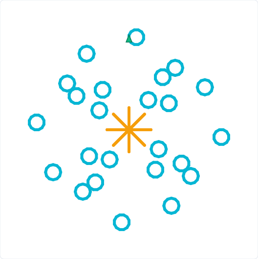

# `anim.10`: Orbiting Moons (`🎨` Creative Sandbox)

- **World:** 🐢 Turtle LOGO — **Flipbook Mode** (`ENV_VERSION_TURTLE_V2`)
- **Card Type:** `🎨` Creative Sandbox (`Starter` + `3` Variation Cards)
- **Prerequisite:** [`anim.9`](./lesson_anim_9_polygon_morphing_and_tape_flipbook.md)
- **Flipbook Config:** `totalFrames: 24`, `defaultFps: 12`, `clearBetweenFrames: true` (Starter, Var 1–2) / `false` (Var 3), `defaultLoopPlayback: true`
- **Block Budget (Closer-Inclusive):** `Starter: 20` (`Slot Cap: 24`; Var 1: `23 / 28`, Var 2: `30 / 34`, Var 3: `25 / 30`)

> **Guided Co-Pilot Card:**
> Point from the Sun at angle **`a = $frame * 15`**, lift the pen (`PEN_UP`), leap out **`160px`**, and draw a crisp planet via **`F3`**! Load **Var 1–3** for Twin Opposite Orbits, an Earth+Moon Epicycle, or an accumulating Spirograph!

<details>
<summary>📖 Parent / Teacher Tip — Polar Orbits, Epicycles & Explicit Orb Helper `F3`</summary>

- **Pure Polar Geometry (One Concept):** `anim.10` focuses strictly on polar radial orbits and rotating sub-orbits (`TELEPORT [0, 0, a]` → `PEN_UP` → `FORWARD [radius]` → `PEN_DOWN` → `Call F3`), reserving Cartesian `(x, y, u, v)` physics cleanly for [`anim.11`](./lesson_anim_11_bouncing_ball_and_gravity_physics.md).
- **Explicit `F3` Orb Helper:** All four cards explicitly define `F3` (`Loop [12] { FORWARD [12], TURN_RIGHT [30] }`, `46px` diameter orb in Starter/Var 1–2; `FORWARD [8]` in Var 3) with generous `130–160px` orbital radii (`215–408px` span across cards).

</details>

---

## Palette & Capabilities

```json
{
  "env": "turtle",
  "flipbookMode": true,
  "totalFrames": 24,
  "defaultFps": 12,
  "clearBetweenFrames": true,
  "defaultLoopPlayback": true,
  "allowVariables": true,
  "varNames": "a..z",
  "allowFunctions": ["F1", "F2", "F3"],
  "allowedBlocks": [
    "FORWARD", "BACKWARD", "TURN_RIGHT", "TELEPORT",
    "PEN_UP", "PEN_DOWN", "SET_PEN_COLOR",
    "LOOP_START", "IF", "CALL_FN", "VAR_OP"
  ],
  "allowedSensors": ["$frame", "$time"]
}
```

---

## Starter: Sun & Orbiting Planet (`20` Flat Blocks)


*Caption: **Selected Frame: #4** (`defaultFps: 12`, `$time = 0.25s`, `clearBetweenFrames: true`, `inkMaxSpan: 222px (222×131)`).*

```text
// MAIN (3 flat blocks)
a = $frame * 15
Call F1
Call F2

// F1 (7 flat blocks)
TELEPORT [0, 0, 0]
SET_PEN_COLOR [yellow]
Loop [8]
  FORWARD [45]
  BACKWARD [45]
  TURN_RIGHT [45]
End Loop

// F2 (6 flat blocks)
TELEPORT [0, 0, a]
PEN_UP
FORWARD [160]
SET_PEN_COLOR [blue]
PEN_DOWN
Call F3

// F3 (4 flat blocks)
Loop [12]
  FORWARD [12]
  TURN_RIGHT [30]
End Loop
```

```json
{
  "slotCap": 24,
  "totalFrames": 24,
  "defaultFps": 12,
  "clearBetweenFrames": true,
  "defaultLoopPlayback": true,
  "targetFrame": 4,
  "MAIN": [
    { "op": "VAR_OP", "target": "a", "operator": "*", "left": "$frame", "right": 15 },
    { "op": "CALL_FN", "fn": "F1" },
    { "op": "CALL_FN", "fn": "F2" }
  ],
  "F1": [
    { "op": "TELEPORT", "x": 0, "y": 0, "heading": 0 },
    { "op": "SET_PEN_COLOR", "color": "yellow" },
    {
      "op": "LOOP_START",
      "count": 8,
      "body": [
        { "op": "FORWARD", "length": 45 },
        { "op": "BACKWARD", "length": 45 },
        { "op": "TURN_RIGHT", "angle": 45 }
      ]
    }
  ],
  "F2": [
    { "op": "TELEPORT", "x": 0, "y": 0, "heading": "a" },
    { "op": "PEN_UP" },
    { "op": "FORWARD", "length": 160 },
    { "op": "SET_PEN_COLOR", "color": "blue" },
    { "op": "PEN_DOWN" },
    { "op": "CALL_FN", "fn": "F3" }
  ],
  "F3": [
    {
      "op": "LOOP_START",
      "count": 12,
      "body": [
        { "op": "FORWARD", "length": 12 },
        { "op": "TURN_RIGHT", "angle": 30 }
      ]
    }
  ]
}
```

---

## Variation 1: Twin Opposite Orbits (`23` Flat Blocks)


*Caption: **Selected Frame: #5** (`defaultFps: 12`, `$time = 0.3333s`, `clearBetweenFrames: true`, `inkMaxSpan: 379px (379×90)`).*

```text
// MAIN (7 flat blocks)
a = $frame * 15
Call F1
SET_PEN_COLOR [blue]
Call F2
a = a + 180
SET_PEN_COLOR [pink]
Call F2

// F1 (7 flat blocks)
TELEPORT [0, 0, 0]
SET_PEN_COLOR [yellow]
Loop [8]
  FORWARD [45]
  BACKWARD [45]
  TURN_RIGHT [45]
End Loop

// F2 (5 flat blocks)
TELEPORT [0, 0, a]
PEN_UP
FORWARD [160]
PEN_DOWN
Call F3

// F3 (4 flat blocks)
Loop [12]
  FORWARD [12]
  TURN_RIGHT [30]
End Loop
```

```json
{
  "slotCap": 28,
  "totalFrames": 24,
  "defaultFps": 12,
  "clearBetweenFrames": true,
  "defaultLoopPlayback": true,
  "targetFrame": 5,
  "MAIN": [
    { "op": "VAR_OP", "target": "a", "operator": "*", "left": "$frame", "right": 15 },
    { "op": "CALL_FN", "fn": "F1" },
    { "op": "SET_PEN_COLOR", "color": "blue" },
    { "op": "CALL_FN", "fn": "F2" },
    { "op": "VAR_OP", "target": "a", "operator": "+", "left": "a", "right": 180 },
    { "op": "SET_PEN_COLOR", "color": "pink" },
    { "op": "CALL_FN", "fn": "F2" }
  ],
  "F1": [
    { "op": "TELEPORT", "x": 0, "y": 0, "heading": 0 },
    { "op": "SET_PEN_COLOR", "color": "yellow" },
    {
      "op": "LOOP_START",
      "count": 8,
      "body": [
        { "op": "FORWARD", "length": 45 },
        { "op": "BACKWARD", "length": 45 },
        { "op": "TURN_RIGHT", "angle": 45 }
      ]
    }
  ],
  "F2": [
    { "op": "TELEPORT", "x": 0, "y": 0, "heading": "a" },
    { "op": "PEN_UP" },
    { "op": "FORWARD", "length": 160 },
    { "op": "PEN_DOWN" },
    { "op": "CALL_FN", "fn": "F3" }
  ],
  "F3": [
    {
      "op": "LOOP_START",
      "count": 12,
      "body": [
        { "op": "FORWARD", "length": 12 },
        { "op": "TURN_RIGHT", "angle": 30 }
      ]
    }
  ]
}
```

---

## Variation 2: Earth + Orbiting Moon Epicycle (`30` Flat Blocks)


*Caption: **Selected Frame: #5** (`defaultFps: 12`, `$time = 0.3333s`, `clearBetweenFrames: true`, `inkMaxSpan: 215px (215×134)`).*

```text
// MAIN (4 flat blocks)
a = $frame * 15
b = $frame * 45
Call F1
Call F2

// F1 (7 flat blocks)
TELEPORT [0, 0, 0]
SET_PEN_COLOR [yellow]
Loop [8]
  FORWARD [45]
  BACKWARD [45]
  TURN_RIGHT [45]
End Loop

// F2 (15 flat blocks)
TELEPORT [0, 0, a]
PEN_UP
FORWARD [140]
SET_PEN_COLOR [blue]
PEN_DOWN
Call F3
PEN_UP
TURN_RIGHT [b]
FORWARD [55]
SET_PEN_COLOR [cyan]
PEN_DOWN
Loop [10]
  FORWARD [8]
  TURN_RIGHT [36]
End Loop

// F3 (4 flat blocks)
Loop [12]
  FORWARD [12]
  TURN_RIGHT [30]
End Loop
```

```json
{
  "slotCap": 34,
  "totalFrames": 24,
  "defaultFps": 12,
  "clearBetweenFrames": true,
  "defaultLoopPlayback": true,
  "targetFrame": 5,
  "MAIN": [
    { "op": "VAR_OP", "target": "a", "operator": "*", "left": "$frame", "right": 15 },
    { "op": "VAR_OP", "target": "b", "operator": "*", "left": "$frame", "right": 45 },
    { "op": "CALL_FN", "fn": "F1" },
    { "op": "CALL_FN", "fn": "F2" }
  ],
  "F1": [
    { "op": "TELEPORT", "x": 0, "y": 0, "heading": 0 },
    { "op": "SET_PEN_COLOR", "color": "yellow" },
    {
      "op": "LOOP_START",
      "count": 8,
      "body": [
        { "op": "FORWARD", "length": 45 },
        { "op": "BACKWARD", "length": 45 },
        { "op": "TURN_RIGHT", "angle": 45 }
      ]
    }
  ],
  "F2": [
    { "op": "TELEPORT", "x": 0, "y": 0, "heading": "a" },
    { "op": "PEN_UP" },
    { "op": "FORWARD", "length": 140 },
    { "op": "SET_PEN_COLOR", "color": "blue" },
    { "op": "PEN_DOWN" },
    { "op": "CALL_FN", "fn": "F3" },
    { "op": "PEN_UP" },
    { "op": "TURN_RIGHT", "angle": "b" },
    { "op": "FORWARD", "length": 55 },
    { "op": "SET_PEN_COLOR", "color": "cyan" },
    { "op": "PEN_DOWN" },
    {
      "op": "LOOP_START",
      "count": 10,
      "body": [
        { "op": "FORWARD", "length": 8 },
        { "op": "TURN_RIGHT", "angle": 36 }
      ]
    }
  ],
  "F3": [
    {
      "op": "LOOP_START",
      "count": 12,
      "body": [
        { "op": "FORWARD", "length": 12 },
        { "op": "TURN_RIGHT", "angle": 30 }
      ]
    }
  ]
}
```

---

## Variation 3: Moon Spirograph Trail (`25` Flat Blocks, `🧹 Clear: OFF`)



*Caption: **Selected Frame: #24** (`defaultFps: 12`, `$time = 1.9167s`, `clearBetweenFrames: false`, `inkMaxSpan: 408px (408×408)`).*

```text
// MAIN (6 flat blocks)
If ($frame == 1)
  Call F1
End If
a = $frame * 15
b = $frame * 60
Call F2

// F1 (7 flat blocks)
TELEPORT [0, 0, 0]
SET_PEN_COLOR [yellow]
Loop [8]
  FORWARD [45]
  BACKWARD [45]
  TURN_RIGHT [45]
End Loop

// F2 (8 flat blocks)
TELEPORT [0, 0, a]
PEN_UP
FORWARD [130]
TURN_RIGHT [b]
FORWARD [55]
SET_PEN_COLOR [cyan]
PEN_DOWN
Call F3

// F3 (4 flat blocks)
Loop [12]
  FORWARD [8]
  TURN_RIGHT [30]
End Loop
```

```json
{
  "slotCap": 30,
  "totalFrames": 24,
  "defaultFps": 12,
  "clearBetweenFrames": false,
  "defaultLoopPlayback": true,
  "targetFrame": 24,
  "MAIN": [
    {
      "op": "IF",
      "cond": { "op": "CMP", "operator": "==", "left": "$frame", "right": 1 },
      "then": [{ "op": "CALL_FN", "fn": "F1" }]
    },
    { "op": "VAR_OP", "target": "a", "operator": "*", "left": "$frame", "right": 15 },
    { "op": "VAR_OP", "target": "b", "operator": "*", "left": "$frame", "right": 60 },
    { "op": "CALL_FN", "fn": "F2" }
  ],
  "F1": [
    { "op": "TELEPORT", "x": 0, "y": 0, "heading": 0 },
    { "op": "SET_PEN_COLOR", "color": "yellow" },
    {
      "op": "LOOP_START",
      "count": 8,
      "body": [
        { "op": "FORWARD", "length": 45 },
        { "op": "BACKWARD", "length": 45 },
        { "op": "TURN_RIGHT", "angle": 45 }
      ]
    }
  ],
  "F2": [
    { "op": "TELEPORT", "x": 0, "y": 0, "heading": "a" },
    { "op": "PEN_UP" },
    { "op": "FORWARD", "length": 130 },
    { "op": "TURN_RIGHT", "angle": "b" },
    { "op": "FORWARD", "length": 55 },
    { "op": "SET_PEN_COLOR", "color": "cyan" },
    { "op": "PEN_DOWN" },
    { "op": "CALL_FN", "fn": "F3" }
  ],
  "F3": [
    {
      "op": "LOOP_START",
      "count": 12,
      "body": [
        { "op": "FORWARD", "length": 8 },
        { "op": "TURN_RIGHT", "angle": 30 }
      ]
    }
  ]
}
```
