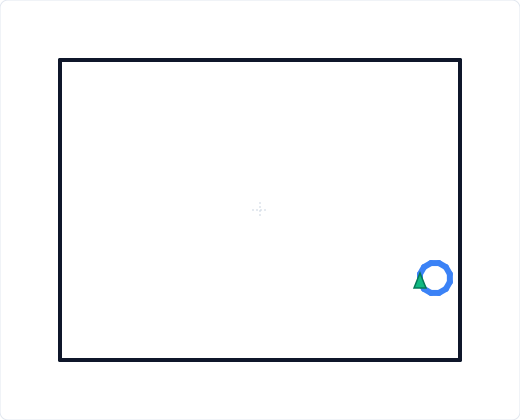
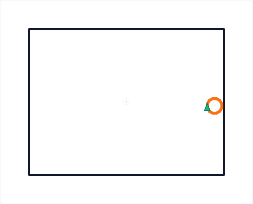
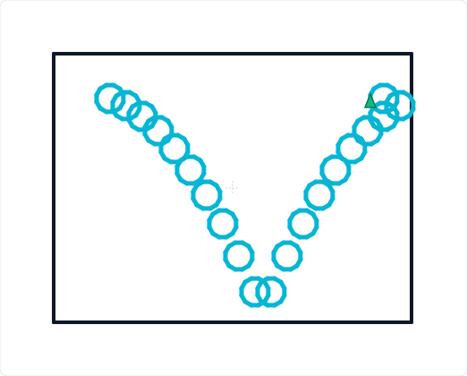
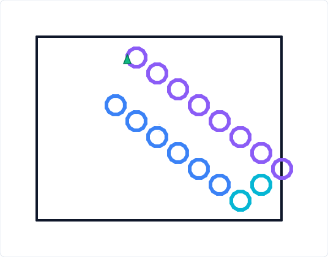

# `anim.11`: Bouncing Ball & Gravity Physics (`🎨` Creative Sandbox)

- **World:** 🐢 Turtle LOGO — **Flipbook Mode** (`ENV_VERSION_TURTLE_V2`)
- **Card Type:** `🎨` Creative Sandbox (`Starter` + `3` Variation Cards)
- **Prerequisite:** [`anim.10`](./lesson_anim_10_orbiting_moons.md)
- **Flipbook Config:** `totalFrames: 24` (Starter, Var 1) / `20` (Var 2) / `16` (Var 3), `defaultFps: 8`, `clearBetweenFrames: true` (Starter, Var 1) / `false` (Var 2–3), `defaultLoopPlayback: true`
- **Block Budget (Closer-Inclusive):** `Starter: 38` (`Slot Cap: 44`; Var 1: `37 / 44`, Var 2: `37 / 44`, Var 3: `43 / 48`)

> **Guided Co-Pilot Card:**
> Store ball position in **`x, y`** and velocity in **`u, v`**! Every frame adds `x = x + u`, `y = y + v`, and flips `u = 0 - u` or `v = 0 - v` when hitting the **`400×300`** box—then turn on gravity (`v = v + 4`) in **Var 1**!

<details>
<summary>📖 Parent / Teacher Tip — Single-Letter Velocity (`u, v`) & Screen `+Y` Gravity Sign</summary>

- **Single-Letter Variable Rule (`x, y, u, v`):** Strictly single-letter `'a'..'z'` variables represent horizontal/vertical position `(x, y)` and velocity `(u, v)`.
- **Why Gravity Adds `+4` (`v = v + 4`):** On Turtle LOGO's canvas, `0°` faces North (`-Y` **up**) and `180°` faces South (`+Y` **down**). Inside the `400×300` arena (`[-200..+200] × [-150..+150]`), `y = -150` is the ceiling and `y = +150` is the floor (`y = 120` bounce contact), so positive gravity acceleration `v = v + 4` pulls the ball **downward** toward the floor and parabolic bounce-ups go negative!
- **Var 2 & Var 3 (`🧹 Clear: OFF`):** Draw `F1` box once on Frame `1` so trajectories stamp crisp parabolic curves (**Var 2**) or color-flashing `$randomColor` trails (**Var 3**)!

</details>

---

## Palette & Capabilities

```json
{
  "env": "turtle",
  "flipbookMode": true,
  "totalFrames": 24,
  "defaultFps": 8,
  "clearBetweenFrames": true,
  "defaultLoopPlayback": true,
  "allowVariables": true,
  "varNames": "a..z",
  "allowFunctions": ["F1", "F2"],
  "allowedBlocks": [
    "FORWARD", "TURN_RIGHT", "TELEPORT",
    "SET_PEN_COLOR", "SET_PEN_WIDTH",
    "LOOP_START", "IF", "CALL_FN", "VAR_ASSIGN", "VAR_OP"
  ],
  "allowedSensors": ["$frame", "$time", "$randomColor"]
}
```

---

## Starter: Bouncing Ball in `400×300` Arena (`38` Flat Blocks)



*Caption: **Selected Frame: #12** (`defaultFps: 8`, `$time = 1.375s`, `clearBetweenFrames: true`, `inkMaxSpan: 400px (400×300)`).*

```text
// MAIN (23 flat blocks)
If ($frame == 1)
  x = -120
  y = -60
  u = 28
  v = 22
End If
x = x + u
y = y + v
If (x > 170)
  u = 0 - u
End If
If (x < -170)
  u = 0 - u
End If
If (y > 120)
  v = 0 - v
End If
If (y < -120)
  v = 0 - v
End If
Call F1
TELEPORT [x, y, 0]
Call F2

// F1 (9 flat blocks)
TELEPORT [-200, -150, 90]
SET_PEN_COLOR [black]
SET_PEN_WIDTH [4]
Loop [2]
  FORWARD [400]
  TURN_RIGHT [90]
  FORWARD [300]
  TURN_RIGHT [90]
End Loop

// F2 (6 flat blocks)
SET_PEN_COLOR [blue]
SET_PEN_WIDTH [6]
Loop [12]
  FORWARD [8]
  TURN_RIGHT [30]
End Loop
```

```json
{
  "slotCap": 44,
  "totalFrames": 24,
  "defaultFps": 8,
  "clearBetweenFrames": true,
  "defaultLoopPlayback": true,
  "targetFrame": 12,
  "MAIN": [
    {
      "op": "IF",
      "cond": { "op": "CMP", "operator": "==", "left": "$frame", "right": 1 },
      "then": [
        { "op": "VAR_ASSIGN", "var": "x", "value": -120 },
        { "op": "VAR_ASSIGN", "var": "y", "value": -60 },
        { "op": "VAR_ASSIGN", "var": "u", "value": 28 },
        { "op": "VAR_ASSIGN", "var": "v", "value": 22 }
      ]
    },
    { "op": "VAR_OP", "target": "x", "operator": "+", "left": "x", "right": "u" },
    { "op": "VAR_OP", "target": "y", "operator": "+", "left": "y", "right": "v" },
    {
      "op": "IF",
      "cond": { "op": "CMP", "operator": ">", "left": "x", "right": 170 },
      "then": [{ "op": "VAR_OP", "target": "u", "operator": "-", "left": 0, "right": "u" }]
    },
    {
      "op": "IF",
      "cond": { "op": "CMP", "operator": "<", "left": "x", "right": -170 },
      "then": [{ "op": "VAR_OP", "target": "u", "operator": "-", "left": 0, "right": "u" }]
    },
    {
      "op": "IF",
      "cond": { "op": "CMP", "operator": ">", "left": "y", "right": 120 },
      "then": [{ "op": "VAR_OP", "target": "v", "operator": "-", "left": 0, "right": "v" }]
    },
    {
      "op": "IF",
      "cond": { "op": "CMP", "operator": "<", "left": "y", "right": -120 },
      "then": [{ "op": "VAR_OP", "target": "v", "operator": "-", "left": 0, "right": "v" }]
    },
    { "op": "CALL_FN", "fn": "F1" },
    { "op": "TELEPORT", "x": "x", "y": "y", "heading": 0 },
    { "op": "CALL_FN", "fn": "F2" }
  ],
  "F1": [
    { "op": "TELEPORT", "x": -200, "y": -150, "heading": 90 },
    { "op": "SET_PEN_COLOR", "color": "black" },
    { "op": "SET_PEN_WIDTH", "width": 4 },
    {
      "op": "LOOP_START",
      "count": 2,
      "body": [
        { "op": "FORWARD", "length": 400 },
        { "op": "TURN_RIGHT", "angle": 90 },
        { "op": "FORWARD", "length": 300 },
        { "op": "TURN_RIGHT", "angle": 90 }
      ]
    }
  ],
  "F2": [
    { "op": "SET_PEN_COLOR", "color": "blue" },
    { "op": "SET_PEN_WIDTH", "width": 6 },
    {
      "op": "LOOP_START",
      "count": 12,
      "body": [
        { "op": "FORWARD", "length": 8 },
        { "op": "TURN_RIGHT", "angle": 30 }
      ]
    }
  ]
}
```

---

## Variation 1: Gravity Bounce (`v = v + 4` Downward) (`37` Flat Blocks)



*Caption: **Selected Frame: #14** (`defaultFps: 8`, `$time = 1.625s`, `clearBetweenFrames: true`, `inkMaxSpan: 400px (400×300)`).*

```text
// MAIN (22 flat blocks)
If ($frame == 1)
  x = -170
  y = -100
  u = 24
  v = 0
End If
v = v + 4
x = x + u
y = y + v
If (x > 170)
  u = 0 - u
End If
If (x < -170)
  u = 0 - u
End If
If (y > 120)
  y = 120
  v = 0 - v
End If
Call F1
TELEPORT [x, y, 0]
Call F2

// F1 (9 flat blocks)
TELEPORT [-200, -150, 90]
SET_PEN_COLOR [black]
SET_PEN_WIDTH [4]
Loop [2]
  FORWARD [400]
  TURN_RIGHT [90]
  FORWARD [300]
  TURN_RIGHT [90]
End Loop

// F2 (6 flat blocks)
SET_PEN_COLOR [orange]
SET_PEN_WIDTH [6]
Loop [12]
  FORWARD [8]
  TURN_RIGHT [30]
End Loop
```

```json
{
  "slotCap": 44,
  "totalFrames": 24,
  "defaultFps": 8,
  "clearBetweenFrames": true,
  "defaultLoopPlayback": true,
  "targetFrame": 14,
  "MAIN": [
    {
      "op": "IF",
      "cond": { "op": "CMP", "operator": "==", "left": "$frame", "right": 1 },
      "then": [
        { "op": "VAR_ASSIGN", "var": "x", "value": -170 },
        { "op": "VAR_ASSIGN", "var": "y", "value": -100 },
        { "op": "VAR_ASSIGN", "var": "u", "value": 24 },
        { "op": "VAR_ASSIGN", "var": "v", "value": 0 }
      ]
    },
    { "op": "VAR_OP", "target": "v", "operator": "+", "left": "v", "right": 4 },
    { "op": "VAR_OP", "target": "x", "operator": "+", "left": "x", "right": "u" },
    { "op": "VAR_OP", "target": "y", "operator": "+", "left": "y", "right": "v" },
    {
      "op": "IF",
      "cond": { "op": "CMP", "operator": ">", "left": "x", "right": 170 },
      "then": [{ "op": "VAR_OP", "target": "u", "operator": "-", "left": 0, "right": "u" }]
    },
    {
      "op": "IF",
      "cond": { "op": "CMP", "operator": "<", "left": "x", "right": -170 },
      "then": [{ "op": "VAR_OP", "target": "u", "operator": "-", "left": 0, "right": "u" }]
    },
    {
      "op": "IF",
      "cond": { "op": "CMP", "operator": ">", "left": "y", "right": 120 },
      "then": [
        { "op": "VAR_ASSIGN", "var": "y", "value": 120 },
        { "op": "VAR_OP", "target": "v", "operator": "-", "left": 0, "right": "v" }
      ]
    },
    { "op": "CALL_FN", "fn": "F1" },
    { "op": "TELEPORT", "x": "x", "y": "y", "heading": 0 },
    { "op": "CALL_FN", "fn": "F2" }
  ],
  "F1": [
    { "op": "TELEPORT", "x": -200, "y": -150, "heading": 90 },
    { "op": "SET_PEN_COLOR", "color": "black" },
    { "op": "SET_PEN_WIDTH", "width": 4 },
    {
      "op": "LOOP_START",
      "count": 2,
      "body": [
        { "op": "FORWARD", "length": 400 },
        { "op": "TURN_RIGHT", "angle": 90 },
        { "op": "FORWARD", "length": 300 },
        { "op": "TURN_RIGHT", "angle": 90 }
      ]
    }
  ],
  "F2": [
    { "op": "SET_PEN_COLOR", "color": "orange" },
    { "op": "SET_PEN_WIDTH", "width": 6 },
    {
      "op": "LOOP_START",
      "count": 12,
      "body": [
        { "op": "FORWARD", "length": 8 },
        { "op": "TURN_RIGHT", "angle": 30 }
      ]
    }
  ]
}
```

---

## Variation 2: Comet Parabolic Arc Trail (`37` Flat Blocks, `🧹 Clear: OFF`)



*Caption: **Selected Frame: #20** (`defaultFps: 8`, `$time = 2.375s`, `clearBetweenFrames: false`, `inkMaxSpan: 402px (402×300)`).*

```text
// MAIN (22 flat blocks)
If ($frame == 1)
  Call F1
  x = -170
  y = -100
  u = 18
  v = 0
End If
v = v + 4
x = x + u
y = y + v
If (x > 170)
  u = 0 - u
End If
If (x < -170)
  u = 0 - u
End If
If (y > 120)
  y = 120
  v = 0 - v
End If
TELEPORT [x, y, 0]
Call F2

// F1 (9 flat blocks)
TELEPORT [-200, -150, 90]
SET_PEN_COLOR [black]
SET_PEN_WIDTH [4]
Loop [2]
  FORWARD [400]
  TURN_RIGHT [90]
  FORWARD [300]
  TURN_RIGHT [90]
End Loop

// F2 (6 flat blocks)
SET_PEN_COLOR [cyan]
SET_PEN_WIDTH [5]
Loop [12]
  FORWARD [8]
  TURN_RIGHT [30]
End Loop
```

```json
{
  "slotCap": 44,
  "totalFrames": 20,
  "defaultFps": 8,
  "clearBetweenFrames": false,
  "defaultLoopPlayback": true,
  "targetFrame": 20,
  "MAIN": [
    {
      "op": "IF",
      "cond": { "op": "CMP", "operator": "==", "left": "$frame", "right": 1 },
      "then": [
        { "op": "CALL_FN", "fn": "F1" },
        { "op": "VAR_ASSIGN", "var": "x", "value": -170 },
        { "op": "VAR_ASSIGN", "var": "y", "value": -100 },
        { "op": "VAR_ASSIGN", "var": "u", "value": 18 },
        { "op": "VAR_ASSIGN", "var": "v", "value": 0 }
      ]
    },
    { "op": "VAR_OP", "target": "v", "operator": "+", "left": "v", "right": 4 },
    { "op": "VAR_OP", "target": "x", "operator": "+", "left": "x", "right": "u" },
    { "op": "VAR_OP", "target": "y", "operator": "+", "left": "y", "right": "v" },
    {
      "op": "IF",
      "cond": { "op": "CMP", "operator": ">", "left": "x", "right": 170 },
      "then": [{ "op": "VAR_OP", "target": "u", "operator": "-", "left": 0, "right": "u" }]
    },
    {
      "op": "IF",
      "cond": { "op": "CMP", "operator": "<", "left": "x", "right": -170 },
      "then": [{ "op": "VAR_OP", "target": "u", "operator": "-", "left": 0, "right": "u" }]
    },
    {
      "op": "IF",
      "cond": { "op": "CMP", "operator": ">", "left": "y", "right": 120 },
      "then": [
        { "op": "VAR_ASSIGN", "var": "y", "value": 120 },
        { "op": "VAR_OP", "target": "v", "operator": "-", "left": 0, "right": "v" }
      ]
    },
    { "op": "TELEPORT", "x": "x", "y": "y", "heading": 0 },
    { "op": "CALL_FN", "fn": "F2" }
  ],
  "F1": [
    { "op": "TELEPORT", "x": -200, "y": -150, "heading": 90 },
    { "op": "SET_PEN_COLOR", "color": "black" },
    { "op": "SET_PEN_WIDTH", "width": 4 },
    {
      "op": "LOOP_START",
      "count": 2,
      "body": [
        { "op": "FORWARD", "length": 400 },
        { "op": "TURN_RIGHT", "angle": 90 },
        { "op": "FORWARD", "length": 300 },
        { "op": "TURN_RIGHT", "angle": 90 }
      ]
    }
  ],
  "F2": [
    { "op": "SET_PEN_COLOR", "color": "cyan" },
    { "op": "SET_PEN_WIDTH", "width": 5 },
    {
      "op": "LOOP_START",
      "count": 12,
      "body": [
        { "op": "FORWARD", "length": 8 },
        { "op": "TURN_RIGHT", "angle": 30 }
      ]
    }
  ]
}
```

---

## Variation 3: Color-Flash `$randomColor` Wall Bounce (`43` Flat Blocks, `🧹 Clear: OFF`)



*Caption: **Selected Frame: #16** (`defaultFps: 8`, `seed: 42`, `$time = 1.875s`, `clearBetweenFrames: false`, `inkMaxSpan: 416px (416×300)`).*

```text
// MAIN (29 flat blocks)
If ($frame == 1)
  Call F1
  x = -120
  y = -60
  u = 34
  v = 26
  c = blue
End If
x = x + u
y = y + v
If (x > 170)
  u = 0 - u
  c = $randomColor
End If
If (x < -170)
  u = 0 - u
  c = $randomColor
End If
If (y > 120)
  v = 0 - v
  c = $randomColor
End If
If (y < -120)
  v = 0 - v
  c = $randomColor
End If
TELEPORT [x, y, 0]
SET_PEN_COLOR [c]
Call F2

// F1 (9 flat blocks)
TELEPORT [-200, -150, 90]
SET_PEN_COLOR [black]
SET_PEN_WIDTH [4]
Loop [2]
  FORWARD [400]
  TURN_RIGHT [90]
  FORWARD [300]
  TURN_RIGHT [90]
End Loop

// F2 (5 flat blocks)
SET_PEN_WIDTH [6]
Loop [12]
  FORWARD [8]
  TURN_RIGHT [30]
End Loop
```

```json
{
  "slotCap": 48,
  "totalFrames": 16,
  "defaultFps": 8,
  "clearBetweenFrames": false,
  "defaultLoopPlayback": true,
  "targetFrame": 16,
  "seed": 42,
  "MAIN": [
    {
      "op": "IF",
      "cond": { "op": "CMP", "operator": "==", "left": "$frame", "right": 1 },
      "then": [
        { "op": "CALL_FN", "fn": "F1" },
        { "op": "VAR_ASSIGN", "var": "x", "value": -120 },
        { "op": "VAR_ASSIGN", "var": "y", "value": -60 },
        { "op": "VAR_ASSIGN", "var": "u", "value": 34 },
        { "op": "VAR_ASSIGN", "var": "v", "value": 26 },
        { "op": "VAR_ASSIGN", "var": "c", "value": "blue" }
      ]
    },
    { "op": "VAR_OP", "target": "x", "operator": "+", "left": "x", "right": "u" },
    { "op": "VAR_OP", "target": "y", "operator": "+", "left": "y", "right": "v" },
    {
      "op": "IF",
      "cond": { "op": "CMP", "operator": ">", "left": "x", "right": 170 },
      "then": [
        { "op": "VAR_OP", "target": "u", "operator": "-", "left": 0, "right": "u" },
        { "op": "VAR_ASSIGN", "var": "c", "value": "$randomColor" }
      ]
    },
    {
      "op": "IF",
      "cond": { "op": "CMP", "operator": "<", "left": "x", "right": -170 },
      "then": [
        { "op": "VAR_OP", "target": "u", "operator": "-", "left": 0, "right": "u" },
        { "op": "VAR_ASSIGN", "var": "c", "value": "$randomColor" }
      ]
    },
    {
      "op": "IF",
      "cond": { "op": "CMP", "operator": ">", "left": "y", "right": 120 },
      "then": [
        { "op": "VAR_OP", "target": "v", "operator": "-", "left": 0, "right": "v" },
        { "op": "VAR_ASSIGN", "var": "c", "value": "$randomColor" }
      ]
    },
    {
      "op": "IF",
      "cond": { "op": "CMP", "operator": "<", "left": "y", "right": -120 },
      "then": [
        { "op": "VAR_OP", "target": "v", "operator": "-", "left": 0, "right": "v" },
        { "op": "VAR_ASSIGN", "var": "c", "value": "$randomColor" }
      ]
    },
    { "op": "TELEPORT", "x": "x", "y": "y", "heading": 0 },
    { "op": "SET_PEN_COLOR", "color": "c" },
    { "op": "CALL_FN", "fn": "F2" }
  ],
  "F1": [
    { "op": "TELEPORT", "x": -200, "y": -150, "heading": 90 },
    { "op": "SET_PEN_COLOR", "color": "black" },
    { "op": "SET_PEN_WIDTH", "width": 4 },
    {
      "op": "LOOP_START",
      "count": 2,
      "body": [
        { "op": "FORWARD", "length": 400 },
        { "op": "TURN_RIGHT", "angle": 90 },
        { "op": "FORWARD", "length": 300 },
        { "op": "TURN_RIGHT", "angle": 90 }
      ]
    }
  ],
  "F2": [
    { "op": "SET_PEN_WIDTH", "width": 6 },
    {
      "op": "LOOP_START",
      "count": 12,
      "body": [
        { "op": "FORWARD", "length": 8 },
        { "op": "TURN_RIGHT", "angle": 30 }
      ]
    }
  ]
}
```
