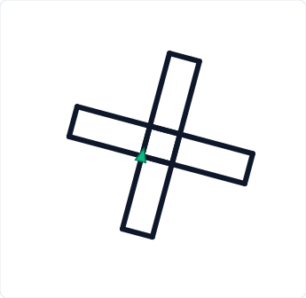
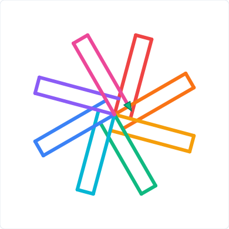
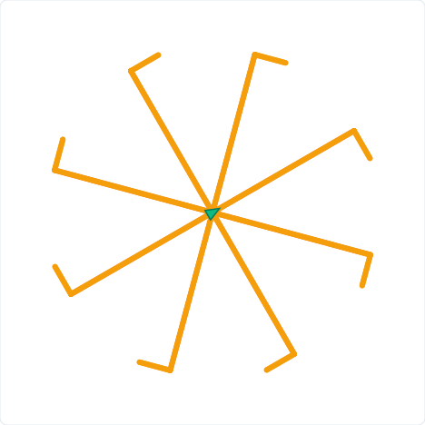
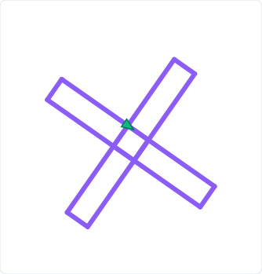

# `anim.2`: Spinning Windmill (`🎨` Creative Sandbox)

- **World:** 🐢 Turtle LOGO — **Flipbook Mode** (`ENV_VERSION_TURTLE_V2`)
- **Card Type:** `🎨` Creative Sandbox (`Starter` + `3` Variation Cards)
- **Prerequisite:** [`anim.1`](./lesson_anim_1_instant_drawing_clear_wait.md)
- **Flipbook Config:** `totalFrames: 24`, `defaultFps: 12`, `clearBetweenFrames: true`, `defaultLoopPlayback: true`
- **Block Budget (Closer-Inclusive):** `Starter: 11` (`Slot Cap: 14`; Var 1: `15 / 18`, Var 2: `16 / 20`, Var 3: `13 / 18`)

> **Guided Co-Pilot Card:**
> Multiply **`$frame * 15`** into **`a`** so every frame twists `15°` farther—after `24` frames (`24 × 15° = 360°`) the windmill loops cleanly! Try changing `15` or loading a **Variation Card**.

<details>
<summary>📖 Parent / Teacher Tip — Stateless `$frame` Arithmetic & Closed Hub Geometry</summary>

`anim.2` builds stateless frame motion using a single 3-address `VAR_OP` (`a = $frame * 15`):
- Helper `F1` (`6` flat blocks) ends with `TURN_RIGHT [90]`, leaving the turtle back at `(0, 0)` rotated `+90°` ready for the next of the `4` blades—a clean closed pinwheel hub!
- **Var 1** introduces Sparse Memory Tape inside Flipbook Mode (`8` rainbow blade colors cycled across `h = h + 45`).
- **Var 2** layers two independent `$frame` multipliers (`a` rotation + `s` spoke growth) in 3-address `VAR_OP` form.
- **Var 3** computes quadratic ease-in acceleration (`a = $frame * $frame`, `b = a * 5`) so the propeller speeds up across frames!

</details>

---

## Palette & Capabilities

```json
{
  "env": "turtle",
  "flipbookMode": true,
  "totalFrames": 24,
  "defaultFps": 12,
  "clearBetweenFrames": true,
  "defaultLoopPlayback": true,
  "allowVariables": true,
  "varNames": "a..z",
  "allowFunctions": ["F1"],
  "allowTape": true,
  "allowedBlocks": [
    "FORWARD", "BACKWARD", "TURN_RIGHT", "TURN_LEFT", "TELEPORT",
    "SET_PEN_COLOR", "LOOP_START", "CALL_FN",
    "VAR_ASSIGN", "VAR_OP", "TAPE_SEEK", "TAPE_STEP"
  ],
  "allowedSensors": ["$frame", "$time", "$cellColor"]
}
```

---

## Starter: Spinning 4-Blade Windmill (`11` Flat Blocks)



*Caption: **Selected Frame: #1** (`defaultFps: 12`, `$time = 0s`, `clearBetweenFrames: true`, `inkMaxSpan: 207px (207×207)`).*

```text
// MAIN (5 flat blocks)
a = $frame * 15
TURN_RIGHT [a]
Loop [4]
  Call F1
End Loop

// F1 (6 flat blocks)
FORWARD [120]
TURN_RIGHT [90]
FORWARD [35]
TURN_RIGHT [90]
FORWARD [120]
TURN_RIGHT [90]
```

```json
{
  "slotCap": 14,
  "totalFrames": 24,
  "defaultFps": 12,
  "clearBetweenFrames": true,
  "defaultLoopPlayback": true,
  "targetFrame": 1,
  "MAIN": [
    { "op": "VAR_OP", "target": "a", "operator": "*", "left": "$frame", "right": 15 },
    { "op": "TURN_RIGHT", "angle": "a" },
    {
      "op": "LOOP_START",
      "count": 4,
      "body": [{ "op": "CALL_FN", "fn": "F1" }]
    }
  ],
  "F1": [
    { "op": "FORWARD", "length": 120 },
    { "op": "TURN_RIGHT", "angle": 90 },
    { "op": "FORWARD", "length": 35 },
    { "op": "TURN_RIGHT", "angle": 90 },
    { "op": "FORWARD", "length": 120 },
    { "op": "TURN_RIGHT", "angle": 90 }
  ]
}
```

---

## Variation 1: Rainbow 8-Blade Tape Pinwheel (`15` Flat Blocks)



*Caption: **Selected Frame: #2** (`defaultFps: 12`, `$time = 0.0833s`, `clearBetweenFrames: true`, `inkMaxSpan: 270px (270×270)`).*

```text
// MAIN (10 flat blocks)
h = $frame * 7.5
TAPE_SEEK [1]
Loop [8]
  TELEPORT [0, 0, h]
  c = $cellColor
  SET_PEN_COLOR [c]
  Call F1
  h = h + 45
  TAPE_STEP [RIGHT]
End Loop

// F1 (5 flat blocks)
FORWARD [140]
TURN_RIGHT [90]
FORWARD [28]
TURN_RIGHT [90]
FORWARD [140]
```

```json
{
  "slotCap": 18,
  "totalFrames": 24,
  "defaultFps": 12,
  "clearBetweenFrames": true,
  "defaultLoopPlayback": true,
  "targetFrame": 2,
  "tape": ["red", "orange", "yellow", "green", "cyan", "blue", "purple", "pink"],
  "MAIN": [
    { "op": "VAR_OP", "target": "h", "operator": "*", "left": "$frame", "right": 7.5 },
    { "op": "TAPE_SEEK", "index": 1 },
    {
      "op": "LOOP_START",
      "count": 8,
      "body": [
        { "op": "TELEPORT", "x": 0, "y": 0, "heading": "h" },
        { "op": "VAR_ASSIGN", "var": "c", "value": "$cellColor" },
        { "op": "SET_PEN_COLOR", "color": "c" },
        { "op": "CALL_FN", "fn": "F1" },
        { "op": "VAR_OP", "target": "h", "operator": "+", "left": "h", "right": 45 },
        { "op": "TAPE_STEP", "direction": "RIGHT" }
      ]
    }
  ],
  "F1": [
    { "op": "FORWARD", "length": 140 },
    { "op": "TURN_RIGHT", "angle": 90 },
    { "op": "FORWARD", "length": 28 },
    { "op": "TURN_RIGHT", "angle": 90 },
    { "op": "FORWARD", "length": 140 }
  ]
}
```

---

## Variation 2: Expanding Starburst (`16` Flat Blocks)



*Caption: **Selected Frame: #4** (`defaultFps: 12`, `$time = 0.25s`, `clearBetweenFrames: true`, `inkMaxSpan: 348px (348×348)`).*

```text
// MAIN (7 flat blocks)
a = $frame * 15
TURN_RIGHT [a]
r = $frame * 25
s = 80 + r
Loop [8]
  Call F1
End Loop

// F1 (9 flat blocks)
SET_PEN_COLOR [orange]
FORWARD [s]
SET_PEN_COLOR [yellow]
TURN_RIGHT [90]
FORWARD [35]
BACKWARD [35]
TURN_LEFT [90]
BACKWARD [s]
TURN_RIGHT [45]
```

```json
{
  "slotCap": 20,
  "totalFrames": 24,
  "defaultFps": 12,
  "clearBetweenFrames": true,
  "defaultLoopPlayback": true,
  "targetFrame": 4,
  "MAIN": [
    { "op": "VAR_OP", "target": "a", "operator": "*", "left": "$frame", "right": 15 },
    { "op": "TURN_RIGHT", "angle": "a" },
    { "op": "VAR_OP", "target": "r", "operator": "*", "left": "$frame", "right": 25 },
    { "op": "VAR_OP", "target": "s", "operator": "+", "left": 80, "right": "r" },
    {
      "op": "LOOP_START",
      "count": 8,
      "body": [{ "op": "CALL_FN", "fn": "F1" }]
    }
  ],
  "F1": [
    { "op": "SET_PEN_COLOR", "color": "orange" },
    { "op": "FORWARD", "length": "s" },
    { "op": "SET_PEN_COLOR", "color": "yellow" },
    { "op": "TURN_RIGHT", "angle": 90 },
    { "op": "FORWARD", "length": 35 },
    { "op": "BACKWARD", "length": 35 },
    { "op": "TURN_LEFT", "angle": 90 },
    { "op": "BACKWARD", "length": "s" },
    { "op": "TURN_RIGHT", "angle": 45 }
  ]
}
```

---

## Variation 3: Accelerating Propeller (`13` Flat Blocks)



*Caption: **Selected Frame: #5** (`defaultFps: 12`, `$time = 0.3333s`, `clearBetweenFrames: true`, `inkMaxSpan: 213px (213×213)`).*

```text
// MAIN (7 flat blocks)
a = $frame * $frame
b = a * 5
TURN_RIGHT [b]
SET_PEN_COLOR [purple]
Loop [4]
  Call F1
End Loop

// F1 (6 flat blocks)
FORWARD [135]
TURN_RIGHT [90]
FORWARD [32]
TURN_RIGHT [90]
FORWARD [135]
TURN_RIGHT [90]
```

```json
{
  "slotCap": 18,
  "totalFrames": 24,
  "defaultFps": 12,
  "clearBetweenFrames": true,
  "defaultLoopPlayback": true,
  "targetFrame": 5,
  "MAIN": [
    { "op": "VAR_OP", "target": "a", "operator": "*", "left": "$frame", "right": "$frame" },
    { "op": "VAR_OP", "target": "b", "operator": "*", "left": "a", "right": 5 },
    { "op": "TURN_RIGHT", "angle": "b" },
    { "op": "SET_PEN_COLOR", "color": "purple" },
    {
      "op": "LOOP_START",
      "count": 4,
      "body": [{ "op": "CALL_FN", "fn": "F1" }]
    }
  ],
  "F1": [
    { "op": "FORWARD", "length": 135 },
    { "op": "TURN_RIGHT", "angle": 90 },
    { "op": "FORWARD", "length": 32 },
    { "op": "TURN_RIGHT", "angle": 90 },
    { "op": "FORWARD", "length": 135 },
    { "op": "TURN_RIGHT", "angle": 90 }
  ]
}
```
