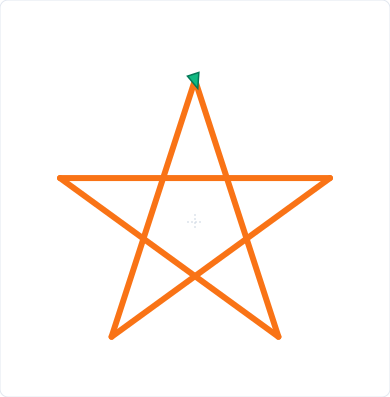
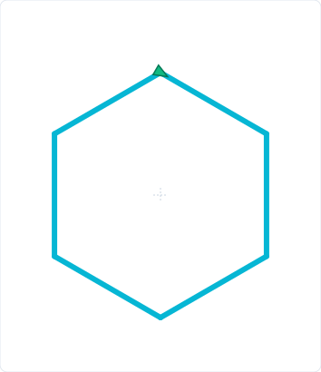
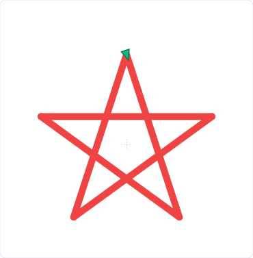
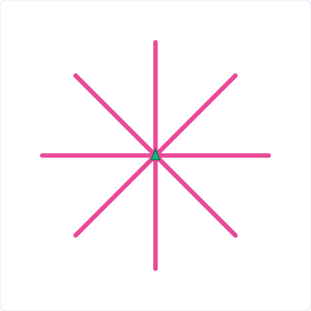

# `anim.4`: Breathing Star (`🎨` Creative Sandbox)

- **World:** 🐢 Turtle LOGO — **Flipbook Mode** (`ENV_VERSION_TURTLE_V2`)
- **Card Type:** `🎨` Creative Sandbox (`Starter` + `3` Variation Cards)
- **Prerequisite:** [`anim.3`](./lesson_anim_3_led_rain_smooth_frame_loops.md)
- **Flipbook Config:** `totalFrames: 12`, `defaultFps: 12`, `clearBetweenFrames: true`, `defaultLoopPlayback: true`
- **Block Budget (Closer-Inclusive):** `Starter: 20` (`Slot Cap: 24`; Var 1: `19 / 24`, Var 2: `21 / 24`, Var 3: `21 / 24`)

> **Guided Co-Pilot Card:**
> Initialize `s = 70` on Frame `1`, grow `s = s + 40` while **`$frame <= 6`**, and shrink `s = s - 40` after! Watch the centered star breathe in and out—then customize colors or try a **Variation Card**.

<details>
<summary>📖 Parent / Teacher Tip — Persistent State Phases & Upright Centering Math</summary>

`anim.4` teaches **multi-phase state progression** using persistent variable `s` + `If/Else`:
1. Frame `1` initializes `s = 70` (instead of an unseen `0`), avoiding an invisible start frame.
2. Frames `2..6` satisfy `$frame <= 6` and expand `s` up to `270px` at peak **Frame `6`** (`s = 70 + 5 × 40 = 270`); Frames `7..12` shrink back down smoothly!
3. Notice `F1` computes radial offset `r = s * 0.526` (`1 / (2 × sin 72°) ≈ 0.526`), lifts the pen, steps straight North `r`, and turns `162°` right—keeping the 5-pointed star upright and centered at `(0, 0)` cleanly inside `600×480`! (Zero phantom `d` or unused variables.)

</details>

---

## Palette & Capabilities

```json
{
  "env": "turtle",
  "flipbookMode": true,
  "totalFrames": 12,
  "defaultFps": 12,
  "clearBetweenFrames": true,
  "defaultLoopPlayback": true,
  "allowVariables": true,
  "varNames": "a..z",
  "allowFunctions": ["F1"],
  "allowedBlocks": [
    "FORWARD", "BACKWARD", "TURN_RIGHT", "TURN_LEFT",
    "PEN_UP", "PEN_DOWN", "SET_PEN_COLOR", "SET_PEN_WIDTH",
    "LOOP_START", "IF", "CALL_FN", "VAR_ASSIGN", "VAR_OP"
  ],
  "allowedSensors": ["$frame", "$time"]
}
```

---

## Starter: Breathing Centered 5-Point Star (`20` Flat Blocks)



*Caption: **Selected Frame: #6** (`defaultFps: 12`, `$time = 0.4167s`, `clearBetweenFrames: true`, `inkMaxSpan: 270px (270×257)`).*

```text
// MAIN (10 flat blocks)
If ($frame == 1)
  s = 70
Else
  If ($frame <= 6)
    s = s + 40
  Else
    s = s - 40
  End If
End If
Call F1

// F1 (10 flat blocks)
r = s * 0.526
PEN_UP
FORWARD [r]
TURN_RIGHT [162]
PEN_DOWN
SET_PEN_COLOR [orange]
Loop [5]
  FORWARD [s]
  TURN_RIGHT [144]
End Loop
```

```json
{
  "slotCap": 24,
  "totalFrames": 12,
  "defaultFps": 12,
  "clearBetweenFrames": true,
  "defaultLoopPlayback": true,
  "targetFrame": 6,
  "MAIN": [
    {
      "op": "IF",
      "cond": { "op": "CMP", "operator": "==", "left": "$frame", "right": 1 },
      "then": [{ "op": "VAR_ASSIGN", "var": "s", "value": 70 }],
      "else": [
        {
          "op": "IF",
          "cond": { "op": "CMP", "operator": "<=", "left": "$frame", "right": 6 },
          "then": [{ "op": "VAR_OP", "target": "s", "operator": "+", "left": "s", "right": 40 }],
          "else": [{ "op": "VAR_OP", "target": "s", "operator": "-", "left": "s", "right": 40 }]
        }
      ]
    },
    { "op": "CALL_FN", "fn": "F1" }
  ],
  "F1": [
    { "op": "VAR_OP", "target": "r", "operator": "*", "left": "s", "right": 0.526 },
    { "op": "PEN_UP" },
    { "op": "FORWARD", "length": "r" },
    { "op": "TURN_RIGHT", "angle": 162 },
    { "op": "PEN_DOWN" },
    { "op": "SET_PEN_COLOR", "color": "orange" },
    {
      "op": "LOOP_START",
      "count": 5,
      "body": [
        { "op": "FORWARD", "length": "s" },
        { "op": "TURN_RIGHT", "angle": 144 }
      ]
    }
  ]
}
```

---

## Variation 1: Breathing Centered Hexagon (`19` Flat Blocks)



*Caption: **Selected Frame: #6** (`defaultFps: 12`, `$time = 0.4167s`, `clearBetweenFrames: true`, `inkMaxSpan: 270px (234×270)`).*

```text
// MAIN (10 flat blocks)
If ($frame == 1)
  s = 35
Else
  If ($frame <= 6)
    s = s + 20
  Else
    s = s - 20
  End If
End If
Call F1

// F1 (9 flat blocks)
PEN_UP
FORWARD [s]
TURN_RIGHT [120]
PEN_DOWN
SET_PEN_COLOR [cyan]
Loop [6]
  FORWARD [s]
  TURN_RIGHT [60]
End Loop
```

```json
{
  "slotCap": 24,
  "totalFrames": 12,
  "defaultFps": 12,
  "clearBetweenFrames": true,
  "defaultLoopPlayback": true,
  "targetFrame": 6,
  "MAIN": [
    {
      "op": "IF",
      "cond": { "op": "CMP", "operator": "==", "left": "$frame", "right": 1 },
      "then": [{ "op": "VAR_ASSIGN", "var": "s", "value": 35 }],
      "else": [
        {
          "op": "IF",
          "cond": { "op": "CMP", "operator": "<=", "left": "$frame", "right": 6 },
          "then": [{ "op": "VAR_OP", "target": "s", "operator": "+", "left": "s", "right": 20 }],
          "else": [{ "op": "VAR_OP", "target": "s", "operator": "-", "left": "s", "right": 20 }]
        }
      ]
    },
    { "op": "CALL_FN", "fn": "F1" }
  ],
  "F1": [
    { "op": "PEN_UP" },
    { "op": "FORWARD", "length": "s" },
    { "op": "TURN_RIGHT", "angle": 120 },
    { "op": "PEN_DOWN" },
    { "op": "SET_PEN_COLOR", "color": "cyan" },
    {
      "op": "LOOP_START",
      "count": 6,
      "body": [
        { "op": "FORWARD", "length": "s" },
        { "op": "TURN_RIGHT", "angle": 60 }
      ]
    }
  ]
}
```

---

## Variation 2: Heartbeat Pulse (`21` Flat Blocks)



*Caption: **Selected Frame: #3** (`defaultFps: 12`, `$time = 0.1667s`, `clearBetweenFrames: true`, `inkMaxSpan: 250px (250×238)`).*

```text
// MAIN (10 flat blocks)
If ($frame == 1)
  s = 100
Else
  If ($frame <= 3)
    s = s + 75
  Else
    s = s - 20
  End If
End If
Call F1

// F1 (11 flat blocks)
r = s * 0.526
PEN_UP
FORWARD [r]
TURN_RIGHT [162]
PEN_DOWN
SET_PEN_COLOR [red]
SET_PEN_WIDTH [10]
Loop [5]
  FORWARD [s]
  TURN_RIGHT [144]
End Loop
```

```json
{
  "slotCap": 24,
  "totalFrames": 12,
  "defaultFps": 12,
  "clearBetweenFrames": true,
  "defaultLoopPlayback": true,
  "targetFrame": 3,
  "MAIN": [
    {
      "op": "IF",
      "cond": { "op": "CMP", "operator": "==", "left": "$frame", "right": 1 },
      "then": [{ "op": "VAR_ASSIGN", "var": "s", "value": 100 }],
      "else": [
        {
          "op": "IF",
          "cond": { "op": "CMP", "operator": "<=", "left": "$frame", "right": 3 },
          "then": [{ "op": "VAR_OP", "target": "s", "operator": "+", "left": "s", "right": 75 }],
          "else": [{ "op": "VAR_OP", "target": "s", "operator": "-", "left": "s", "right": 20 }]
        }
      ]
    },
    { "op": "CALL_FN", "fn": "F1" }
  ],
  "F1": [
    { "op": "VAR_OP", "target": "r", "operator": "*", "left": "s", "right": 0.526 },
    { "op": "PEN_UP" },
    { "op": "FORWARD", "length": "r" },
    { "op": "TURN_RIGHT", "angle": 162 },
    { "op": "PEN_DOWN" },
    { "op": "SET_PEN_COLOR", "color": "red" },
    { "op": "SET_PEN_WIDTH", "width": 10 },
    {
      "op": "LOOP_START",
      "count": 5,
      "body": [
        { "op": "FORWARD", "length": "s" },
        { "op": "TURN_RIGHT", "angle": 144 }
      ]
    }
  ]
}
```

---

## Variation 3: Kaleidoscope Pulse (`21` Flat Blocks)



*Caption: **Selected Frame: #6** (`defaultFps: 12`, `$time = 0.4167s`, `clearBetweenFrames: true`, `inkMaxSpan: 320px (320×320)`).*

```text
// MAIN (10 flat blocks)
If ($frame == 1)
  s = 60
Else
  If ($frame <= 6)
    s = s + 20
  Else
    s = s - 20
  End If
End If
Call F1

// F1 (11 flat blocks)
m = $frame % 2
If (m == 0)
  SET_PEN_COLOR [pink]
Else
  SET_PEN_COLOR [purple]
End If
Loop [8]
  FORWARD [s]
  BACKWARD [s]
  TURN_RIGHT [45]
End Loop
```

```json
{
  "slotCap": 24,
  "totalFrames": 12,
  "defaultFps": 12,
  "clearBetweenFrames": true,
  "defaultLoopPlayback": true,
  "targetFrame": 6,
  "MAIN": [
    {
      "op": "IF",
      "cond": { "op": "CMP", "operator": "==", "left": "$frame", "right": 1 },
      "then": [{ "op": "VAR_ASSIGN", "var": "s", "value": 60 }],
      "else": [
        {
          "op": "IF",
          "cond": { "op": "CMP", "operator": "<=", "left": "$frame", "right": 6 },
          "then": [{ "op": "VAR_OP", "target": "s", "operator": "+", "left": "s", "right": 20 }],
          "else": [{ "op": "VAR_OP", "target": "s", "operator": "-", "left": "s", "right": 20 }]
        }
      ]
    },
    { "op": "CALL_FN", "fn": "F1" }
  ],
  "F1": [
    { "op": "VAR_OP", "target": "m", "operator": "%", "left": "$frame", "right": 2 },
    {
      "op": "IF",
      "cond": { "op": "CMP", "operator": "==", "left": "m", "right": 0 },
      "then": [{ "op": "SET_PEN_COLOR", "color": "pink" }],
      "else": [{ "op": "SET_PEN_COLOR", "color": "purple" }]
    },
    {
      "op": "LOOP_START",
      "count": 8,
      "body": [
        { "op": "FORWARD", "length": "s" },
        { "op": "BACKWARD", "length": "s" },
        { "op": "TURN_RIGHT", "angle": 45 }
      ]
    }
  ]
}
```
