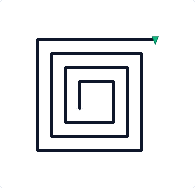
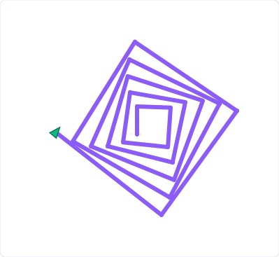
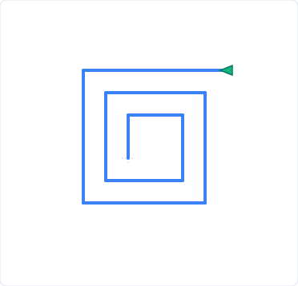
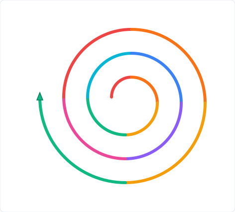

# `anim.5`: Spiral Trail & White Eraser (`🎨` Creative Sandbox)

- **World:** 🐢 Turtle LOGO — **Flipbook Mode** (`ENV_VERSION_TURTLE_V2`)
- **Card Type:** `🎨` Creative Sandbox (`Starter` + `3` Variation Cards)
- **Prerequisite:** [`anim.4`](./lesson_anim_4_breathing_star.md)
- **Flipbook Config:** `totalFrames: 14` (Starter) / `20` (Var 1) / `28` (Var 2) / `12` (Var 3), `defaultFps: 6` (Starter, Var 2, Var 3) / `8` (Var 1), **`clearBetweenFrames: false`**, `defaultLoopPlayback: true`
- **Block Budget (Closer-Inclusive):** `Starter: 11` (`Slot Cap: 14`; Var 1: `12 / 16`, Var 2: `24 / 28`, Var 3: `13 / 16`)

> **Guided Co-Pilot Card:**
> Toggle **`🧹 Clear Between Frames` to `OFF`**! Each frame saves the turtle's pose `(x, y, h)` and draws the next longer spiral leg—then in **Var 2**, flip to **`White`** and unwind backward like an eraser!

<details>
<summary>📖 Parent / Teacher Tip — Trail Accumulation & Explicit White Eraser Width</summary>

1. Because Flipbook Mode resets `(x, y, heading)` back to `(0, 0, 0°)` before every frame `> 1`, saving `x = $x`, `y = $y`, `h = $heading` and restoring via `TELEPORT [x, y, h]` lets `Main` append exactly **one spiral segment per frame** across `🧹 Clear: OFF`!
2. **Var 2 (`White` Eraser Unwind):** Draws frames `1..14` in `Blue` (`width: 4`), turns right `+90°` once at Frame `15` to reverse direction (`+90°` after `TURN_RIGHT [90]` = `180°` U-turn!), then switches to `SET_PEN_COLOR [white]` (`#ffffff`, index `9`, bearing Turtle's diagonal eraser-tip swatch badge) with explicit **`SET_PEN_WIDTH [8]`** (`w + 2` or wider—no silent VM width inflation!) to cleanly carve away Frame `14..1` in reverse! Selected **Frame `18`** captures the crisp mid-unwind knockout.

</details>

---

## Palette & Capabilities

```json
{
  "env": "turtle",
  "flipbookMode": true,
  "totalFrames": 14,
  "defaultFps": 6,
  "clearBetweenFrames": false,
  "defaultLoopPlayback": true,
  "allowVariables": true,
  "varNames": "a..z",
  "allowTape": true,
  "allowedBlocks": [
    "FORWARD", "ARC_RIGHT", "TURN_RIGHT", "TURN_LEFT", "TELEPORT",
    "SET_PEN_COLOR", "SET_PEN_WIDTH", "IF",
    "VAR_ASSIGN", "VAR_OP", "TAPE_SEEK"
  ],
  "allowedSensors": ["$frame", "$x", "$y", "$heading", "$cellColor"]
}
```

---

## Starter: Progressive Square Spiral (`11` Flat Blocks)



*Caption: **Selected Frame: #14** (`defaultFps: 6`, `$time = 2.1667s`, `clearBetweenFrames: false`, `inkMaxSpan: 236px (236×222)`).*

```text
// MAIN (11 flat blocks)
If ($frame == 1)
  s = 54
Else
  TELEPORT [x, y, h]
End If
FORWARD [s]
TURN_RIGHT [90]
x = $x
y = $y
h = $heading
s = s + 14
```

```json
{
  "slotCap": 14,
  "totalFrames": 14,
  "defaultFps": 6,
  "clearBetweenFrames": false,
  "defaultLoopPlayback": true,
  "targetFrame": 14,
  "MAIN": [
    {
      "op": "IF",
      "cond": { "op": "CMP", "operator": "==", "left": "$frame", "right": 1 },
      "then": [{ "op": "VAR_ASSIGN", "var": "s", "value": 54 }],
      "else": [{ "op": "TELEPORT", "x": "x", "y": "y", "heading": "h" }]
    },
    { "op": "FORWARD", "length": "s" },
    { "op": "TURN_RIGHT", "angle": 90 },
    { "op": "VAR_ASSIGN", "var": "x", "value": "$x" },
    { "op": "VAR_ASSIGN", "var": "y", "value": "$y" },
    { "op": "VAR_ASSIGN", "var": "h", "value": "$heading" },
    { "op": "VAR_OP", "target": "s", "operator": "+", "left": "s", "right": 14 }
  ]
}
```

---

## Variation 1: `92°` Skewed Vortex (`12` Flat Blocks)



*Caption: **Selected Frame: #20** (`defaultFps: 8`, `$time = 2.375s`, `clearBetweenFrames: false`, `inkMaxSpan: 259px (259×247)`).*

```text
// MAIN (12 flat blocks)
If ($frame == 1)
  s = 40
Else
  TELEPORT [x, y, h]
End If
SET_PEN_COLOR [purple]
FORWARD [s]
TURN_RIGHT [92]
x = $x
y = $y
h = $heading
s = s + 8
```

```json
{
  "slotCap": 16,
  "totalFrames": 20,
  "defaultFps": 8,
  "clearBetweenFrames": false,
  "defaultLoopPlayback": true,
  "targetFrame": 20,
  "MAIN": [
    {
      "op": "IF",
      "cond": { "op": "CMP", "operator": "==", "left": "$frame", "right": 1 },
      "then": [{ "op": "VAR_ASSIGN", "var": "s", "value": 40 }],
      "else": [{ "op": "TELEPORT", "x": "x", "y": "y", "heading": "h" }]
    },
    { "op": "SET_PEN_COLOR", "color": "purple" },
    { "op": "FORWARD", "length": "s" },
    { "op": "TURN_RIGHT", "angle": 92 },
    { "op": "VAR_ASSIGN", "var": "x", "value": "$x" },
    { "op": "VAR_ASSIGN", "var": "y", "value": "$y" },
    { "op": "VAR_ASSIGN", "var": "h", "value": "$heading" },
    { "op": "VAR_OP", "target": "s", "operator": "+", "left": "s", "right": 8 }
  ]
}
```

---

## Variation 2: `White` Eraser Unwind (`24` Flat Blocks)



*Caption: **Selected Frame: #18** mid-unwind (`defaultFps: 6`, `$time = 2.8333s`, `clearBetweenFrames: false`, `inkMaxSpan: 236px (236×222)` — explicit `SET_PEN_WIDTH [8]` erases `width: 4` blue arms cleanly).*

```text
// MAIN (24 flat blocks)
If ($frame == 1)
  s = 54
Else
  TELEPORT [x, y, h]
End If
If ($frame <= 14)
  SET_PEN_COLOR [blue]
  SET_PEN_WIDTH [4]
  FORWARD [s]
  TURN_RIGHT [90]
  s = s + 14
Else
  If ($frame == 15)
    TURN_RIGHT [90]
  End If
  SET_PEN_COLOR [white]
  SET_PEN_WIDTH [8]
  s = s - 14
  FORWARD [s]
  TURN_LEFT [90]
End If
x = $x
y = $y
h = $heading
```

```json
{
  "slotCap": 28,
  "totalFrames": 28,
  "defaultFps": 6,
  "clearBetweenFrames": false,
  "defaultLoopPlayback": true,
  "targetFrame": 18,
  "MAIN": [
    {
      "op": "IF",
      "cond": { "op": "CMP", "operator": "==", "left": "$frame", "right": 1 },
      "then": [{ "op": "VAR_ASSIGN", "var": "s", "value": 54 }],
      "else": [{ "op": "TELEPORT", "x": "x", "y": "y", "heading": "h" }]
    },
    {
      "op": "IF",
      "cond": { "op": "CMP", "operator": "<=", "left": "$frame", "right": 14 },
      "then": [
        { "op": "SET_PEN_COLOR", "color": "blue" },
        { "op": "SET_PEN_WIDTH", "width": 4 },
        { "op": "FORWARD", "length": "s" },
        { "op": "TURN_RIGHT", "angle": 90 },
        { "op": "VAR_OP", "target": "s", "operator": "+", "left": "s", "right": 14 }
      ],
      "else": [
        {
          "op": "IF",
          "cond": { "op": "CMP", "operator": "==", "left": "$frame", "right": 15 },
          "then": [{ "op": "TURN_RIGHT", "angle": 90 }]
        },
        { "op": "SET_PEN_COLOR", "color": "white" },
        { "op": "SET_PEN_WIDTH", "width": 8 },
        { "op": "VAR_OP", "target": "s", "operator": "-", "left": "s", "right": 14 },
        { "op": "FORWARD", "length": "s" },
        { "op": "TURN_LEFT", "angle": 90 }
      ]
    },
    { "op": "VAR_ASSIGN", "var": "x", "value": "$x" },
    { "op": "VAR_ASSIGN", "var": "y", "value": "$y" },
    { "op": "VAR_ASSIGN", "var": "h", "value": "$heading" }
  ]
}
```

---

## Variation 3: Rainbow Tape Arc Trail (`13` Flat Blocks)



*Caption: **Selected Frame: #12** (`defaultFps: 6`, `$time = 1.8333s`, `clearBetweenFrames: false`, `inkMaxSpan: 332px (332×308)`).*

```text
// MAIN (13 flat blocks)
If ($frame == 1)
  s = 40
Else
  TELEPORT [x, y, h]
End If
TAPE_SEEK [$frame]
c = $cellColor
SET_PEN_COLOR [c]
ARC_RIGHT [s, 90]
x = $x
y = $y
h = $heading
s = s + 12
```

```json
{
  "slotCap": 16,
  "totalFrames": 12,
  "defaultFps": 6,
  "clearBetweenFrames": false,
  "defaultLoopPlayback": true,
  "targetFrame": 12,
  "tape": ["red", "orange", "yellow", "green", "cyan", "blue", "purple", "pink", "red", "orange", "yellow", "green"],
  "MAIN": [
    {
      "op": "IF",
      "cond": { "op": "CMP", "operator": "==", "left": "$frame", "right": 1 },
      "then": [{ "op": "VAR_ASSIGN", "var": "s", "value": 40 }],
      "else": [{ "op": "TELEPORT", "x": "x", "y": "y", "heading": "h" }]
    },
    { "op": "TAPE_SEEK", "index": "$frame" },
    { "op": "VAR_ASSIGN", "var": "c", "value": "$cellColor" },
    { "op": "SET_PEN_COLOR", "color": "c" },
    { "op": "ARC_RIGHT", "radius": "s", "angle": 90 },
    { "op": "VAR_ASSIGN", "var": "x", "value": "$x" },
    { "op": "VAR_ASSIGN", "var": "y", "value": "$y" },
    { "op": "VAR_ASSIGN", "var": "h", "value": "$heading" },
    { "op": "VAR_OP", "target": "s", "operator": "+", "left": "s", "right": 12 }
  ]
}
```
