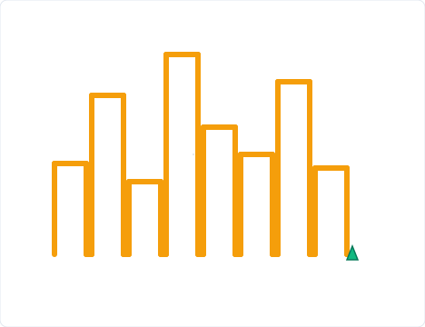
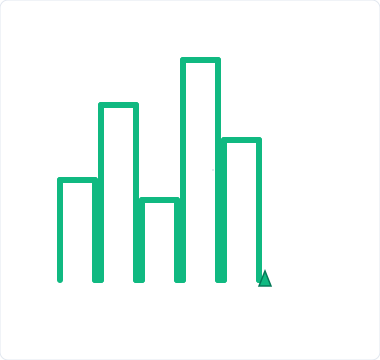
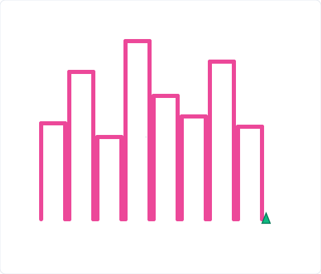

# `anim.7`: Animated Skyline Day to Night (`🎨` Creative Sandbox)

- **World:** 🐢 Turtle LOGO — **Flipbook Mode + Sparse Memory Tape** (`ENV_VERSION_TURTLE_V2`)
- **Card Type:** `🎨` Creative Sandbox (`Starter` + `3` Variation Cards)
- **Prerequisite:** [`anim.6a`](./lesson_anim_6a_fix_blank_lightshow_bug.md)
- **Flipbook Config:** `totalFrames: 2` (Starter: Night/Day) / `4` (Var 1) / `8` (Var 2–3), `defaultFps: 2` (Starter, Var 1) / `4` (Var 2, Var 3), `clearBetweenFrames: true`, `defaultLoopPlayback: true`
- **Block Budget (Closer-Inclusive):** `Starter: 18` (`Slot Cap: 22`; Var 1: `18 / 22`, Var 2: `16 / 20`, Var 3: `23 / 26`)

> **Guided Co-Pilot Card:**
> Seek cell **`$frame`** for this frame's sky color, jump to `(-160, 110)` facing North (`0°`), and draw all `8` towers from Tape cells **`3..10`**! Load **Var 1–3** for sunset hues, construction time-lapse, or pulsing equalizer towers.

<details>
<summary>📖 Parent / Teacher Tip — Zero-Corruption Heading Helper & Unified `PALETTE_COLORS`</summary>

- **Clean `F1` Heading Restoration (`10` flat blocks):** Old drafts left `F1` pointing `+90°` sideways! Ending `F1` with `TURN_LEFT [90] → FORWARD [6] → TURN_LEFT [90]` restores the turtle cleanly to `0°` (North) ready for the next building—zero heading drift across all `8` towers (`328×220px` span).
- **Tape Layout (`Starter`):** Cells `1..2` hold the time-of-day colors (`["blue", "yellow"]` — index `2` = Blue night, `4` = Yellow day in `PALETTE_COLORS`, where `8 = orange` `#f97316` sunset in Var 1!), and Cells `3..10` hold bold tower heights `100..220px` (`[100, 175, 80, 220, 140, 110, 190, 95]`).

</details>

---

## Palette & Capabilities

```json
{
  "env": "turtle",
  "flipbookMode": true,
  "totalFrames": 2,
  "defaultFps": 2,
  "clearBetweenFrames": true,
  "defaultLoopPlayback": true,
  "allowVariables": true,
  "varNames": "a..z",
  "allowFunctions": ["F1"],
  "allowTape": true,
  "allowedBlocks": [
    "FORWARD", "TURN_RIGHT", "TURN_LEFT", "TELEPORT",
    "SET_PEN_COLOR", "LOOP_START", "CALL_FN",
    "VAR_ASSIGN", "VAR_OP", "TAPE_SEEK", "TAPE_STEP"
  ],
  "allowedSensors": ["$frame", "$time", "$cellColor", "$cellValue"]
}
```

---

## Starter: Day/Night Skyline (`18` Flat Blocks)



*Caption: **Selected Frame: #2** (`defaultFps: 2`, `$time = 0.5s`, `clearBetweenFrames: true`, `inkMaxSpan: 328px (328×220)`).*

```text
// MAIN (8 flat blocks)
TAPE_SEEK [$frame]
c = $cellColor
SET_PEN_COLOR [c]
TELEPORT [-160, 110, 0]
TAPE_SEEK [3]
Loop [8]
  Call F1
End Loop

// F1 (10 flat blocks)
h = $cellValue
FORWARD [h]
TURN_RIGHT [90]
FORWARD [35]
TURN_RIGHT [90]
FORWARD [h]
TURN_LEFT [90]
FORWARD [6]
TURN_LEFT [90]
TAPE_STEP [RIGHT]
```

```json
{
  "slotCap": 22,
  "totalFrames": 2,
  "defaultFps": 2,
  "clearBetweenFrames": true,
  "defaultLoopPlayback": true,
  "targetFrame": 2,
  "tape": ["blue", "yellow", 100, 175, 80, 220, 140, 110, 190, 95],
  "MAIN": [
    { "op": "TAPE_SEEK", "index": "$frame" },
    { "op": "VAR_ASSIGN", "var": "c", "value": "$cellColor" },
    { "op": "SET_PEN_COLOR", "color": "c" },
    { "op": "TELEPORT", "x": -160, "y": 110, "heading": 0 },
    { "op": "TAPE_SEEK", "index": 3 },
    {
      "op": "LOOP_START",
      "count": 8,
      "body": [{ "op": "CALL_FN", "fn": "F1" }]
    }
  ],
  "F1": [
    { "op": "VAR_ASSIGN", "var": "h", "value": "$cellValue" },
    { "op": "FORWARD", "length": "h" },
    { "op": "TURN_RIGHT", "angle": 90 },
    { "op": "FORWARD", "length": 35 },
    { "op": "TURN_RIGHT", "angle": 90 },
    { "op": "FORWARD", "length": "h" },
    { "op": "TURN_LEFT", "angle": 90 },
    { "op": "FORWARD", "length": 6 },
    { "op": "TURN_LEFT", "angle": 90 },
    { "op": "TAPE_STEP", "direction": "RIGHT" }
  ]
}
```

---

## Variation 1: 4-Stage Dawn to Midnight Skyline (`18` Flat Blocks)


*Caption: **Selected Frame: #3** (`orange` sunset, `defaultFps: 2`, `$time = 1.0s`, `clearBetweenFrames: true`, `inkMaxSpan: 328px (328×220)`).*

```text
// MAIN (8 flat blocks)
TAPE_SEEK [$frame]
c = $cellColor
SET_PEN_COLOR [c]
TELEPORT [-160, 110, 0]
TAPE_SEEK [5]
Loop [8]
  Call F1
End Loop

// F1 (10 flat blocks)
h = $cellValue
FORWARD [h]
TURN_RIGHT [90]
FORWARD [35]
TURN_RIGHT [90]
FORWARD [h]
TURN_LEFT [90]
FORWARD [6]
TURN_LEFT [90]
TAPE_STEP [RIGHT]
```

```json
{
  "slotCap": 22,
  "totalFrames": 4,
  "defaultFps": 2,
  "clearBetweenFrames": true,
  "defaultLoopPlayback": true,
  "targetFrame": 3,
  "tape": ["pink", "cyan", "orange", "purple", 100, 175, 80, 220, 140, 110, 190, 95],
  "MAIN": [
    { "op": "TAPE_SEEK", "index": "$frame" },
    { "op": "VAR_ASSIGN", "var": "c", "value": "$cellColor" },
    { "op": "SET_PEN_COLOR", "color": "c" },
    { "op": "TELEPORT", "x": -160, "y": 110, "heading": 0 },
    { "op": "TAPE_SEEK", "index": 5 },
    {
      "op": "LOOP_START",
      "count": 8,
      "body": [{ "op": "CALL_FN", "fn": "F1" }]
    }
  ],
  "F1": [
    { "op": "VAR_ASSIGN", "var": "h", "value": "$cellValue" },
    { "op": "FORWARD", "length": "h" },
    { "op": "TURN_RIGHT", "angle": 90 },
    { "op": "FORWARD", "length": 35 },
    { "op": "TURN_RIGHT", "angle": 90 },
    { "op": "FORWARD", "length": "h" },
    { "op": "TURN_LEFT", "angle": 90 },
    { "op": "FORWARD", "length": 6 },
    { "op": "TURN_LEFT", "angle": 90 },
    { "op": "TAPE_STEP", "direction": "RIGHT" }
  ]
}
```

---

## Variation 2: Construction Time-Lapse (`16` Flat Blocks)



*Caption: **Selected Frame: #5** (`defaultFps: 4`, `$time = 1.0s`, `clearBetweenFrames: true`, `inkMaxSpan: 220px (205×220)`).*

```text
// MAIN (6 flat blocks)
SET_PEN_COLOR [green]
TELEPORT [-160, 110, 0]
TAPE_SEEK [3]
Loop [$frame]
  Call F1
End Loop

// F1 (10 flat blocks)
h = $cellValue
FORWARD [h]
TURN_RIGHT [90]
FORWARD [35]
TURN_RIGHT [90]
FORWARD [h]
TURN_LEFT [90]
FORWARD [6]
TURN_LEFT [90]
TAPE_STEP [RIGHT]
```

```json
{
  "slotCap": 20,
  "totalFrames": 8,
  "defaultFps": 4,
  "clearBetweenFrames": true,
  "defaultLoopPlayback": true,
  "targetFrame": 5,
  "tape": ["blue", "green", 100, 175, 80, 220, 140, 110, 190, 95],
  "MAIN": [
    { "op": "SET_PEN_COLOR", "color": "green" },
    { "op": "TELEPORT", "x": -160, "y": 110, "heading": 0 },
    { "op": "TAPE_SEEK", "index": 3 },
    {
      "op": "LOOP_START",
      "count": "$frame",
      "body": [{ "op": "CALL_FN", "fn": "F1" }]
    }
  ],
  "F1": [
    { "op": "VAR_ASSIGN", "var": "h", "value": "$cellValue" },
    { "op": "FORWARD", "length": "h" },
    { "op": "TURN_RIGHT", "angle": 90 },
    { "op": "FORWARD", "length": 35 },
    { "op": "TURN_RIGHT", "angle": 90 },
    { "op": "FORWARD", "length": "h" },
    { "op": "TURN_LEFT", "angle": 90 },
    { "op": "FORWARD", "length": 6 },
    { "op": "TURN_LEFT", "angle": 90 },
    { "op": "TAPE_STEP", "direction": "RIGHT" }
  ]
}
```

---

## Variation 3: Dancing Equalizer Towers (`23` Flat Blocks)



*Caption: **Selected Frame: #1** (`defaultFps: 4`, `$time = 0s`, `clearBetweenFrames: true`, `inkMaxSpan: 328px (328×260)`).*

```text
// MAIN (10 flat blocks)
m = $frame % 2
r = m + 1
TAPE_SEEK [r]
c = $cellColor
SET_PEN_COLOR [c]
TELEPORT [-160, 120, 0]
TAPE_SEEK [3]
Loop [8]
  Call F1
End Loop

// F1 (13 flat blocks)
h = $cellValue
b = $frame % 2
d = b * 40
h = h + d
FORWARD [h]
TURN_RIGHT [90]
FORWARD [35]
TURN_RIGHT [90]
FORWARD [h]
TURN_LEFT [90]
FORWARD [6]
TURN_LEFT [90]
TAPE_STEP [RIGHT]
```

```json
{
  "slotCap": 26,
  "totalFrames": 8,
  "defaultFps": 4,
  "clearBetweenFrames": true,
  "defaultLoopPlayback": true,
  "targetFrame": 1,
  "tape": ["cyan", "pink", 100, 175, 80, 220, 140, 110, 190, 95],
  "MAIN": [
    { "op": "VAR_OP", "target": "m", "operator": "%", "left": "$frame", "right": 2 },
    { "op": "VAR_OP", "target": "r", "operator": "+", "left": "m", "right": 1 },
    { "op": "TAPE_SEEK", "index": "r" },
    { "op": "VAR_ASSIGN", "var": "c", "value": "$cellColor" },
    { "op": "SET_PEN_COLOR", "color": "c" },
    { "op": "TELEPORT", "x": -160, "y": 120, "heading": 0 },
    { "op": "TAPE_SEEK", "index": 3 },
    {
      "op": "LOOP_START",
      "count": 8,
      "body": [{ "op": "CALL_FN", "fn": "F1" }]
    }
  ],
  "F1": [
    { "op": "VAR_ASSIGN", "var": "h", "value": "$cellValue" },
    { "op": "VAR_OP", "target": "b", "operator": "%", "left": "$frame", "right": 2 },
    { "op": "VAR_OP", "target": "d", "operator": "*", "left": "b", "right": 40 },
    { "op": "VAR_OP", "target": "h", "operator": "+", "left": "h", "right": "d" },
    { "op": "FORWARD", "length": "h" },
    { "op": "TURN_RIGHT", "angle": 90 },
    { "op": "FORWARD", "length": 35 },
    { "op": "TURN_RIGHT", "angle": 90 },
    { "op": "FORWARD", "length": "h" },
    { "op": "TURN_LEFT", "angle": 90 },
    { "op": "FORWARD", "length": 6 },
    { "op": "TURN_LEFT", "angle": 90 },
    { "op": "TAPE_STEP", "direction": "RIGHT" }
  ]
}
```
