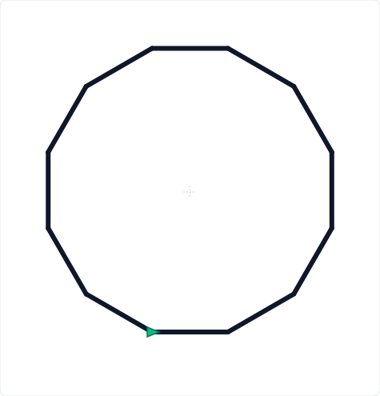
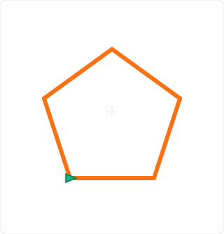
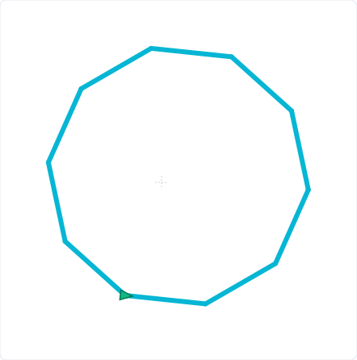
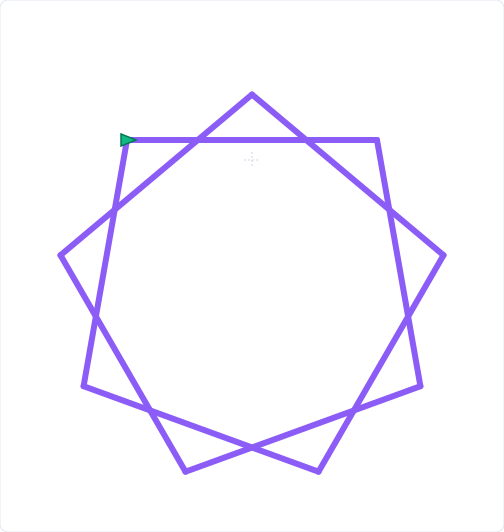

# `anim.9`: Polygon Morphing & Tape Flipbook (`🎨` Creative Sandbox)

- **World:** 🐢 Turtle LOGO — **Flipbook Mode + Sparse Memory Tape** (`ENV_VERSION_TURTLE_V2`)
- **Card Type:** `🎨` Creative Sandbox (`Starter` + `3` Variation Cards)
- **Prerequisite:** [`anim.8a`](./lesson_anim_8a_multi_frame_sprite_sheet.md)
- **Flipbook Config:** `totalFrames: 10` (Starter, Var 2) / `4` (Var 1, Var 3), `defaultFps: 4` (Starter, Var 2) / `2` (Var 1, Var 3), `clearBetweenFrames: true`, `defaultLoopPlayback: true`
- **Block Budget (Closer-Inclusive):** `Starter: 7` (`Slot Cap: 10`; Var 1: `13 / 16`, Var 2: `9 / 12`, Var 3: `9 / 12`)

> **Guided Co-Pilot Card:**
> Set `n = $frame + 2` and turn angle `a = 360 / n` so every frame morphs upward from triangle (`3` sides) to dodecagon (`12`)! Try **Var 1** to drive custom `(length, angle)` pairs straight from the **Memory Tape**.

<details>
<summary>📖 Parent / Teacher Tip — Upward Centered Growth & 3-Address Tape Indexing</summary>

- **Upright `TURN_LEFT` Framing (`7` flat blocks):** Starting at `TELEPORT [-47, 175, 90]` (facing East `+X`) with `TURN_LEFT [a]` builds polygons **upward** cleanly inside `600×480` from `3` sides to `12` sides (`355×355px` span at Frame 10, never clipping below the screen!).
- **Strict 3-Address Tape Flipbook (Var 1, `totalFrames: 4`):** Reads `4` shapes from Tape `[180, 120, 140, 90, 120, 72, 100, 60]` via two standalone 3-address `VAR_OP` lines (`i = $frame * 2`, `i = i - 1`, then `n = 360 / a`), cycling Triangle → Square → Pentagon → Hexagon cleanly!

</details>

---

## Palette & Capabilities

```json
{
  "env": "turtle",
  "flipbookMode": true,
  "totalFrames": 10,
  "defaultFps": 4,
  "clearBetweenFrames": true,
  "defaultLoopPlayback": true,
  "allowVariables": true,
  "varNames": "a..z",
  "allowTape": true,
  "allowedBlocks": [
    "FORWARD", "TURN_LEFT", "TURN_RIGHT", "TELEPORT",
    "SET_PEN_COLOR", "LOOP_START",
    "VAR_ASSIGN", "VAR_OP", "TAPE_SEEK", "TAPE_STEP"
  ],
  "allowedSensors": ["$frame", "$time", "$cellValue"]
}
```

---

## Starter: `3`- to `12`-Gon Polygon Morph (`7` Flat Blocks)



*Caption: **Selected Frame: #10** (`12`-gon, `defaultFps: 4`, `$time = 2.25s`, `clearBetweenFrames: true`, `inkMaxSpan: 355px (355×355)`).*

```text
// MAIN (7 flat blocks)
n = $frame + 2
TELEPORT [-47, 175, 90]
a = 360 / n
Loop [n]
  FORWARD [95]
  TURN_LEFT [a]
End Loop
```

```json
{
  "slotCap": 10,
  "totalFrames": 10,
  "defaultFps": 4,
  "clearBetweenFrames": true,
  "defaultLoopPlayback": true,
  "targetFrame": 10,
  "MAIN": [
    { "op": "VAR_OP", "target": "n", "operator": "+", "left": "$frame", "right": 2 },
    { "op": "TELEPORT", "x": -47, "y": 175, "heading": 90 },
    { "op": "VAR_OP", "target": "a", "operator": "/", "left": 360, "right": "n" },
    {
      "op": "LOOP_START",
      "count": "n",
      "body": [
        { "op": "FORWARD", "length": 95 },
        { "op": "TURN_LEFT", "angle": "a" }
      ]
    }
  ]
}
```

---

## Variation 1: Tape Shape Flipbook (`13` Flat Blocks)



*Caption: **Selected Frame: #3** (pentagon from Tape pair `120, 72`, `totalFrames: 4`, `defaultFps: 2`, `$time = 1.0s`, `clearBetweenFrames: true`, `inkMaxSpan: 194px (194×185)`).*

```text
// MAIN (13 flat blocks)
i = $frame * 2
i = i - 1
TAPE_SEEK [i]
l = $cellValue
TAPE_STEP [RIGHT]
a = $cellValue
n = 360 / a
SET_PEN_COLOR [orange]
TELEPORT [-60, 95, 90]
Loop [n]
  FORWARD [l]
  TURN_LEFT [a]
End Loop
```

```json
{
  "slotCap": 16,
  "totalFrames": 4,
  "defaultFps": 2,
  "clearBetweenFrames": true,
  "defaultLoopPlayback": true,
  "targetFrame": 3,
  "tape": [180, 120, 140, 90, 120, 72, 100, 60],
  "MAIN": [
    { "op": "VAR_OP", "target": "i", "operator": "*", "left": "$frame", "right": 2 },
    { "op": "VAR_OP", "target": "i", "operator": "-", "left": "i", "right": 1 },
    { "op": "TAPE_SEEK", "index": "i" },
    { "op": "VAR_ASSIGN", "var": "l", "value": "$cellValue" },
    { "op": "TAPE_STEP", "direction": "RIGHT" },
    { "op": "VAR_ASSIGN", "var": "a", "value": "$cellValue" },
    { "op": "VAR_OP", "target": "n", "operator": "/", "left": 360, "right": "a" },
    { "op": "SET_PEN_COLOR", "color": "orange" },
    { "op": "TELEPORT", "x": -60, "y": 95, "heading": 90 },
    {
      "op": "LOOP_START",
      "count": "n",
      "body": [
        { "op": "FORWARD", "length": "l" },
        { "op": "TURN_LEFT", "angle": "a" }
      ]
    }
  ]
}
```

---

## Variation 2: Spinning Morphing Polygon (`9` Flat Blocks)



*Caption: **Selected Frame: #8** (`10`-gon rotated `96°`, `defaultFps: 4`, `$time = 1.75s`, `clearBetweenFrames: true`, `inkMaxSpan: 322px (322×317)`).*

```text
// MAIN (9 flat blocks)
n = $frame + 2
h = $frame * 12
TELEPORT [-45, 140, h]
SET_PEN_COLOR [cyan]
a = 360 / n
Loop [n]
  FORWARD [100]
  TURN_LEFT [a]
End Loop
```

```json
{
  "slotCap": 12,
  "totalFrames": 10,
  "defaultFps": 4,
  "clearBetweenFrames": true,
  "defaultLoopPlayback": true,
  "targetFrame": 8,
  "MAIN": [
    { "op": "VAR_OP", "target": "n", "operator": "+", "left": "$frame", "right": 2 },
    { "op": "VAR_OP", "target": "h", "operator": "*", "left": "$frame", "right": 12 },
    { "op": "TELEPORT", "x": -45, "y": 140, "heading": "h" },
    { "op": "SET_PEN_COLOR", "color": "cyan" },
    { "op": "VAR_OP", "target": "a", "operator": "/", "left": 360, "right": "n" },
    {
      "op": "LOOP_START",
      "count": "n",
      "body": [
        { "op": "FORWARD", "length": 100 },
        { "op": "TURN_LEFT", "angle": "a" }
      ]
    }
  ]
}
```

---

## Variation 3: Morphing Polygram Stars (`9` Flat Blocks)



*Caption: **Selected Frame: #3** (`9`-point `720/9` star, `totalFrames: 4`, `defaultFps: 2`, `$time = 1.0s`, `clearBetweenFrames: true`, `inkMaxSpan: 383px (383×377)`).*

```text
// MAIN (9 flat blocks)
i = $frame * 2
n = i + 3
a = 720 / n
SET_PEN_COLOR [purple]
TELEPORT [-125, -20, 90]
Loop [n]
  FORWARD [250]
  TURN_RIGHT [a]
End Loop
```

```json
{
  "slotCap": 12,
  "totalFrames": 4,
  "defaultFps": 2,
  "clearBetweenFrames": true,
  "defaultLoopPlayback": true,
  "targetFrame": 3,
  "MAIN": [
    { "op": "VAR_OP", "target": "i", "operator": "*", "left": "$frame", "right": 2 },
    { "op": "VAR_OP", "target": "n", "operator": "+", "left": "i", "right": 3 },
    { "op": "VAR_OP", "target": "a", "operator": "/", "left": 720, "right": "n" },
    { "op": "SET_PEN_COLOR", "color": "purple" },
    { "op": "TELEPORT", "x": -125, "y": -20, "heading": 90 },
    {
      "op": "LOOP_START",
      "count": "n",
      "body": [
        { "op": "FORWARD", "length": 250 },
        { "op": "TURN_RIGHT", "angle": "a" }
      ]
    }
  ]
}
```
