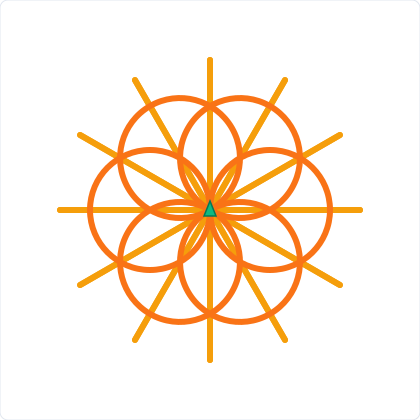
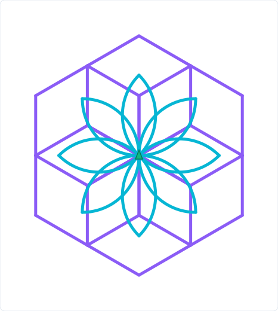
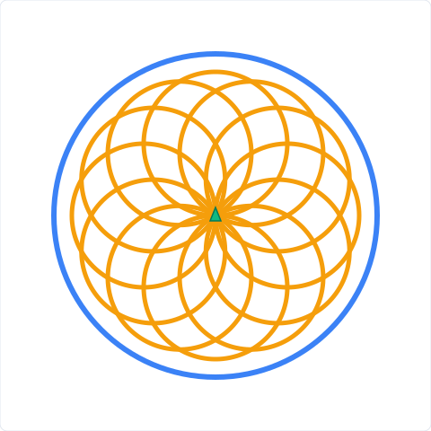
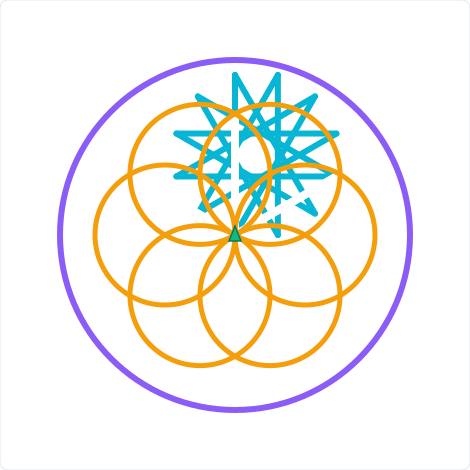

# `branch.B` — `🏆 🎨` Capstone: Interactive Scene Studio (`$input`)

- **Slug / Legacy Alias:** `branch.B` *(New Stage 2 Turtle Capstone)*
- **Order:** `20` (`🏆 🎨` Turtle LOGO Capstone)
- **Environment:** `turtle`
- **One-Concept Goal:** Combine **combinators (`NOT`, `AND`, `OR`)**, **`IF / ELSE IF / ELSE`**, **`F1..F3`** sub-drawings, and **`🎛️ $input`** (`1..4` or `1..6` dial) to orchestrate multi-layer interactive mandalas and white-stencil cutouts!

---

## 1. Zero-Reading UI & Adult Guidance

- **Learner-Facing UI:** Zero words. Trophy + Artist badge (`🏆 🎨`), Top-Dock **`🎛️ $input`** selector, `4` scope tabs **`[MAIN, F1, F2, F3]`**, and `3` rich **Variation Cards**.
- **Coach Spotlight:** Opens with a `4`-scene interactive Starter (`$input = 1` Sun-Lotus at `300×300px`), then invites remixing layers via `OR`/`AND`/`NOT` and Variation Cards `1–3`.

<details>
<summary>📖 Parent / Teacher Tip (Adult-Only <code>explanationText</code>)</summary>

In your **Turtle Scene Studio Capstone**, `MAIN` acts like a master stage director! Not only can **`$input`** pick completely different patterns via `IF / ELSE IF / ELSE`, you can layer shared borders with **`OR`** (`$input == 1 OR $input == 2`), toggle accents with **`NOT`**, or carve white stencil shapes (`SET_PEN_COLOR white`) right across dark mandalas (Variation 3)!

</details>

---

## 2. Palette, Sensors & Sandbox Rules

```json
{
  "isCapstone": true,
  "isSandbox": true,
  "allowedScopes": ["MAIN", "F1", "F2", "F3"],
  "allowRecursion": false,
  "allowedSimBlocks": [
    "FORWARD", "BACKWARD", "TURN_LEFT", "TURN_RIGHT",
    "ARC_LEFT", "ARC_RIGHT", "PEN_UP", "PEN_DOWN",
    "SET_PEN_COLOR", "SET_PEN_WIDTH", "CALL_FN"
  ],
  "allowedControlBlocks": ["LOOP_START", "LOOP_END", "IF", "ELSE_IF", "ELSE", "END_IF"],
  "allowedSensors": ["$input"],
  "allowedCombinators": ["AND", "OR", "NOT"],
  "inputConfig": {
    "mode": "int",
    "min": 1,
    "max": 6,
    "options": [1, 2, 3, 4],
    "previewInput": 1
  },
  "slotCap": { "MAIN": 22, "F1": 22, "F2": 22, "F3": 22 },
  "editDelta": "free (>= 1 edit or Variation exploration)"
}
```

---

## 3. Starter Scene — `4`-Show Interactive Gallery (`Total: 38` Flat Blocks)



```text
MAIN (13 flat blocks):
1.  IF ($input == 1)
2.    CALL_FN (F1)
3.  ELSE_IF ($input == 2)
4.    CALL_FN (F2)
5.  ELSE_IF ($input == 3)
6.    CALL_FN (F3)
7.  ELSE
8.    SET_PEN_COLOR (pink)
9.    LOOP_START (10)
10.     ARC_RIGHT (75, 360)
11.     TURN_RIGHT (36)
12.   LOOP_END
13. END_IF

F1 (12 flat blocks — Sunburst + Orange Rosette):
1. SET_PEN_WIDTH (6)
2. SET_PEN_COLOR (amber)
3. LOOP_START (12) { FORWARD (150); BACKWARD (150); TURN_RIGHT (30) } LOOP_END
4. SET_PEN_COLOR (orange)
5. LOOP_START (6) { ARC_RIGHT (60, 360); TURN_RIGHT (60) } LOOP_END

F2 (5 flat blocks — Cyan 8-Arch Crown):
1. SET_PEN_COLOR (cyan)
2. LOOP_START (8) { ARC_RIGHT (110, 90); TURN_RIGHT (45) } LOOP_END

F3 (8 flat blocks — Green 6× Star Mandala):
1. SET_PEN_COLOR (green)
2. LOOP_START (6) { LOOP_START (5) { FORWARD (140); TURN_RIGHT (144) } LOOP_END; TURN_RIGHT (60) } LOOP_END
```

- **Rendered Metrics (`$input = 1`):** `flatBlocksByScope: { MAIN: 13, F1: 12, F2: 5, F3: 8 }`, `finalPose: { x: 0, y: 0, heading: 0 }`, `penDown: true`, `inkBounds: 300×300 (inkMaxSpan: 300)`, `scaleWarning: false`.

---

## 4. Variation Cards (`3` Clickable Studio Remixes)

### Variation 1 — Double-Deck Kaleidoscope (`OR` Base Lattice + `IF/ELSE`)


- **Previewed (`$input = 2`):** `flatBlocksByScope: { MAIN: 8, F1: 9, F2: 7, F3: 7 }` (`total: 31`), `finalPose: { x: 0, y: 0, heading: 0 }`, `penDown: true`, `inkBounds: 346×400 (inkMaxSpan: 400)`, `scaleWarning: false`.
- **Logic:** `MAIN` runs `IF ($input == 1 OR $input == 2) { CALL_FN F1 }` (`6×6` `100px` purple hex lattice), then `IF ($input == 1) { CALL_FN F2 }` (pink 10-point geometric star: `LOOP 10 { FWD 120; RT 144; FWD 120; LT 108 }`) `ELSE { CALL_FN F3 }` (cyan 8-petal `95px` lotus).

### Variation 2 — 6-Mood Selector Dial (`AND + NOT + OR` Halo, `options: [1..6]`)


- **Previewed (`$input = 5`):** `flatBlocksByScope: { MAIN: 16, F1: 13, F2: 6, F3: 6 }` (`total: 41`), `finalPose: { x: 0, y: 0, heading: 0 }`, `penDown: true`, `inkBounds: 360×360 (inkMaxSpan: 360)`, `scaleWarning: false`.
- **Logic:** `MAIN` draws a centered `180px` blue frame circle (`F1`) whenever **`NOT ($input == 1) AND ($input == 5 OR $input == 6)`**, then routes `1..6` via `IF / ELSE_IF ×4 / ELSE` across `F1`, `F2` (12-circle amber bloom), and `F3` (8-ray red starburst).

### Variation 3 — White-Eraser Stencil Mandala (`color: white` Cutout + `NOT`)


- **Previewed (`$input = 3`):** `flatBlocksByScope: { MAIN: 7, F1: 13, F2: 13, F3: 6 }` (`total: 39`), `finalPose: { x: 0, y: 0, heading: 0 }`, `penDown: true`, `inkBounds: 350×350 (inkMaxSpan: 350)`, `scaleWarning: false`.
- **Logic:**
  1. `IF (NOT ($input == 6)) { CALL_FN F1 }` draws the `175px` purple outer halo everywhere except Mood `6`.
  2. `IF ($input == 3 OR $input == 4) { CALL_FN F2 }` paints a `160px` 12-point cyan star and carves a crisp **`white` (`#ffffff`, width `8`)** `120px` 6-spoke stencil cutout in the middle.
  3. `CALL_FN F3` finishes every mood with a centered amber 6-circle blossom!
