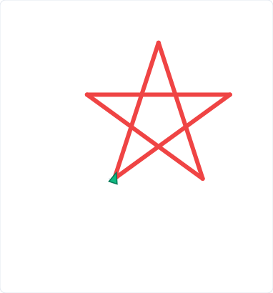
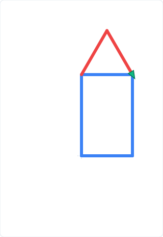
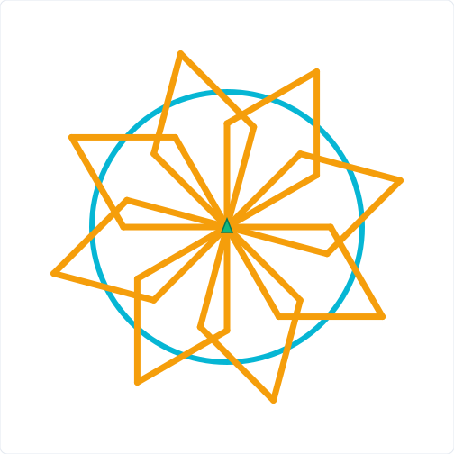
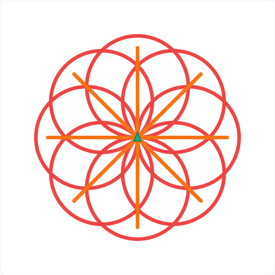

# `branch.10` — `🎨` Mood Mandala (`$input` + Variation Cards)

- **Slug / Legacy Alias:** `branch.10` *(Legacy M5: `5.10`)*
- **Order:** `18` (`🎨` Open-Ended Creative Sandbox)
- **Environment:** `turtle`
- **One-Concept Goal:** Dispatch **`🎛️ $input`** (`1..4` numbers or color swatches) cleanly from **`MAIN`** into **`F1 / F2 / F3`** drawing scopes using **`IF / ELSE IF / ELSE`** — keeping `MAIN` short and expressive!

---

## 1. Zero-Reading UI & Adult Guidance

- **Learner-Facing UI:** Zero words. Top-Dock **`🎛️ $input`** selector (`[1] [2] [3] [4]`, switching to `🔴 🔵 🟢 🟡` swatches in Variation 3), 4 scope tabs `[MAIN, F1, F2, F3]`, and `3` clickable **Variation Cards** in the creative tray. Victory pops gently on run once at least 1 change/interaction occurs (`freePlay: true`).
- **Coach Spotlight:** Highlights `MAIN` calling `F1` when `$input == 1`, inviting learners to remix colors, arc radii, or try Variation Cards `1–3`.

<details>
<summary>📖 Parent / Teacher Tip (Adult-Only <code>explanationText</code>)</summary>

In `branch.10a`, putting every drawing inside `MAIN` grew big fast! Here, `MAIN` becomes a clean **switchboard** using `IF / ELSE IF / ELSE` to jump to **`F1`**, **`F2`**, or **`F3`** based on **`$input`**. Click the `1..4` selector buttons (or switch to color swatches in Variation 3!) and test changing petal colors, frame rings, or sticker sizes!

</details>

---

## 2. Palette, Sensors & Sandbox Rules

```json
{
  "isSandbox": true,
  "allowedScopes": ["MAIN", "F1", "F2", "F3"],
  "allowRecursion": false,
  "allowedSimBlocks": [
    "FORWARD", "BACKWARD", "TURN_LEFT", "TURN_RIGHT",
    "ARC_LEFT", "ARC_RIGHT", "PEN_UP", "PEN_DOWN",
    "SET_PEN_COLOR", "SET_PEN_WIDTH", "CALL_FN"
  ],
  "allowedControlBlocks": ["LOOP_START", "LOOP_END", "IF", "ELSE_IF", "ELSE", "END_IF"],
  "allowedSensors": ["$input"],
  "allowedCombinators": ["OR", "NOT"],
  "inputConfig": {
    "mode": "int",
    "min": 1,
    "max": 4,
    "options": [1, 2, 3, 4],
    "previewInput": 1
  },
  "slotCap": { "MAIN": 22, "F1": 22, "F2": 22, "F3": 22 },
  "editDelta": "free (>= 1 edit or run with $input switch)"
}
```

---

## 3. Starter Scene — `4`-Mood Dispatch (`MAIN: 13`, Total `34`)



```text
MAIN (13 flat blocks):
1.  IF ($input == 1)
2.    CALL_FN (F1)
3.  ELSE_IF ($input == 2)
4.    CALL_FN (F2)
5.  ELSE_IF ($input == 3)
6.    CALL_FN (F3)
7.  ELSE
8.    SET_PEN_COLOR (purple)
9.    LOOP_START (6)
10.     ARC_LEFT (60, 360)
11.     TURN_RIGHT (60)
12.   LOOP_END
13. END_IF

F1 (6 flat blocks — Red 5-Star):
1. SET_PEN_COLOR (red)
2. TURN_RIGHT (18)
3. LOOP_START (5)
4.   FORWARD (200)
5.   TURN_RIGHT (144)
6. LOOP_END

F2 (7 flat blocks — Blue 6-Petal Lotus):
1. SET_PEN_COLOR (blue)
2. LOOP_START (6)
3.   ARC_RIGHT (90, 90)
4.   TURN_RIGHT (90)
5.   ARC_RIGHT (90, 90)
6.   TURN_RIGHT (150)
7. LOOP_END

F3 (8 flat blocks — Green 4-Window Pinwheel):
1. SET_PEN_COLOR (green)
2. LOOP_START (4)
3.   LOOP_START (4)
4.     FORWARD (110)
5.     TURN_RIGHT (90)
6.   LOOP_END
7.   TURN_RIGHT (90)
8. LOOP_END
```

- **Rendered Metrics (`$input = 1`):** `flatBlocksByScope: { MAIN: 13, F1: 6, F2: 7, F3: 8 }`, `finalPose: { x: 0, y: 0, heading: 18 }`, `penDown: true`, `inkBounds: 200×190 (inkMaxSpan: 200)`, `scaleWarning: false`.

---

## 4. Variation Cards (`3` Clickable Presets)

### Variation 1 — Toy Stickers (`$input`: `1` Sun / `2` Waves / `3` House / `4` Triangle)


- **Previewed (`$input = 3`):** `flatBlocksByScope: { MAIN: 14, F1: 6, F2: 10, F3: 13 }` (`total: 43`), `finalPose: { x: 100, y: -160, heading: 150 }`, `penDown: true`, `inkBounds: 100×247 (inkMaxSpan: 247)`, `scaleWarning: false`.
- **Scopes:** `MAIN` adds `SET_PEN_WIDTH (6)` + `IF / ELSE_IF ×2 / ELSE` (`F1` 12-spoke `135px` yellow starburst; `F2` cyan centered 2-crest `50px` radius waves; `F3` blue `100×160` house + `100px` red roof; `ELSE` green `180px` triangle).

### Variation 2 — Shared Cyan Halo Frame (`OR` + `NOT` Layering)


- **Previewed (`$input = 2`):** `flatBlocksByScope: { MAIN: 20, F1: 13, F2: 5, F3: 10 }` (`total: 48`), `finalPose: { x: 0, y: 0, heading: 0 }`, `penDown: true`, `inkBounds: 385×385 (inkMaxSpan: 385)`, `scaleWarning: false`.
- **Highlight:** First `IF ($input == 1 OR $input == 2)` calls `F1` (`150px` centered cyan ring); second `IF (NOT ($input == 4))` sets width `7` else `4`; third `IF/ELSE_IF/ELSE` draws pink hexagon (`F2`), amber 8-petal star (`F3`), or `135px` purple 8-ray burst (`ELSE`).

### Variation 3 — Color Swatch Kaleidoscope (`$inputConfig.mode: "color"`)


- **`inputConfig`:** `{ "mode": "color", "options": ["red", "blue", "green", "yellow"], "previewInput": "red" }` *(maps to index `1` in `render_logo_svg.mjs`)*.
- **Previewed (`$input = "red"`):** `flatBlocksByScope: { MAIN: 13, F1: 12, F2: 6, F3: 9 }` (`total: 40`), `finalPose: { x: 0, y: 0, heading: 0 }`, `penDown: true`, `inkBounds: 340×340 (inkMaxSpan: 340)`, `scaleWarning: false`.
- **Scopes:** `F1` (Red 8-ring + Orange 8-spokes), `F2` (Blue 6-ring rosette), `F3` (Green 12-square spirograph), `ELSE` (`Yellow` 12-arc crescent swirl).
