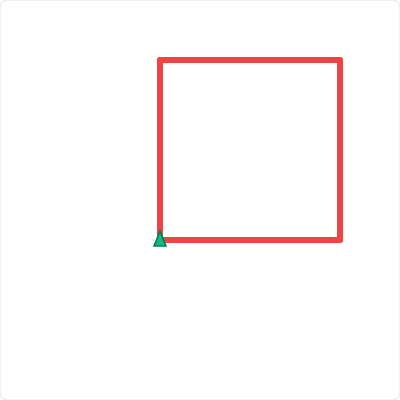
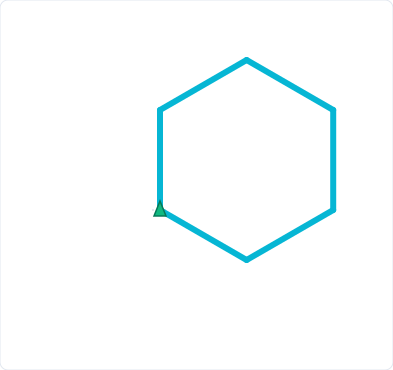
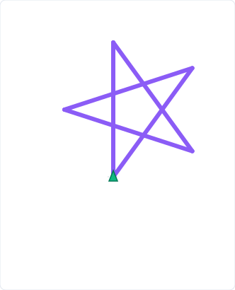

# `branch.10a` — `📖` Meet Scene Selector (`$input`)

- **Slug / Legacy Alias:** `branch.10a` *(New Stage 2 Onboarding Lesson)*
- **Order:** `17` (Guided Read-Only Concept Demo)
- **Environment:** `turtle`
- **One-Concept Goal:** Introduce the reactive **`🎛️ $input`** Top-Dock selector paired with `IF` / `ELSE IF` / `ELSE` in **`MAIN`** — switching `[1]`, `[2]`, `[3]` turns one fixed turtle program into an interactive color & shape chooser (`0` helper tabs needed yet).

---

## 1. Zero-Reading UI & Adult Guidance

- **Learner-Facing UI:** Zero words. **`🎛️ $input`** pill bar (`[1]`, `[2]`, `[3]`) sits cleanly in the Top Dock; changing `$input` triggers an instant turtle re-run (`SET_INSTANT` optional or crisp stroke animation).
- **Coach Spotlights (`2` Tabs):**
  - **Tab 1 (`2` Colors — `$input == 1` Red vs `ELSE` Blue):** Switching `[1] ↔ [2]` changes `SET_PEN_COLOR` while reusing the exact same `180px` square loop!
  - **Tab 2 (`3` Shapes — Square / Cyan Hexagon / Purple Star):** Shows `IF ($input == 1) / ELSE_IF ($input == 2) / ELSE` drawing three full-scale shapes (`inkMaxSpan: 180–200px`).

<details>
<summary>📖 Parent / Teacher Tip (Adult-Only <code>explanationText</code>)</summary>

Meet **`$input`**, the magic selector dial at the top of the screen! Every time you tap `[1]`, `[2]`, or `[3]`, `$input` updates and **`IF / ELSE IF / ELSE`** immediately runs the matching branch — first picking pen colors on the same `180px` square (Tab 1), then drawing completely different shapes (Tab 2)!

</details>

---

## 2. Shared Configuration (`2` Read-Only Tabs)

```json
{
  "isGuidedDemo": true,
  "readOnlyWorkspace": true,
  "allowedScopes": ["MAIN"],
  "allowRecursion": false,
  "allowedSimBlocks": ["FORWARD", "TURN_RIGHT", "SET_PEN_COLOR"],
  "allowedControlBlocks": ["LOOP_START", "LOOP_END", "IF", "ELSE_IF", "ELSE", "END_IF"],
  "allowedSensors": ["$input"],
  "inputConfig": {
    "mode": "int",
    "min": 1,
    "max": 3,
    "options": [1, 2, 3],
    "previewInput": 1
  },
  "slotCap": { "MAIN": 20 },
  "editDelta": 0
}
```

---

## 3. Tab 1 — Red vs Blue Square (`MAIN: 9` Flat Blocks)

- **Selector Options:** `[1, 2]` (`previewInput: 1`)



```text
MAIN (9 flat blocks):
1. IF ($input == 1)
2.   SET_PEN_COLOR (red)
3. ELSE
4.   SET_PEN_COLOR (blue)
5. END_IF
6. LOOP_START (4)
7.   FORWARD (180)
8.   TURN_RIGHT (90)
9. LOOP_END
```

- **Rendered Metrics (`$input = 1`):** `flatBlocksByScope: { MAIN: 9 }`, `finalPose: { x: 0, y: 0, heading: 0 }`, `penDown: true`, `penColor: "#ef4444"`, `inkBounds: 180×180 (inkMaxSpan: 180)`, `scaleWarning: false`.

---

## 4. Tab 2 — 3-Shape Selector (`MAIN: 19` Flat Blocks)

- **Selector Options:** `[1, 2, 3]`

| `$input = 2` (Cyan Hexagon) | `$input = 3` (Purple 5-Point Star) |
|---|---|
|  |  |

```text
MAIN (19 flat blocks):
1.  IF ($input == 1)
2.    SET_PEN_COLOR (red)
3.    LOOP_START (4)
4.      FORWARD (180)
5.      TURN_RIGHT (90)
6.    LOOP_END
7.  ELSE_IF ($input == 2)
8.    SET_PEN_COLOR (cyan)
9.    LOOP_START (6)
10.     FORWARD (100)
11.     TURN_RIGHT (60)
12.   LOOP_END
13. ELSE
14.   SET_PEN_COLOR (purple)
15.   LOOP_START (5)
16.     FORWARD (190)
17.     TURN_RIGHT (144)
18.   LOOP_END
19. END_IF
```

- **Rendered Metrics (`$input = 2`):** `flatBlocksByScope: { MAIN: 19 }`, `finalPose: { x: 0, y: 0, heading: 0 }`, `penDown: true`, `penColor: "#06b6d4"`, `inkBounds: 173×200 (inkMaxSpan: 200)`, `scaleWarning: false`.
- **Rendered Metrics (`$input = 3`):** `flatBlocksByScope: { MAIN: 19 }`, `finalPose: { x: 0, y: 0, heading: 0 }`, `penDown: true`, `penColor: "#8b5cf6"`, `inkBounds: 181×190 (inkMaxSpan: 190)`, `scaleWarning: false`.
