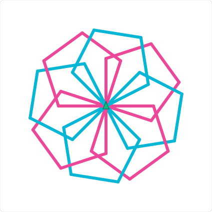
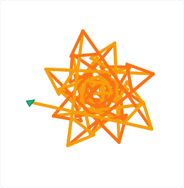
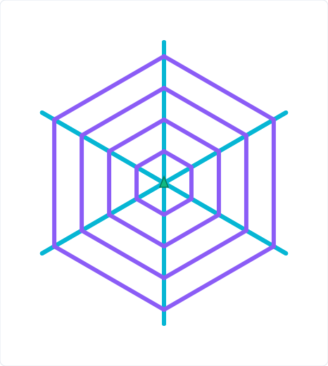
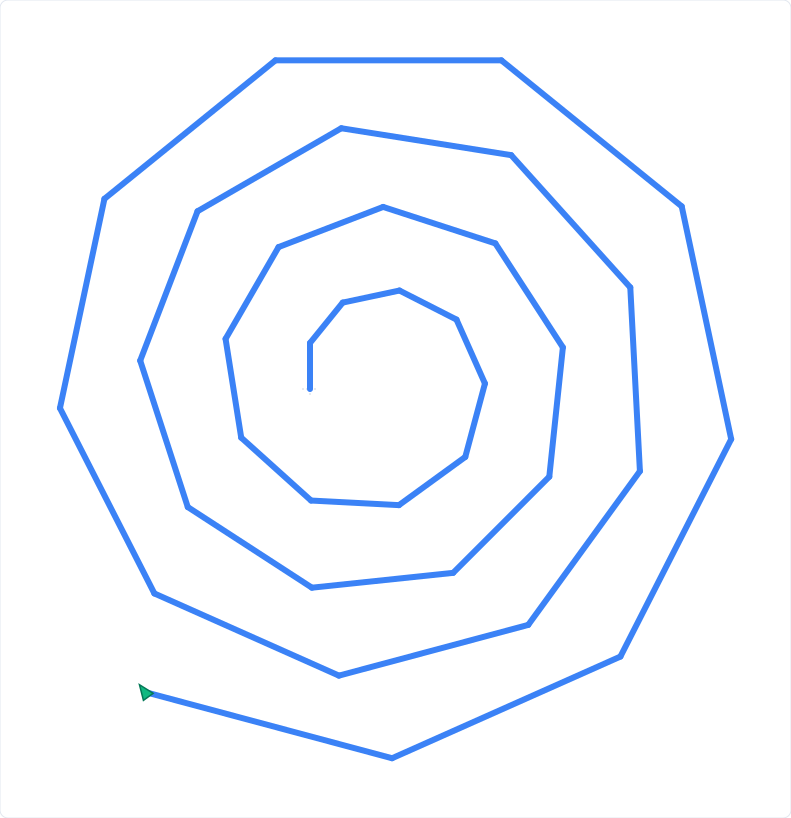
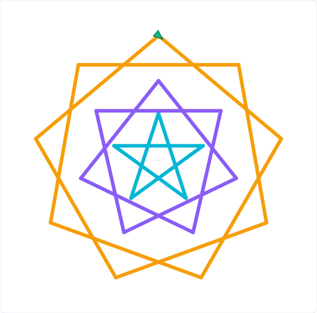

# Capstone `cmp.C` — Parametric Spirograph & Galaxy

> [← `cmp.B`](./capstone_cmp_b_parity_and_threshold_maintenance.md) · [Module `cmp` Overview](./overview.md) · **Format:** 🎨 Capstone Sandbox · **Environment:** [🎨 Turtle LOGO](../../envs/turtle_logo.md) · **Next:** [`cmp.M1` →](./challenge_cmp_m1_max_vault_hunter.md)

---

## 1. One-Concept Goal

Combine subroutines (`F1`), computed division angles (**`360 / n`**, **`720 / n`**), accumulating lengths, and modulo color parity (**`i % 2`**) into bold, full-scale spirographs, spirals, spiderwebs, vortices, and concentric star mandalas (`inkMaxSpan >= 240 px`).

> **Guided Co-Pilot Card (`<= 2` sentences):** Tweak top sliders **`n`**, **`k`**, and **`d`** to remix the whole crystal flower in one click, or copy any Galaxy Card below! Keep **`n`** and **`k`** above **`0`** so **`/`** never pops **`🧮÷0`**.

---

## 2. Starter Example — Crystal Flower (`n = 8, k = 5, d = 95`)



- **Canvas Metrics:** `MAIN: 9`, `F1: 11` (`20` flat blocks total) · Ink `304 × 304 px` (`inkMaxSpan: 304 px`, `scaleWarning: false`).

```json
{
  "scopes": {
    "MAIN": [
      { "op": "VAR_ASSIGN", "var": "n", "value": 8 },
      { "op": "VAR_ASSIGN", "var": "k", "value": 5 },
      { "op": "VAR_ASSIGN", "var": "d", "value": 95 },
      { "op": "VAR_OP", "target": "a", "left": 360, "operator": "/", "right": "n" },
      { "op": "VAR_OP", "target": "b", "left": 360, "operator": "/", "right": "k" },
      {
        "op": "LOOP_START",
        "count": "n",
        "body": [
          { "op": "CALL_FN", "fn": "F1" },
          { "op": "TURN_RIGHT", "angle": "a" }
        ]
      }
    ],
    "F1": [
      { "op": "VAR_OP", "target": "i", "left": "i", "operator": "+", "right": 1 },
      { "op": "VAR_OP", "target": "r", "left": "i", "operator": "%", "right": 2 },
      {
        "op": "IF",
        "cond": { "op": "CMP", "operator": "==", "left": "r", "right": 0 },
        "then": [{ "op": "SET_PEN_COLOR", "color": "cyan" }],
        "else": [{ "op": "SET_PEN_COLOR", "color": "pink" }]
      },
      {
        "op": "LOOP_START",
        "count": "k",
        "body": [
          { "op": "FORWARD", "length": "d" },
          { "op": "TURN_RIGHT", "angle": "b" }
        ]
      }
    ]
  }
}
```

---

## 3. Illustrated Copyable Variations (`4` Galaxy Cards)

### Variation 1 — Golden-Angle Sunflower (`137.5°` Phyllotaxis)



- **Canvas Metrics:** `MAIN: 7`, `F1: 11` (`18` flat blocks total) · Ink `240 × 224 px` (`inkMaxSpan: 240 px`, `scaleWarning: false`).

```json
{
  "scopes": {
    "MAIN": [
      { "op": "VAR_ASSIGN", "var": "l", "value": 50 },
      {
        "op": "LOOP_START",
        "count": 24,
        "body": [
          { "op": "CALL_FN", "fn": "F1" },
          { "op": "VAR_OP", "target": "l", "left": "l", "operator": "+", "right": 8 },
          { "op": "FORWARD", "length": "l" },
          { "op": "TURN_RIGHT", "angle": 137.5 }
        ]
      }
    ],
    "F1": [
      { "op": "VAR_OP", "target": "i", "left": "i", "operator": "+", "right": 1 },
      { "op": "VAR_OP", "target": "r", "left": "i", "operator": "%", "right": 2 },
      {
        "op": "IF",
        "cond": { "op": "CMP", "operator": "==", "left": "r", "right": 0 },
        "then": [{ "op": "SET_PEN_COLOR", "color": "yellow" }],
        "else": [{ "op": "SET_PEN_COLOR", "color": "orange" }]
      },
      {
        "op": "LOOP_START",
        "count": 3,
        "body": [
          { "op": "FORWARD", "length": 55 },
          { "op": "TURN_RIGHT", "angle": 120 }
        ]
      }
    ]
  }
}
```

### Variation 2 — 6-Spoke Spiderweb (`F1` Hex Rings + `PEN_UP` Travel)



- **Canvas Metrics:** `MAIN: 12`, `F1: 13` (`25` flat blocks total) · Ink `346 × 400 px` (`inkMaxSpan: 400 px`, `scaleWarning: false`).

```json
{
  "scopes": {
    "MAIN": [
      { "op": "SET_PEN_COLOR", "color": "cyan" },
      {
        "op": "LOOP_START",
        "count": 6,
        "body": [
          { "op": "FORWARD", "length": 200 },
          { "op": "BACKWARD", "length": 200 },
          { "op": "TURN_RIGHT", "angle": 60 }
        ]
      },
      { "op": "SET_PEN_COLOR", "color": "purple" },
      {
        "op": "LOOP_START",
        "count": 4,
        "body": [
          { "op": "VAR_OP", "target": "i", "left": "i", "operator": "+", "right": 1 },
          { "op": "VAR_OP", "target": "d", "left": "i", "operator": "*", "right": 45 },
          { "op": "CALL_FN", "fn": "F1" }
        ]
      }
    ],
    "F1": [
      { "op": "PEN_UP" },
      { "op": "FORWARD", "length": "d" },
      { "op": "TURN_RIGHT", "angle": 120 },
      { "op": "PEN_DOWN" },
      {
        "op": "LOOP_START",
        "count": 6,
        "body": [
          { "op": "FORWARD", "length": "d" },
          { "op": "TURN_RIGHT", "angle": 60 }
        ]
      },
      { "op": "PEN_UP" },
      { "op": "TURN_RIGHT", "angle": 60 },
      { "op": "FORWARD", "length": "d" },
      { "op": "TURN_RIGHT", "angle": 180 },
      { "op": "PEN_DOWN" }
    ]
  }
}
```

### Variation 3 — Optical Vortex (`a = (360 / n) + 3`)



- **Canvas Metrics:** `MAIN: 10` (`10` flat blocks total) · Ink `671 × 698 px` (`inkMaxSpan: 698 px`, `scaleWarning: false`). Adding just `3°` to `360 / 10` creates an optical twist across `36` growing ribs (`46..256 px`).

```json
{
  "scopes": {
    "MAIN": [
      { "op": "SET_PEN_COLOR", "color": "blue" },
      { "op": "VAR_ASSIGN", "var": "n", "value": 10 },
      { "op": "VAR_OP", "target": "t", "left": 360, "operator": "/", "right": "n" },
      { "op": "VAR_OP", "target": "a", "left": "t", "operator": "+", "right": 3 },
      { "op": "VAR_ASSIGN", "var": "l", "value": 40 },
      {
        "op": "LOOP_START",
        "count": 36,
        "body": [
          { "op": "VAR_OP", "target": "l", "left": "l", "operator": "+", "right": 6 },
          { "op": "FORWARD", "length": "l" },
          { "op": "TURN_RIGHT", "angle": "a" }
        ]
      }
    ]
  }
}
```

### Variation 4 — Triple-Star Concentric Mandala (`5`, `7`, `9`-Pointed Stars)



- **Canvas Metrics:** `MAIN: 15`, `F1: 8` (`23` flat blocks total) · Ink `414 × 407 px` (`inkMaxSpan: 414 px`, `scaleWarning: false`).

```json
{
  "scopes": {
    "MAIN": [
      { "op": "SET_PEN_COLOR", "color": "cyan" },
      { "op": "VAR_ASSIGN", "var": "n", "value": 5 },
      { "op": "VAR_ASSIGN", "var": "l", "value": 150 },
      { "op": "VAR_ASSIGN", "var": "y", "value": -79 },
      { "op": "CALL_FN", "fn": "F1" },
      { "op": "SET_PEN_COLOR", "color": "purple" },
      { "op": "VAR_ASSIGN", "var": "n", "value": 7 },
      { "op": "VAR_ASSIGN", "var": "l", "value": 210 },
      { "op": "VAR_ASSIGN", "var": "y", "value": -134 },
      { "op": "CALL_FN", "fn": "F1" },
      { "op": "SET_PEN_COLOR", "color": "yellow" },
      { "op": "VAR_ASSIGN", "var": "n", "value": 9 },
      { "op": "VAR_ASSIGN", "var": "l", "value": 270 },
      { "op": "VAR_ASSIGN", "var": "y", "value": -210 },
      { "op": "CALL_FN", "fn": "F1" }
    ],
    "F1": [
      { "op": "VAR_OP", "target": "t", "left": 360, "operator": "/", "right": "n" },
      { "op": "VAR_OP", "target": "h", "left": 90, "operator": "+", "right": "t" },
      { "op": "VAR_OP", "target": "a", "left": 720, "operator": "/", "right": "n" },
      { "op": "TELEPORT", "x": 0, "y": "y", "heading": "h" },
      {
        "op": "LOOP_START",
        "count": "n",
        "body": [
          { "op": "FORWARD", "length": "l" },
          { "op": "TURN_RIGHT", "angle": "a" }
        ]
      }
    ]
  }
}
```

---

## 4. Sandbox Configuration & Palette

| Field | Value | Notes |
| :--- | :--- | :--- |
| **Environment** | `turtle_logo` (Capstone Sandbox) | `slotCap: 25/tab`, `autoFitOverflow` zooms smoothly even for `698 px` vortices |
| **Palette** | `LOOP_START`, `IF / ELSE`, `CALL_FN`, `VAR_ASSIGN`, `VAR_OP (+, -, *, /, %)`, `FORWARD`, `BACKWARD`, `TURN_LEFT`, `TURN_RIGHT`, `PEN_UP`, `PEN_DOWN`, `SET_PEN_COLOR`, `TELEPORT` | Zero artificial small-size throttling |

<details>
<summary>📖 Parent / Teacher Tip</summary>

- **Why Recompute `a` & `b` Outside vs. Inside `F1`?** Starter `cmp.C` computes `a` and `b` once in `MAIN`, while Variation 4 recomputes `t`, `h`, and `a` right inside `F1` whenever `(n, l, y)` changes—an intuitive preview of parameterized functions arriving in Module [`args`](../args/overview.md)!

</details>
