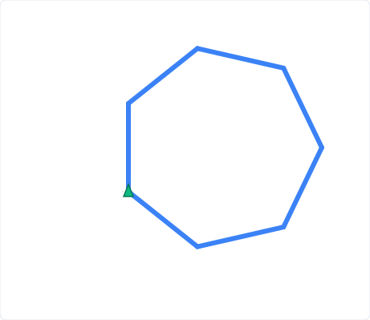

# Lesson `cmp.3` — Division & Remainder Math (`/` and `%`)

> [← `cmp.2`](./lesson_cmp_2_variable_threshold_checks.md) · [Module `cmp` Overview](./overview.md) · **Format:** 📖 Explanation (`4` Beats) · **Environments:** [🚂 Switchyard](../../envs/switchyard.md) / [🎵 Beat & Light](../../envs/beat_light.md) / [🎨 Turtle LOGO](../../envs/turtle_logo.md) · **Next:** [`cmp.4` →](./lesson_cmp_4_modulo_and_alternating_cycles.md)

---

## 1. One-Concept Goal

See how floating-point division **`/`** splits turns evenly, how modulo remainder **`%`** creates repeating cycles, and how dividing by **`0`** raises a safe **`🧮÷0`** pause bubble.

---

## 2. Guided Co-Pilot Experience (`4` Interactive Beats)

> **UI Contract ([`ui_guidelines.md`](../../ui_guidelines.md)):** Guided Co-Pilot card stays `<= 2` sentences per beat; Watch Tray displays exact 3-address `OP_VAR_OP` intermediate values (`r`, `a`, `b`, `p`) live without text overlays inside the grid.

### Beat 1 — Alternating Flip-Flop (`i % 2`) · [🚂 Switchyard](../../envs/switchyard.md)

- **Co-Pilot Card (`<= 2` sentences):** Dividing crate number **`i`** by **`2`** leaves remainder **`r`** flipping **`1, 0, 1, 0`**. When **`r == 0`**, the switch swings Left; otherwise it swings Right!
- **Watch Tray Trace (`4` Crates):** `i=1 -> r=1` (`Right`), `i=2 -> r=0` (`Left`), `i=3 -> r=1` (`Right`), `i=4 -> r=0` (`Left`).

### Beat 2 — 4-Beat Kick (`$beatIndex % 4`) & Checkerboard (`(x + y) % 2`) · [🎵 Beat & Light](../../envs/beat_light.md)

- **Co-Pilot Card (`<= 2` sentences):** Watch **`b = $beatIndex % 4`** drop the Kick drum every **`1`** (`1, 5, 9...`), while **`s = $cursorX + $cursorY`** and **`p = s % 2`** swap Purple and Cyan LEDs across rows!
- **Watch Tray Trace:** Beat `1` -> `b=1` (`DRUM_KICK`); Beats `2, 3, 4` -> `b=2, 3, 0` (`DRUM_CLAP`). At `(1,1)` `s=2, p=0` (`Cyan`); at `(2,1)` `s=3, p=1` (`Purple`).

### Beat 3 — Regular Heptagon Slicing (`360 / n`, `n = 7`) · [🎨 Turtle LOGO](../../envs/turtle_logo.md)

- **Co-Pilot Card (`<= 2` sentences):** **`a = 360 / n`** keeps full decimal precision (**`360 / 7 = 51.42857...°`**) so all **`7`** big **`110 px`** edges close cleanly at home!



- **Verified Geometry & Demo JSON (`MAIN`, `7` flat blocks, `241 × 247 px`, `inkMaxSpan: 247 px`, `scaleWarning: false`):**

```json
{
  "scopes": {
    "MAIN": [
      { "op": "SET_PEN_COLOR", "color": "blue" },
      { "op": "VAR_ASSIGN", "var": "n", "value": 7 },
      { "op": "VAR_OP", "target": "a", "left": 360, "operator": "/", "right": "n" },
      {
        "op": "LOOP_START",
        "count": "n",
        "body": [
          { "op": "FORWARD", "length": 110 },
          { "op": "TURN_RIGHT", "angle": "a" }
        ]
      }
    ]
  }
}
```

### Beat 4 — The Zero-Guard Bubble (`🧮÷0`) · Watch Tray Safe Stop

- **Co-Pilot Card (`<= 2` sentences):** You can't slice a circle into **`0`** pieces—**`360 / 0`** or **`x % 0`** freezes gently with an orange **`🧮÷0`** speech bubble! Always check **`d != 0`** first.
- **Fault Demo + Safe Fix Preview:**

```json
{
  "scopes": {
    "MAIN": [
      { "op": "VAR_ASSIGN", "var": "d", "value": 0 },
      {
        "op": "IF",
        "cond": { "op": "CMP", "operator": "!=", "left": "d", "right": 0 },
        "then": [
          { "op": "VAR_OP", "target": "a", "left": 360, "operator": "/", "right": "d" }
        ]
      }
    ]
  }
}
```

| Mode | `d` Value | Result | Watch Tray State |
| :--- | :---: | :--- | :--- |
| **Fault Demo (no `IF`)** | `0` | **`MATH_ERROR`** (`🧮÷0`) | Pauses safely on `VAR_OP`; highlights `/ 0` chip |
| **Guarded Preview (`IF d != 0`)** | `0` | Safely skipped (`a` unchanged) | Completes cleanly (`0` error) |
| **Guarded Preview (`IF d != 0`)** | `6` | `a = 60` | Completes cleanly (`60°` hex turn) |

<details>
<summary>📖 Parent / Teacher Tip</summary>

- **Float `/` vs. Integer `%`:** Division `/` stores `float64` values (`360 / 7 ≈ 51.428571°`), preventing polygon drift on odd sides (`7`, `9`, `11`). Modulo `%` produces non-negative remainders (`0..divisor-1`) for alternating Switchyard tracks, musical rhythms, and checkerboards.
- **Why Full `110 px` Sides on `cmp.3`?** Keeping `l = 110` ensures `inkMaxSpan = 247 px` (`>= 160 px`), keeping the entire heptagon comfortably larger than the `40 × 45 px` turtle.
- **Why `🧮÷0` Early?** Experiencing `MATH_ERROR` in a controlled explanation beat removes fear when learners later experiment with `n = 0` in sandbox [`cmp.5`](./lesson_cmp_5_computed_geometry.md).

</details>
