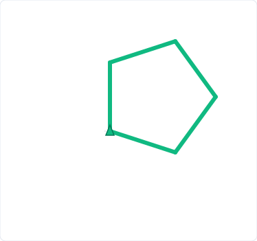
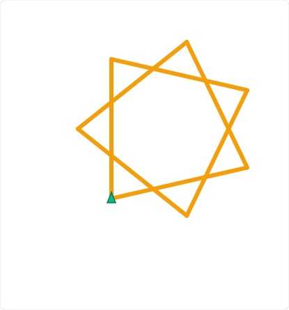
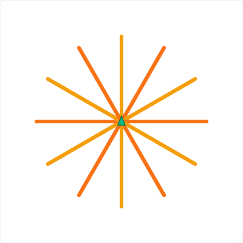
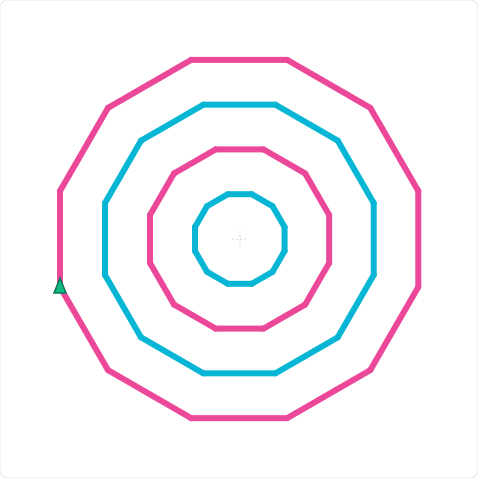
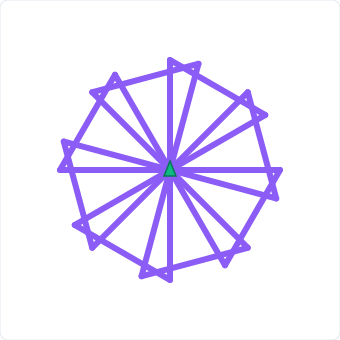

# Lesson `cmp.5` — Computed Geometry (`360 / n` & Alternating Colors)

> [← `cmp.4`](./lesson_cmp_4_modulo_and_alternating_cycles.md) · [Module `cmp` Overview](./overview.md) · **Format:** 🎨 Sandbox · **Environment:** [🎨 Turtle LOGO](../../envs/turtle_logo.md) · **Next:** [`cmp.5a` →](./lesson_cmp_5a_modulo_beat_and_checkerboard.md)

---

## 1. One-Concept Goal

Use computed division angles (**`360 / n`**, **`720 / n`**) and loop parity (**`i % 2`**) with generous line lengths (**`inkMaxSpan >= 160 px`**) to invent regular polygons, stars, sunbursts, concentric bullseyes, and pinwheels.

> **Guided Co-Pilot Card (`<= 2` sentences):** Change **`n`** at the top (`3, 4, 6, 8...`) to morph the polygon automatically while **`a = 360 / n`** keeps every corner crisp! Try loading any Variation Card below, and stay **`n >= 1`** to avoid **`🧮÷0`**.

---

## 2. Starter Example — Any Regular Polygon (`360 / n`)



- **Canvas Metrics:** `MAIN: 8` flat blocks · Ink `154 × 162 px` (`inkMaxSpan: 162 px >= 160 px`, `scaleWarning: false`).

```json
{
  "scopes": {
    "MAIN": [
      { "op": "SET_PEN_COLOR", "color": "green" },
      { "op": "VAR_ASSIGN", "var": "n", "value": 5 },
      { "op": "VAR_ASSIGN", "var": "l", "value": 100 },
      { "op": "VAR_OP", "target": "a", "left": 360, "operator": "/", "right": "n" },
      {
        "op": "LOOP_START",
        "count": "n",
        "body": [
          { "op": "FORWARD", "length": "l" },
          { "op": "TURN_RIGHT", "angle": "a" }
        ]
      }
    ]
  }
}
```

---

## 3. Illustrated Copyable Variations (`4` Cards)

### Variation 1 — Universal Odd `n`-Pointed Star (`720 / n`)



- **Canvas Metrics:** `MAIN: 8` flat blocks · Ink `243 × 249 px` (`inkMaxSpan: 249 px`, `scaleWarning: false`). Double the turn numerator (`720 / n`) weaves straight across the star!

```json
{
  "scopes": {
    "MAIN": [
      { "op": "SET_PEN_COLOR", "color": "yellow" },
      { "op": "VAR_ASSIGN", "var": "n", "value": 7 },
      { "op": "VAR_ASSIGN", "var": "l", "value": 200 },
      { "op": "VAR_OP", "target": "a", "left": 720, "operator": "/", "right": "n" },
      {
        "op": "LOOP_START",
        "count": "n",
        "body": [
          { "op": "FORWARD", "length": "l" },
          { "op": "TURN_RIGHT", "angle": "a" }
        ]
      }
    ]
  }
}
```

### Variation 2 — Two-Color Alternating Sunburst (`i % 2`)



- **Canvas Metrics:** `MAIN: 14` flat blocks · Ink `280 × 280 px` (`inkMaxSpan: 280 px`, `scaleWarning: false`).

```json
{
  "scopes": {
    "MAIN": [
      { "op": "VAR_ASSIGN", "var": "n", "value": 12 },
      { "op": "VAR_OP", "target": "a", "left": 360, "operator": "/", "right": "n" },
      {
        "op": "LOOP_START",
        "count": "n",
        "body": [
          { "op": "VAR_OP", "target": "i", "left": "i", "operator": "+", "right": 1 },
          { "op": "VAR_OP", "target": "r", "left": "i", "operator": "%", "right": 2 },
          {
            "op": "IF",
            "cond": { "op": "CMP", "operator": "==", "left": "r", "right": 0 },
            "then": [{ "op": "SET_PEN_COLOR", "color": "orange" }],
            "else": [{ "op": "SET_PEN_COLOR", "color": "yellow" }]
          },
          { "op": "FORWARD", "length": 140 },
          { "op": "BACKWARD", "length": 140 },
          { "op": "TURN_RIGHT", "angle": "a" }
        ]
      }
    ]
  }
}
```

### Variation 3 — Concentric Bullseye Rings (`l = i * 24`, `i % 2`)



- **Canvas Metrics:** `MAIN: 19` flat blocks · Ink `358 × 358 px` (`inkMaxSpan: 358 px`, `scaleWarning: false`). Computes `x = 0 - d` (strict 3-address `OP_VAR_OP`) to recenter each ring around `(0, 0)`.

```json
{
  "scopes": {
    "MAIN": [
      { "op": "VAR_OP", "target": "a", "left": 360, "operator": "/", "right": 12 },
      {
        "op": "LOOP_START",
        "count": 4,
        "body": [
          { "op": "VAR_OP", "target": "i", "left": "i", "operator": "+", "right": 1 },
          { "op": "VAR_OP", "target": "l", "left": "i", "operator": "*", "right": 24 },
          { "op": "VAR_OP", "target": "d", "left": "i", "operator": "*", "right": 45 },
          { "op": "VAR_OP", "target": "x", "left": 0, "operator": "-", "right": "d" },
          { "op": "VAR_OP", "target": "h", "left": "i", "operator": "*", "right": 12 },
          { "op": "TELEPORT", "x": "x", "y": "h", "heading": 0 },
          { "op": "VAR_OP", "target": "r", "left": "i", "operator": "%", "right": 2 },
          {
            "op": "IF",
            "cond": { "op": "CMP", "operator": "==", "left": "r", "right": 1 },
            "then": [{ "op": "SET_PEN_COLOR", "color": "cyan" }],
            "else": [{ "op": "SET_PEN_COLOR", "color": "pink" }]
          },
          {
            "op": "LOOP_START",
            "count": 12,
            "body": [
              { "op": "FORWARD", "length": "l" },
              { "op": "TURN_RIGHT", "angle": "a" }
            ]
          }
        ]
      }
    ]
  }
}
```

### Variation 4 — Starburst Pinwheel (`n = 8` Rotating Triangles)



- **Canvas Metrics:** `MAIN: 10` flat blocks · Ink `220 × 220 px` (`inkMaxSpan: 220 px`, `scaleWarning: false`).

```json
{
  "scopes": {
    "MAIN": [
      { "op": "SET_PEN_COLOR", "color": "purple" },
      { "op": "VAR_ASSIGN", "var": "n", "value": 8 },
      { "op": "VAR_OP", "target": "a", "left": 360, "operator": "/", "right": "n" },
      {
        "op": "LOOP_START",
        "count": "n",
        "body": [
          {
            "op": "LOOP_START",
            "count": 3,
            "body": [
              { "op": "FORWARD", "length": 110 },
              { "op": "TURN_RIGHT", "angle": 120 }
            ]
          },
          { "op": "TURN_RIGHT", "angle": "a" }
        ]
      }
    ]
  }
}
```

---

## 4. Sandbox Configuration & Palette

| Field | Value | Notes |
| :--- | :--- | :--- |
| **Environment** | `turtle_logo` (Open Sandbox) | `slotCap: 24`, auto-fit camera handles `>= 600 px` spans seamlessly |
| **Palette** | `LOOP_START`, `IF / ELSE`, `VAR_ASSIGN`, `VAR_OP (+, -, *, /, %)`, `FORWARD`, `BACKWARD`, `TURN_LEFT`, `TURN_RIGHT`, `PEN_UP`, `PEN_DOWN`, `SET_PEN_COLOR`, `TELEPORT` | Full creative freedom; `n = 0` triggers `🧮÷0` cleanly |

<details>
<summary>📖 Parent / Teacher Tip</summary>

- **Why Big Fixed Sides Instead of `300 / n`?** Dividing `300 / n` shrinks shapes down to the size of the `40 × 45 px` turtle icon. Keeping `l >= 100 px` keeps every drawing crisp (`162–358 px`) and lets the LOGO viewport camera zoom cleanly to frame large shapes.

</details>
