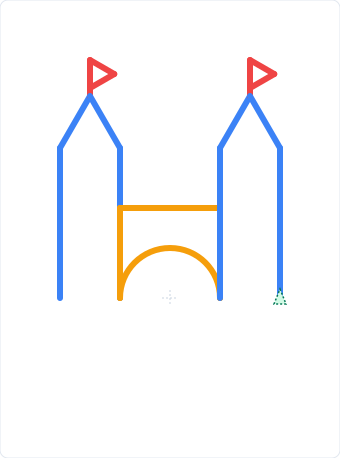
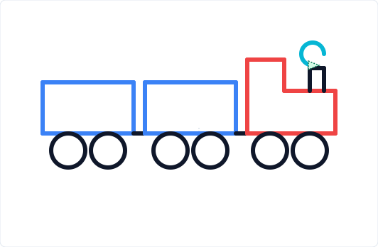
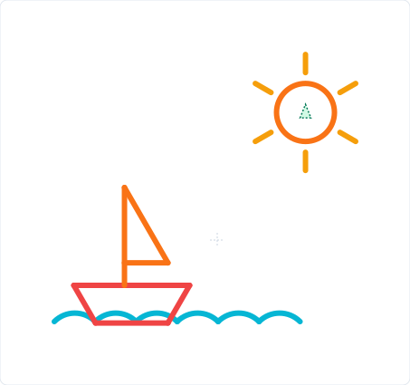
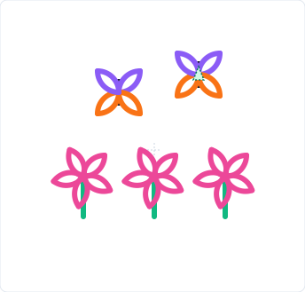

# func.B: Castle Architect

- **Header ID:** `func.B` (Legacy `4B`)
- **Format:** 🎨 Capstone
- **Environment:** [🐢 Turtle LOGO](../../envs/turtle_logo.md)
- **One-Concept Goal:** Unlock all 4 tabs (`Main`, `F1`, `F2`, `F3`) to architect rich, multi-part Turtle scenes where `Main` arranges `F1` and `F2`, and `F1`/`F2` reuse micro-motifs built in `F3` (`Castle Pennants`, `Train Wheels`, `Harbor Sunburst`, `Flower & Butterfly Wings`) — strictly **zero `TELEPORT`** and high-contrast visible palette colors!

<details>
<summary>📖 Parent / Teacher Tip (Adult-Only <code>explanationText</code>)</summary>

Now all four tabs (`Main`, `F1`, `F2`, `F3`) are open! Think like a master architect: put your tiniest reusable detail in `F3` (a red pennant flag, a train wheel, a glowing sun, or a curved petal), call `F3` from inside bigger buildings/vehicles in `F1` and `F2`, and use `Main` like a stage director placing everything onto the canvas without a single `TELEPORT` jump!

</details>

---

## Learner UI & Platform Config

- **Learner-Facing Text:** `0` words (100% Zero-Reading Rule; Starter + 3 Variation Cards render visual SVG previews).
- **Enabled Scope Tabs (`allowedScopes`):** `["MAIN", "F1", "F2", "F3"]` (all 4 tabs active).
- **Allow Recursion (`allowRecursion`):** `false` (`allowRecursion: false`; self-calls & mutual cycles forbidden).
- **Palette:**
  - `allowedSimBlocks`: `["FORWARD", "BACKWARD", "TURN_LEFT", "TURN_RIGHT", "ARC_LEFT", "ARC_RIGHT", "PEN_UP", "PEN_DOWN", "SET_PEN_COLOR", "SET_PEN_WIDTH", "HIDE_TURTLE", "SHOW_TURTLE"]` *(strictly **NO `TELEPORT`**)*
  - `allowedControlBlocks`: `["LOOP_START", "LOOP_END", "CALL_FN"]` (`targets: ["F1", "F2", "F3"]` from `MAIN`; `F1/F2` may call lower helper `F3` safely without cycles)
  - `allowedBlockParams`:
    - `FORWARD` / `BACKWARD`: `[4, 8, 10, 12, 14, 16, 18, 20, 22, 24, 25, 26, 28, 30, 32, 36, 40, 45, 48, 50, 52, 54, 55, 60, 62, 64, 75, 80, 90, 100, 110, 125, 140, 200]`
    - `TURN_LEFT` / `TURN_RIGHT`: `[15, 30, 45, 60, 72, 90, 120, 135, 144, 150, 180]`
    - `ARC_LEFT` / `ARC_RIGHT`: radii `[8, 12, 16, 24, 25, 50]`, sweeps `[90, 180, 270, 360]`
    - `SET_PEN_COLOR`: canonical `0..9` (`black, red, blue, green, amber, purple, pink, cyan, orange, white`)
    - `SET_PEN_WIDTH`: `[2, 4, 6, 8]`
  - `allowRepeatBadges`: `false`
  - `allowActionParams`: `true`
- **Slot Trays:** Creative Capstone — soft visual guidance (`Starter` keeps every tab `≤ 14` flat blocks; Variations scale up to `~30–35`/tab max).
- **UI Coach Spotlights (`uiSpotlights`):** `["all-4-tabs-main-to-f3", "state-hygiene-connector", "capstone-variation-cards"]`
- **Turtle Start State:** `{ "x": 0, "y": 0, "heading": 0, "penDown": true, "penColor": "#0f172a", "penWidth": 6, "hideTurtle": false }`

---

## Starter & Variation Cards (Rendered & Verified SVGs)

### Starter Card: Fairy-Tale Castle (`7 + 14 + 13 + 9 = 43` flat blocks)



- **Architecture:** `MAIN` (`7`) → `F1` Twin Blue Towers (`14`) & `F2` Amber Arched Gatehouse (`13`); `F1` → `F3` Red Pennant Flags (`9`). Every single tab sits at `≤ 14` flat blocks!
- **Verified Render Metrics:** `finalPose: (55, 0, 0°)`, `penDown: false`, `pathCount: 20`.
- **`MAIN` (`7` flat blocks):**
  ```json
  [
    { "op": "PEN_UP" },
    { "op": "TURN_LEFT", "angle": 90 },
    { "op": "FORWARD", "length": 55 },
    { "op": "TURN_RIGHT", "angle": 90 },
    { "op": "CALL_FN", "fn": "F1" },
    { "op": "CALL_FN", "fn": "F2" },
    { "op": "CALL_FN", "fn": "F1" }
  ]
  ```
- **`F1` — Castle Tower + Spire + `F3` Flag (`14` flat blocks):**
  ```json
  [
    { "op": "SET_PEN_COLOR", "color": "blue" },
    { "op": "PEN_DOWN" },
    { "op": "FORWARD", "length": 75 },
    { "op": "TURN_RIGHT", "angle": 30 },
    { "op": "FORWARD", "length": 30 },
    { "op": "TURN_LEFT", "angle": 30 },
    { "op": "CALL_FN", "fn": "F3" },
    { "op": "SET_PEN_COLOR", "color": "blue" },
    { "op": "TURN_RIGHT", "angle": 150 },
    { "op": "FORWARD", "length": 30 },
    { "op": "TURN_RIGHT", "angle": 30 },
    { "op": "FORWARD", "length": 75 },
    { "op": "PEN_UP" },
    { "op": "TURN_RIGHT", "angle": 180 }
  ]
  ```
- **`F2` — Amber Arched Gatehouse (`13` flat blocks):**
  ```json
  [
    { "op": "SET_PEN_COLOR", "color": "amber" },
    { "op": "PEN_DOWN" },
    { "op": "FORWARD", "length": 45 },
    { "op": "TURN_RIGHT", "angle": 90 },
    { "op": "FORWARD", "length": 50 },
    { "op": "TURN_RIGHT", "angle": 90 },
    { "op": "FORWARD", "length": 45 },
    { "op": "TURN_RIGHT", "angle": 180 },
    { "op": "ARC_LEFT", "radius": 25, "angle": 180 },
    { "op": "PEN_UP" },
    { "op": "TURN_LEFT", "angle": 90 },
    { "op": "FORWARD", "length": 50 },
    { "op": "TURN_LEFT", "angle": 90 }
  ]
  ```
- **`F3` — Red Pennant Flag (`9` flat blocks):**
  ```json
  [
    { "op": "SET_PEN_COLOR", "color": "red" },
    { "op": "PEN_DOWN" },
    { "op": "FORWARD", "length": 18 },
    { "op": "TURN_RIGHT", "angle": 120 },
    { "op": "FORWARD", "length": 14 },
    { "op": "TURN_RIGHT", "angle": 120 },
    { "op": "FORWARD", "length": 14 },
    { "op": "TURN_RIGHT", "angle": 120 },
    { "op": "BACKWARD", "length": 4 }
  ]
  ```

---

### Variation 1: Choo-Choo Steam Train (`8 + 20 + 35 + 4 = 67` flat blocks)



- **Architecture:** `MAIN` (`8`) hooks up two Blue Train Cars (`F1`, `20` each looped `×2`) + Red Steam Engine (`F2`, `35`); both `F1` and `F2` call `F3` (`4`) to stamp rolling black wheels along the track (`y=0`), topped by a black smokestack and floating cyan steam curl!
- **Verified Render Metrics:** `finalPose: (80, -48, 90°)`, `penDown: false`, `pathCount: 26`.
- **`MAIN` (`8` flat blocks):**
  ```json
  [
    { "op": "PEN_UP" },
    { "op": "TURN_LEFT", "angle": 90 },
    { "op": "FORWARD", "length": 110 },
    { "op": "TURN_RIGHT", "angle": 90 },
    {
      "op": "LOOP_START",
      "count": 2,
      "body": [{ "op": "CALL_FN", "fn": "F1" }]
    },
    { "op": "CALL_FN", "fn": "F2" }
  ]
  ```
- **`F1` — Passenger Car + 2 `F3` Wheels + Coupler (`20` flat blocks):**
  ```json
  [
    { "op": "SET_PEN_COLOR", "color": "blue" },
    { "op": "PEN_DOWN" },
    {
      "op": "LOOP_START",
      "count": 2,
      "body": [
        { "op": "FORWARD", "length": 36 },
        { "op": "TURN_RIGHT", "angle": 90 },
        { "op": "FORWARD", "length": 64 },
        { "op": "TURN_RIGHT", "angle": 90 }
      ]
    },
    { "op": "PEN_UP" },
    { "op": "TURN_RIGHT", "angle": 90 },
    { "op": "FORWARD", "length": 18 },
    { "op": "CALL_FN", "fn": "F3" },
    { "op": "FORWARD", "length": 28 },
    { "op": "CALL_FN", "fn": "F3" },
    { "op": "FORWARD", "length": 18 },
    { "op": "SET_PEN_COLOR", "color": "black" },
    { "op": "PEN_DOWN" },
    { "op": "FORWARD", "length": 8 },
    { "op": "PEN_UP" },
    { "op": "TURN_LEFT", "angle": 90 }
  ]
  ```
- **`F2` — Steam Locomotive + Smokestack + Floating Cyan Steam (`35` flat blocks):**
  ```json
  [
    { "op": "SET_PEN_COLOR", "color": "red" },
    { "op": "PEN_DOWN" },
    { "op": "FORWARD", "length": 52 },
    { "op": "TURN_RIGHT", "angle": 90 },
    { "op": "FORWARD", "length": 26 },
    { "op": "TURN_RIGHT", "angle": 90 },
    { "op": "FORWARD", "length": 22 },
    { "op": "TURN_LEFT", "angle": 90 },
    { "op": "FORWARD", "length": 36 },
    { "op": "TURN_RIGHT", "angle": 90 },
    { "op": "FORWARD", "length": 30 },
    { "op": "TURN_RIGHT", "angle": 90 },
    { "op": "FORWARD", "length": 62 },
    { "op": "TURN_RIGHT", "angle": 180 },
    { "op": "PEN_UP" },
    { "op": "FORWARD", "length": 16 },
    { "op": "CALL_FN", "fn": "F3" },
    { "op": "FORWARD", "length": 28 },
    { "op": "CALL_FN", "fn": "F3" },
    { "op": "TURN_LEFT", "angle": 90 },
    { "op": "FORWARD", "length": 30 },
    { "op": "SET_PEN_COLOR", "color": "black" },
    { "op": "PEN_DOWN" },
    { "op": "FORWARD", "length": 16 },
    { "op": "TURN_RIGHT", "angle": 90 },
    { "op": "FORWARD", "length": 10 },
    { "op": "TURN_RIGHT", "angle": 90 },
    { "op": "FORWARD", "length": 16 },
    { "op": "PEN_UP" },
    { "op": "TURN_RIGHT", "angle": 180 },
    { "op": "FORWARD", "length": 26 },
    { "op": "SET_PEN_COLOR", "color": "cyan" },
    { "op": "PEN_DOWN" },
    { "op": "ARC_LEFT", "radius": 8, "angle": 270 },
    { "op": "PEN_UP" }
  ]
  ```
- **`F3` — Rolling Wheel (`4` flat blocks):**
  ```json
  [
    { "op": "SET_PEN_COLOR", "color": "black" },
    { "op": "PEN_DOWN" },
    { "op": "ARC_RIGHT", "radius": 12, "angle": 360 },
    { "op": "PEN_UP" }
  ]
  ```

---

### Variation 2: Sunny Harbor (`16 + 9 + 24 + 17 = 66` flat blocks)



- **Architecture:** `F1` (`9`) paints scalloped cyan waves, `F2` (`24`) draws a bright Red Hull + Orange Sailboat (zero `#ffffff` white-on-white strokes!), and `F3` (`17`) stamps a radiant Orange + Amber 6-ray Sunburst in the upper-right sky!
- **Verified Render Metrics:** `finalPose: (48.7644, -70.4308, 0°)`, `penDown: false`, `pathCount: 20`.
- **`MAIN` (`16` flat blocks):**
  ```json
  [
    { "op": "PEN_UP" },
    { "op": "TURN_LEFT", "angle": 90 },
    { "op": "FORWARD", "length": 90 },
    { "op": "TURN_RIGHT", "angle": 90 },
    { "op": "BACKWARD", "length": 45 },
    { "op": "CALL_FN", "fn": "F1" },
    { "op": "TURN_LEFT", "angle": 90 },
    { "op": "FORWARD", "length": 125 },
    { "op": "TURN_RIGHT", "angle": 90 },
    { "op": "FORWARD", "length": 20 },
    { "op": "CALL_FN", "fn": "F2" },
    { "op": "TURN_RIGHT", "angle": 90 },
    { "op": "FORWARD", "length": 100 },
    { "op": "TURN_LEFT", "angle": 90 },
    { "op": "FORWARD", "length": 95 },
    { "op": "CALL_FN", "fn": "F3" }
  ]
  ```
- **`F1` — Ocean Waves (`9` flat blocks):**
  ```json
  [
    { "op": "SET_PEN_COLOR", "color": "cyan" },
    { "op": "TURN_RIGHT", "angle": 45 },
    { "op": "PEN_DOWN" },
    {
      "op": "LOOP_START",
      "count": 6,
      "body": [
        { "op": "ARC_RIGHT", "radius": 16, "angle": 90 },
        { "op": "TURN_LEFT", "angle": 90 }
      ]
    },
    { "op": "PEN_UP" },
    { "op": "TURN_LEFT", "angle": 45 }
  ]
  ```
- **`F2` — Red Hull & Orange Sailboat (`24` flat blocks):**
  ```json
  [
    { "op": "TURN_RIGHT", "angle": 90 },
    { "op": "SET_PEN_COLOR", "color": "red" },
    { "op": "PEN_DOWN" },
    { "op": "FORWARD", "length": 64 },
    { "op": "TURN_RIGHT", "angle": 120 },
    { "op": "FORWARD", "length": 24 },
    { "op": "TURN_RIGHT", "angle": 60 },
    { "op": "FORWARD", "length": 40 },
    { "op": "TURN_RIGHT", "angle": 60 },
    { "op": "FORWARD", "length": 24 },
    { "op": "PEN_UP" },
    { "op": "TURN_RIGHT", "angle": 120 },
    { "op": "FORWARD", "length": 28 },
    { "op": "TURN_LEFT", "angle": 90 },
    { "op": "SET_PEN_COLOR", "color": "orange" },
    { "op": "PEN_DOWN" },
    { "op": "FORWARD", "length": 54 },
    { "op": "TURN_RIGHT", "angle": 150 },
    { "op": "FORWARD", "length": 48 },
    { "op": "TURN_RIGHT", "angle": 120 },
    { "op": "FORWARD", "length": 24 },
    { "op": "PEN_UP" },
    { "op": "TURN_RIGHT", "angle": 90 },
    { "op": "BACKWARD", "length": 12 }
  ]
  ```
- **`F3` — Glowing Sunburst (`17` flat blocks):**
  ```json
  [
    { "op": "SET_PEN_COLOR", "color": "orange" },
    { "op": "FORWARD", "length": 16 },
    { "op": "TURN_RIGHT", "angle": 90 },
    { "op": "PEN_DOWN" },
    { "op": "ARC_RIGHT", "radius": 16, "angle": 360 },
    { "op": "PEN_UP" },
    { "op": "TURN_LEFT", "angle": 90 },
    { "op": "BACKWARD", "length": 16 },
    { "op": "SET_PEN_COLOR", "color": "amber" },
    {
      "op": "LOOP_START",
      "count": 6,
      "body": [
        { "op": "FORWARD", "length": 22 },
        { "op": "PEN_DOWN" },
        { "op": "FORWARD", "length": 10 },
        { "op": "PEN_UP" },
        { "op": "BACKWARD", "length": 32 },
        { "op": "TURN_RIGHT", "angle": 60 }
      ]
    }
  ]
  ```

---

### Variation 3: Butterfly & Petal Meadow (`21 + 10 + 17 + 6 = 54` flat blocks)



- **Architecture:** Shows the ultimate power of shared `F3` (`6` blocks): both `F1` (**5-Petal Pink Flower**, `10`) and `F2` (**Purple & Orange Butterfly**, `17`) call the exact same `F3` almond-arc helper rotated by `72°` (`F1`) or `90°` (`F2`), while `Main` (`21`) plants 3 flowers along the ground (`y=+75`) and flies 2 butterflies cleanly overhead (`y=-65` & `y=-85`)!
- **Verified Render Metrics:** `finalPose: (50, -85, 0°)`, `penDown: false`, `pathCount: 55`.
- **`MAIN` (`21` flat blocks):**
  ```json
  [
    { "op": "PEN_UP" },
    { "op": "TURN_LEFT", "angle": 90 },
    { "op": "FORWARD", "length": 80 },
    { "op": "TURN_RIGHT", "angle": 90 },
    { "op": "BACKWARD", "length": 75 },
    {
      "op": "LOOP_START",
      "count": 3,
      "body": [
        { "op": "CALL_FN", "fn": "F1" },
        { "op": "TURN_RIGHT", "angle": 90 },
        { "op": "FORWARD", "length": 80 },
        { "op": "TURN_LEFT", "angle": 90 }
      ]
    },
    { "op": "FORWARD", "length": 140 },
    { "op": "TURN_LEFT", "angle": 90 },
    { "op": "FORWARD", "length": 200 },
    { "op": "TURN_RIGHT", "angle": 90 },
    { "op": "CALL_FN", "fn": "F2" },
    { "op": "TURN_RIGHT", "angle": 90 },
    { "op": "FORWARD", "length": 90 },
    { "op": "TURN_LEFT", "angle": 90 },
    { "op": "FORWARD", "length": 20 },
    { "op": "CALL_FN", "fn": "F2" }
  ]
  ```
- **`F1` — 5-Petal Flower (`10` flat blocks):**
  ```json
  [
    { "op": "SET_PEN_COLOR", "color": "green" },
    { "op": "PEN_DOWN" },
    { "op": "FORWARD", "length": 45 },
    { "op": "SET_PEN_COLOR", "color": "pink" },
    {
      "op": "LOOP_START",
      "count": 5,
      "body": [
        { "op": "CALL_FN", "fn": "F3" },
        { "op": "TURN_RIGHT", "angle": 72 }
      ]
    },
    { "op": "PEN_UP" },
    { "op": "BACKWARD", "length": 45 }
  ]
  ```
- **`F2` — Purple & Orange Butterfly (`17` flat blocks):**
  ```json
  [
    { "op": "SET_PEN_COLOR", "color": "black" },
    { "op": "PEN_DOWN" },
    { "op": "BACKWARD", "length": 12 },
    { "op": "FORWARD", "length": 24 },
    { "op": "BACKWARD", "length": 12 },
    { "op": "PEN_UP" },
    { "op": "SET_PEN_COLOR", "color": "purple" },
    { "op": "CALL_FN", "fn": "F3" },
    { "op": "TURN_RIGHT", "angle": 90 },
    { "op": "SET_PEN_COLOR", "color": "orange" },
    { "op": "CALL_FN", "fn": "F3" },
    { "op": "TURN_RIGHT", "angle": 90 },
    { "op": "CALL_FN", "fn": "F3" },
    { "op": "TURN_RIGHT", "angle": 90 },
    { "op": "SET_PEN_COLOR", "color": "purple" },
    { "op": "CALL_FN", "fn": "F3" },
    { "op": "TURN_RIGHT", "angle": 90 }
  ]
  ```
- **`F3` — Shared Petal / Wing (`6` flat blocks):**
  ```json
  [
    { "op": "PEN_DOWN" },
    { "op": "ARC_RIGHT", "radius": 24, "angle": 90 },
    { "op": "TURN_RIGHT", "angle": 90 },
    { "op": "ARC_RIGHT", "radius": 24, "angle": 90 },
    { "op": "TURN_RIGHT", "angle": 90 },
    { "op": "PEN_UP" }
  ]
  ```

---

## Edge Cases & Acceptance Criteria
- **Zero `TELEPORT`:** Verified across Starter and all 3 Variations (`0` occurrences).
- **High-Contrast Color Check:** Zero `white` (`#ffffff`) strokes on white card backgrounds (`Sunny Harbor` sailboat renders in red + orange).
- **SVG Integrity Check:** All 4 `.svg` assets exist under `./svg/funcB_*.svg`, end with `penDown: false`, and contain zero `<animate>` tags.
