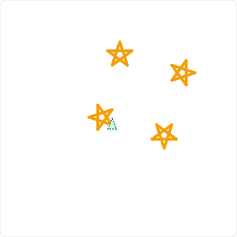
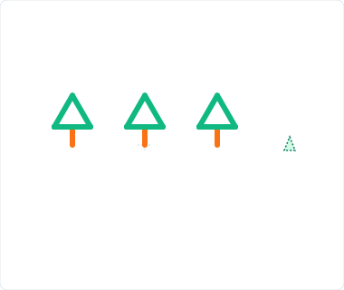
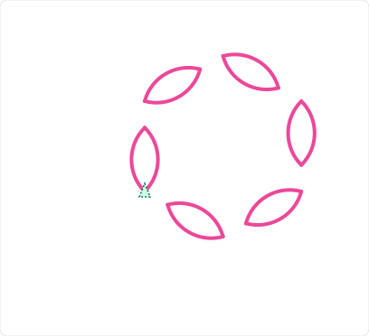
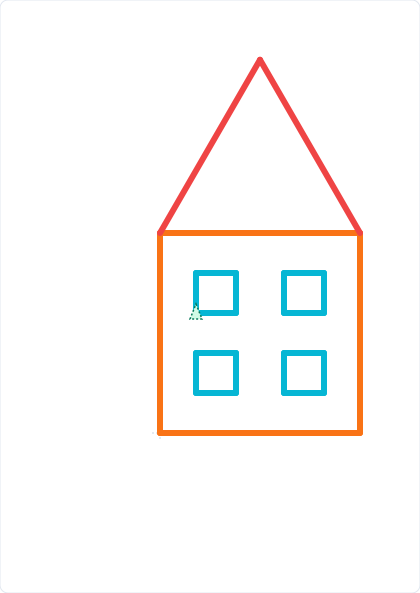
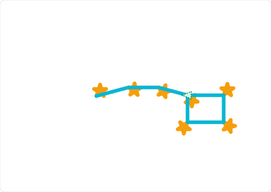

# func.2: Shape Stamps & State Hygiene

- **Header ID:** `func.2` (Legacy `4.2`)
- **Format:** 🎨 Creative
- **Environment:** [🐢 Turtle LOGO](../../envs/turtle_logo.md)
- **One-Concept Goal:** Build a reusable shape stamp in `F1` (star, pine tree, flower petal, window, or glowing constellation star) and practice **state hygiene** — every `F1` call leaves pen state (`PEN_UP`), heading, and caller color clean before returning to `Main`.

<details>
<summary>📖 Parent / Teacher Tip (Adult-Only <code>explanationText</code>)</summary>

A tidy stamp helper paints its shape, lifts its pen (`PEN_UP`), and turns back to its starting direction before returning to `Main`. That way, `Main` only worries about *where* to place the next star, tree, petal, window, or Big Dipper star! Notice how Variation 3 (*Glowing Big Dipper*) also restores the cyan line color inside `F1` before drawing the next star bridge.

</details>

---

## Learner UI & Platform Config

- **Learner-Facing Text:** `0` words (100% Zero-Reading Rule; Starter + 4 Variation Cards use visual thumbnail previews).
- **Enabled Scope Tabs (`allowedScopes`):** `["MAIN", "F1"]` (`F2`, `F3` hidden).
- **Allow Recursion (`allowRecursion`):** `false`
- **Palette:**
  - `allowedSimBlocks`: `["FORWARD", "BACKWARD", "TURN_LEFT", "TURN_RIGHT", "ARC_LEFT", "ARC_RIGHT", "PEN_UP", "PEN_DOWN", "SET_PEN_COLOR", "SET_PEN_WIDTH"]` *(strictly **NO `TELEPORT`**)*
  - `allowedControlBlocks`: `["LOOP_START", "LOOP_END", "CALL_FN"]` (`targets: ["F1"]`)
  - `allowedBlockParams`:
    - `FORWARD` / `BACKWARD`: `[10, 20, 25, 35, 38, 40, 44, 45, 50, 55, 60, 80, 85, 100]` *(with default `50` quick-tap)*
    - `TURN_LEFT` / `TURN_RIGHT`: `[15, 18, 30, 45, 60, 72, 75, 90, 120, 135, 144, 180, 210]`
    - `ARC_LEFT` / `ARC_RIGHT`: radii `[24, 25, 50, 75]`, sweeps `[90, 180, 270, 360]`
    - `SET_PEN_COLOR`: canonical 10-swatch indices `0..9` (`black, red, blue, green, amber, purple, pink, cyan, orange, white`)
    - `SET_PEN_WIDTH`: `[2, 3, 4, 6, 8]`
  - `allowRepeatBadges`: `false`
  - `allowActionParams`: `true` (visual parameter badges preserved)
- **Slot Trays:** Creative sandbox — soft visual caps only (Starter & Var 1 ≤ `14`/tab & `24` total; Var 2 ≤ `20`/tab & `40` total; Var 3 ≤ `30`/tab & `60` total).
- **UI Coach Spotlights (`uiSpotlights`):** `["state-hygiene-pen-up", "heading-restore-turn", "canvas-thumbnail-cards"]`
- **Turtle Start State:** `{ "x": 0, "y": 0, "heading": 0, "penDown": true, "penColor": "#0f172a", "penWidth": 6, "hideTurtle": false }`

---

## Starter & Variation Cards (Rendered & Verified SVGs)

### Starter Card: Starry Corners (`7 + 9 = 16` flat blocks)



- **State Hygiene Highlight:** `F1` turns `+18°`, stamps a 5-point amber star (`144° × 5`), lifts pen (`PEN_UP`), and turns `-18°` back so `Main`'s `90°` invisible square stays crisp!
- **Verified Render Metrics:** `finalPose: (0, 0, 0°)`, `penDown: false`, `pathCount: 20`.
- **`MAIN` (`7` flat blocks):**
  ```json
  [
    { "op": "SET_PEN_WIDTH", "width": 4 },
    { "op": "PEN_UP" },
    {
      "op": "LOOP_START",
      "count": 4,
      "body": [
        { "op": "FORWARD", "length": 85 },
        { "op": "CALL_FN", "fn": "F1" },
        { "op": "TURN_RIGHT", "angle": 90 }
      ]
    }
  ]
  ```
- **`F1` (`9` flat blocks):**
  ```json
  [
    { "op": "TURN_RIGHT", "angle": 18 },
    { "op": "SET_PEN_COLOR", "color": "amber" },
    { "op": "PEN_DOWN" },
    {
      "op": "LOOP_START",
      "count": 5,
      "body": [
        { "op": "FORWARD", "length": 35 },
        { "op": "TURN_RIGHT", "angle": 144 }
      ]
    },
    { "op": "PEN_UP" },
    { "op": "TURN_LEFT", "angle": 18 }
  ]
  ```

---

### Variation 1: Pine Forest (`10 + 14 = 24` flat blocks)



- **State Hygiene Highlight:** `F1` paints an orange trunk and green triangle canopy, then drops straight back to ground level (`(x, 0, 0°)`) with `PEN_UP` so `Main` marches cleanly `80px` East to the next tree!
- **Verified Render Metrics:** `finalPose: (160, 0, 0°)`, `penDown: false`, `pathCount: 18`.
- **`MAIN` (`10` flat blocks):**
  ```json
  [
    { "op": "PEN_UP" },
    { "op": "TURN_LEFT", "angle": 90 },
    { "op": "FORWARD", "length": 80 },
    { "op": "TURN_RIGHT", "angle": 90 },
    {
      "op": "LOOP_START",
      "count": 3,
      "body": [
        { "op": "CALL_FN", "fn": "F1" },
        { "op": "TURN_RIGHT", "angle": 90 },
        { "op": "FORWARD", "length": 80 },
        { "op": "TURN_LEFT", "angle": 90 }
      ]
    }
  ]
  ```
- **`F1` (`14` flat blocks):**
  ```json
  [
    { "op": "SET_PEN_COLOR", "color": "orange" },
    { "op": "PEN_DOWN" },
    { "op": "FORWARD", "length": 20 },
    { "op": "SET_PEN_COLOR", "color": "green" },
    { "op": "TURN_RIGHT", "angle": 90 },
    { "op": "BACKWARD", "length": 20 },
    {
      "op": "LOOP_START",
      "count": 3,
      "body": [
        { "op": "FORWARD", "length": 40 },
        { "op": "TURN_LEFT", "angle": 120 }
      ]
    },
    { "op": "FORWARD", "length": 20 },
    { "op": "TURN_LEFT", "angle": 90 },
    { "op": "PEN_UP" },
    { "op": "BACKWARD", "length": 20 }
  ]
  ```

---

### Variation 2: Petal Crown Ring (`7 + 9 = 16` flat blocks)



- **State Hygiene Highlight:** `F1` tilts `+15°`, arcs an almond pink petal (`ARC_RIGHT 24, 90°` × 2), lifts the pen, and counter-tilts `-15°` so six petals bloom around a symmetric hexagon!
- **Verified Render Metrics:** `finalPose: (0, 0, 0°)`, `penDown: false`, `pathCount: 12`.
- **`MAIN` (`7` flat blocks):**
  ```json
  [
    { "op": "SET_PEN_WIDTH", "width": 4 },
    { "op": "PEN_UP" },
    {
      "op": "LOOP_START",
      "count": 6,
      "body": [
        { "op": "FORWARD", "length": 60 },
        { "op": "CALL_FN", "fn": "F1" },
        { "op": "TURN_RIGHT", "angle": 60 }
      ]
    }
  ]
  ```
- **`F1` (`9` flat blocks):**
  ```json
  [
    { "op": "TURN_RIGHT", "angle": 15 },
    { "op": "SET_PEN_COLOR", "color": "pink" },
    { "op": "PEN_DOWN" },
    { "op": "ARC_RIGHT", "radius": 24, "angle": 90 },
    { "op": "TURN_RIGHT", "angle": 90 },
    { "op": "ARC_RIGHT", "radius": 24, "angle": 90 },
    { "op": "TURN_RIGHT", "angle": 90 },
    { "op": "PEN_UP" },
    { "op": "TURN_LEFT", "angle": 15 }
  ]
  ```

---

### Variation 3A: Cozy Cottage (4 Windows) (`28 + 7 = 35` flat blocks)



- **State Hygiene Highlight:** `Main` paints the orange walls and red roof, then hops inside to stamp four `20 × 20` cyan windows with `F1` (`PEN_UP` at end keeps travel lines clean).
- **Verified Render Metrics:** `finalPose: (18, -60, 0°)`, `penDown: false`, `pathCount: 22`.
- **`MAIN` (`28` flat blocks):**
  ```json
  [
    { "op": "SET_PEN_COLOR", "color": "orange" },
    {
      "op": "LOOP_START",
      "count": 4,
      "body": [
        { "op": "FORWARD", "length": 100 },
        { "op": "TURN_RIGHT", "angle": 90 }
      ]
    },
    { "op": "PEN_UP" },
    { "op": "FORWARD", "length": 100 },
    { "op": "SET_PEN_COLOR", "color": "red" },
    { "op": "PEN_DOWN" },
    { "op": "TURN_RIGHT", "angle": 30 },
    { "op": "FORWARD", "length": 100 },
    { "op": "TURN_RIGHT", "angle": 120 },
    { "op": "FORWARD", "length": 100 },
    { "op": "TURN_RIGHT", "angle": 210 },
    { "op": "PEN_UP" },
    { "op": "BACKWARD", "length": 40 },
    { "op": "TURN_LEFT", "angle": 90 },
    { "op": "FORWARD", "length": 38 },
    { "op": "TURN_RIGHT", "angle": 90 },
    { "op": "CALL_FN", "fn": "F1" },
    { "op": "BACKWARD", "length": 40 },
    { "op": "CALL_FN", "fn": "F1" },
    { "op": "TURN_LEFT", "angle": 90 },
    { "op": "FORWARD", "length": 44 },
    { "op": "TURN_RIGHT", "angle": 90 },
    { "op": "CALL_FN", "fn": "F1" },
    { "op": "FORWARD", "length": 40 },
    { "op": "CALL_FN", "fn": "F1" }
  ]
  ```
- **`F1` (`7` flat blocks):**
  ```json
  [
    { "op": "SET_PEN_COLOR", "color": "cyan" },
    { "op": "PEN_DOWN" },
    {
      "op": "LOOP_START",
      "count": 4,
      "body": [
        { "op": "FORWARD", "length": 20 },
        { "op": "TURN_RIGHT", "angle": 90 }
      ]
    },
    { "op": "PEN_UP" }
  ]
  ```

---

### Variation 3B: Glowing Big Dipper (7 Stars) (`30 + 10 = 40` flat blocks)



- **State Hygiene Highlight:** `F1` demonstrates **3-way state hygiene**: after switching to `"amber"` for each star and tilting `+18°`, `F1` lifts the pen (`PEN_UP`), restores `"cyan"`, and counter-tilts `-18°` so `Main`'s sky-line constellation connects all 7 stars and closes cleanly back on Star #4!
- **Verified Render Metrics:** `finalPose: (151.4222, -1.294, 270°)`, `penDown: false`, `pathCount: 42`.
- **`MAIN` (`30` flat blocks):**
  ```json
  [
    { "op": "SET_PEN_COLOR", "color": "cyan" },
    { "op": "CALL_FN", "fn": "F1" },
    { "op": "PEN_DOWN" },
    { "op": "TURN_RIGHT", "angle": 75 },
    { "op": "FORWARD", "length": 55 },
    { "op": "CALL_FN", "fn": "F1" },
    { "op": "PEN_DOWN" },
    { "op": "TURN_RIGHT", "angle": 15 },
    { "op": "FORWARD", "length": 50 },
    { "op": "CALL_FN", "fn": "F1" },
    { "op": "PEN_DOWN" },
    { "op": "TURN_RIGHT", "angle": 15 },
    { "op": "FORWARD", "length": 50 },
    { "op": "CALL_FN", "fn": "F1" },
    { "op": "PEN_DOWN" },
    { "op": "TURN_RIGHT", "angle": 75 },
    { "op": "FORWARD", "length": 45 },
    { "op": "CALL_FN", "fn": "F1" },
    { "op": "PEN_DOWN" },
    { "op": "TURN_LEFT", "angle": 90 },
    { "op": "FORWARD", "length": 60 },
    { "op": "CALL_FN", "fn": "F1" },
    { "op": "PEN_DOWN" },
    { "op": "TURN_LEFT", "angle": 90 },
    { "op": "FORWARD", "length": 45 },
    { "op": "CALL_FN", "fn": "F1" },
    { "op": "PEN_DOWN" },
    { "op": "TURN_LEFT", "angle": 90 },
    { "op": "FORWARD", "length": 60 },
    { "op": "PEN_UP" }
  ]
  ```
- **`F1` (`10` flat blocks):**
  ```json
  [
    { "op": "TURN_RIGHT", "angle": 18 },
    { "op": "SET_PEN_COLOR", "color": "amber" },
    { "op": "PEN_DOWN" },
    {
      "op": "LOOP_START",
      "count": 5,
      "body": [
        { "op": "FORWARD", "length": 20 },
        { "op": "TURN_RIGHT", "angle": 144 }
      ]
    },
    { "op": "PEN_UP" },
    { "op": "SET_PEN_COLOR", "color": "cyan" },
    { "op": "TURN_LEFT", "angle": 18 }
  ]
  ```

---

## Edge Cases & Acceptance Criteria
- **Zero `TELEPORT`:** Verified across Starter and all 4 Variations (`0` occurrences).
- **SVG Integrity Check:** All 5 `.svg` assets exist under `./svg/func2_*.svg`, end with `penDown: false`, contain zero `<animate>` tags, and use canonical 10-swatch colors.
- **No Self-Recursion:** Calling `F1` from inside `F1` is disallowed (`allowRecursion: false`).
