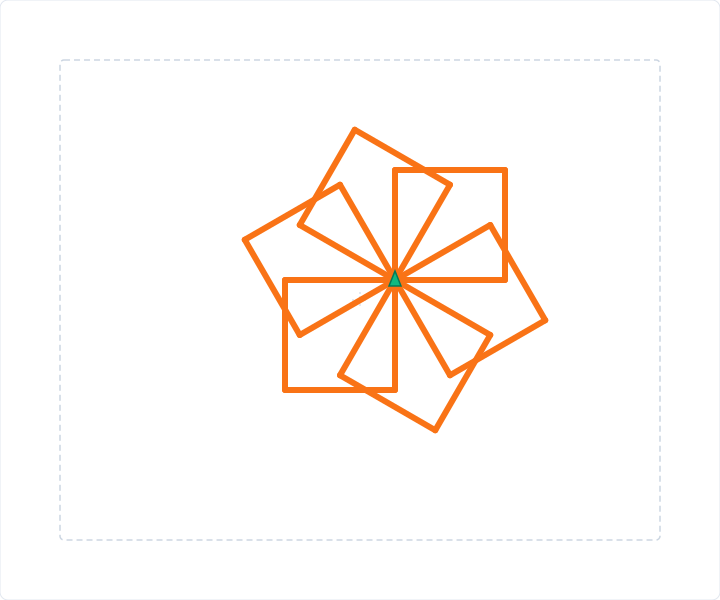
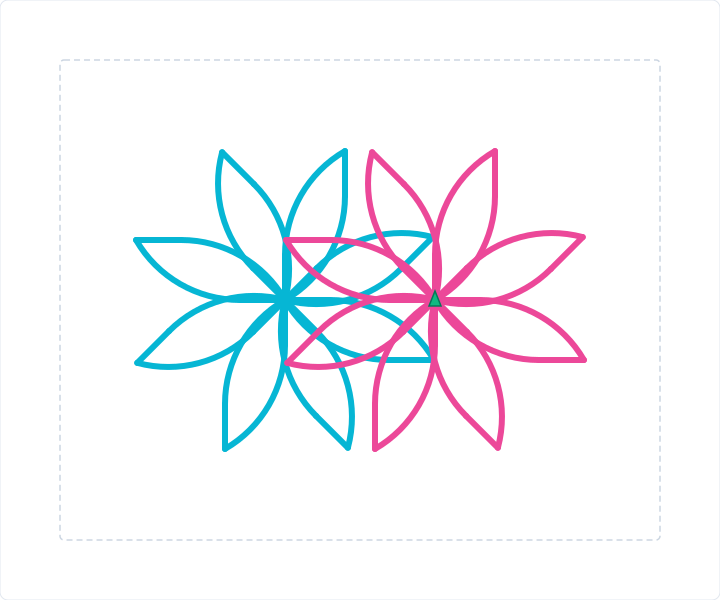
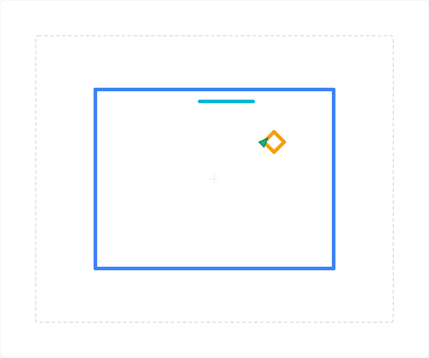
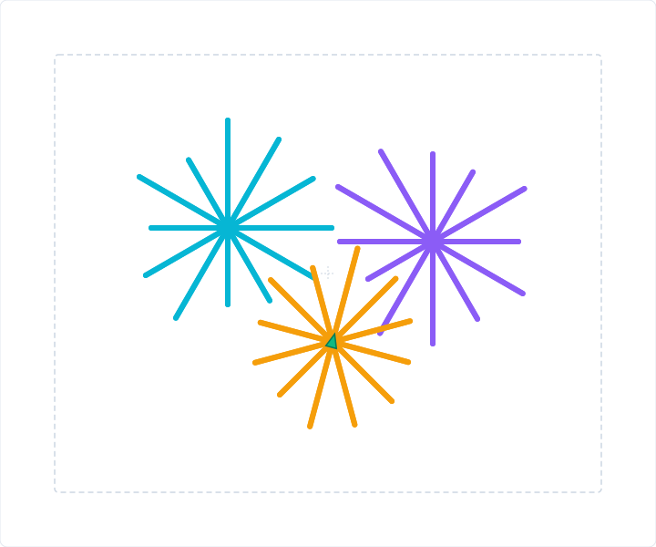

# Capstone `inter.B`: Interactive Kaleidoscope & Arcade (`🐢` `♾️ Live Mode`)

- **Type:** `🏆` Capstone Challenge (Part 2 of 2 — unlocks **`🔥 Mastery Set inter`** & **`🕹️ inter` Badge**)
- **Previous:** [`inter.A` Capstone A: Playable Arcade & Mega-Synth](./capstone_inter_a_playable_arcade_and_synth.md) | **Next:** [Module `inter` Overview](./overview.md)

| Metadata | Value |
|---|---|
| Environment & Mode | `🐢` Turtle LOGO (`mode: 2` `♾️ Live Interactive Mode`) |
| Skills Combined | Pointer Tracking (`$pointerX`, `$pointerY`), D-Pad Variable Morphing, Functions (`F1`, `F2`), 3-Address Geometry & Pong Physics |
| Visual Previews | [`inter_b_starter.svg`](svg/inter_b_starter.svg) (`301×301`), [`inter_b_var1.svg`](svg/inter_b_var1.svg) (`448×298`), [`inter_b_var2.svg`](svg/inter_b_var2.svg) (`400×300`), [`inter_b_var3.svg`](svg/inter_b_var3.svg) (`422×336`) |
| Flat Block Budget | Starter: `20` \| Var 1: `23` \| Var 2: `34` \| Var 3: `14` (`slotCap: 38`) |

---

## 1. Starter — Live Pointer-Tracking Polygon Kaleidoscope (`20` flat blocks, `🧹 Clear: ON`)

> **Guided Co-Pilot Card (Read-Aloud, <= 2 sentences):**  
> Slide your finger to carry a spinning geometric star (`110px` petals), and tap **`⬅️`** / **`➡️`** to morph its arms live between `3` and `12`! Press **`[🅰️]`** to spark fresh colors.

<details>
<summary>📖 Parent / Teacher Tip</summary>

With `🧹 Clear Between Frames` **`true`**, the whole kaleidoscope tracks `($pointerX, $pointerY)` smoothly while `ON_KEY_LEFT`/`ON_KEY_RIGHT` adjust arm count `n` and compute `a = 360 / n`. Encourage creative remixes (`Edit Delta <= 10`): change `F1` into triangles or stars, or switch `🧹 Clear` **OFF** to drag rainbow ribbons!

</details>



```json
{
  "env": "turtle",
  "mode": 2,
  "clearBetweenFrames": true,
  "slotCap": 24,
  "MAIN": [
    {
      "op": "IF",
      "cond": { "op": "CMP", "operator": "<", "left": "n", "right": 3 },
      "then": [{ "op": "VAR_ASSIGN", "var": "n", "value": 6 }]
    },
    { "op": "TELEPORT", "x": "$pointerX", "y": "$pointerY", "heading": 0 },
    { "op": "VAR_OP", "target": "a", "left": 360, "operator": "/", "right": "n" },
    {
      "op": "LOOP_START",
      "count": "n",
      "body": [
        { "op": "CALL_FN", "fn": "F1" },
        { "op": "TURN_RIGHT", "angle": "a" }
      ]
    }
  ],
  "F1": [
    {
      "op": "LOOP_START",
      "count": 4,
      "body": [
        { "op": "FORWARD", "length": 110 },
        { "op": "TURN_RIGHT", "angle": 90 }
      ]
    }
  ],
  "ON_KEY_LEFT": [
    {
      "op": "IF",
      "cond": { "op": "CMP", "operator": ">", "left": "n", "right": 3 },
      "then": [{ "op": "VAR_OP", "target": "n", "left": "n", "operator": "-", "right": 1 }]
    }
  ],
  "ON_KEY_RIGHT": [
    {
      "op": "IF",
      "cond": { "op": "CMP", "operator": "<", "left": "n", "right": 12 },
      "then": [{ "op": "VAR_OP", "target": "n", "left": "n", "operator": "+", "right": 1 }]
    }
  ],
  "ON_KEY_A": [
    { "op": "SET_PEN_COLOR", "color": "$randomColor" }
  ]
}
```

---

## 2. Variation Cards (`🎨` Pick & Remix!)

### Variation 1 — Tap-to-Bloom Spirograph Composer (`23` flat blocks, `🧹 Clear: OFF`)
**Kid Idea:** Switch to `ON_TAP` (`0x40`) with `🧹 Clear: OFF`! Every tap plants a custom lotus bloom built from **`s = 45px`** stems and **`r = 120px`** curved arcs, while **`⬅️`** / **`➡️`** sets petals (`3..12`), **`[🅰️]`** randomizes ink, and **`[🅱️]`** clears! *(Span: `448×298`, `inkMaxSpan: 448px`.)*



```json
{
  "env": "turtle",
  "mode": 2,
  "clearBetweenFrames": false,
  "slotCap": 26,
  "MAIN": [],
  "F1": [
    { "op": "FORWARD", "length": 45 },
    { "op": "ARC_RIGHT", "radius": 120, "angle": 60 },
    { "op": "TURN_RIGHT", "angle": 120 },
    { "op": "FORWARD", "length": 45 },
    { "op": "ARC_RIGHT", "radius": 120, "angle": 60 },
    { "op": "TURN_RIGHT", "angle": 120 }
  ],
  "ON_TAP": [
    {
      "op": "IF",
      "cond": { "op": "CMP", "operator": "<", "left": "n", "right": 3 },
      "then": [{ "op": "VAR_ASSIGN", "var": "n", "value": 8 }]
    },
    { "op": "TELEPORT", "x": "$pointerX", "y": "$pointerY", "heading": 0 },
    { "op": "VAR_OP", "target": "a", "left": 360, "operator": "/", "right": "n" },
    {
      "op": "LOOP_START",
      "count": "n",
      "body": [
        { "op": "CALL_FN", "fn": "F1" },
        { "op": "TURN_RIGHT", "angle": "a" }
      ]
    }
  ],
  "ON_KEY_LEFT": [
    {
      "op": "IF",
      "cond": { "op": "CMP", "operator": ">", "left": "n", "right": 3 },
      "then": [{ "op": "VAR_OP", "target": "n", "left": "n", "operator": "-", "right": 1 }]
    }
  ],
  "ON_KEY_RIGHT": [
    {
      "op": "IF",
      "cond": { "op": "CMP", "operator": "<", "left": "n", "right": 12 },
      "then": [{ "op": "VAR_OP", "target": "n", "left": "n", "operator": "+", "right": 1 }]
    }
  ],
  "ON_KEY_A": [
    { "op": "SET_PEN_COLOR", "color": "$randomColor" }
  ],
  "ON_KEY_B": [
    { "op": "CLEAR_CANVAS" }
  ]
}
```

### Variation 2 — Interactive Turtle Pong Arena (`34` flat blocks, `🧹 Clear: ON`)
**Kid Idea:** Draw a crisp **`400×300`** blue court (`F1`), slide your cyan `90px` paddle left/right with your finger (`l = 👆X - 45`), and bounce a yellow `24px` ball `(x, y)` with velocity `(u, v)` off every wall! *(Span: `400×300`, `inkMaxSpan: 400px`.)*



```json
{
  "env": "turtle",
  "mode": 2,
  "clearBetweenFrames": true,
  "initialVars": { "x": 35, "y": -20, "u": 16, "v": -14 },
  "slotCap": 38,
  "MAIN": [
    { "op": "VAR_OP", "target": "x", "left": "x", "operator": "+", "right": "u" },
    { "op": "VAR_OP", "target": "y", "left": "y", "operator": "+", "right": "v" },
    {
      "op": "IF",
      "cond": { "op": "CMP", "operator": ">", "left": "x", "right": 180 },
      "then": [{ "op": "VAR_OP", "target": "u", "left": 0, "operator": "-", "right": "u" }]
    },
    {
      "op": "IF",
      "cond": { "op": "CMP", "operator": "<", "left": "x", "right": -180 },
      "then": [{ "op": "VAR_OP", "target": "u", "left": 0, "operator": "-", "right": "u" }]
    },
    {
      "op": "IF",
      "cond": { "op": "CMP", "operator": ">", "left": "y", "right": 130 },
      "then": [{ "op": "VAR_OP", "target": "v", "left": 0, "operator": "-", "right": "v" }]
    },
    {
      "op": "IF",
      "cond": { "op": "CMP", "operator": "<", "left": "y", "right": -110 },
      "then": [{ "op": "VAR_OP", "target": "v", "left": 0, "operator": "-", "right": "v" }]
    },
    { "op": "CALL_FN", "fn": "F1" },
    { "op": "VAR_OP", "target": "l", "left": "$pointerX", "operator": "-", "right": 45 },
    { "op": "SET_PEN_COLOR", "color": "cyan" },
    { "op": "TELEPORT", "x": "l", "y": -130, "heading": 90 },
    { "op": "FORWARD", "length": 90 },
    { "op": "SET_PEN_COLOR", "color": "yellow" },
    { "op": "TELEPORT", "x": "x", "y": "y", "heading": 45 },
    { "op": "CALL_FN", "fn": "F2" }
  ],
  "F1": [
    { "op": "SET_PEN_COLOR", "color": "blue" },
    { "op": "TELEPORT", "x": -200, "y": -150, "heading": 90 },
    {
      "op": "LOOP_START",
      "count": 2,
      "body": [
        { "op": "FORWARD", "length": 400 },
        { "op": "TURN_RIGHT", "angle": 90 },
        { "op": "FORWARD", "length": 300 },
        { "op": "TURN_RIGHT", "angle": 90 }
      ]
    }
  ],
  "F2": [
    {
      "op": "LOOP_START",
      "count": 4,
      "body": [
        { "op": "FORWARD", "length": 24 },
        { "op": "TURN_RIGHT", "angle": 90 }
      ]
    }
  ]
}
```

### Variation 3 — Interactive Random-Ray Fireworks Painter (`14` flat blocks, `🧹 Clear: OFF`)
**Kid Idea:** Tap anywhere (`ON_TAP`) or launch rotated `[🅰️]` bursts (`ON_KEY_A`) using 3-address `r = $randD20 * 2; r = r + 80` randomized starburst spikes (`82..120px`), then press `[🅱️]` for a dark night sky reset! *(Span: `422×336`, `inkMaxSpan: 422px`.)*



```json
{
  "env": "turtle",
  "mode": 2,
  "clearBetweenFrames": false,
  "slotCap": 16,
  "MAIN": [],
  "F1": [
    {
      "op": "LOOP_START",
      "count": 12,
      "body": [
        { "op": "VAR_OP", "target": "r", "left": "$randD20", "operator": "*", "right": 2 },
        { "op": "VAR_OP", "target": "r", "left": "r", "operator": "+", "right": 80 },
        { "op": "FORWARD", "length": "r" },
        { "op": "BACKWARD", "length": "r" },
        { "op": "TURN_RIGHT", "angle": 30 }
      ]
    }
  ],
  "ON_TAP": [
    { "op": "TELEPORT", "x": "$pointerX", "y": "$pointerY", "heading": 0 },
    { "op": "SET_PEN_COLOR", "color": "$randomColor" },
    { "op": "CALL_FN", "fn": "F1" }
  ],
  "ON_KEY_A": [
    { "op": "TELEPORT", "x": "$pointerX", "y": "$pointerY", "heading": 15 },
    { "op": "SET_PEN_COLOR", "color": "$randomColor" },
    { "op": "CALL_FN", "fn": "F1" }
  ],
  "ON_KEY_B": [
    { "op": "CLEAR_CANVAS" }
  ]
}
```
