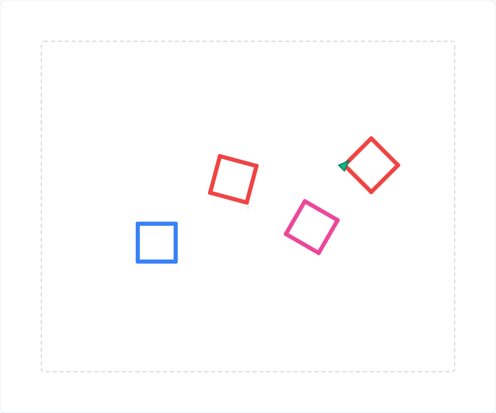
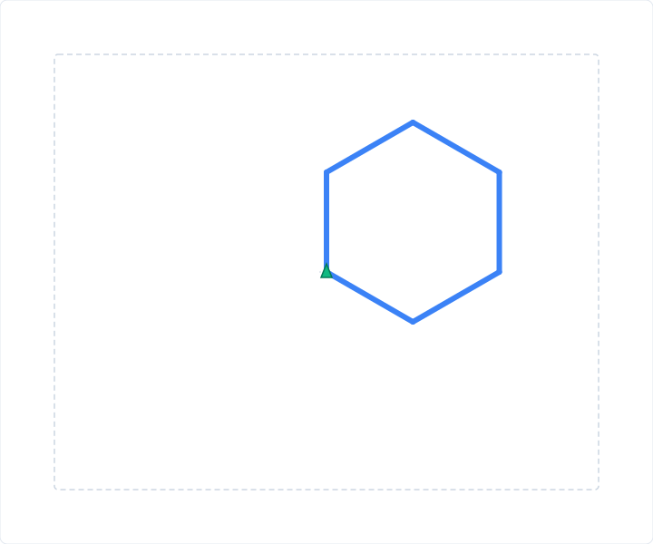

# Lesson `inter.5`: Live Interactive Turtle (`🐢` Turtle LOGO `♾️ Live Mode`)

- **Type:** `📖` Explanation & Guided Demo
- **Previous:** [`inter.4` Hold & Drag Sparkle Pad](./lesson_inter_4_hold_and_drag_sparkle_pad.md) | **Next:** [`inter.6` Turtle Finger Brush & D-Pad Sketcher](./lesson_inter_6_turtle_finger_brush_and_dpad_sketcher.md)

| Metadata | Value |
|---|---|
| Environment & Mode | `🐢` Turtle LOGO (**`mode: 2` — `♾️ Live Interactive Mode`**) |
| Key UI Features | Conditional **`👆 X, Y`** readout pill, **`🧹 Clear Between Frames [ON/OFF]`**, Bottom-Dock D-Pad / `[🅱️]` |
| Visual Previews | Static Stage-2 SVGs: [`inter_5_demo1.svg`](svg/inter_5_demo1.svg) (`378×179`), [`inter_5_demo2.svg`](svg/inter_5_demo2.svg) (`191×220`) |
| Flat Block Budget | Demo 1: `11` \| Demo 2: `15` \| Guided Try-It: `15` (`slotCap: 18`) |

---

## 1. Visual Concept Card (`♾️ Live Mode` & `🧹 Clear Between Frames`)

> **Guided Co-Pilot Card (Read-Aloud, <= 2 sentences):**  
> Turn on **`♾️ Live Mode`** so the turtle keeps listening to your finger and D-Pad every single frame! Flip **`🧹 Clear Between Frames`** **OFF** to leave colorful stamp trails, or **ON** to morph a glowing live shape.

<details>
<summary>📖 Parent / Teacher Tip</summary>

In LOGO `♾️ Live Interactive Mode` (`mode: 2`):
- **Single-finger touch/drag** updates **`$pointerX` (`0x93`)**, **`$pointerY` (`0x94`)**, and **`$pointerDown` (`0x95`)** in canvas coordinates (origin `(0, 0)` at center), while two-finger pinch/pan zooms the viewport.
- **`🧹 Clear Between Frames [OFF]`** acts like an arcade stamp canvas (Demo 1), whereas **`🧹 Clear Between Frames [ON]`** automatically erases each prior frame before `MAIN` ticks (Demo 2) — enabling crisp live polygon sliders!

</details>

---

## 2. Walkthrough Demos (`📖` Two Step-by-Step Examples)

### Demo 1 — Drag & Spin Stamp Brush (`11` flat blocks, `🧹 Clear: OFF`)



Dragging across the canvas teleports the turtle (`TELEPORT [$pointerX, $pointerY, a]`), calls **`F1`** to paint a `55px` random-color square, and spins `a = a + 15` degrees each tick. Press **`[🅱️]`** to clear the art canvas. *(Rendered span: `378×179`, `inkMaxSpan: 378px`.)*

```text
// MAIN (0x00) [mode: live, clearBetweenFrames: false]
IF $pointerDown
  TELEPORT [$pointerX, $pointerY, a]
  CALL F1
  a = a + 15
END_IF

// F1 (0x81)
SET_PEN_COLOR [$randomColor]
LOOP 4
  FORWARD [55]
  TURN_RIGHT [90]
END_LOOP

// ON_KEY_B (0x46)
CLEAR_CANVAS
```

```json
{
  "env": "turtle",
  "mode": 2,
  "clearBetweenFrames": false,
  "slotCap": 14,
  "MAIN": [
    {
      "op": "IF",
      "cond": { "op": "SENSOR", "sensor": "$pointerDown" },
      "then": [
        { "op": "TELEPORT", "x": "$pointerX", "y": "$pointerY", "heading": "a" },
        { "op": "CALL_FN", "fn": "F1" },
        { "op": "VAR_OP", "target": "a", "left": "a", "operator": "+", "right": 15 }
      ]
    }
  ],
  "F1": [
    { "op": "SET_PEN_COLOR", "color": "$randomColor" },
    {
      "op": "LOOP_START",
      "count": 4,
      "body": [
        { "op": "FORWARD", "length": 55 },
        { "op": "TURN_RIGHT", "angle": 90 }
      ]
    }
  ],
  "ON_KEY_B": [
    { "op": "CLEAR_CANVAS" }
  ]
}
```

### Demo 2 — Live D-Pad Polygon Morpher (`15` flat blocks, `🧹 Clear: ON`)



Because `🧹 Clear Between Frames` is **ON**, tapping **`⬅️`** or **`➡️`** morphs the `110px`-side polygon live between a triangle (`n = 3`) and a dodecagon (`n = 12`) using `a = 360 / n`! Notice the safe zero-init guard `IF n < 3 THEN n = 6` so division by zero never happens on frame 1. *(Rendered span: `191×220`, `inkMaxSpan: 220px`.)*

```text
// MAIN (0x00) [mode: live, clearBetweenFrames: true]
IF n < 3
  n = 6
END_IF
a = 360 / n
SET_PEN_COLOR [blue]
LOOP n
  FORWARD [110]
  TURN_RIGHT [a]
END_LOOP

// ON_KEY_LEFT (0x43)
IF n > 3
  n = n - 1
END_IF

// ON_KEY_RIGHT (0x44)
IF n < 12
  n = n + 1
END_IF
```

```json
{
  "env": "turtle",
  "mode": 2,
  "clearBetweenFrames": true,
  "slotCap": 18,
  "MAIN": [
    {
      "op": "IF",
      "cond": { "op": "CMP", "operator": "<", "left": "n", "right": 3 },
      "then": [{ "op": "VAR_ASSIGN", "var": "n", "value": 6 }]
    },
    { "op": "VAR_OP", "target": "a", "left": 360, "operator": "/", "right": "n" },
    { "op": "SET_PEN_COLOR", "color": "blue" },
    {
      "op": "LOOP_START",
      "count": "n",
      "body": [
        { "op": "FORWARD", "length": 110 },
        { "op": "TURN_RIGHT", "angle": "a" }
      ]
    }
  ],
  "ON_KEY_LEFT": [
    {
      "op": "IF",
      "cond": { "op": "CMP", "operator": ">", "left": "n", "right": 3 },
      "then": [{ "op": "VAR_OP", "target": "n", "left": "n", "operator": "-", "right": 1 }]
    }
  ],
  "ON_KEY_RIGHT": [
    {
      "op": "IF",
      "cond": { "op": "CMP", "operator": "<", "left": "n", "right": 12 },
      "then": [{ "op": "VAR_OP", "target": "n", "left": "n", "operator": "+", "right": 1 }]
    }
  ]
}
```

---

## 3. Guided Hands-On Try-It (`🎯` Add `[🅰️]` Color Wheel to Live Polygons)

> **Guided Co-Pilot Card (Read-Aloud, <= 2 sentences):**  
> Tap **`⬅️`** and **`➡️`** to morph your live shape's corners, then open **`🅰️`** and drop **`🎨 Random`** so every button tap repaints your polygon! Remove the fixed `blue` color inside **`▶️`** if your random paint gets overwritten.

### Challenge & Palette Spec (`Edit Delta: 2` — remove fixed `blue` in `MAIN`, add `SET_LED/PEN_COLOR [$randomColor]` in `ON_KEY_A`)

```json
{
  "env": "turtle",
  "mode": 2,
  "clearBetweenFrames": true,
  "allowedTabs": ["MAIN", "ON_KEY_LEFT", "ON_KEY_RIGHT", "ON_KEY_A"],
  "allowedSimBlocks": [
    "IF",
    "CMP",
    "VAR_ASSIGN",
    "VAR_OP",
    "LOOP_START",
    "FORWARD",
    "TURN_RIGHT",
    "SET_PEN_COLOR"
  ],
  "slotCap": 18,
  "initial": {
    "MAIN": [
      {
        "op": "IF",
        "cond": { "op": "CMP", "operator": "<", "left": "n", "right": 3 },
        "then": [{ "op": "VAR_ASSIGN", "var": "n", "value": 6 }]
      },
      { "op": "VAR_OP", "target": "a", "left": 360, "operator": "/", "right": "n" },
      { "op": "SET_PEN_COLOR", "color": "blue" },
      {
        "op": "LOOP_START",
        "count": "n",
        "body": [
          { "op": "FORWARD", "length": 110 },
          { "op": "TURN_RIGHT", "angle": "a" }
        ]
      }
    ],
    "ON_KEY_LEFT": [
      {
        "op": "IF",
        "cond": { "op": "CMP", "operator": ">", "left": "n", "right": 3 },
        "then": [{ "op": "VAR_OP", "target": "n", "left": "n", "operator": "-", "right": 1 }]
      }
    ],
    "ON_KEY_RIGHT": [
      {
        "op": "IF",
        "cond": { "op": "CMP", "operator": "<", "left": "n", "right": 12 },
        "then": [{ "op": "VAR_OP", "target": "n", "left": "n", "operator": "+", "right": 1 }]
      }
    ],
    "ON_KEY_A": []
  },
  "solution": {
    "MAIN": [
      {
        "op": "IF",
        "cond": { "op": "CMP", "operator": "<", "left": "n", "right": 3 },
        "then": [{ "op": "VAR_ASSIGN", "var": "n", "value": 6 }]
      },
      { "op": "VAR_OP", "target": "a", "left": 360, "operator": "/", "right": "n" },
      {
        "op": "LOOP_START",
        "count": "n",
        "body": [
          { "op": "FORWARD", "length": 110 },
          { "op": "TURN_RIGHT", "angle": "a" }
        ]
      }
    ],
    "ON_KEY_LEFT": [
      {
        "op": "IF",
        "cond": { "op": "CMP", "operator": ">", "left": "n", "right": 3 },
        "then": [{ "op": "VAR_OP", "target": "n", "left": "n", "operator": "-", "right": 1 }]
      }
    ],
    "ON_KEY_RIGHT": [
      {
        "op": "IF",
        "cond": { "op": "CMP", "operator": "<", "left": "n", "right": 12 },
        "then": [{ "op": "VAR_OP", "target": "n", "left": "n", "operator": "+", "right": 1 }]
      }
    ],
    "ON_KEY_A": [
      { "op": "SET_PEN_COLOR", "color": "$randomColor" }
    ]
  }
}
```

### Verification Checklist
- [ ] **Live Morphing:** Starting polygon is a hexagon (`n = 6`); `⬅️` reduces sides down to triangle (`3`), `➡️` increases up to `12`.
- [ ] **No Color Reset:** Removing `SET_PEN_COLOR [blue]` in `MAIN` lets `[🅰️]` change the pen color persistently (`15` flat blocks `<= slotCap 18`).
