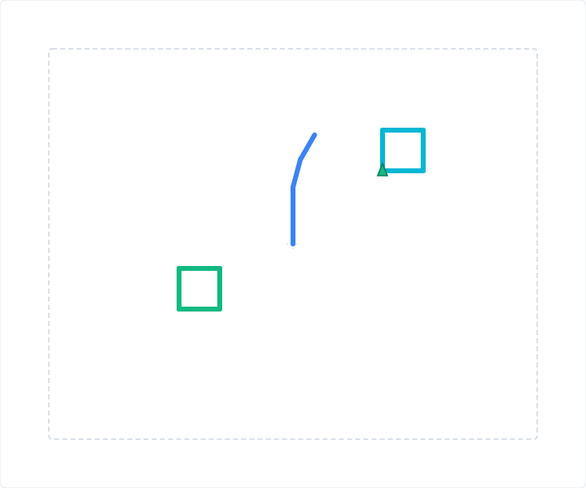
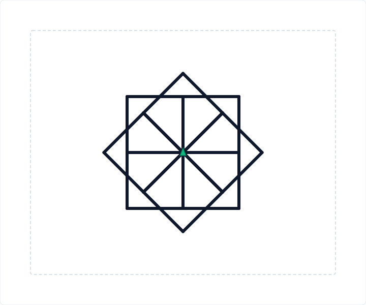
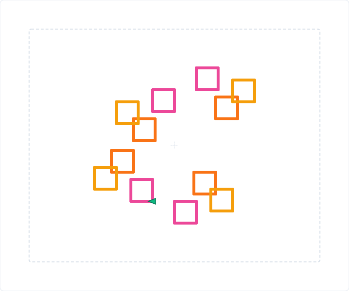
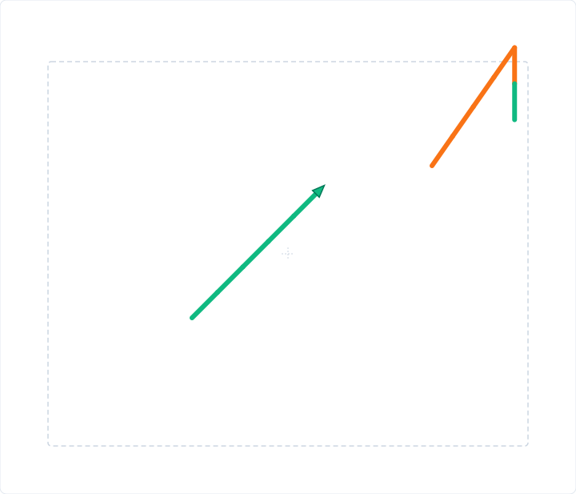

# Lesson `inter.6`: Turtle Finger Brush & D-Pad Sketcher (`🐢` `♾️ Live Mode`)

- **Type:** `🎨` Creative Sandbox
- **Previous:** [`inter.5` Live Interactive Turtle](./lesson_inter_5_live_interactive_turtle.md) | **Next:** [`inter.7` Fix-It: Broken Interactive Toy](./lesson_inter_7_fix_broken_interactive_toy.md)

| Metadata | Value |
|---|---|
| Environment & Mode | `🐢` Turtle LOGO (`mode: 2` `♾️ Live Mode`) |
| Key Concepts | Continuous **`0x2E keyHeld(UP/LEFT/RIGHT)`** steering, live mandala sizing, 4-quadrant symmetric finger stamping, `NOT insideCanvas` wall bounce |
| Visual Previews | [`inter_6_starter.svg`](svg/inter_6_starter.svg) (`300×220`), [`inter_6_var1.svg`](svg/inter_6_var1.svg) (`311×311`), [`inter_6_var2.svg`](svg/inter_6_var2.svg) (`330×320`), [`inter_6_var3.svg`](svg/inter_6_var3.svg) (`403×337`) |
| Flat Block Budget | Starter: `20` \| Var 1: `18` \| Var 2: `18` \| Var 3: `10` (`slotCap: 24`) |

---

## 1. Starter — Smooth `keyHeld` RC Turtle + Finger Stamp (`20` flat blocks, `🧹 Clear: OFF`)

> **Guided Co-Pilot Card (Read-Aloud, <= 2 sentences):**  
> Hold **`⬆️`**, **`⬅️`**, or **`➡️`** to drive the turtle smoothly like a remote-control car, or tap anywhere on the canvas to drop a **`50px`** square stamp! Press **`[🅰️]`** for fresh rainbow ink and **`[🅱️]`** to reset home.

<details>
<summary>📖 Parent / Teacher Tip</summary>

Here `MAIN` introduces **`0x2E keyHeld`** conditions (`UP` moves forward `35px`, `LEFT`/`RIGHT` steer `15°`) right beside `$pointerDown` click-stamps (`F1`). Because `keyHeld` lives inside `ConditionExpr` inside `MAIN`, **holding** two buttons at once (e.g., `UP` + `RIGHT`) curves smoothly!

</details>



```json
{
  "env": "turtle",
  "mode": 2,
  "clearBetweenFrames": false,
  "slotCap": 24,
  "MAIN": [
    {
      "op": "IF",
      "cond": { "op": "SENSOR", "sensor": "keyHeld", "key": "UP" },
      "then": [{ "op": "FORWARD", "length": 35 }]
    },
    {
      "op": "IF",
      "cond": { "op": "SENSOR", "sensor": "keyHeld", "key": "LEFT" },
      "then": [{ "op": "TURN_LEFT", "angle": 15 }]
    },
    {
      "op": "IF",
      "cond": { "op": "SENSOR", "sensor": "keyHeld", "key": "RIGHT" },
      "then": [{ "op": "TURN_RIGHT", "angle": 15 }]
    },
    {
      "op": "IF",
      "cond": { "op": "SENSOR", "sensor": "$pointerDown" },
      "then": [
        { "op": "TELEPORT", "x": "$pointerX", "y": "$pointerY", "heading": 0 },
        { "op": "CALL_FN", "fn": "F1" }
      ]
    }
  ],
  "F1": [
    {
      "op": "LOOP_START",
      "count": 4,
      "body": [
        { "op": "FORWARD", "length": 50 },
        { "op": "TURN_RIGHT", "angle": 90 }
      ]
    }
  ],
  "ON_KEY_A": [
    { "op": "SET_PEN_COLOR", "color": "$randomColor" }
  ],
  "ON_KEY_B": [
    { "op": "CLEAR_CANVAS" },
    { "op": "TELEPORT", "x": 0, "y": 0, "heading": 0 }
  ]
}
```

---

## 2. Variation Cards (`🎨` Pick & Remix!)

### Variation 1 — D-Pad Live Mandala Dial (`18` flat blocks, `🧹 Clear: ON`)
**Kid Idea:** Tap **`⬆️`** and **`⬇️`** to grow or shrink an 8-square spinning mandala (`s = 65..125`, default `95`) live every frame, and press **`[🅰️]`** to cycle neon ink! *(Span: `311×311`, `inkMaxSpan: 311px`.)*



```json
{
  "env": "turtle",
  "mode": 2,
  "clearBetweenFrames": true,
  "slotCap": 22,
  "MAIN": [
    {
      "op": "IF",
      "cond": { "op": "CMP", "operator": "<", "left": "s", "right": 80 },
      "then": [{ "op": "VAR_ASSIGN", "var": "s", "value": 95 }]
    },
    {
      "op": "LOOP_START",
      "count": 8,
      "body": [
        { "op": "CALL_FN", "fn": "F1" },
        { "op": "TURN_RIGHT", "angle": 45 }
      ]
    }
  ],
  "F1": [
    {
      "op": "LOOP_START",
      "count": 4,
      "body": [
        { "op": "FORWARD", "length": "s" },
        { "op": "TURN_RIGHT", "angle": 90 }
      ]
    }
  ],
  "ON_KEY_UP": [
    {
      "op": "IF",
      "cond": { "op": "CMP", "operator": "<", "left": "s", "right": 125 },
      "then": [{ "op": "VAR_OP", "target": "s", "left": "s", "operator": "+", "right": 15 }]
    }
  ],
  "ON_KEY_DOWN": [
    {
      "op": "IF",
      "cond": { "op": "CMP", "operator": ">", "left": "s", "right": 65 },
      "then": [{ "op": "VAR_OP", "target": "s", "left": "s", "operator": "-", "right": 15 }]
    }
  ],
  "ON_KEY_A": [
    { "op": "SET_PEN_COLOR", "color": "$randomColor" }
  ]
}
```

### Variation 2 — 4-Quadrant Mirror Finger Painter (`18` flat blocks, `🧹 Clear: OFF`)
**Kid Idea:** Negate your finger coordinates (`a = 0 - 👆X`, `b = 0 - 👆Y`) so every drag stamps **4 mirrored squares** (`45px`) rotated in all four quadrants at once! *(Span: `330×320`, `inkMaxSpan: 330px`.)*



```json
{
  "env": "turtle",
  "mode": 2,
  "clearBetweenFrames": false,
  "slotCap": 22,
  "MAIN": [
    {
      "op": "IF",
      "cond": { "op": "SENSOR", "sensor": "$pointerDown" },
      "then": [
        { "op": "VAR_OP", "target": "a", "left": 0, "operator": "-", "right": "$pointerX" },
        { "op": "VAR_OP", "target": "b", "left": 0, "operator": "-", "right": "$pointerY" },
        { "op": "TELEPORT", "x": "$pointerX", "y": "$pointerY", "heading": 0 },
        { "op": "CALL_FN", "fn": "F1" },
        { "op": "TELEPORT", "x": "a", "y": "$pointerY", "heading": 90 },
        { "op": "CALL_FN", "fn": "F1" },
        { "op": "TELEPORT", "x": "$pointerX", "y": "b", "heading": 180 },
        { "op": "CALL_FN", "fn": "F1" },
        { "op": "TELEPORT", "x": "a", "y": "b", "heading": 270 },
        { "op": "CALL_FN", "fn": "F1" }
      ]
    }
  ],
  "F1": [
    {
      "op": "LOOP_START",
      "count": 4,
      "body": [
        { "op": "FORWARD", "length": 45 },
        { "op": "TURN_RIGHT", "angle": 90 }
      ]
    }
  ],
  "ON_KEY_A": [
    { "op": "SET_PEN_COLOR", "color": "$randomColor" }
  ],
  "ON_KEY_B": [
    { "op": "CLEAR_CANVAS" }
  ]
}
```

### Variation 3 — Auto-Wander Bounce + Finger Teleport (`10` flat blocks, `🧹 Clear: OFF`)
**Kid Idea:** Let the turtle roam free and bounce off canvas borders (`NOT insideCanvas` -> `TURN_RIGHT 145`), then tap anywhere to warp it to your finger! *(Span: `403×337`, `inkMaxSpan: 403px`.)*



```json
{
  "env": "turtle",
  "mode": 2,
  "clearBetweenFrames": false,
  "slotCap": 14,
  "MAIN": [
    { "op": "FORWARD", "length": 45 },
    {
      "op": "IF",
      "cond": { "op": "NOT", "expr": { "op": "SENSOR", "sensor": "insideCanvas" } },
      "then": [
        { "op": "TURN_RIGHT", "angle": 145 },
        { "op": "FORWARD", "length": 45 }
      ]
    },
    {
      "op": "IF",
      "cond": { "op": "SENSOR", "sensor": "$pointerDown" },
      "then": [
        { "op": "TELEPORT", "x": "$pointerX", "y": "$pointerY", "heading": 45 }
      ]
    }
  ],
  "ON_KEY_A": [
    { "op": "SET_PEN_COLOR", "color": "$randomColor" }
  ],
  "ON_KEY_B": [
    { "op": "CLEAR_CANVAS" }
  ]
}
```
