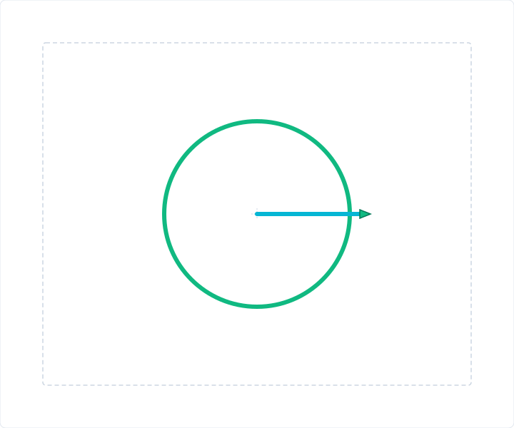

# Lesson `inter.7`: Fix-It — Broken Interactive Toy (`🎵` Beat & `🐢` LOGO Live Mode)

- **Type:** `🔧` Debug / Fix-It
- **Previous:** [`inter.6` Turtle Finger Brush & D-Pad Sketcher](./lesson_inter_6_turtle_finger_brush_and_dpad_sketcher.md) | **Next:** [`inter.8` Whack-a-Star & Mini-Arcade](./lesson_inter_8_whack_a_star_and_pong_rally.md)

| Metadata | Value |
|---|---|
| Environments | `🎵` Beat & Light Matrix (`8×8` & `16×16`) + `🐢` LOGO (`♾️ Live Mode`) |
| Core Bugs Diagnosed | (1) Loop-hijack / missing `WAIT_BEAT` yield, (2) `🧹 Clear Between Frames` smeared trails, (3) Unguarded matrix edges (`x < 1` / `x > 16`) |
| Visual Preview | [`inter_7_fix2.svg`](svg/inter_7_fix2.svg) (`280×260` repaired clean sweep radar) |
| Flat Block Budget | Broken Starter: `18` \| Fix 1: `19` \| Fix 2: `9` \| Fix 3: `26` (`slotCap: 28`) |

---

## 1. Broken Interactive Toy Starter (`🎵` `8×8`, `18` flat blocks)

> **Guided Co-Pilot Card (Read-Aloud, <= 2 sentences):**  
> Oh no — tapping the pad freezes the song for 4 whole beats and immediately paints everything back to red! Spot why **`👆`** stalls the queue and why **`▶️`** steals your color and drum yield.

<details>
<summary>📖 Parent / Teacher Tip</summary>

Two classic interactive bugs live in this `18`-block broken starter:
1. **Queue Hijack inside `ON_TAP` (`5` blocks):** Putting `LOOP 4` with `WAIT_BEAT [1]` inside an event tab locks the single-threaded event handler for 4 full beats, queueing sluggish delayed notes behind every tap.
2. **Yield Starvation & Color Lock inside `MAIN` (`13` blocks):** Setting `SET_LED_COLOR [red]` *inside* `WHILE` stomps over `ON_TAP`'s `$randomColor`, and omitting `WAIT_BEAT [0.125]` while looping `DRUM_KICK` causes audio spam and instant flicker.

</details>

```json
{
  "env": "beat",
  "sizePreset": 0,
  "grid": "8x8",
  "slotCap": 22,
  "MAIN": [
    { "op": "SET_BEAT_DELAY", "stepDelayMultiplier": 0 },
    { "op": "VAR_ASSIGN", "var": "x", "value": 4 },
    { "op": "VAR_ASSIGN", "var": "y", "value": 4 },
    {
      "op": "WHILE",
      "cond": { "op": "CMP", "operator": "==", "left": "a", "right": 0 },
      "body": [
        { "op": "CLEAR_LEDS" },
        { "op": "SET_LED_COLOR", "color": "red" },
        {
          "op": "IF",
          "cond": { "op": "SENSOR", "sensor": "$pointerDown" },
          "then": [
            { "op": "LIGHT_PIXEL", "x": "$pointerX", "y": "$pointerY" },
            { "op": "PLAY_NOTE", "pitch": "$pointerX", "duration": 0.25 }
          ]
        },
        { "op": "LIGHT_PIXEL", "x": "x", "y": "y" },
        { "op": "DRUM_KICK" }
      ]
    }
  ],
  "ON_TAP": [
    { "op": "SET_LED_COLOR", "color": "$randomColor" },
    {
      "op": "LOOP_START",
      "count": 4,
      "body": [
        { "op": "PLAY_NOTE", "pitch": "$pointerX", "duration": 0.5 },
        { "op": "WAIT_BEAT", "beats": 1 }
      ]
    }
  ]
}
```

---

## 2. Three Fix-It Missions (`🔧` Repair All 3!)

### `[Fix 1]` Non-Blocking Interactive Synth (`🎵` `8×8`, `19` flat blocks)
**The Fix:** Move initial `SET_LED_COLOR [cyan]` **before** `WHILE` so `ON_TAP` colors persist, swap the `DRUM_KICK` flood for `WAIT_BEAT [0.125]`, make `ON_TAP` fire a snappy crosshair chime (`LIGHT_ROW` + `LIGHT_COL` + `PLAY_NOTE` + `PLAY_CHIME`), and add `[🅱️]` clear (`ON_KEY_B`).

```json
{
  "env": "beat",
  "sizePreset": 0,
  "grid": "8x8",
  "slotCap": 22,
  "MAIN": [
    { "op": "SET_BEAT_DELAY", "stepDelayMultiplier": 0 },
    { "op": "VAR_ASSIGN", "var": "x", "value": 4 },
    { "op": "VAR_ASSIGN", "var": "y", "value": 4 },
    { "op": "SET_LED_COLOR", "color": "cyan" },
    {
      "op": "WHILE",
      "cond": { "op": "CMP", "operator": "==", "left": "a", "right": 0 },
      "body": [
        { "op": "CLEAR_LEDS" },
        { "op": "LIGHT_PIXEL", "x": "x", "y": "y" },
        {
          "op": "IF",
          "cond": { "op": "SENSOR", "sensor": "$pointerDown" },
          "then": [
            { "op": "LIGHT_PIXEL", "x": "$pointerX", "y": "$pointerY" },
            { "op": "PLAY_NOTE", "pitch": "$pointerX", "duration": 0.125 }
          ]
        },
        { "op": "WAIT_BEAT", "beats": 0.125 }
      ]
    }
  ],
  "ON_TAP": [
    { "op": "SET_LED_COLOR", "color": "$randomColor" },
    { "op": "LIGHT_ROW", "row": "$pointerY" },
    { "op": "LIGHT_COL", "col": "$pointerX" },
    { "op": "PLAY_NOTE", "pitch": "$pointerX", "duration": 0.25 },
    { "op": "PLAY_CHIME" }
  ],
  "ON_KEY_B": [
    { "op": "CLEAR_LEDS" }
  ]
}
```

### `[Fix 2]` Live LOGO `🧹 Clear Between Frames` Radar Fix (`🐢` `♾️ Live Mode`, `9` flat blocks)
**The Bug:** `clearBetweenFrames` starts **`false`**, so every rotating `150px` cyan radar beam leaves permanent spokes clogging the green `130px`-radius circle!  
**The Fix:** Flip **`🧹 Clear Between Frames` -> `true`** so only the single crisp active beam appears each frame (`280×260`, `inkMaxSpan: 280px`).



```json
{
  "env": "turtle",
  "mode": 2,
  "clearBetweenFrames": true,
  "slotCap": 12,
  "MAIN": [
    { "op": "VAR_OP", "target": "a", "left": "a", "operator": "+", "right": 30 },
    { "op": "PEN_UP" },
    { "op": "TELEPORT", "x": 0, "y": -130, "heading": 90 },
    { "op": "PEN_DOWN" },
    { "op": "SET_PEN_COLOR", "color": "green" },
    { "op": "ARC_RIGHT", "radius": 130, "angle": 360 },
    { "op": "TELEPORT", "x": 0, "y": 0, "heading": "a" },
    { "op": "SET_PEN_COLOR", "color": "cyan" },
    { "op": "FORWARD", "length": 150 }
  ]
}
```

### `[Fix 3]` Wall-Clamp Rover (`🎵` `16×16` HD Matrix, `26` flat blocks)
**The Bug:** Pressing **`⬅️`**, **`➡️`**, **`⬆️`**, or **`⬇️`** lets the rover walk straight off the `1..16` LED matrix (`x = 0` or `x = 17`), vanishing into silent out-of-bounds limbo until you push back the exact number of missed presses!  
**The Fix:** Wrap every D-Pad step in `IF y < 16`, `IF y > 1`, `IF x > 1`, and `IF x < 16` boundary fences. `partialHelp` gives vertical fences already repaired (`Edit Delta: 4` blocks on `ON_KEY_LEFT` + `ON_KEY_RIGHT`).

```json
{
  "env": "beat",
  "sizePreset": 1,
  "grid": "16x16",
  "slotCap": 28,
  "initial": {
    "MAIN": [
      { "op": "SET_BEAT_DELAY", "stepDelayMultiplier": 0 },
      { "op": "VAR_ASSIGN", "var": "x", "value": 8 },
      { "op": "VAR_ASSIGN", "var": "y", "value": 8 },
      {
        "op": "WHILE",
        "cond": { "op": "CMP", "operator": "==", "left": "a", "right": 0 },
        "body": [
          { "op": "CLEAR_LEDS" },
          { "op": "SET_LED_COLOR", "color": "cyan" },
          { "op": "LIGHT_PIXEL", "x": "x", "y": "y" },
          { "op": "WAIT_BEAT", "beats": 0.125 }
        ]
      }
    ],
    "ON_KEY_UP": [
      { "op": "VAR_OP", "target": "y", "left": "y", "operator": "+", "right": 1 },
      { "op": "PLAY_NOTE", "pitch": "y", "duration": 0.125 }
    ],
    "ON_KEY_DOWN": [
      { "op": "VAR_OP", "target": "y", "left": "y", "operator": "-", "right": 1 },
      { "op": "PLAY_NOTE", "pitch": "y", "duration": 0.125 }
    ],
    "ON_KEY_LEFT": [
      { "op": "VAR_OP", "target": "x", "left": "x", "operator": "-", "right": 1 },
      { "op": "PLAY_NOTE", "pitch": "x", "duration": 0.125 }
    ],
    "ON_KEY_RIGHT": [
      { "op": "VAR_OP", "target": "x", "left": "x", "operator": "+", "right": 1 },
      { "op": "PLAY_NOTE", "pitch": "x", "duration": 0.125 }
    ],
    "ON_KEY_B": [
      { "op": "CLEAR_LEDS" }
    ]
  },
  "partialHelp": {
    "MAIN": [
      { "op": "SET_BEAT_DELAY", "stepDelayMultiplier": 0 },
      { "op": "VAR_ASSIGN", "var": "x", "value": 8 },
      { "op": "VAR_ASSIGN", "var": "y", "value": 8 },
      {
        "op": "WHILE",
        "cond": { "op": "CMP", "operator": "==", "left": "a", "right": 0 },
        "body": [
          { "op": "CLEAR_LEDS" },
          { "op": "SET_LED_COLOR", "color": "cyan" },
          { "op": "LIGHT_PIXEL", "x": "x", "y": "y" },
          { "op": "WAIT_BEAT", "beats": 0.125 }
        ]
      }
    ],
    "ON_KEY_UP": [
      {
        "op": "IF",
        "cond": { "op": "CMP", "operator": "<", "left": "y", "right": 16 },
        "then": [
          { "op": "VAR_OP", "target": "y", "left": "y", "operator": "+", "right": 1 },
          { "op": "PLAY_NOTE", "pitch": "y", "duration": 0.125 }
        ]
      }
    ],
    "ON_KEY_DOWN": [
      {
        "op": "IF",
        "cond": { "op": "CMP", "operator": ">", "left": "y", "right": 1 },
        "then": [
          { "op": "VAR_OP", "target": "y", "left": "y", "operator": "-", "right": 1 },
          { "op": "PLAY_NOTE", "pitch": "y", "duration": 0.125 }
        ]
      }
    ],
    "ON_KEY_LEFT": [
      { "op": "VAR_OP", "target": "x", "left": "x", "operator": "-", "right": 1 },
      { "op": "PLAY_NOTE", "pitch": "x", "duration": 0.125 }
    ],
    "ON_KEY_RIGHT": [
      { "op": "VAR_OP", "target": "x", "left": "x", "operator": "+", "right": 1 },
      { "op": "PLAY_NOTE", "pitch": "x", "duration": 0.125 }
    ],
    "ON_KEY_B": [
      { "op": "CLEAR_LEDS" }
    ]
  },
  "referenceSolution": {
    "MAIN": [
      { "op": "SET_BEAT_DELAY", "stepDelayMultiplier": 0 },
      { "op": "VAR_ASSIGN", "var": "x", "value": 8 },
      { "op": "VAR_ASSIGN", "var": "y", "value": 8 },
      {
        "op": "WHILE",
        "cond": { "op": "CMP", "operator": "==", "left": "a", "right": 0 },
        "body": [
          { "op": "CLEAR_LEDS" },
          { "op": "SET_LED_COLOR", "color": "cyan" },
          { "op": "LIGHT_PIXEL", "x": "x", "y": "y" },
          { "op": "WAIT_BEAT", "beats": 0.125 }
        ]
      }
    ],
    "ON_KEY_UP": [
      {
        "op": "IF",
        "cond": { "op": "CMP", "operator": "<", "left": "y", "right": 16 },
        "then": [
          { "op": "VAR_OP", "target": "y", "left": "y", "operator": "+", "right": 1 },
          { "op": "PLAY_NOTE", "pitch": "y", "duration": 0.125 }
        ]
      }
    ],
    "ON_KEY_DOWN": [
      {
        "op": "IF",
        "cond": { "op": "CMP", "operator": ">", "left": "y", "right": 1 },
        "then": [
          { "op": "VAR_OP", "target": "y", "left": "y", "operator": "-", "right": 1 },
          { "op": "PLAY_NOTE", "pitch": "y", "duration": 0.125 }
        ]
      }
    ],
    "ON_KEY_LEFT": [
      {
        "op": "IF",
        "cond": { "op": "CMP", "operator": ">", "left": "x", "right": 1 },
        "then": [
          { "op": "VAR_OP", "target": "x", "left": "x", "operator": "-", "right": 1 },
          { "op": "PLAY_NOTE", "pitch": "x", "duration": 0.125 }
        ]
      }
    ],
    "ON_KEY_RIGHT": [
      {
        "op": "IF",
        "cond": { "op": "CMP", "operator": "<", "left": "x", "right": 16 },
        "then": [
          { "op": "VAR_OP", "target": "x", "left": "x", "operator": "+", "right": 1 },
          { "op": "PLAY_NOTE", "pitch": "x", "duration": 0.125 }
        ]
      }
    ],
    "ON_KEY_B": [
      { "op": "CLEAR_LEDS" }
    ]
  }
}
```
