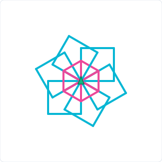
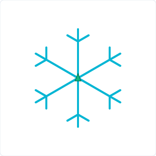
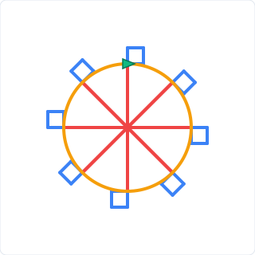
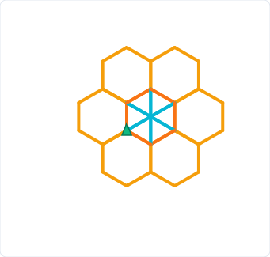

# `loop.B` — Capstone: Kaleidoscope Medallion

> **Format**: Creative Capstone (`🎨 🐢`) · **Module**: [`loop`](./overview.md) · **Environment**: [Turtle LOGO](../../envs/turtle_logo.md) · **Legacy ID**: `3B` *(Fixed off-center starter arc offset; static Frame-1 only)*

## One-Concept Goal

Combine **multiple nested shape loops, pen color switches, pen-width styling, and circular arcs** to compose rich radial medallions, crystal snowflakes, carnival Ferris wheels, and crystalline golden honeycombs.

<details>
<summary>📖 Parent / Teacher Tip</summary>

Press **Run** on the **Starter Medallion** to watch **6 Cyan squares** and **6 Pink triangles** lock perfectly together around the exact center `(0, 0)`! Then explore all **3 Variation Cards**: a **6-Branch Crystal Snowflake** (`Variation 1`), a **Carnival Ferris Wheel** with an Amber circular outer rim (`Variation 2`), and a **7-Cell Golden Honeycomb Flower** with glowing Cyan crystal spokes (`Variation 3`)!

</details>

## UI & Playground Contract

- **Zero Reading**: Starter and all 3 Variation Cards display static Frame-1 SVGs and icons only.
- **Parameter Picker Alignment**: Preserves trajectory/curvature SVG badges (`LengthVisual`, `RotationVisual`, `RadiusVisual`, `ArcAngleVisual`, `ColorVisual`, `PenWidthVisual`; `showEraserCue` corner accent on Turtle `SET_PEN_COLOR` `White` only; no pie-wedge or live arc preview popovers).
- **No Animation Blocks / No Variables / `[MAIN]` Only**: `WAIT`, `SET_INSTANT`, `CLEAR_CANVAS`, `TELEPORT`, and `hideTurtle` excluded (`allowVariables: false`, `allowRecursion: false`).
- **Start Pose**: `(0, 0)` facing `0°` (**North**), `penDown = true`.

## Palette & Capabilities

```json
{
  "allowedSimBlocks": [
    "FORWARD",
    "BACKWARD",
    "TURN_LEFT",
    "TURN_RIGHT",
    "ARC_LEFT",
    "ARC_RIGHT",
    "PEN_UP",
    "PEN_DOWN",
    "SET_PEN_COLOR",
    "SET_PEN_WIDTH"
  ],
  "allowedControlBlocks": ["LOOP_START"],
  "allowedScopes": ["MAIN"],
  "allowRepeatBadges": true,
  "allowActionParams": true,
  "allowedBlockParams": ["length", "angle", "radius", "color", "width"],
  "allowVariables": false,
  "allowRecursion": false,
  "slotCap": { "maxTotal": 28 }
}
```

## Starter Card — Two-Layer Neon Medallion (`14` flat blocks, `<= 14`)

*(Centers cleanly around `(0, 0)` with Cyan `4`-sided squares and Pink `3`-sided triangles sharing every petal vertex; replaces legacy off-center `ARC_LEFT(100,120)` starter.)*



```json
{
  "id": "starter-neon-medallion",
  "icon": "💠",
  "flatBlocks": 14,
  "finalPose": { "x": 0, "y": 0, "heading": 0 },
  "MAIN": [
    { "op": "SET_PEN_WIDTH", "width": 4 },
    {
      "op": "LOOP_START",
      "count": 6,
      "body": [
        { "op": "SET_PEN_COLOR", "color": "cyan" },
        {
          "op": "LOOP_START",
          "count": 4,
          "body": [
            { "op": "FORWARD", "length": 65 },
            { "op": "TURN_RIGHT", "angle": 90 }
          ]
        },
        { "op": "SET_PEN_COLOR", "color": "pink" },
        {
          "op": "LOOP_START",
          "count": 3,
          "body": [
            { "op": "FORWARD", "length": 40 },
            { "op": "TURN_RIGHT", "angle": 120 }
          ]
        },
        { "op": "TURN_RIGHT", "angle": 60 }
      ]
    }
  ]
}
```

## Variation Cards

### Variation 1 — 6-Branch Crystal Snowflake (`14` flat blocks, `<= 14`)



```json
{
  "id": "var1-crystal-snowflake",
  "icon": "❄️",
  "flatBlocks": 14,
  "finalPose": { "x": 0, "y": 0, "heading": 0 },
  "MAIN": [
    { "op": "SET_PEN_COLOR", "color": "cyan" },
    { "op": "SET_PEN_WIDTH", "width": 4 },
    {
      "op": "LOOP_START",
      "count": 6,
      "body": [
        { "op": "FORWARD", "length": 75 },
        { "op": "TURN_LEFT", "angle": 60 },
        {
          "op": "LOOP_START",
          "count": 3,
          "body": [
            { "op": "FORWARD", "length": 25 },
            { "op": "BACKWARD", "length": 25 },
            { "op": "TURN_RIGHT", "angle": 60 }
          ]
        },
        { "op": "TURN_LEFT", "angle": 120 },
        { "op": "BACKWARD", "length": 75 },
        { "op": "TURN_RIGHT", "angle": 60 }
      ]
    }
  ]
}
```

### Variation 2 — Carnival Ferris Wheel (`19` flat blocks, `<= 20`)

*(Draws 8 Red spokes, 8 Blue square gondola cabins at the outer ring, and finishes with a full `360°` Amber rim circle passing cleanly through every spoke tip.)*



```json
{
  "id": "var2-ferris-wheel",
  "icon": "🎡",
  "flatBlocks": 19,
  "finalPose": { "x": 0, "y": -80, "heading": 90 },
  "MAIN": [
    { "op": "SET_PEN_COLOR", "color": "red" },
    { "op": "SET_PEN_WIDTH", "width": 4 },
    {
      "op": "LOOP_START",
      "count": 8,
      "body": [
        { "op": "FORWARD", "length": 80 },
        { "op": "SET_PEN_COLOR", "color": "blue" },
        {
          "op": "LOOP_START",
          "count": 4,
          "body": [
            { "op": "FORWARD", "length": 20 },
            { "op": "TURN_RIGHT", "angle": 90 }
          ]
        },
        { "op": "SET_PEN_COLOR", "color": "red" },
        { "op": "BACKWARD", "length": 80 },
        { "op": "TURN_RIGHT", "angle": 45 }
      ]
    },
    { "op": "PEN_UP" },
    { "op": "FORWARD", "length": 80 },
    { "op": "TURN_RIGHT", "angle": 90 },
    { "op": "PEN_DOWN" },
    { "op": "SET_PEN_COLOR", "color": "amber" },
    { "op": "ARC_RIGHT", "radius": 80, "angle": 360 }
  ]
}
```

### Variation 3 — 7-Cell Golden Honeycomb Flower (`16` flat blocks, `<= 30`)

*(Tessellates 6 golden outer hexagons around an orange central hexagon and adds 6 converging Cyan spokes right to the central cell hub `(30.31, -17.5)`.)*



```json
{
  "id": "var3-golden-honeycomb",
  "icon": "🍯",
  "flatBlocks": 16,
  "finalPose": { "x": 0, "y": 0, "heading": 0 },
  "MAIN": [
    { "op": "SET_PEN_WIDTH", "width": 4 },
    {
      "op": "LOOP_START",
      "count": 6,
      "body": [
        { "op": "SET_PEN_COLOR", "color": "amber" },
        {
          "op": "LOOP_START",
          "count": 6,
          "body": [
            { "op": "FORWARD", "length": 35 },
            { "op": "TURN_LEFT", "angle": 60 }
          ]
        },
        { "op": "SET_PEN_COLOR", "color": "cyan" },
        { "op": "TURN_RIGHT", "angle": 60 },
        { "op": "FORWARD", "length": 35 },
        { "op": "BACKWARD", "length": 35 },
        { "op": "TURN_LEFT", "angle": 60 },
        { "op": "SET_PEN_COLOR", "color": "orange" },
        { "op": "FORWARD", "length": 35 },
        { "op": "TURN_RIGHT", "angle": 60 }
      ]
    }
  ]
}
```
