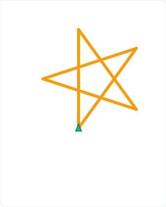
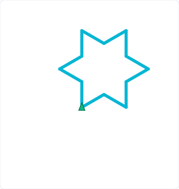
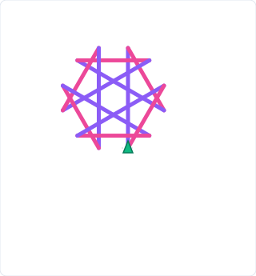
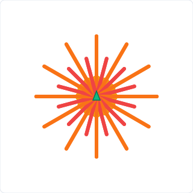

# `loop.3` — Closed Polygons & Star Loops

> **Format**: Creative Sandbox (`🎨 🐢`) · **Module**: [`loop`](./overview.md) · **Environment**: [Turtle LOGO](../../envs/turtle_logo.md) · **Legacy ID**: `3.3` *(Static Frame-1 drawings only; all animation scripts moved to `anim`)*

## One-Concept Goal

Explore how repeating forward steps and fixed turn angles (`144°`, `120°`/`60°`, `150°`, `30°`/`15°`) close into **stars, hexagrams, woven compass stars, and centered sunbursts** using single-depth loops and color changes.

<details>
<summary>📖 Parent / Teacher Tip</summary>

Press **Run** right away to watch the **5-Pointed Gold Star**! Notice why the turtle turns **`144°` five times** (`5 × 144° = 720°` — two full spins!). Try opening the **Variation Cards** below to remix a **Crystal Hexagram**, a **Dual-Tone Woven Compass Star**, or a **Radiant Sunburst**. *(Want to animate spinning stars over time? Try the Animation side module `anim` after finishing `loop`!)*

</details>

## UI & Playground Contract

- **Zero Reading**: Starter and all 3 Variation Cards display visual preview thumbnails (static Frame-1 SVGs) and icons only.
- **Parameter Picker Alignment**: Preserves trajectory/curvature SVG badges (`VisualParamBadges.tsx`: `LengthVisual`, `RotationVisual`, `ColorVisual`, `PenWidthVisual`; `showEraserCue` corner accent on Turtle `SET_PEN_COLOR` `White` only); no pie-wedge or live arc preview popovers.
- **No Animation Blocks**: `WAIT`, `SET_INSTANT`, `CLEAR_CANVAS`, `TELEPORT`, and `hideTurtle` are intentionally excluded from `loop` (`allowVariables: false`, `allowRecursion: false`).
- **Enabled Scope Tabs**: `[MAIN]` only.
- **Start Pose**: `(0, 0)` facing `0°` (**North**), `penDown = true`, default `penColor = "#0f172a"`, default `penWidth = 6`.

## Palette & Capabilities

```json
{
  "allowedSimBlocks": [
    "FORWARD",
    "BACKWARD",
    "TURN_LEFT",
    "TURN_RIGHT",
    "PEN_UP",
    "PEN_DOWN",
    "SET_PEN_COLOR",
    "SET_PEN_WIDTH"
  ],
  "allowedControlBlocks": ["LOOP_START"],
  "allowedScopes": ["MAIN"],
  "allowRepeatBadges": true,
  "allowActionParams": true,
  "allowedBlockParams": ["length", "angle", "color", "width"],
  "allowVariables": false,
  "allowRecursion": false,
  "slotCap": { "maxTotal": 24 },
  "antiBypassRules": [
    {
      "id": "static-single-depth-loop",
      "description": "Single-depth geometry loops only (no nested loops yet, no WAIT/TELEPORT)",
      "maxLoopNestingDepth": 0
    }
  ]
}
```

## Starter Card — 5-Pointed Gold Star (`5` flat blocks, `<= 14`)



```json
{
  "id": "starter-gold-star",
  "icon": "⭐",
  "flatBlocks": 5,
  "finalPose": { "x": 0, "y": 0, "heading": 0 },
  "MAIN": [
    { "op": "SET_PEN_COLOR", "color": "yellow" },
    {
      "op": "LOOP_START",
      "count": 5,
      "body": [
        { "op": "FORWARD", "length": 200 },
        { "op": "TURN_RIGHT", "angle": 144 }
      ]
    }
  ]
}
```

## Variation Cards

### Variation 1 — 6-Pointed Crystal Hexagram (`7` flat blocks, `<= 14`)

*(Fixes legacy single-turn hexagram geometry bug using alternating `TURN_LEFT 60°` inner notch and `TURN_RIGHT 120°` outer tip.)*



```json
{
  "id": "var1-crystal-hexagram",
  "icon": "❄️",
  "flatBlocks": 7,
  "finalPose": { "x": 0, "y": 0, "heading": 0 },
  "MAIN": [
    { "op": "SET_PEN_COLOR", "color": "cyan" },
    {
      "op": "LOOP_START",
      "count": 6,
      "body": [
        { "op": "FORWARD", "length": 75 },
        { "op": "TURN_LEFT", "angle": 60 },
        { "op": "FORWARD", "length": 75 },
        { "op": "TURN_RIGHT", "angle": 120 }
      ]
    }
  ]
}
```

### Variation 2 — Dual-Tone Woven Compass Star (`9` flat blocks, `<= 20`)

*(Alternates long Purple chords `200` and medium Pink chords `150` with `150°` turns over 6 iterations (`6 × 300° = 1800°`), closing cleanly at `(0,0)`.)*



```json
{
  "id": "var2-compass-star",
  "icon": "🧭",
  "flatBlocks": 9,
  "finalPose": { "x": 0, "y": 0, "heading": 0 },
  "MAIN": [
    { "op": "SET_PEN_WIDTH", "width": 5 },
    {
      "op": "LOOP_START",
      "count": 6,
      "body": [
        { "op": "SET_PEN_COLOR", "color": "purple" },
        { "op": "FORWARD", "length": 200 },
        { "op": "TURN_RIGHT", "angle": 150 },
        { "op": "SET_PEN_COLOR", "color": "pink" },
        { "op": "FORWARD", "length": 150 },
        { "op": "TURN_RIGHT", "angle": 150 }
      ]
    }
  ]
}
```

### Variation 3 — Radiant Sunburst (`18` flat blocks, `<= 30`)

*(Stays 100% centered at `(0,0)` with a thick `#f59e0b` width-14 solar core and 24 alternating `#f97316` orange `100px` / `#ef4444` red `65px` rays.)*



```json
{
  "id": "var3-radiant-sunburst",
  "icon": "☀️",
  "flatBlocks": 18,
  "finalPose": { "x": 0, "y": 0, "heading": 0 },
  "MAIN": [
    { "op": "SET_PEN_WIDTH", "width": 14 },
    { "op": "SET_PEN_COLOR", "color": "yellow" },
    {
      "op": "LOOP_START",
      "count": 12,
      "body": [
        { "op": "FORWARD", "length": 28 },
        { "op": "BACKWARD", "length": 28 },
        { "op": "TURN_RIGHT", "angle": 30 }
      ]
    },
    { "op": "SET_PEN_WIDTH", "width": 6 },
    {
      "op": "LOOP_START",
      "count": 12,
      "body": [
        { "op": "SET_PEN_COLOR", "color": "orange" },
        { "op": "FORWARD", "length": 100 },
        { "op": "BACKWARD", "length": 100 },
        { "op": "TURN_RIGHT", "angle": 15 },
        { "op": "SET_PEN_COLOR", "color": "red" },
        { "op": "FORWARD", "length": 65 },
        { "op": "BACKWARD", "length": 65 },
        { "op": "TURN_RIGHT", "angle": 15 }
      ]
    }
  ]
}
```
