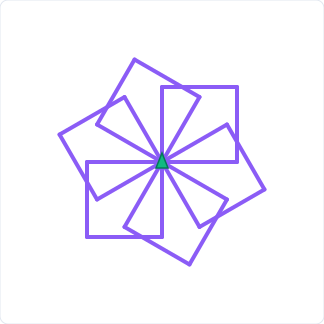
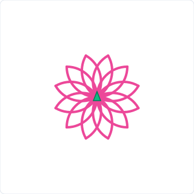
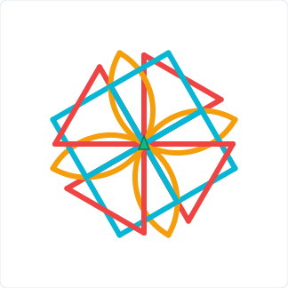
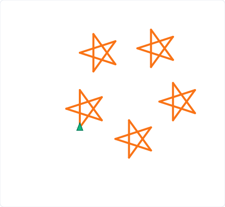

# `loop.7` — Nested Loop Rosettes & Spirographs

> **Format**: Creative Sandbox (`🎨 🐢`) · **Module**: [`loop`](./overview.md) · **Environment**: [Turtle LOGO](../../envs/turtle_logo.md) · **Legacy ID**: `3.7` *(Replaced off-center star-row with Ring of 5 Stars; static Frame-1 only)*

## One-Concept Goal

Spin polygons, curved arcs, and whole stars **around a central hub** using **nested loops** (`outer rotation × inner motif`) to compose radial rosettes, flower petals, pinwheels, and star rings.

<details>
<summary>📖 Parent / Teacher Tip</summary>

Here is the secret behind every spirograph: put **one shape loop** (`Loop ×4` for a square, or `Loop ×2` for a leaf) inside an **outer `Loop` + `Turn Right`**! Notice how `6 × 60° = 360°` turns 6 squares into a Purple crystal rosette (`Starter`), `12 × 30° = 360°` spins curved arcs into a Pink blossom (`Variation 1`), `4 × (30°+30°+30°) = 360°` weaves a Tri-Color Pinwheel (`Variation 2`), and `Pen Up` between 5 stars draws a glowing **Ring of 5 Stars** (`Variation 3`)!

</details>

## UI & Playground Contract

- **Zero Reading**: Starter and all 3 Variation Cards display static Frame-1 SVGs and icons only.
- **Parameter Picker Alignment**: Preserves trajectory/curvature SVG badges (`LengthVisual`, `RotationVisual`, `RadiusVisual`, `ArcAngleVisual`, `ColorVisual`, `PenWidthVisual`; `showEraserCue` corner accent on Turtle `SET_PEN_COLOR` `White` only; no pie-wedge or live arc preview popovers).
- **No Animation Blocks**: `WAIT`, `SET_INSTANT`, `CLEAR_CANVAS`, `TELEPORT`, and `hideTurtle` excluded (`allowVariables: false`, `allowRecursion: false`).
- **Start Pose**: `(0, 0)` facing `0°` (**North**), `penDown = true`.

## Palette & Capabilities

```json
{
  "allowedSimBlocks": [
    "FORWARD",
    "BACKWARD",
    "TURN_LEFT",
    "TURN_RIGHT",
    "ARC_LEFT",
    "ARC_RIGHT",
    "PEN_UP",
    "PEN_DOWN",
    "SET_PEN_COLOR",
    "SET_PEN_WIDTH"
  ],
  "allowedControlBlocks": ["LOOP_START"],
  "allowedScopes": ["MAIN"],
  "allowRepeatBadges": true,
  "allowActionParams": true,
  "allowedBlockParams": ["length", "angle", "radius", "color", "width"],
  "allowVariables": false,
  "allowRecursion": false,
  "slotCap": { "maxTotal": 28 }
}
```

## Starter Card — 6 Rotated Squares (`9` flat blocks, `<= 14`)



```json
{
  "id": "starter-rotated-squares",
  "icon": "💠",
  "flatBlocks": 9,
  "finalPose": { "x": 0, "y": 0, "heading": 0 },
  "MAIN": [
    { "op": "SET_PEN_COLOR", "color": "purple" },
    { "op": "SET_PEN_WIDTH", "width": 4 },
    {
      "op": "LOOP_START",
      "count": 6,
      "body": [
        {
          "op": "LOOP_START",
          "count": 4,
          "body": [
            { "op": "FORWARD", "length": 75 },
            { "op": "TURN_RIGHT", "angle": 90 }
          ]
        },
        { "op": "TURN_RIGHT", "angle": 60 }
      ]
    }
  ]
}
```

## Variation Cards

### Variation 1 — 12-Petal Arc Flower (`9` flat blocks, `<= 14`)



```json
{
  "id": "var1-arc-flower",
  "icon": "🌸",
  "flatBlocks": 9,
  "finalPose": { "x": 0, "y": 0, "heading": 0 },
  "MAIN": [
    { "op": "SET_PEN_COLOR", "color": "pink" },
    { "op": "SET_PEN_WIDTH", "width": 4 },
    {
      "op": "LOOP_START",
      "count": 12,
      "body": [
        {
          "op": "LOOP_START",
          "count": 2,
          "body": [
            { "op": "ARC_RIGHT", "radius": 75, "angle": 90 },
            { "op": "TURN_RIGHT", "angle": 90 }
          ]
        },
        { "op": "TURN_RIGHT", "angle": 30 }
      ]
    }
  ]
}
```

### Variation 2 — Tri-Color Pinwheel (`20` flat blocks, `<= 20`)

*(Combines Red triangles, Yellow curved petals, and Cyan squares around the center hub inside `Loop ×4`.)*



```json
{
  "id": "var2-tricolor-pinwheel",
  "icon": "🎡",
  "flatBlocks": 20,
  "finalPose": { "x": 0, "y": 0, "heading": 0 },
  "MAIN": [
    {
      "op": "LOOP_START",
      "count": 4,
      "body": [
        { "op": "SET_PEN_COLOR", "color": "red" },
        {
          "op": "LOOP_START",
          "count": 3,
          "body": [
            { "op": "FORWARD", "length": 100 },
            { "op": "TURN_RIGHT", "angle": 120 }
          ]
        },
        { "op": "TURN_RIGHT", "angle": 30 },
        { "op": "SET_PEN_COLOR", "color": "yellow" },
        {
          "op": "LOOP_START",
          "count": 2,
          "body": [
            { "op": "ARC_RIGHT", "radius": 75, "angle": 90 },
            { "op": "TURN_RIGHT", "angle": 90 }
          ]
        },
        { "op": "TURN_RIGHT", "angle": 30 },
        { "op": "SET_PEN_COLOR", "color": "cyan" },
        {
          "op": "LOOP_START",
          "count": 4,
          "body": [
            { "op": "FORWARD", "length": 75 },
            { "op": "TURN_RIGHT", "angle": 90 }
          ]
        },
        { "op": "TURN_RIGHT", "angle": 30 }
      ]
    }
  ]
}
```

### Variation 3 — Ring of 5 Stars (`12` flat blocks, `<= 30`)

*(Replaces legacy off-center `3.7-star-row` (`y = -300` clip) with a closed regular pentagon of 5 crisp stars using `PEN_UP` / `PEN_DOWN` hops.)*



```json
{
  "id": "var3-ring-of-stars",
  "icon": "🌟",
  "flatBlocks": 12,
  "finalPose": { "x": 0, "y": 0, "heading": 0 },
  "MAIN": [
    { "op": "SET_PEN_COLOR", "color": "orange" },
    { "op": "SET_PEN_WIDTH", "width": 4 },
    {
      "op": "LOOP_START",
      "count": 5,
      "body": [
        {
          "op": "LOOP_START",
          "count": 5,
          "body": [
            { "op": "FORWARD", "length": 75 },
            { "op": "TURN_RIGHT", "angle": 144 }
          ]
        },
        { "op": "PEN_UP" },
        { "op": "FORWARD", "length": 150 },
        { "op": "TURN_RIGHT", "angle": 72 },
        { "op": "PEN_DOWN" }
      ]
    }
  ]
}
```
