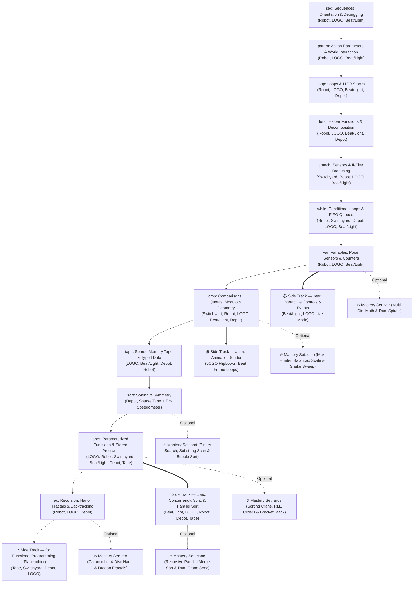

# Programming Curriculum for Complete Newcomers — Overview

This curriculum defines the learning roadmap for **Robot Emulator (`robotemu`)**, structured as a **12-module Core Spine** plus **4 Parallel Side Modules (`anim`, `inter`, `conc`, `fp`)** and **6 Optional Mastery Challenge sets**. It takes complete newcomers—starting with **zero prior programming knowledge** and **zero reading required**—from sequential actions to data structures (LIFO stacks, FIFO queues, sparse memory tape), typed variables, sorting/searching algorithms, parameterized functions, recursion/backtracking, interactive event-driven experiences, and multi-worker concurrency with parallel sorting.

For cross-environment language features, pedagogical mechanics, and platform infrastructure, see [Shared Language, Lesson Mechanics & Platform Requirements](../platform_requirements.md). For UI layout rules, see [Kid-Friendly UI Principles & Guidelines](../ui_guidelines.md). For future non-curriculum sandbox concepts, see [Sandbox & Future Evolution Ideas](../sandbox_ideas.md). For simulation-specific specs, see:
- [🤖 Robot Grid](../envs/robot_grid.md)
- [🐢 Turtle LOGO](../envs/turtle_logo.md)
- [🎵 Beat & Light Matrix](../envs/beat_light.md)
- [🚂 Switchyard / Conveyor Sorter](../envs/switchyard.md)
- [🏗️ Depot](../envs/depot.md)

---

## 1. Terminology, Slug IDs & Track Hierarchy

To keep module reordering, splits, and parallel tracks backward-compatible without breaking saved progress or directory paths, modules are identified by **short lowercase slugs** rather than sequential integers:

- **Core Spine (`12` Modules):** Lean foundational CS & DS&A track (`seq` → `param` → `loop` → `func` → `branch` → `while` → `var` → `cmp` → `tape` → `sort` → `args` → `rec`).
- **Parallel Side Modules (`4` Thematic Tracks):** Self-contained expansion modules (`anim`, `inter`, `conc`, `fp`) that branch off specific Core milestones once their prerequisites are met, playing uninterrupted from start to Module Badge without bloating the Core Spine.
- **Activity ID Convention (`<mod>.<item>`):**
  - **Lesson (`seq.0`, `seq.1`, `loop.5a`, …):** A single small-step activity inside module `<mod>` (interactive **Explanation**, validated **Puzzle**, or open **Sandbox**).
  - **Capstone (`seq.A`, `seq.B`, `conc.A`, …):** Synthesis puzzle or creative showcase at the end of module `<mod>`, awarding that module's **Module Badge**.
  - **Mastery Challenge (`var.M1`, `cmp.M1`, `conc.M1`, …):** Fully optional bonus algorithmic puzzles unlocked upon completing specific modules, awarding **Challenge Medals**.
  - *(Backward Compatibility Note: Compact binary UTF-8 lesson/module IDs in [`binary_format.md` §2.3.2](../binary_format.md#232-compact-lesson-identifier-compactlessonid) encode slug IDs natively; legacy numeric IDs such as `"1.2"` or `"8.1"` map transparently via a one-way alias table during module-file migration.)*

---

## 2. Core Pedagogical Principles & Age-Span Design

1. **Strict One-Concept-Per-Lesson Pacing:**
   - Every lesson teaches **strictly one** new mental model.
   - Whenever a learner meets a brand-new environment (Switchyard, Depot, Memory Tape, Flipbook Studio), world item, sensor, or synchronization block, it is introduced **on its own** (via an interactive `📖 Explanation` lesson and/or using only already-mastered control blocks)—never pairing a new environment with a new control-flow jump.
2. **Low Floor (Ages 5–7), High Ceiling (Ages 9–12+ & Adult Sandboxes) — Two-Layer Reading Policy:**
   - **100% Zero-Reading Code Always:** Across *all* modules, programming itself requires zero reading—relying on unmistakable icons, numbers, color swatches, shape sockets (`●`, `▲`, `■`), physical slot trays, and visual runtime bounces.
   - **Autonomous Early Core vs. Guided Advanced Concepts:** Early modules (`seq` through `while`, ~Ages 5–7) require **zero reading anywhere**; spotlight animations and ghost previews explain everything visually. Intermediate and advanced modules (`var` onward, plus `anim`, `inter`, `conc`, `fp`, ~Ages 7–12+) may include concise **Guided / Co-Pilot Explanation Cards** that an older learner can read directly or an adult can read aloud during `📖 Explanation` demos.
   - **Progressive Sandbox Unlocking & Future Code Views:** Curriculum levels expose only lesson-relevant tools, while **Free-Play Sandboxes** progressively unlock pro-grade features (`10,000`-cell sparse memory, `16×16`/`32×32` LED matrices, `[0, 1)` float randomness, interactive live loops, multi-worker concurrency—or all at once via **Unlock All / Pro Sandbox**). As a future evolution, alternative readable/textual code representations will layer onto the exact same engines and sandboxes once learners outgrow icon blocks.
3. **Constraint-Driven Discovery, Bug-Hunt Practice & Visual Speedup (`⏱️`):**
   - Validated puzzles enforce **physical slot budgets** or **simultaneous multi-map / multi-stream validation** (`3–4` visible runs) so loops, helpers, conditionals, variables, synchronization barriers, and data structures cannot be brute-forced.
   - **Recurring Fix-It / Bug-Hunt Thread:** Beyond `seq` debugging, later modules weave in pre-populated *buggy* starter programs (e.g., off-by-one loop counts in `loop`, sequential-`If` state-mutation bugs vs. `If/Else` in `branch`, fencepost bounds collisions in `tape`, lost updates and deadlocks in `conc`).
   - **Wall-Clock Tick Speedometer (`⏱️`):** Algorithmic and concurrent modules (`sort`, Binary Search, `conc`) surface a live non-verbal **Elapsed Wall-Clock Ticks (`⏱️`)** readout so learners viscerally see Merge Sort beat Insertion Sort and **Parallel Sort** slash single-worker tick counts without Big-$O$ text.
4. **Complementary Environment Tracks:**
   - **Constrained Puzzles (🤖 Robot Grid, 🚂 Switchyard & 🏗️ Depot):** Clear pass/fail validation, backed by non-spoiling **Partial Solutions** and guaranteed **Full Working Solutions**.
   - **Creative & Interactive Sandboxes (🐢 Turtle LOGO & 🎵 Beat & Light Matrix):** Zero pass/fail anxiety; each lesson pre-loads a **working starter example** alongside **2–4 illustrated/playable variation cards** with **1-tap Copy / Load Code** (powered by sensors like `$input`, `🎲` random dice, Flipbook `$frame`/`$time`, and queued events).

---

## 3. Activity Formats & Two-Axis Block Guardrails

### Five Activity Formats

| Format | Badge | Validation | Purpose |
| :--- | :---: | :--- | :--- |
| **Explanation Lesson (Interactive Demo)** | 📖 | **No Exercise** *(1-tap continue)* | Presents **1–3 runnable, step-able visual examples** with spotlight callouts (and optional Guided Co-Pilot card in `var`+) to introduce a new environment, item, mode, sensor, type rule, operator, or synchronization primitive before puzzle practice. |
| **Puzzle Lesson *(incl. Fix-It Variants)*** | 🤖 / 🚂 / 🏗️ | **Validated Puzzle** | Focused single-concept or bug-fix puzzle with **Partial + Full Visual Solutions**. |
| **Sandbox Lesson** | 🐢 / 🎵 | **Open Sandbox** | Working starter program + **2–4 illustrated/playable variation cards** with **Copy / Load Code** (and 1-tap Undo). |
| **Module Capstone** | 🏆 / 🎨 | **Puzzle or Sandbox** | Synthesizes everything taught in the current Module into a rewarding milestone. |
| **Optional Mastery Challenge (`var`+)** | 🔥 | **Bonus Challenge** *(fully optional)* | Unlocks upon finishing `var`, `cmp`, `sort`, `args`, `rec`, and `conc`. Never blocks progression; explores deeper multi-tab algorithmic challenges (**Partial + Full Solutions** included). |

### Two-Axis Block Guardrails (Edit-Delta Budget vs. Comprehension Ceiling)

To eliminate repetitive "grunt work" without artificially crippling rich starter programs or creative showcase variations, guardrails separate **how many blocks a learner must add/edit** from **overall workspace readability**:

| Activity Tier | Learner Edit Delta *(Blocks Added / Changed)* | Comprehension / Physical Slot Ceiling | Authoring Guideline |
| :--- | :---: | :---: | :--- |
| **Early Puzzles (`seq`, `param`)** | **`≤ 6–8 blocks`** | **`≤ 8 blocks`** *(up to `10–12` in Early Capstones; `3×3`–`4×4` pre-repeat, `5×5`–`6×6` once `×N` unlocks)* | Keep maps compact before repeat badges exist so learners never chain 8+ duplicate moves. |
| **Core & Side Puzzles (`loop`+)** | **`≤ 6–8 blocks`** *(up to `10–12` in Capstones)* | **`≤ 14 blocks/tab`** (`≤ 24–30` total across tabs; tighter `[■]` trays when preventing brute force) | **Pre-fill setup/boilerplate in the Starter Workspace** whenever a puzzle needs supporting scaffolding, keeping learner effort focused strictly on the target concept. |
| **Mastery Challenges (`🔥`)** | Open | **`≤ 20 blocks/tab`**, **`≤ 50 blocks total`** *(typically `12–24` total, `≤ 10/tab`)* | Multi-tab depth (`Main` + `F1`–`F3` / concurrent workers) allowed for optional algorithmic challenges. |
| **Creative Sandboxes (`🐢` / `🎵`)** | Open exploration | **Starter & Var 1:** `≤ 14/tab` (`≤ 24` total) **Var 2:** up to `~20/tab` (`~40` total) **Var 3+ (Showcase):** up to `~30/tab` (`~60–80` total) | **Allowance, not a target:** Starter and Variation 1 stay compact and immediately readable on one screen; Variation 2+ may use higher block counts *only when earned* to demonstrate inspiring art, music, or animations without degraded visual quality. |

---

## 4. Progression Architecture (12 Core Modules + 4 Side Tracks + 6 Mastery Sets)

### CS, Data Structures & Concurrency Concept Progression

| Module | Programming Tools Introduced | Explicit CS / DS&A / Systems Concepts Taught | Key Environments |
| :--- | :--- | :--- | :--- |
| **`seq`–`param`** | Sequential actions, parameters, items | Ordered execution, egocentric turns, stateful pickup/use (keys, retrievable planks, crates) | 🤖 🐢 🎵 |
| **`loop`** | `Loop ×N`, nested loops | **Stack (LIFO)** physical reversal, setup vs. body separation, off-by-one bug fixing | 🤖 🐢 🎵 🏗️ |
| **`func`** | Helper tabs (`F1`–`F3`) | Procedural abstraction, state hygiene, double stack reversal = identity | 🤖 🐢 🎵 🏗️ |
| **`branch`** | `If`, `If/Else`, `Else If`, `NOT/AND/OR`, `$input` | Categorization, hazard filtering, sequential-`If` vs. `If/Else` state-mutation hazard | 🚂 🤖 🐢 🎵 |
| **`while`** | `While [cond]`, boundary sensors | **Queue (FIFO)** vs. Stack (LIFO), indefinite stream/corridor draining | 🤖 🚂 🏗️ 🐢 🎵 |
| **`var`** | Variables (`a`–`z`), pose sensors, `🎲` | Named mutable state, sensor capture (`tileDial`, `$x`, `$y`), stepping counters | 🤖 🐢 🎵 |
| **`cmp`** | `<`, `>`, `==`, `!=`, `/`, `%` | Running maximum (`$heldValue > $topValue`), quotas, modulo cycles/rhythms, `360 / n` polygons | 🚂 🤖 🐢 🎵 🏗️ |
| **`tape`** | `TAPE_SEEK`, `TAPE_STEP`, `TAPE_WRITE` | **Sparse Tape (`1..10,000`)**, **bounds collisions**, **`number` vs `color` types**, linear search | 📼 across 🐢 🎵 🏗️ 🤖 |
| **`sort`** | Two pointers (`l`, `h`), `⏱️` tick counter | **Palindrome symmetry**, **Insertion / Selection / Two-Way Merge sort**, step efficiency | 🏗️ 📼 |
| **`args`** | Parameterized `F1(●, ▲, ■)` | **Local stack-frame sockets vs. shared globals/Tape**, **stored-program interpreter**, `TransferN` | 📼 🐢 🤖 🚂 🎵 🏗️ |
| **`rec`** | Self-calls (`F1` → `F1`) | **Call-stack unwinding**, **Tower of Hanoi**, **fractals & L-systems**, **cave backtracking** | 🤖 🐢 🏗️ |
| **`inter`** *(Side)* | `$pointerX/Y`, keys, queued `On Event` | **Event-driven vs. polling loops**, single-threaded run-to-completion event dispatch | 🎵 🐢 |
| **`anim`** *(Side)* | LOGO Flipbook (`$frame`, `$time`), Beat `0ms` loop | **Stateless (`f(t)`) vs. stateful frame simulation**, hardware display-buffer clearing, physics bounce | 🐢 🎵 📼 |
| **`conc`** *(Side)* | `Main 1..N`, `🚧 Barrier`, `📨 Send`/`📬 $recv`, `🔀 Fork`/`Join`, `🔒 Lock` | **Lockstep parallelism**, **phase barriers**, **message-passing value copies**, **race conditions & deadlocks**, **mutexes & producer–consumer queues**, **Parallel Sort** | 🎵 🐢 🤖 🏗️ 📼 |
| **`fp`** *(Side)* | Function sockets `F1([Fn])` *(Planned)* | **Immutability**, **Higher-Order Functions (`Map`, `Filter`, `Fold`)**, recursion over loops | 📼 🚂 🏗️ 🐢 |

---

## 5. Modules (What Each Module Teaches)

### Core Spine Modules

#### [`seq` — First Steps: Sequences, Orientation & Visual Debugging](./seq/overview.md)
*Environments: 🤖 Robot Grid, 🐢 Turtle LOGO, 🎵 Beat & Light Matrix*  
Must teach top-to-bottom execution order, egocentric rotation vs. movement, tick-by-tick visual debugging, staged sub-goals across ordered sequence waypoints (`1 ⋯▶ 2`), and parameterless creative sequencing.

#### [`param` — Action Parameters & World Interaction](./param/overview.md)
*Environments: 🤖 Robot Grid, 🐢 Turtle LOGO, 🎵 Beat & Light Matrix*  
Must teach customizing single actions via visual parameter badges (repeat counts, distances, trajectory turn angles, colors, pen widths, arc radii, pitches, beat delays) and interacting statefully with distinct world objects (`PICK_UP` & `USE_DROP` across consumed color-matched Keys, **retrievable 1-cell-ahead Planks**, and floor-switch Crates).

#### [`loop` — Loops: Repeating Sequences & LIFO Stacks](./loop/overview.md)
*Environments: 🤖 Robot Grid, 🐢 Turtle LOGO, 🎵 Beat & Light Matrix, 🏗️ Depot*  
Must teach spotting multi-block repeating motifs, enclosing them in `Loop Start` / `Loop End`, separating setup/cleanup from loop bodies, nesting loops, fixing off-by-one loop bugs, and discovering **Last-In, First-Out (LIFO)** stack reversal physically with stackable rings/blocks in the Depot. *(Frame-by-frame animation lives in Side Module [`anim`](./anim/overview.md).)*

#### [`func` — Functions: Abstraction, Naming & Decomposition](./func/overview.md)
*Environments: 🤖 Robot Grid, 🐢 Turtle LOGO, 🎵 Beat & Light Matrix, 🏗️ Depot*  
Must teach packaging reusable sub-tasks into `F1`, `F2`, `F3`, maintaining "state hygiene" (restoring heading/pen state), combining functions with loops, composing multi-layer helpers (`Main → F1 → F2`), and double stack reversal (`Stack 1 → Stack 2 → Stack 3`).

#### [`branch` — Sensors & Branching: Making Decisions](./branch/overview.md)
*Environments: 🚂 Switchyard, 🤖 Robot Grid, 🐢 Turtle LOGO, 🎵 Beat & Light Matrix*  
Must teach reading live world sensors and the `🎛️ $input` scene selector widget to write adaptive branching rules (`If`, `If / Else`, `If / Else If / Else`, `NOT`/`AND`/`OR`) verified against **3–4 simultaneous variant maps/streams**, explicitly contrasting sequential `If` + `If` state-mutation bugs against `If / Else`, alongside `$input`-driven creative LOGO art and Beat jukeboxes.

#### [`while` — Conditional Loops & FIFO Queues](./while/overview.md)
*Environments: 🤖 Robot Grid, 🚂 Switchyard, 🏗️ Depot, 🐢 Turtle LOGO, 🎵 Beat & Light Matrix*  
Must teach indefinite repetition (`While [condition]`) across variable-length corridors and incoming train streams, boundary-driven creative loops (`insideCanvas` in LOGO, `cursorAtEdge` in Beat), and contrasting **First-In, First-Out (FIFO)** conveyor queues directly beside LIFO stacks in the Depot.

#### [`var` — Variables, Pose Sensors & Stepping Counters](./var/overview.md)
*Environments: 🤖 Robot Grid, 🐢 Turtle LOGO, 🎵 Beat & Light Matrix*  
Must teach variables as named memory boxes—storing constants (`s = 60`), reading world, pose, and random sensors (`a = tileDial`, `a = $x`, `b = $y`, `🎲`), and stepping counters up/down inside loops (`a = a + 1`) to drive staircases, spirals, and generative melodies. Completing `var` unlocks Side Module **[`inter`](./inter/overview.md)** and **🔥 Mastery Set `var`**.

#### [`cmp` — Comparisons, Quotas, Modulo & Computed Geometry](./cmp/overview.md)
*Environments: 🚂 Switchyard, 🤖 Robot Grid, 🐢 Turtle LOGO, 🎵 Beat & Light Matrix, 🏗️ Depot*  
Must teach combining variables with relational and arithmetic operators—comparing values (`<`, `>`, `==`, `!=`), tracking stack maximums (`$heldValue > $topValue`), enforcing dock quotas, splitting beat sequencers and LED checkerboards with modulo (`%`), and computing geometric angles (`360 / n`). Completing `cmp` unlocks Side Module **[`anim`](./anim/overview.md)** and **🔥 Mastery Set `cmp`**.

#### [`tape` — 📼 The Sparse Memory Tape & Typed Color Data](./tape/overview.md)
*Environments: 🐢 Turtle LOGO, 🎵 Beat & Light Matrix, 🏗️ Depot, 🤖 Robot Grid*  
Must teach 1-indexed random-access memory cells (`TAPE_SEEK`, `TAPE_STEP`, `TAPE_WRITE`) with strict out-of-bounds checks (`1..$tapeLength`, scaling to `10,000` sparse cells in Sandboxes), bounds-safe `While ($headPos < $tapeLength)` scans (plus fencepost Fix-It debugging), distinguishing `color` vs. `number` runtime types (`TYPE_ERROR` visual bounces and `White`/`Black` selective erasing), and data-driven art, music, and linear search.

#### [`sort` — 🔍 Sorting, Symmetry & Algorithmic Speed](./sort/overview.md)
*Environments: 🏗️ Depot, 📼 Sparse Memory Tape*  
Must teach combining comparisons, converging tape pointers (`l`, `h`), and multi-stack Depot operations to verify symmetry (palindromes) and implement classic sorting algorithms (**Insertion**, **Selection**, and **Two-Way Merge**), using the **Wall-Clock Tick Speedometer (`⏱️`)** to see *why* divide-and-merge outperforms quadratic passes. Completing `sort` unlocks **🔥 Mastery Set `sort`**.

#### [`args` — Parameterized Functions & Stored Programs](./args/overview.md)
*Environments: 🐢 Turtle LOGO, 🤖 Robot Grid, 🚂 Switchyard, 🎵 Beat & Light Matrix, 🏗️ Depot, 📼 Sparse Memory Tape*  
Must teach passing values into visual shape sockets (`F1(●)`, `F1(●, ▲)`, `F1(●, ▲, ■)`) with **isolated local stack-frame scope**—explicitly contrasting private sockets against shared globals (`a`–`z`) and Tape—to build command-tape interpreters, shape stampers, serializers, arpeggiators, and `TransferN` movers. Completing `args` unlocks Side Module **[`conc`](./conc/overview.md)** and **🔥 Mastery Set `args`**.

#### [`rec` — Recursion: Self-Reference, Hanoi, Fractals & Backtracking](./rec/overview.md)
*Environments: 🤖 Robot Grid, 🐢 Turtle LOGO, 🏗️ Depot*  
Must teach recursion in gentle, explicit steps: (1) tail call + base case, (2) call-stack unwinding on return, (3) socket parameter shrinking, (4) branching fractals & L-systems, (5) 3-peg **Tower of Hanoi** in the Depot, and (6) footprint-guided cave backtracking (`unvisitedAhead`). Completing `rec` unlocks Side Module **[`fp`](./fp/overview.md)** and **🔥 Mastery Set `rec`**.

---

### Parallel Side Modules (Thematic Expansion Tracks)

#### [`inter` — 🕹️ Interactive Controls & Events](./inter/overview.md) *(Unlocks after `var`)*
*Environments: 🎵 Beat & Light Matrix (`8×8`–`32×32`), 🐢 Turtle LOGO (`♾️ Live Interactive Mode`)*  
Must teach polling live pointer/tap coordinates (`$pointerX`, `$pointerY`, `$pointerDown`) and virtual D-Pad/action keys alongside **single-threaded queued event handlers** (`On Key` / `On Tap → F1`) and LOGO Live Interactive loops to build playable synths, reactive pixel toys, and mini-games without premature concurrency hazards.

#### [`anim` — 🎬 Animation Studio: Flipbooks, Pacing & Physics](./anim/overview.md) *(Unlocks after `cmp`)*
*Environments: 🐢 Turtle LOGO (Flipbook Mode), 🎵 Beat & Light Matrix (Explicit Frame Loops), 📼 Sparse Memory Tape*  
Must teach **LOGO Flipbook Animation Mode** (`MAIN` called once per frame with `$frame` & `$time`, persistent variables/Tape, first-pass stroke rendering, cached Timeline Scrubber, and optional trail mode) contrasted with **Beat & Light explicit hardware frame loops** (`SET_BEAT_DELAY [0]` + `CLEAR_LEDS` + `WAIT_BEAT`), cyclic modulo motion, and bouncing physics.

#### [`conc` — ⚡ Concurrency: Multi-Programs, Synchronization & Parallel Algorithms](./conc/overview.md) *(Unlocks after `args`)*
*Environments: 🎵 Beat & Light Matrix, 🐢 Turtle LOGO, 🤖 Robot Grid, 🏗️ Depot, 📼 Sparse Memory Tape*  
Must teach running simultaneous lockstep programs (`Main 1`, `Main 2`), aligning variable-length phases with **Global Barriers (`🚧`)**, communicating safely via **value-copy Message Passing (`📨 Send` / blocking `📬 $recv`)**, spawning dynamic tasks (`🔀 Fork F1(●, ▲, ■)` + `🚧 Join`), diagnosing and fixing **shared-state race conditions & deadlocks** with **Mutex Locks (`🔒` / `🔓`)** and producer–consumer queues, and slashing `⏱️` wall-clock ticks via **Parallel Sort** on per-worker Tape heads (`▲1`, `▲2`). Completing `conc` unlocks **🔥 Mastery Set `conc`**.

#### [`fp` — λ Functional Programming](./fp/overview.md) *(Planned Placeholder — Unlocks after `rec`)*
*Environments: 📼 Sparse Memory Tape, 🚂 Switchyard, 🏗️ Depot, 🐢 Turtle LOGO*  
Planned side track covering pure/immutable data transformations, passing function badges into higher-order sockets (`F1([Fn], ●, ▲)`), visual `Map` / `Filter` / `Fold` pipelines, and recursion over loops.

---

## 6. Optional Mastery Challenges (`🔥` Bonus Drawer — `var`+ Only)

**Mastery Challenges** reside in a dedicated **Optional Challenges** drawer separate from the main progression. They **never gate module unlocks**, support `10,000`-cell sparse tapes where applicable, allow multi-tab solutions (`≤ 20 blocks/tab`, `≤ 50 total`), and include **Partial Scaffolds + Full Working Solutions**.

- **Set `var` (Unlocked after [`var`](./var/overview.md)):** [`var.M1` Multi-Dial Vault](./var/challenge_var_m1_multi_dial_vault.md) · [`var.M2` Opposing Spirals](./var/challenge_var_m2_opposing_spirals.md)
- **Set `cmp` (Unlocked after [`cmp`](./cmp/overview.md)):** [`cmp.M1` Max Vault Hunter](./cmp/challenge_cmp_m1_max_vault_hunter.md) · [`cmp.M2` Balanced Twin Scale](./cmp/challenge_cmp_m2_balanced_twin_scale.md) · [`cmp.M3` Snake Plow Sweeper](./cmp/challenge_cmp_m3_snake_plow_sweeper.md)
- **Set `sort` (Unlocked after [`sort`](./sort/overview.md)):** [`sort.M1` Binary Search](./sort/challenge_sort_m1_binary_search.md) · [`sort.M2` Substring Scanner](./sort/challenge_sort_m2_substring_scanner.md) · [`sort.M3` Bubble Sort](./sort/challenge_sort_m3_bubble_sort.md)
- **Set `args` (Unlocked after [`args`](./args/overview.md)):** [`args.M1` Sorting Crane](./args/challenge_args_m1_sorting_crane.md) · [`args.M2` RLE Order Dispatcher](./args/challenge_args_m2_rle_order_dispatcher.md) · [`args.M3` Balanced Brackets](./args/challenge_args_m3_balanced_brackets.md)
- **Set `rec` (Unlocked after [`rec`](./rec/overview.md)):** [`rec.M1` Multi-Relic Catacombs](./rec/challenge_rec_m1_multi_relic_catacombs.md) · [`rec.M2` 4-Disc Hanoi](./rec/challenge_rec_m2_4_disc_hanoi.md) · [`rec.M3` Dragon Curve](./rec/challenge_rec_m3_dragon_curve.md) · [`rec.M4` Koch Island & Sierpinski](./rec/challenge_rec_m4_koch_island_sierpinski.md)
- **Set `conc` *(Planned — Unlocked after [`conc`](./conc/overview.md))*:** `conc.M1` Recursive Parallel Merge Sort *(also requires [`rec`](./rec/overview.md))* · `conc.M2` Deadlock-Free Dual-Crane Warehouse · `conc.M3` Multi-Robot Coordinated Catacombs *(see [`conc/overview.md`](./conc/overview.md))*
