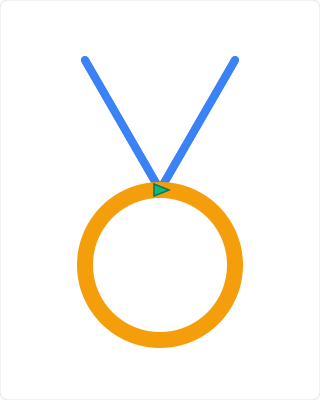
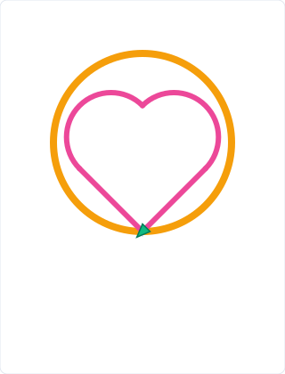
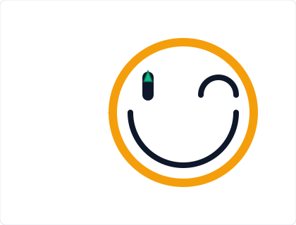
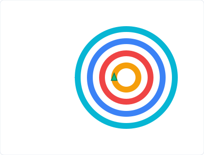
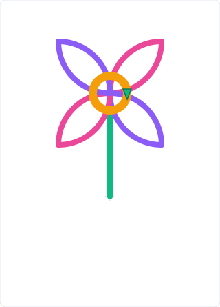

# `param.B`: Emblem & Emoji Studio (`🎨 🐢`)

- **Activity ID:** `param.B` *(Legacy Alias: `2B`)*
- **Format:** `capstone` (`capstoneType: creative`)
- **Simulation:** `turtle` ([Turtle LOGO](../../envs/turtle_logo.md))
- **Icon:** `🎨 🐢`
- **Concept:** Unrolled Creative Synthesis — Lengths, Trajectory Angles, Persistent Pen Colors & Widths, `PEN_UP`/`PEN_DOWN`, and `ARC_LEFT`/`ARC_RIGHT`

<details>
<summary>📖 Parent / Teacher Tip (Adult-Only Reference — Never Rendered to Learners)</summary>

Here kids combine every Turtle LOGO parameter unlocked in `param.2`, `param.3`, and `param.4` to draw expressive ribbons, badges, winking emojis, bullseye shields, and curved flowers—all **without loops or `TELEPORT`**, staying cleanly within the unrolled Sandbox block budgets (`Starter & Var 1 ≤ 14`, `Var 2 ~20`, `Var 3–4 ≤ 30`). Notice how `PEN_UP` and `PEN_DOWN` cleanly center eyes, target rings, and flower centers!

</details>

## Palette, SlotCap & Environment State

- **Palette (`PaletteConfig`):**
  ```json
  {
    "allowedSimBlocks": [
      "FORWARD", "BACKWARD", "TURN_LEFT", "TURN_RIGHT",
      "ARC_LEFT", "ARC_RIGHT",
      "PEN_UP", "PEN_DOWN",
      "SET_PEN_COLOR", "SET_PEN_WIDTH"
    ],
    "allowedControlBlocks": [],
    "allowedScopes": ["MAIN"],
    "allowRepeatBadges": true,
    "allowActionParams": true,
    "allowedBlockParams": {
      "length": [25, 50, 75, 100, 125, 150],
      "angle": [15, 30, 45, 60, 72, 90, 120, 135, 144, 150, 180, 270, 360],
      "radius": [25, 30, 40, 50, 60, 75, 100, 125, 150],
      "color": [0, 1, 2, 3, 4, 5, 6, 7, 8, 9],
      "width": [2, 4, 6, 8, 12, 16, 20]
    },
    "allowVariables": false,
    "allowRecursion": false
  }
  ```
- **SlotCap (`SlotCapConfig`):** `null` (Creative Capstone Sandbox: Starter & Var 1 `≤ 14`, Var 2 `~20`, Var 3+ `≤ 30`)
- **Env Defaults:** `(0, 0)`, heading `0°` North, `penDown: true`, `penColor: '#0f172a'`, `penWidth: 6`
- **Explicit Boundaries:** Uses canonical `FORWARD`/`BACKWARD`, no `TELEPORT`, no loops; trajectory/curvature badges only.

---

## Starter Workspace (`starterWorkspace`): `🏅 Colored Winner Medal` (`12` blocks `≤ 14`)



- **MAIN (`blocks.length = 12`):**
  1. `SET_PEN_COLOR {"color": "#3b82f6"}` *(2=Blue V-ribbon)*
  2. `SET_PEN_WIDTH {"width": 8}`
  3. `TURN_LEFT {"angle": 30}`
  4. `FORWARD {"length": 100}`
  5. `BACKWARD {"length": 100}`
  6. `TURN_RIGHT {"angle": 60}`
  7. `FORWARD {"length": 100}`
  8. `BACKWARD {"length": 100}`
  9. `TURN_RIGHT {"angle": 60}`
  10. `SET_PEN_COLOR {"color": "#f59e0b"}` *(4=Amber/Gold medallion)*
  11. `SET_PEN_WIDTH {"width": 16}`
  12. `ARC_RIGHT {"radius": 50, "angle": 360}`
- **Verified Renderer Output (`render_logo_svg.mjs`):** `finalPose: (0, 0), heading: 90°`, `pathCount: 5`.

---

## Creative Variation Cards (`variations[]`)

### Variation 1 (`param-b-var1-heart-crest`): `💝 Heart Medallion Crest` (`13` blocks `≤ 14`)
*(New `≤ 14`-block bridge card combining a Gold `R=50` outer halo ring with a compact `param.4` Pink heart centered cleanly inside.)*



- **MAIN (`blocks.length = 13`):**
  1. `SET_PEN_COLOR {"color": "#f59e0b"}` *(Gold halo)*
  2. `SET_PEN_WIDTH {"width": 8}`
  3. `TURN_RIGHT {"angle": 90}`
  4. `ARC_LEFT {"radius": 50, "angle": 360}`
  5. `TURN_LEFT {"angle": 90}`
  6. `SET_PEN_COLOR {"color": "#ec4899"}` *(Pink heart)*
  7. `SET_PEN_WIDTH {"width": 6}`
  8. `TURN_LEFT {"angle": 45}`
  9. `FORWARD {"length": 50}`
  10. `ARC_RIGHT {"radius": 25, "angle": 180}`
  11. `TURN_LEFT {"angle": 90}`
  12. `ARC_RIGHT {"radius": 25, "angle": 180}`
  13. `FORWARD {"length": 50}`
- **Verified Renderer Output (`render_logo_svg.mjs`):** `finalPose: (0.0002, 0), heading: 225°`, `pathCount: 5`.

### Variation 2 (`param-b-var2-winking-emoji`): `😉 Winking Emoji` (`22` blocks `~20`)
*(Draws a `R=100` Gold face centered at `(100, 0)` with `PEN_UP` repositioned Black `R=75` smile, `R=25` right wink arch, and thick left open eye.)*



- **MAIN (`blocks.length = 22`):**
  1. `SET_PEN_COLOR {"color": "#f59e0b"}`
  2. `SET_PEN_WIDTH {"width": 12}`
  3. `ARC_RIGHT {"radius": 100, "angle": 360}`
  4. `PEN_UP`
  5. `TURN_RIGHT {"angle": 90}`
  6. `FORWARD {"length": 25}`
  7. `TURN_RIGHT {"angle": 90}`
  8. `SET_PEN_COLOR {"color": "#0f172a"}`
  9. `SET_PEN_WIDTH {"width": 8}`
  10. `PEN_DOWN`
  11. `ARC_LEFT {"radius": 75, "angle": 180}`
  12. `PEN_UP`
  13. `FORWARD {"length": 25}`
  14. `PEN_DOWN`
  15. `ARC_LEFT {"radius": 25, "angle": 180}`
  16. `PEN_UP`
  17. `TURN_RIGHT {"angle": 90}`
  18. `FORWARD {"length": 75}`
  19. `TURN_RIGHT {"angle": 90}`
  20. `SET_PEN_WIDTH {"width": 16}`
  21. `PEN_DOWN`
  22. `FORWARD {"length": 25}`
- **Verified Renderer Output (`render_logo_svg.mjs`):** `finalPose: (50, -50), heading: 0°`, `pathCount: 4`.

### Variation 3 (`param-b-var3-bullseye-shield`): `🛡️ 4-Ring Bullseye Shield` (`24` blocks `≤ 30`)
*(Steps inward `25px` per ring via `PEN_UP`/`PEN_DOWN` to draw four concentric circles—Cyan `100`, Blue `75`, Red `50`, Yellow `25`—centered around `(100, 0)`.)*



- **MAIN (`blocks.length = 24`):**
  1. `SET_PEN_WIDTH {"width": 12}`
  2. `SET_PEN_COLOR {"color": "#06b6d4"}` *(Cyan outer ring)*
  3. `ARC_RIGHT {"radius": 100, "angle": 360}`
  4. `PEN_UP`
  5. `TURN_RIGHT {"angle": 90}`
  6. `FORWARD {"length": 25}`
  7. `TURN_LEFT {"angle": 90}`
  8. `SET_PEN_COLOR {"color": "#3b82f6"}` *(Blue ring)*
  9. `PEN_DOWN`
  10. `ARC_RIGHT {"radius": 75, "angle": 360}`
  11. `PEN_UP`
  12. `TURN_RIGHT {"angle": 90}`
  13. `FORWARD {"length": 25}`
  14. `TURN_LEFT {"angle": 90}`
  15. `SET_PEN_COLOR {"color": "#ef4444"}` *(Red ring)*
  16. `PEN_DOWN`
  17. `ARC_RIGHT {"radius": 50, "angle": 360}`
  18. `PEN_UP`
  19. `TURN_RIGHT {"angle": 90}`
  20. `FORWARD {"length": 25}`
  21. `TURN_LEFT {"angle": 90}`
  22. `SET_PEN_COLOR {"color": "#f59e0b"}` *(Yellow bullseye)*
  23. `PEN_DOWN`
  24. `ARC_RIGHT {"radius": 25, "angle": 360}`
- **Verified Renderer Output (`render_logo_svg.mjs`):** `finalPose: (75, 0), heading: 0°`, `pathCount: 4`.

### Variation 4 (`param-b-var4-curved-flower`): `🌸 4-Petal Curved Flower` (`30` blocks `≤ 30`)
*(Fixes legacy broken `2B-curved-flower` where petals floated upward off-axis: draws 4 symmetric alternating Pink/Purple pointed petals meeting cleanly at `(0, -100)` with a dead-center `R=25` Amber pollen ring.)*



- **MAIN (`blocks.length = 30`):**
  1. `SET_PEN_COLOR {"color": "#10b981"}` *(Green stem)*
  2. `SET_PEN_WIDTH {"width": 8}`
  3. `FORWARD {"length": 100}`
  4. `SET_PEN_COLOR {"color": "#ec4899"}` *(Pink NE petal)*
  5. `ARC_RIGHT {"radius": 50, "angle": 90}`
  6. `TURN_RIGHT {"angle": 90}`
  7. `ARC_RIGHT {"radius": 50, "angle": 90}`
  8. `TURN_RIGHT {"angle": 180}`
  9. `SET_PEN_COLOR {"color": "#8b5cf6"}` *(Purple SE petal)*
  10. `ARC_RIGHT {"radius": 50, "angle": 90}`
  11. `TURN_RIGHT {"angle": 90}`
  12. `ARC_RIGHT {"radius": 50, "angle": 90}`
  13. `TURN_RIGHT {"angle": 180}`
  14. `SET_PEN_COLOR {"color": "#ec4899"}` *(Pink SW petal)*
  15. `ARC_RIGHT {"radius": 50, "angle": 90}`
  16. `TURN_RIGHT {"angle": 90}`
  17. `ARC_RIGHT {"radius": 50, "angle": 90}`
  18. `TURN_RIGHT {"angle": 180}`
  19. `SET_PEN_COLOR {"color": "#8b5cf6"}` *(Purple NW petal)*
  20. `ARC_RIGHT {"radius": 50, "angle": 90}`
  21. `TURN_RIGHT {"angle": 90}`
  22. `ARC_RIGHT {"radius": 50, "angle": 90}`
  23. `SET_PEN_COLOR {"color": "#f59e0b"}` *(Amber centered core)*
  24. `SET_PEN_WIDTH {"width": 12}`
  25. `PEN_UP`
  26. `TURN_LEFT {"angle": 90}`
  27. `FORWARD {"length": 25}`
  28. `TURN_RIGHT {"angle": 90}`
  29. `PEN_DOWN`
  30. `ARC_RIGHT {"radius": 25, "angle": 360}`
- **Verified Renderer Output (`render_logo_svg.mjs`):** `finalPose: (25, -100), heading: 180°`, `pathCount: 10`.

## Verification Checklist
- [x] Every script uses pure unrolled Turtle LOGO ops (`FORWARD`/`BACKWARD`, no `TELEPORT`, no `Loop`).
- [x] Fixes legacy `2B-curved-flower` symmetry & center offset (`center = (0, -100)`).
- [x] All 5 figures (`12`, `13`, `22`, `24`, `30`) verified via `render_logo_svg.mjs` within Sandbox block budgets.
