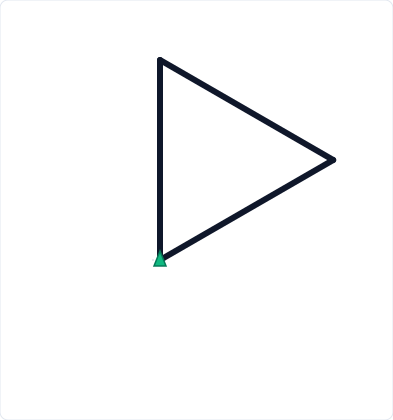
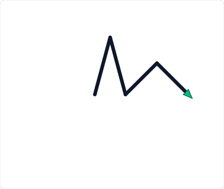
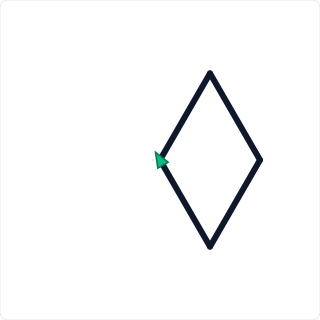
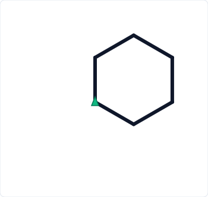
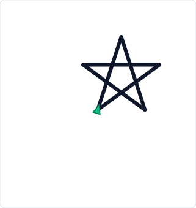

# `param.2`: Length & Turn Angle Parameters (`🐢`)

- **Activity ID:** `param.2` *(Legacy Alias: `2.2`)*
- **Format:** `sandbox`
- **Simulation:** `turtle` ([Turtle LOGO](../../envs/turtle_logo.md))
- **Icon:** `🐢`
- **Concept:** Parameterized Forward/Backward Distances & Exterior CCW/CW Trajectory Turn Angles

<details>
<summary>📖 Parent / Teacher Tip (Adult-Only Reference — Never Rendered to Learners)</summary>

In Turtle LOGO, `TURN_LEFT` and `TURN_RIGHT` spin the turtle by an **exterior turn angle** shown via live directional trajectory-arc badges (`RotationVisual` with crisp presets including `15°..180°`, **`72°`**, and **`144°`**). Even though a triangle's inside corners are `60°`, the turtle turns `120°` at each corner (`3 × 120° = 360°`) to close the loop! Encourage kids to test `150°` (sharp mountain needle) vs. `90°` (wide gable roof) in Variation 1, and explore `144°` in the 5-Point Star challenge.

</details>

## Palette, SlotCap & Environment State

- **Palette (`PaletteConfig`):**
  ```json
  {
    "allowedSimBlocks": ["FORWARD", "BACKWARD", "TURN_LEFT", "TURN_RIGHT", "PEN_UP", "PEN_DOWN"],
    "allowedControlBlocks": [],
    "allowedScopes": ["MAIN"],
    "allowRepeatBadges": true,
    "allowActionParams": true,
    "allowedBlockParams": {
      "length": [25, 50, 75, 100, 125, 150],
      "angle": [15, 30, 45, 60, 72, 90, 120, 135, 144, 150, 180]
    },
    "allowVariables": false,
    "allowRecursion": false
  }
  ```
- **SlotCap (`SlotCapConfig`):** `null` (Sandbox: Starter & Var 1 `≤ 14`, Var 2 `≤ 20`, Var 3+ `≤ 30`)
- **Env Defaults:** Canvas center `(0, 0)`, heading `0°` (`North`), `penDown: true`, `penColor: '#0f172a'`, `penWidth: 6`
- **Explicit Boundaries:** Uses `FORWARD`/`BACKWARD` (never `MOVE_FWD`/`MOVE_BACK`, never `TELEPORT`). Angle badges use directional `RotationVisual` trajectory badges (`CCW`/`CW` arrows + angle ticks, **no pie-wedge pickers**).

---

## Starter Workspace (`starterWorkspace`): Equilateral Triangle (`6` blocks `≤ 14`)



- **MAIN (`blocks.length = 6`):**
  1. `FORWARD {"length": 100}`
  2. `TURN_RIGHT {"angle": 120}`
  3. `FORWARD {"length": 100}`
  4. `TURN_RIGHT {"angle": 120}`
  5. `FORWARD {"length": 100}`
  6. `TURN_RIGHT {"angle": 120}`
- **Verified Renderer Output (`render_logo_svg.mjs`):** `finalPose: (0, 0), heading: 0°`, `pathCount: 3`.

---

## Creative Variation Cards (`variations[]`)

### Variation 1 (`param-2-var1-mountain-roof`): `🏔️ Steep Peak & Wide Roof` (`8` blocks `≤ 14`)
*(Upgraded from legacy broken `2.2-mountain-roof` staircase so both shapes share the exact `y = 0` baseline and cleanly contrast `150°` steep summit vs. `90°` wide gable.)*



- **MAIN (`blocks.length = 8`):**
  1. `TURN_RIGHT {"angle": 15}`
  2. `FORWARD {"length": 100}`
  3. `TURN_RIGHT {"angle": 150}`
  4. `FORWARD {"length": 100}`
  5. `TURN_LEFT {"angle": 120}`
  6. `FORWARD {"length": 75}`
  7. `TURN_RIGHT {"angle": 90}`
  8. `FORWARD {"length": 75}`
- **Verified Renderer Output (`render_logo_svg.mjs`):** `finalPose: (157.8298, 0), heading: 135°`, `pathCount: 4`.

### Variation 2 (`param-2-var2-tilted-diamond`): `🔷 Upright Diamond (60° / 120°)` (`8` blocks `≤ 20`)
*(Upgraded from legacy `2.2-tilted-diamond` horizontal parallelogram into a vertical upright rhombus.)*



- **MAIN (`blocks.length = 8`):**
  1. `TURN_RIGHT {"angle": 30}`
  2. `FORWARD {"length": 100}`
  3. `TURN_RIGHT {"angle": 120}`
  4. `FORWARD {"length": 100}`
  5. `TURN_RIGHT {"angle": 60}`
  6. `FORWARD {"length": 100}`
  7. `TURN_RIGHT {"angle": 120}`
  8. `FORWARD {"length": 100}`
- **Verified Renderer Output (`render_logo_svg.mjs`):** `finalPose: (0, 0), heading: 330°`, `pathCount: 4`.

### Variation 3 (`param-2-var3-hexagon`): `🛑 Closed Stop-Sign Hexagon` (`12` blocks `≤ 30`)
*(Upgraded from unfinished legacy `2.2-hexagon-dish` into a complete 6-sided closed hexagon returning to `(0, 0)` at `0°`.)*



- **MAIN (`blocks.length = 12`):**
  1. `FORWARD {"length": 75}`
  2. `TURN_RIGHT {"angle": 60}`
  3. `FORWARD {"length": 75}`
  4. `TURN_RIGHT {"angle": 60}`
  5. `FORWARD {"length": 75}`
  6. `TURN_RIGHT {"angle": 60}`
  7. `FORWARD {"length": 75}`
  8. `TURN_RIGHT {"angle": 60}`
  9. `FORWARD {"length": 75}`
  10. `TURN_RIGHT {"angle": 60}`
  11. `FORWARD {"length": 75}`
  12. `TURN_RIGHT {"angle": 60}`
- **Verified Renderer Output (`render_logo_svg.mjs`):** `finalPose: (0, 0), heading: 0°`, `pathCount: 6`.

### Variation 4 (`param-2-var4-five-point-star`): `⭐ 5-Point Star (144° Preset)` (`11` blocks `≤ 30`)
*(New card highlighting the added `144°` exterior star-turn preset in `VisualParamBadges`.)*



- **MAIN (`blocks.length = 11`):**
  1. `TURN_RIGHT {"angle": 18}`
  2. `FORWARD {"length": 125}`
  3. `TURN_RIGHT {"angle": 144}`
  4. `FORWARD {"length": 125}`
  5. `TURN_RIGHT {"angle": 144}`
  6. `FORWARD {"length": 125}`
  7. `TURN_RIGHT {"angle": 144}`
  8. `FORWARD {"length": 125}`
  9. `TURN_RIGHT {"angle": 144}`
  10. `FORWARD {"length": 125}`
  11. `TURN_RIGHT {"angle": 144}`
- **Verified Renderer Output (`render_logo_svg.mjs`):** `finalPose: (0, 0), heading: 18°`, `pathCount: 5`.

## Verification Checklist
- [x] Every script uses canonical Turtle ops (`FORWARD`, `BACKWARD`, `TURN_LEFT`, `TURN_RIGHT`, `PEN_UP`, `PEN_DOWN`); no `MOVE_FWD` or `TELEPORT`.
- [x] Every Starter + Variation script verified through `render_logo_svg.mjs` with SVG embedded above.
- [x] All block counts comfortably inside `≤ 14 / ~20 / ≤ 30` Sandbox guardrails without loops.
