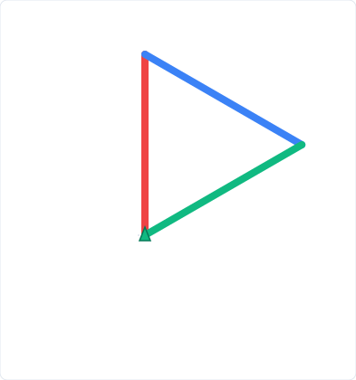
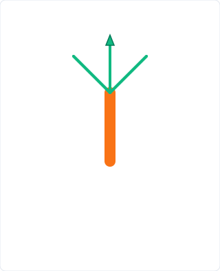
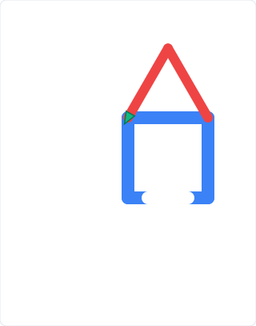

# `param.3`: Persistent Style State & White Eraser (`🐢`)

- **Activity ID:** `param.3` *(Legacy Alias: `2.3`)*
- **Format:** `sandbox`
- **Simulation:** `turtle` ([Turtle LOGO](../../envs/turtle_logo.md))
- **Icon:** `🐢`
- **Concept:** Persistent `SET_PEN_COLOR` (`0..9`) & `SET_PEN_WIDTH` State Across Multiple Strokes, Plus `White` (`#ffffff`) Selective Erasing

<details>
<summary>📖 Parent / Teacher Tip (Adult-Only Reference — Never Rendered to Learners)</summary>

Once you set a pen color or stroke width, the turtle remembers that style for every later line until you set a new one! Notice two key design details:
1. Setting `White` (`index 9`, shown with a slate border + eraser-tip badge) lets kids **carve clean doorways or notches** straight across existing colored strokes on the white canvas.
2. Only standard palette colors `0..9` (`Black, Red, Blue, Green, Yellow/Amber, Purple, Pink, Cyan, Orange, White`) exist—there is no Brown, so tree trunks use thick **`Orange`** (`#f97316`) or **`Black`** (`#0f172a`).

</details>

## Palette, SlotCap & Environment State

- **Palette (`PaletteConfig`):**
  ```json
  {
    "allowedSimBlocks": [
      "FORWARD", "BACKWARD", "TURN_LEFT", "TURN_RIGHT",
      "PEN_UP", "PEN_DOWN", "SET_PEN_COLOR", "SET_PEN_WIDTH"
    ],
    "allowedControlBlocks": [],
    "allowedScopes": ["MAIN"],
    "allowRepeatBadges": true,
    "allowActionParams": true,
    "allowedBlockParams": {
      "length": [25, 50, 75, 100, 125, 150, 200],
      "angle": [15, 30, 45, 60, 72, 90, 120, 135, 144, 150, 180],
      "color": [0, 1, 2, 3, 4, 5, 6, 7, 8, 9],
      "width": [2, 4, 6, 8, 12, 16, 20]
    },
    "allowVariables": false,
    "allowRecursion": false
  }
  ```
- **SlotCap (`SlotCapConfig`):** `null` (Sandbox: Starter & Var 1 `≤ 14`, Var 2 `≤ 20`, Var 3 `≤ 30`)
- **Env Defaults:** `(0, 0)`, heading `0°` North, `penDown: true`, `penColor: '#0f172a'`, `penWidth: 6`
- **UI & Coach Spotlights:**
  - `White` (`index 9`, `#ffffff`) swatch renders a crisp slate rim + subtle diagonal eraser-tip corner accent (`showEraserCue`), gated strictly to Turtle `SET_PEN_COLOR` so Beat's `#ffffff` LED swatch stays untouched.

---

## Starter Workspace (`starterWorkspace`): `Red & Blue Bars + White Eraser Slice` (`14` blocks `≤ 14`)
*(Fixes legacy `2.3` Starter which never showed `White` erasing: thick `Width 16` persists from Red to Blue across `PEN_UP`/`PEN_DOWN`, then `White` (`Width 8`) slices diagonally across both pillars.)*


- **MAIN (`blocks.length = 14`):**
  1. `SET_PEN_WIDTH {"width": 16}`
  2. `SET_PEN_COLOR {"color": "#ef4444"}` *(1=Red)*
  3. `FORWARD {"length": 200}`
  4. `PEN_UP`
  5. `TURN_RIGHT {"angle": 90}`
  6. `FORWARD {"length": 50}`
  7. `TURN_RIGHT {"angle": 90}`
  8. `PEN_DOWN`
  9. `SET_PEN_COLOR {"color": "#3b82f6"}` *(2=Blue — `width: 16` persists!)*
  10. `FORWARD {"length": 200}`
  11. `TURN_RIGHT {"angle": 135}`
  12. `SET_PEN_COLOR {"color": "#ffffff"}` *(9=White eraser)*
  13. `SET_PEN_WIDTH {"width": 8}`
  14. `FORWARD {"length": 150}`
- **Verified Renderer Output (`render_logo_svg.mjs`):** `finalPose: (-56.066, -106.066), heading: 315°`, `penColor: '#ffffff'`, `penWidth: 8`, `pathCount: 3`.

---

## Creative Variation Cards (`variations[]`)

### Variation 1 (`param-3-var1-tricolor-triangle`): `🔺 Tricolor Triangle` (`10` blocks `≤ 14`)
*(Shows `SET_PEN_WIDTH 8` persisting across Red, Blue, and Green edges.)*



- **MAIN (`blocks.length = 10`):**
  1. `SET_PEN_WIDTH {"width": 8}`
  2. `SET_PEN_COLOR {"color": "#ef4444"}` *(Red)*
  3. `FORWARD {"length": 200}`
  4. `TURN_RIGHT {"angle": 120}`
  5. `SET_PEN_COLOR {"color": "#3b82f6"}` *(Blue)*
  6. `FORWARD {"length": 200}`
  7. `TURN_RIGHT {"angle": 120}`
  8. `SET_PEN_COLOR {"color": "#10b981"}` *(Green)*
  9. `FORWARD {"length": 200}`
  10. `TURN_RIGHT {"angle": 120}`
- **Verified Renderer Output (`render_logo_svg.mjs`):** `finalPose: (0, 0), heading: 0°`, `penColor: '#10b981'`, `penWidth: 8`, `pathCount: 3`.

### Variation 2 (`param-3-var2-trunk-twigs`): `🌳 Thick Orange Trunk & Green Canopy` (`13` blocks `≤ 20`)
*(Fixes legacy `2.3-trunk-twigs` color choice by using valid palette `Orange #f97316` index `8` for the `Width 16` trunk and adds center canopy spire.)*



- **MAIN (`blocks.length = 13`):**
  1. `SET_PEN_COLOR {"color": "#f97316"}` *(8=Orange)*
  2. `SET_PEN_WIDTH {"width": 16}`
  3. `FORWARD {"length": 100}`
  4. `SET_PEN_COLOR {"color": "#10b981"}` *(3=Green)*
  5. `SET_PEN_WIDTH {"width": 4}`
  6. `TURN_LEFT {"angle": 45}`
  7. `FORWARD {"length": 75}`
  8. `BACKWARD {"length": 75}`
  9. `TURN_RIGHT {"angle": 90}`
  10. `FORWARD {"length": 75}`
  11. `BACKWARD {"length": 75}`
  12. `TURN_LEFT {"angle": 45}`
  13. `FORWARD {"length": 75}`
- **Verified Renderer Output (`render_logo_svg.mjs`):** `finalPose: (0, -175), heading: 0°`, `penColor: '#10b981'`, `penWidth: 4`, `pathCount: 6`.

### Variation 3 (`param-3-var3-painted-house`): `🏠 Painted House with White Doorway Cutout` (`25` blocks `≤ 30`)
*(Synthesizes `param.2` exterior roof angles `30°/120°`, persistent `Width 16` Blue walls + `Width 12` Red roof, and `White` selective erasing of a clean 50px front doorway.)*



- **MAIN (`blocks.length = 25`):**
  1. `SET_PEN_COLOR {"color": "#3b82f6"}` *(2=Blue)*
  2. `SET_PEN_WIDTH {"width": 16}`
  3. `FORWARD {"length": 100}`
  4. `TURN_RIGHT {"angle": 90}`
  5. `FORWARD {"length": 100}`
  6. `TURN_RIGHT {"angle": 90}`
  7. `FORWARD {"length": 100}`
  8. `TURN_RIGHT {"angle": 90}`
  9. `FORWARD {"length": 100}`
  10. `PEN_UP`
  11. `BACKWARD {"length": 25}`
  12. `SET_PEN_COLOR {"color": "#ffffff"}` *(9=White eraser; width 16 persists!)*
  13. `PEN_DOWN`
  14. `BACKWARD {"length": 50}`
  15. `PEN_UP`
  16. `BACKWARD {"length": 25}`
  17. `TURN_RIGHT {"angle": 90}`
  18. `FORWARD {"length": 100}`
  19. `PEN_DOWN`
  20. `SET_PEN_COLOR {"color": "#ef4444"}` *(1=Red)*
  21. `SET_PEN_WIDTH {"width": 12}`
  22. `TURN_LEFT {"angle": 30}`
  23. `FORWARD {"length": 100}`
  24. `TURN_LEFT {"angle": 120}`
  25. `FORWARD {"length": 100}`
- **Verified Renderer Output (`render_logo_svg.mjs`):** `finalPose: (0, -100), heading: 210°`, `penColor: '#ef4444'`, `penWidth: 12`, `pathCount: 7`.

## Verification Checklist
- [x] Strictly uses `PALETTE_COLORS` (`0..9`); zero nonexistent colors (like Brown).
- [x] Starter directly demonstrates both persistent `Width 16` across strokes AND visible `White` erasing across colored bars.
- [x] Every figure verified through `render_logo_svg.mjs`; `≤ 14 / ≤ 20 / ≤ 30` guardrails met.
