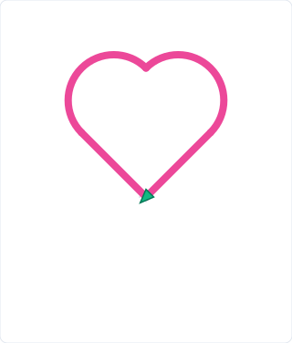
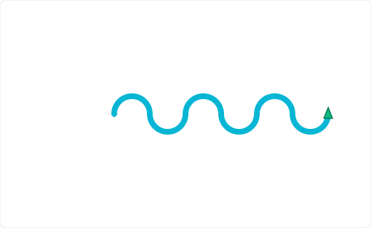
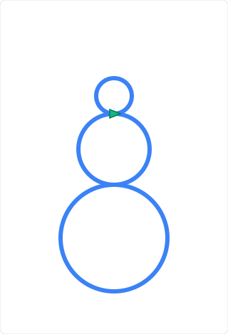

# `param.4`: Multi-Parameter Actions (`🐢`)

- **Activity ID:** `param.4` *(Legacy Alias: `2.4`)*
- **Format:** `sandbox`
- **Simulation:** `turtle` ([Turtle LOGO](../../envs/turtle_logo.md))
- **Icon:** `🐢`
- **Concept:** Coordinating Two Independent Parameters (`radius`, `angle`) on `ARC_LEFT` and `ARC_RIGHT`

<details>
<summary>📖 Parent / Teacher Tip (Adult-Only Reference — Never Rendered to Learners)</summary>

`ARC_LEFT` and `ARC_RIGHT` introduce two side-by-side parameter badges on one block: **`radius`** (`RadiusVisual` curve size: `25..150`) and **`angle`** (`ArcAngleVisual` curve sweep: `30°..360°`). Step Execution (`Step`) lets learners watch one curved sweep at a time while building shapes. In the Geometry Heart starter, note the exact closing trick: `length = 2 × radius` (`100 = 2 × 50`), so two `180°` semicircles meet cleanly back at `(0, 0)` without needing `TELEPORT`.

</details>

## Palette, SlotCap & Environment State

- **Palette (`PaletteConfig`):**
  ```json
  {
    "allowedSimBlocks": [
      "FORWARD", "BACKWARD", "TURN_LEFT", "TURN_RIGHT",
      "PEN_UP", "PEN_DOWN", "SET_PEN_COLOR", "SET_PEN_WIDTH",
      "ARC_LEFT", "ARC_RIGHT"
    ],
    "allowedControlBlocks": [],
    "allowedScopes": ["MAIN"],
    "allowRepeatBadges": true,
    "allowActionParams": true,
    "allowedBlockParams": {
      "length": [25, 50, 75, 100, 125, 150],
      "angle": [15, 30, 45, 60, 72, 90, 120, 135, 144, 150, 180, 270, 360],
      "radius": [25, 30, 40, 50, 60, 75, 100, 125, 150],
      "color": [0, 1, 2, 3, 4, 5, 6, 7, 8, 9],
      "width": [2, 4, 6, 8, 12, 16, 20]
    },
    "allowVariables": false,
    "allowRecursion": false
  }
  ```
- **SlotCap (`SlotCapConfig`):** `null` (Sandbox: Starter & Var 1 `≤ 14`, Var 2 `≤ 20`, Var 3 `≤ 30`)
- **Env Defaults:** `(0, 0)`, heading `0°` North, `penDown: true`, `penColor: '#0f172a'`, `penWidth: 6`
- **UI & Coach Spotlights:**
  - Dual badges on `ARC_LEFT` / `ARC_RIGHT`: existing **`RadiusVisual`** (left) + **`ArcAngleVisual`** (right) trajectory/curvature SVG badges (`no pie-wedge pickers` and no combined popover live arc preview per user-reviewed `env_logo_plan.md` §3).

---

## Starter Workspace (`starterWorkspace`): `Geometry Heart` (`8` blocks `≤ 14`)



- **MAIN (`blocks.length = 8`):**
  1. `SET_PEN_COLOR {"color": "#ec4899"}` *(6=Pink)*
  2. `SET_PEN_WIDTH {"width": 8}`
  3. `TURN_LEFT {"angle": 45}`
  4. `FORWARD {"length": 100}` *(chord = `2R`)*
  5. `ARC_RIGHT {"radius": 50, "angle": 180}`
  6. `TURN_LEFT {"angle": 90}`
  7. `ARC_RIGHT {"radius": 50, "angle": 180}`
  8. `FORWARD {"length": 100}`
- **Verified Renderer Output (`render_logo_svg.mjs`):** `finalPose: (-0.0002, 0), heading: 225°`, `penColor: '#ec4899'`, `pathCount: 4`.

---

## Creative Variation Cards (`variations[]`)

### Variation 1 (`param-4-var1-ocean-wave`): `🌊 Wavy Ocean Line` (`8` blocks `≤ 14`)
*(Uses `radius: 25` so 3 alternating crests and troughs stay compact and cleanly centered on canvas.)*



- **MAIN (`blocks.length = 8`):**
  1. `SET_PEN_COLOR {"color": "#06b6d4"}` *(7=Cyan)*
  2. `SET_PEN_WIDTH {"width": 8}`
  3. `ARC_RIGHT {"radius": 25, "angle": 180}`
  4. `ARC_LEFT {"radius": 25, "angle": 180}`
  5. `ARC_RIGHT {"radius": 25, "angle": 180}`
  6. `ARC_LEFT {"radius": 25, "angle": 180}`
  7. `ARC_RIGHT {"radius": 25, "angle": 180}`
  8. `ARC_LEFT {"radius": 25, "angle": 180}`
- **Verified Renderer Output (`render_logo_svg.mjs`):** `finalPose: (300, 0), heading: 0°`, `pathCount: 6`.

### Variation 2 (`param-4-var2-snowman`): `⛄ 3-Radius Snowman (25, 50, 75)` (`7` blocks `≤ 20`)
*(Draws three tangent full circles vertically (`y = -50..0`, `0..100`, `100..250`) by alternating `ARC_LEFT 360°` and `ARC_RIGHT 180°` halves.)*



- **MAIN (`blocks.length = 7`):**
  1. `SET_PEN_COLOR {"color": "#3b82f6"}` *(2=Blue)*
  2. `SET_PEN_WIDTH {"width": 6}`
  3. `TURN_RIGHT {"angle": 90}`
  4. `ARC_LEFT {"radius": 25, "angle": 360}`
  5. `ARC_RIGHT {"radius": 50, "angle": 180}`
  6. `ARC_LEFT {"radius": 75, "angle": 360}`
  7. `ARC_RIGHT {"radius": 50, "angle": 180}`
- **Verified Renderer Output (`render_logo_svg.mjs`):** `finalPose: (0, 0), heading: 90°`, `pathCount: 4`.

### Variation 3 (`param-4-var3-rainbow-arches`): `🌈 Nested Rainbow Arches` (`24` blocks `≤ 30`)
*(Fixes legacy `2.4-rainbow-arches` which dragged floor lines between arches by cleanly lifting the pen (`PEN_UP`/`PEN_DOWN`) on every `25px` step inward across Red `100`, Amber `75`, Green `50`, and Blue `25`.)*


- **MAIN (`blocks.length = 24`):**
  1. `SET_PEN_WIDTH {"width": 8}`
  2. `SET_PEN_COLOR {"color": "#ef4444"}` *(Red outer arch)*
  3. `ARC_RIGHT {"radius": 100, "angle": 180}`
  4. `PEN_UP`
  5. `TURN_RIGHT {"angle": 90}`
  6. `FORWARD {"length": 25}`
  7. `TURN_RIGHT {"angle": 90}`
  8. `PEN_DOWN`
  9. `SET_PEN_COLOR {"color": "#f59e0b"}` *(Amber arch)*
  10. `ARC_LEFT {"radius": 75, "angle": 180}`
  11. `PEN_UP`
  12. `TURN_LEFT {"angle": 90}`
  13. `FORWARD {"length": 25}`
  14. `TURN_LEFT {"angle": 90}`
  15. `PEN_DOWN`
  16. `SET_PEN_COLOR {"color": "#10b981"}` *(Green arch)*
  17. `ARC_RIGHT {"radius": 50, "angle": 180}`
  18. `PEN_UP`
  19. `TURN_RIGHT {"angle": 90}`
  20. `FORWARD {"length": 25}`
  21. `TURN_RIGHT {"angle": 90}`
  22. `PEN_DOWN`
  23. `SET_PEN_COLOR {"color": "#3b82f6"}` *(Blue core arch)*
  24. `ARC_LEFT {"radius": 25, "angle": 180}`
- **Verified Renderer Output (`render_logo_svg.mjs`):** `finalPose: (75, 0), heading: 180°`, `pathCount: 4` (zero stray floor strokes).

## Verification Checklist
- [x] `L = 2R` heart closure verified (`(-0.0002, 0)`).
- [x] Legacy `2.4-rainbow-arches` missing `PEN_UP` bug fixed and verified (`pathCount: 4`).
- [x] `≤ 14 / ≤ 20 / ≤ 30` Sandbox guardrails respected (`8`, `8`, `7`, `24`).
