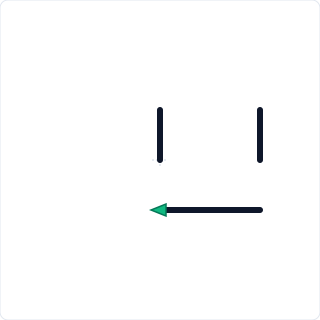
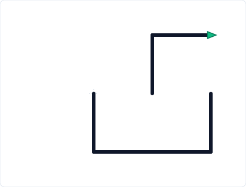
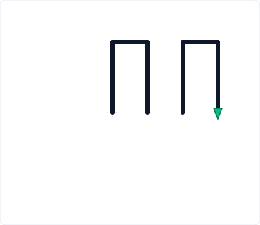
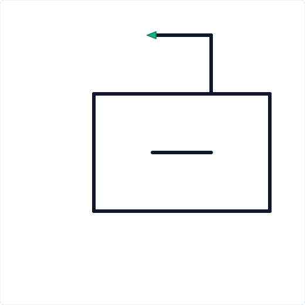

# Capstone `seq.B` — Postcard Sketch

> [← Module `seq` Overview](./overview.md) · **Format:** 🎨 Capstone Sandbox · **Environment:** [🐢 Turtle LOGO](../../envs/turtle_logo.md) · **ID:** `seq.B` (Legacy Alias: `1B`)

**One-Concept Goal:** Synthesize `100px` movement, `90°`-locked turns, `Pen Up`, and `Pen Down` to illustrate charming multi-part postcard artwork (`≤ 14` block Starter & Var 1, up to `20` Var 2, up to `30` Showcase Var 3) with zero text/letter prompts.

📖 Parent / Teacher Tip (Adult Context — Collapsed by Default)

This creative capstone celebrates everything learned in Turtle LOGO while honoring Module `seq`'s two-axis block guardrails (`≤ 14` Starter/Var 1, `≤ 20` Var 2, `≤ 30` Showcase Var 3). Kids start with a `14`-block **Pixel Buddy Face** (`| |` eyes + smile bar) and can explore **Sailboat on Water** (`14` blocks), **Twin Towers** (`19` blocks), or a **`27`-block Blocky Robot with Visor & Antenna**—all verified on the `100px` lattice with zero reading required!

---

## Palette, Scopes, Caps & Environment Setup

- **Allowed Blocks (`allowedSimBlocks`):** `["FORWARD", "BACKWARD", "TURN_LEFT", "TURN_RIGHT", "PEN_UP", "PEN_DOWN"]` *(strictly omits Grid opcodes `MOVE_FWD` / `MOVE_BACK`)*
- **Allowed Control Blocks (`allowedControlBlocks`):** `[]`
- **Block Parameter Lock (`allowedBlockParams`):** Fixed `100px` steps, `TURN_LEFT: { fixedAngle: 90 }`, `TURN_RIGHT: { fixedAngle: 90 }`, `allowActionParams: false`, `allowRepeatBadges: false`, `allowVariables: false`
- **Allowed Scope Tabs:** `["MAIN"]` (`allowRecursion: false`)
- **Slot Cap (`slotCap`):** `null`
- **Environment Setup:** Start pose `(0, 0, 0° NORTH)`, `penDown: true`, `penColor: "#0f172a"`, `penWidth: 6`; dual-state turtle avatar (`Pen Up` vs `Pen Down`); `#e2e8f0` card borders.

---

## Starter Workspace (`starterWorkspace`)

### 🤖 Pixel Buddy Face (`14` flat blocks ≤ 14)

- **MAIN (`14` blocks):**
  1. `FORWARD`
  2. `PEN_UP`
  3. `TURN_RIGHT`
  4. `FORWARD`
  5. `FORWARD`
  6. `TURN_RIGHT`
  7. `PEN_DOWN`
  8. `FORWARD`
  9. `PEN_UP`
  10. `FORWARD`
  11. `PEN_DOWN`
  12. `TURN_RIGHT`
  13. `FORWARD`
  14. `FORWARD`
- **Rendered Verification (`render_logo_svg.mjs`):** Two vertical eyes `(0, 0)–(0, -100)` & `(200, -100)–(200, 0)` and horizontal smile `(200, 100)–(0, 100)`; `finalPose: (0, 100, 270°)`; `penDown: true`; `pathCount: 4`.

---

## Illustrated Copyable Variations (`variations[]`)

### Variation 1 (`seq.B-sailboat`): ⛵ Sailboat on Water (`14` flat blocks ≤ 14)

- **MAIN (`14` blocks):**
  1. `BACKWARD`
  2. `TURN_RIGHT`
  3. `FORWARD`
  4. `FORWARD`
  5. `TURN_LEFT`
  6. `FORWARD`
  7. `PEN_UP`
  8. `TURN_LEFT`
  9. `FORWARD`
  10. `TURN_RIGHT`
  11. `PEN_DOWN`
  12. `FORWARD`
  13. `TURN_RIGHT`
  14. `FORWARD`
- **Rendered Verification (`render_logo_svg.mjs`):** Open boat hull `(0,0)→(0,100)→(200,100)→(200,0)`, hops invisibly back to deck center `(100, 0)`, raises mast `(100, 0)→(100, -100)` and flag `(100, -100)→(200, -100)`; `finalPose: (200, -100, 90°)`; `penDown: true`; `pathCount: 6`.

---

### Variation 2 (`seq.B-twin-towers`): 🏙️ Twin Towers (`19` flat blocks ≤ 20)

- **MAIN (`19` blocks):**
  1. `FORWARD`
  2. `FORWARD`
  3. `TURN_RIGHT`
  4. `FORWARD`
  5. `TURN_RIGHT`
  6. `FORWARD`
  7. `FORWARD`
  8. `PEN_UP`
  9. `TURN_LEFT`
  10. `FORWARD`
  11. `TURN_LEFT`
  12. `PEN_DOWN`
  13. `FORWARD`
  14. `FORWARD`
  15. `TURN_RIGHT`
  16. `FORWARD`
  17. `TURN_RIGHT`
  18. `FORWARD`
  19. `FORWARD`
- **Rendered Verification (`render_logo_svg.mjs`):** Two `100×200` open tower arches at `[0..100] × [-200..0]` and `[200..300] × [-200..0]` separated by a `100px` street gap; `finalPose: (300, 0, 180°)`; `penDown: true`; `pathCount: 10`.

---

### Variation 3 (`seq.B-robot-visor`): 🤖 Blocky Robot with Visor & Antenna (`27` flat blocks ≤ 30 Showcase)

- **MAIN (`27` blocks):**
  1. `FORWARD`
  2. `FORWARD`
  3. `TURN_RIGHT`
  4. `FORWARD`
  5. `FORWARD`
  6. `FORWARD`
  7. `TURN_RIGHT`
  8. `FORWARD`
  9. `FORWARD`
  10. `TURN_RIGHT`
  11. `FORWARD`
  12. `FORWARD`
  13. `FORWARD`
  14. `PEN_UP`
  15. `TURN_RIGHT`
  16. `FORWARD`
  17. `TURN_RIGHT`
  18. `FORWARD`
  19. `PEN_DOWN`
  20. `FORWARD`
  21. `PEN_UP`
  22. `TURN_LEFT`
  23. `FORWARD`
  24. `PEN_DOWN`
  25. `FORWARD`
  26. `TURN_LEFT`
  27. `FORWARD`
- **Rendered Verification (`render_logo_svg.mjs`):** Closed `300×200` robot head `[0..300] × [-200..0]`, detached centered visor `(100, -100)–(200, -100)`, and top-mounted L-antenna `(200, -200)→(200, -300)→(100, -300)`; `finalPose: (100, -300, 270°)`; `penDown: true`; `pathCount: 13`.
