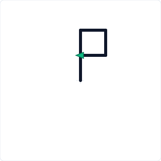
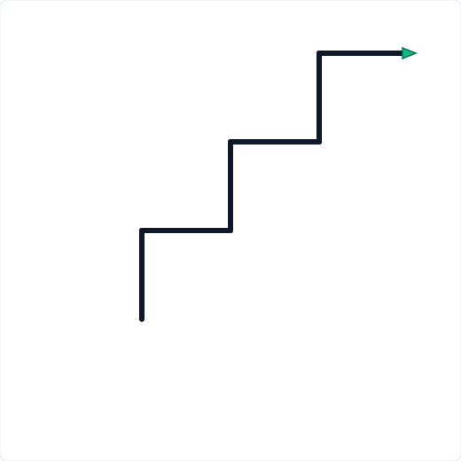
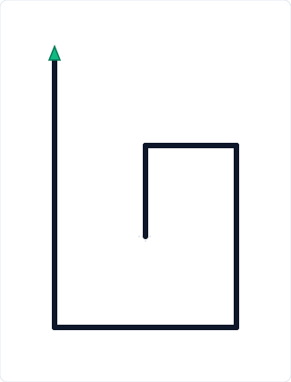
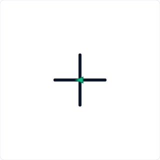

# Lesson `seq.6` — First Continuous Line Drawings

> [← Module `seq` Overview](./overview.md) · **Format:** 🐢 Sandbox · **Environment:** [🐢 Turtle LOGO](../../envs/turtle_logo.md) · **ID:** `seq.6` (Legacy Alias: `1.6`)

**One-Concept Goal:** Transition sequential `50px` movement and `90°`-locked turns into open-ended creative continuous-line drawings (introducing **no pass/fail grading**, working Starter examples, and 1-tap **Variation Cards**).

📖 Parent / Teacher Tip (Adult Context — Collapsed by Default)

Welcome to **Turtle LOGO**! Unlike Robot Grid, there are no walls or puzzles to fail. Every `Forward` or `Backward` block slides the turtle `50px` while leaving a `#0f172a` ink stroke (`penWidth: 6`), and turns pivot cleanly by `90°` (`fixedAngle: 90`). Kids can immediately run the pre-loaded **Flag on a Pole** starter (`8` blocks) or load one of the 3 joyful illustrated cards (`3-Step Staircase`, `Square Snail Spiral`, `Four-Way Plus Cross`) and remix freely—with zero letter/reading prompts!

---

## Palette, Scopes, Caps & Environment Setup

- **Allowed Blocks (`allowedSimBlocks`):** `["FORWARD", "BACKWARD", "TURN_LEFT", "TURN_RIGHT"]` *(strictly omits Grid opcodes `MOVE_FWD` / `MOVE_BACK`)*
- **Allowed Control Blocks (`allowedControlBlocks`):** `[]`
- **Block Parameter Lock (`allowedBlockParams`):** Fixed `50px` `FORWARD` (`0x10`) / `BACKWARD` (`0x11`), `TURN_LEFT: { fixedAngle: 90 }`, `TURN_RIGHT: { fixedAngle: 90 }` (`allowActionParams: false`, `allowRepeatBadges: false`, `allowVariables: false`)
- **Allowed Scope Tabs:** `["MAIN"]` (`allowRecursion: false`)
- **Slot Cap (`slotCap`):** `null` *(Sandbox guidelines: Starter & Var 1 ≤ 14, Var 2 ≤ 20, Var 3 ≤ 30)*
- **Environment Setup:** Start pose `(0, 0, 0° NORTH)`, `penDown: true`, `penColor: "#0f172a"`, `penWidth: 6`, `#e2e8f0` card borders.

---

## Starter Workspace (`starterWorkspace`)

### 🚩 Flag on a Pole (`8` flat blocks ≤ 14)

- **MAIN (`8` blocks):**
  1. `FORWARD`
  2. `FORWARD`
  3. `TURN_RIGHT`
  4. `FORWARD`
  5. `TURN_RIGHT`
  6. `FORWARD`
  7. `TURN_RIGHT`
  8. `FORWARD`
- **Rendered Verification (`render_logo_svg.mjs`):** Flagpole `(0, 0) → (0, -100)` with closed `50×50` flag `[0..50] × [-100..-50]`; `finalPose: (0, -50, 270°)`; `penDown: true`; `pathCount: 5`.

---

## Illustrated Copyable Variations (`variations[]`)

### Variation 1 (`seq.6-stairs`): 🪜 3-Step Staircase (`11` flat blocks ≤ 14)

- **MAIN (`11` blocks):**
  1. `FORWARD`
  2. `TURN_RIGHT`
  3. `FORWARD`
  4. `TURN_LEFT`
  5. `FORWARD`
  6. `TURN_RIGHT`
  7. `FORWARD`
  8. `TURN_LEFT`
  9. `FORWARD`
  10. `TURN_RIGHT`
  11. `FORWARD`
- **Rendered Verification (`render_logo_svg.mjs`):** Three rising stair risers & treads from `(0, 0)` to `(150, -150)`; `finalPose: (150, -150, 90°)`; `penDown: true`; `pathCount: 6`.

---

### Variation 2 (`seq.6-spiral`): 🐚 Square Snail Spiral (`13` flat blocks ≤ 20)

- **MAIN (`13` blocks):**
  1. `FORWARD`
  2. `TURN_RIGHT`
  3. `FORWARD`
  4. `TURN_RIGHT`
  5. `FORWARD`
  6. `FORWARD`
  7. `TURN_RIGHT`
  8. `FORWARD`
  9. `FORWARD`
  10. `TURN_RIGHT`
  11. `FORWARD`
  12. `FORWARD`
  13. `FORWARD`
- **Rendered Verification (`render_logo_svg.mjs`):** Growing clockwise square spiral `(0,0) → (0,-50) → (50,-50) → (50,50) → (-50,50) → (-50,-100)`; `finalPose: (-50, -100, 0°)`; `penDown: true`; `pathCount: 9`.

---

### Variation 3 (`seq.6-plus`): ➕ Four-Way Plus Cross (`11` flat blocks ≤ 30)

- **MAIN (`11` blocks):**
  1. `FORWARD`
  2. `BACKWARD`
  3. `TURN_RIGHT`
  4. `FORWARD`
  5. `BACKWARD`
  6. `TURN_RIGHT`
  7. `FORWARD`
  8. `BACKWARD`
  9. `TURN_RIGHT`
  10. `FORWARD`
  11. `BACKWARD`
- **Rendered Verification (`render_logo_svg.mjs`):** Demonstrates `FORWARD` + `BACKWARD` symmetry around `(0, 0)` spanning `[-50..50] × [-50..50]`; `finalPose: (0, 0, 270°)`; `penDown: true`; `pathCount: 8`.
