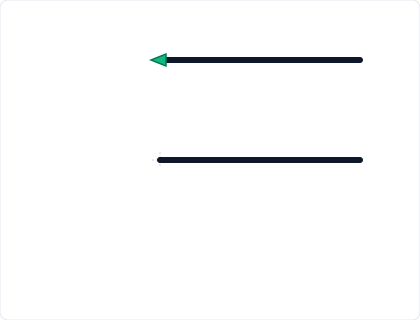
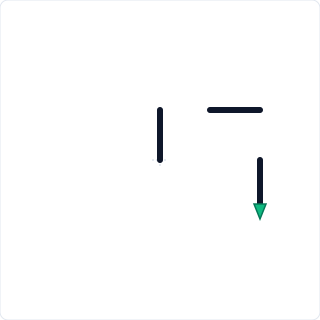
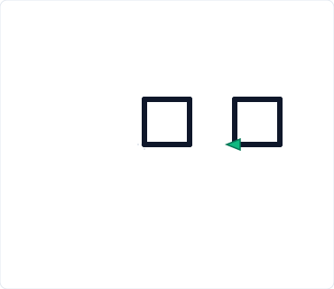
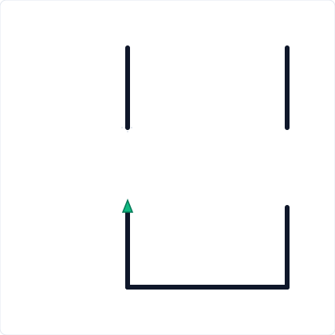

# Lesson `seq.7` — Lifting & Lowering the Pen (`Pen Up` / `Pen Down`)

> [← Module `seq` Overview](./overview.md) · **Format:** 🐢 Sandbox · **Environment:** [🐢 Turtle LOGO](../../envs/turtle_logo.md) · **ID:** `seq.7` (Legacy Alias: `1.7`)

**One-Concept Goal:** Control pen state with `Pen Up` (travel invisibly without drawing) and `Pen Down` (resume ink strokes) to create multi-part disconnected drawings.

📖 Parent / Teacher Tip (Adult Context — Collapsed by Default)

While `Pen Up` (`PEN_UP`) is active, the turtle avatar visually lifts slightly (`scale(1.12)`, soft shadow, hollow nib) and leaves a brief fading dotted air-trail in animated playback—so 5–7yo kids can see *where* the turtle hops across empty paper before `Pen Down` (`PEN_DOWN`) sets the ink nib back onto the canvas. All cards stay inside a compact viewport (`≤ 300px` radius) and avoid text/letter themes.

---

## Palette, Scopes, Caps & Environment Setup

- **Allowed Blocks (`allowedSimBlocks`):** `["FORWARD", "BACKWARD", "TURN_LEFT", "TURN_RIGHT", "PEN_UP", "PEN_DOWN"]`
- **Allowed Control Blocks (`allowedControlBlocks`):** `[]`
- **Block Parameter Lock (`allowedBlockParams`):** Fixed `100px` steps, `TURN_LEFT: { fixedAngle: 90 }`, `TURN_RIGHT: { fixedAngle: 90 }`, `allowActionParams: false`, `allowRepeatBadges: false`, `allowVariables: false`
- **Allowed Scope Tabs:** `["MAIN"]` (`allowRecursion: false`)
- **Slot Cap (`slotCap`):** `null`
- **Environment Setup:** Start pose `(0, 0, 0° NORTH)`, `penDown: true`, `penColor: "#0f172a"`, `penWidth: 6`; dual-state turtle avatar (`Pen Up` vs `Pen Down`); `#e2e8f0` card borders.

---

## Starter Workspace (`starterWorkspace`)

### ⏸️ Parallel Bars `=` (`10` flat blocks ≤ 14)

- **MAIN (`10` blocks):**
  1. `TURN_RIGHT`
  2. `FORWARD`
  3. `FORWARD`
  4. `PEN_UP`
  5. `TURN_LEFT`
  6. `FORWARD`
  7. `PEN_DOWN`
  8. `TURN_LEFT`
  9. `FORWARD`
  10. `FORWARD`
- **Rendered Verification (`render_logo_svg.mjs`):** Two horizontal `200px` bars at `(0, 0)–(200, 0)` and `(200, -100)–(0, -100)` separated by a `100px` invisible hop (`200×100px` overall span); `finalPose: (0, -100, 270°)`; `penDown: true`; `pathCount: 4`.

---

## Illustrated Copyable Variations (`variations[]`)

### Variation 1 (`seq.7-dashed-corner`): 〰️ Dashed Corner Trail (`11` flat blocks ≤ 14)

- **MAIN (`11` blocks):**
  1. `FORWARD`
  2. `PEN_UP`
  3. `TURN_RIGHT`
  4. `FORWARD`
  5. `PEN_DOWN`
  6. `FORWARD`
  7. `PEN_UP`
  8. `TURN_RIGHT`
  9. `FORWARD`
  10. `PEN_DOWN`
  11. `FORWARD`
- **Rendered Verification (`render_logo_svg.mjs`):** Three separate `100px` dashes wrapping clockwise around a corner (`(0,0)–(0,-100)`, `(100,-100)–(200,-100)`, `(200,0)–(200,100)`); `finalPose: (200, 100, 180°)`; `penDown: true`; `pathCount: 3`.

---

### Variation 2 (`seq.7-gift-boxes`): 🎁 Twin Floating Gift Boxes (`19` flat blocks ≤ 20)

- **MAIN (`19` blocks):**
  1. `FORWARD`
  2. `TURN_RIGHT`
  3. `FORWARD`
  4. `TURN_RIGHT`
  5. `FORWARD`
  6. `TURN_RIGHT`
  7. `FORWARD`
  8. `PEN_UP`
  9. `BACKWARD`
  10. `BACKWARD`
  11. `TURN_RIGHT`
  12. `PEN_DOWN`
  13. `FORWARD`
  14. `TURN_RIGHT`
  15. `FORWARD`
  16. `TURN_RIGHT`
  17. `FORWARD`
  18. `TURN_RIGHT`
  19. `FORWARD`
- **Rendered Verification (`render_logo_svg.mjs`):** Left square `[0..100] × [-100..0]` + `100px` air-gap using `BACKWARD × 2` while facing West + right square `[200..300] × [-100..0]`; `finalPose: (200, 0, 270°)`; `penDown: true`; `pathCount: 8`.

---

### Variation 3 (`seq.7-smiling-face`): 😊 Smiling Block Face (`17` flat blocks ≤ 30)

- **MAIN (`17` blocks):**
  1. `FORWARD`
  2. `PEN_UP`
  3. `TURN_RIGHT`
  4. `FORWARD`
  5. `FORWARD`
  6. `TURN_RIGHT`
  7. `PEN_DOWN`
  8. `FORWARD`
  9. `PEN_UP`
  10. `FORWARD`
  11. `PEN_DOWN`
  12. `FORWARD`
  13. `TURN_RIGHT`
  14. `FORWARD`
  15. `FORWARD`
  16. `TURN_RIGHT`
  17. `FORWARD`
- **Rendered Verification (`render_logo_svg.mjs`):** Two detached vertical eyes at `(0, -100)–(0, 0)` and `(200, -100)–(200, 0)` above a wide U-shaped smile `(200, 100)–(200, 200)–(0, 200)–(0, 100)`; `finalPose: (0, 100, 0°)`; `penDown: true`; `pathCount: 6`.
