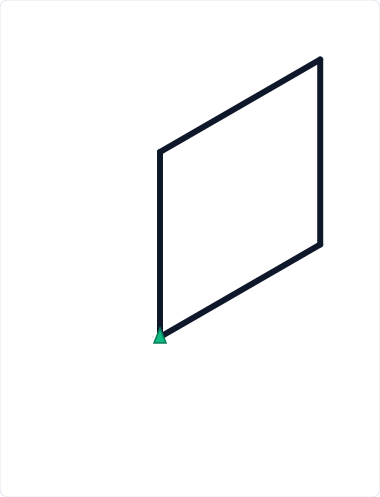
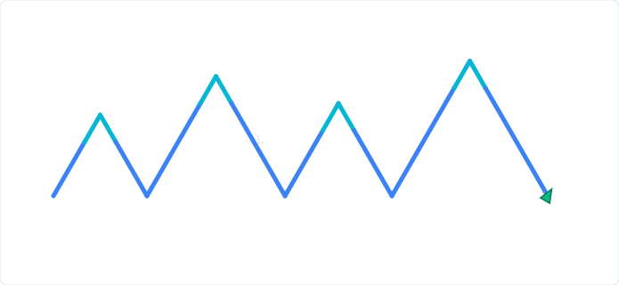
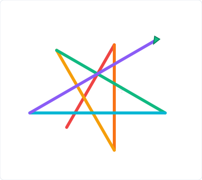
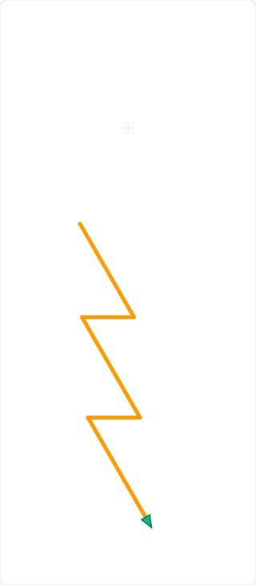
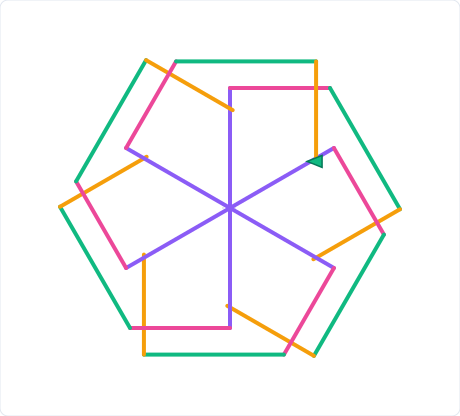

# Capstone `tape.B` — Tape Art Studio

- **Format:** 🏆 Capstone Creative Sandbox
- **Environment:** 🐢 Turtle LOGO (`TapeDock: paired numbers, triplets mixing color + number, and live TAPE_WRITE`)
- **One-Concept Goal:** Encode complete geometric blueprints on the Memory Tape—from `(length, angle)` rhombus pairs and zero-drift `30°` mountain ranges to mixed `(Color, Length, Angle)` triplets and a `🎲` self-writing kaleidoscope.

---

## Guided Co-Pilot Card

Pairs of cells on a Tape work like a turtle's **blueprint**: one cell is **distance**, the next cell is **turn**! Try all 4 studio cards—from snowy peaks and prism pinwheels to a kaleidoscope that invents its own Tape!

---

## Capabilities & Budget

```json
{
  "env": "turtle_logo",
  "mode": "creative_capstone_sandbox",
  "tape": { "length": 10000, "window": "1..8", "editable": true },
  "sensors": ["$cellValue", "$cellColor", "$randomColor", "$randD6"],
  "actions": ["TELEPORT", "SET_PEN_WIDTH", "SET_PEN_COLOR", "TAPE_SEEK", "TAPE_STEP", "TAPE_WRITE", "FORWARD", "TURN_RIGHT", "TURN_LEFT", "CALL_FN", "VAR_ASSIGN", "VAR_OP"],
  "starterBudget": { "MAIN": 9, "slotCap": 36 }
}
```

---

## Starter Workspace — Paired `(Length, Angle)` Rhombus (`9` flat blocks)

**Initial Tape (`1..8`):** `[185, 60, 185, 120, 185, 60, 185, 120]`



- **Canvas Metrics (`render_stage2_frame_svg`):** `inkBounds: [0..160, -277..0]`, `inkWidth: 160px`, `inkHeight: 278px`, `inkMaxSpan: 278px` (`scaleWarning: false`), `status: "OK"`.

### Canonical Pseudocode (`MAIN` — `9` flat blocks exact)

```text
// MAIN (9 flat blocks)
TAPE_SEEK [1]
Loop [4]
  a = $cellValue
  FORWARD [a]
  TAPE_STEP [RIGHT]
  a = $cellValue
  TURN_RIGHT [a]
  TAPE_STEP [RIGHT]
End Loop
```

### Canonical JSON AST (`Starter`)

```json
{
  "slotCap": 12,
  "MAIN": [
    { "op": "TAPE_SEEK", "index": 1 },
    {
      "op": "LOOP",
      "count": 4,
      "body": [
        { "op": "VAR_ASSIGN", "var": "a", "value": "$cellValue" },
        { "op": "FORWARD", "length": "a" },
        { "op": "TAPE_STEP", "direction": "RIGHT" },
        { "op": "VAR_ASSIGN", "var": "a", "value": "$cellValue" },
        { "op": "TURN_RIGHT", "angle": "a" },
        { "op": "TAPE_STEP", "direction": "RIGHT" }
      ]
    }
  ]
}
```

---

## Variation Cards (`1..4`)

### Variation 1 — Connected Glacier Mountain Range (`30°` Start → `0°` Net Turn `F1`)

**Tape (`1..4`):** `[105, 155, 120, 175]` (Peak heights; `F1` paints icy `Cyan` summits over `Blue` mountain slopes with `+120° - 120° = 0°` net turn).



- **Canvas Metrics:** `inkBounds: [-230..325, -92..60]`, `inkWidth: 555px`, `inkHeight: 152px`, `inkMaxSpan: 555px` (`scaleWarning: false`).

```text
// MAIN (8 flat blocks)
TELEPORT [-230, 60, 30]
SET_PEN_WIDTH [5]
TAPE_SEEK [1]
Loop [4]
  a = $cellValue
  Call F1
  TAPE_STEP [RIGHT]
End Loop

// F1 (10 flat blocks)
b = a - 35
SET_PEN_COLOR [blue]
FORWARD [b]
SET_PEN_COLOR [cyan]
FORWARD [35]
TURN_RIGHT [120]
FORWARD [35]
SET_PEN_COLOR [blue]
FORWARD [b]
TURN_LEFT [120]
```

```json
{
  "slotCap": 22,
  "MAIN": [
    { "op": "TELEPORT", "x": -230, "y": 60, "heading": 30 },
    { "op": "SET_PEN_WIDTH", "width": 5 },
    { "op": "TAPE_SEEK", "index": 1 },
    {
      "op": "LOOP",
      "count": 4,
      "body": [
        { "op": "VAR_ASSIGN", "var": "a", "value": "$cellValue" },
        { "op": "CALL_FN", "fn": "F1" },
        { "op": "TAPE_STEP", "direction": "RIGHT" }
      ]
    }
  ],
  "F1": [
    { "op": "VAR_OP", "target": "b", "left": "a", "operator": "-", "right": 35 },
    { "op": "SET_PEN_COLOR", "color": "blue" },
    { "op": "FORWARD", "length": "b" },
    { "op": "SET_PEN_COLOR", "color": "cyan" },
    { "op": "FORWARD", "length": 35 },
    { "op": "TURN_RIGHT", "angle": 120 },
    { "op": "FORWARD", "length": 35 },
    { "op": "SET_PEN_COLOR", "color": "blue" },
    { "op": "FORWARD", "length": "b" },
    { "op": "TURN_LEFT", "angle": 120 }
  ]
}
```

### Variation 2 — Mixed `(Color, Length, Angle)` Stride-3 Prism Pinwheel (`1..18`)

**Tape (`1..18`):** `["red", 190, 150, "orange", 210, 150, "yellow", 230, 150, "green", 250, 150, "cyan", 270, 150, "purple", 290, 150]` — mixes `color` swatches (`$cellColor`) and two `number` cells (`$cellValue`) in stride-3 records!



- **Canvas Metrics:** `inkBounds: [-183..87, -99..120]`, `inkWidth: 270px`, `inkHeight: 219px`, `inkMaxSpan: 270px` (`scaleWarning: false`).

```text
// MAIN (14 flat blocks)
TELEPORT [-110, 75, 30]
SET_PEN_WIDTH [6]
TAPE_SEEK [1]
Loop [6]
  c = $cellColor
  SET_PEN_COLOR [c]
  TAPE_STEP [RIGHT]
  l = $cellValue
  FORWARD [l]
  TAPE_STEP [RIGHT]
  a = $cellValue
  TURN_RIGHT [a]
  TAPE_STEP [RIGHT]
End Loop
```

```json
{
  "slotCap": 18,
  "MAIN": [
    { "op": "TELEPORT", "x": -110, "y": 75, "heading": 30 },
    { "op": "SET_PEN_WIDTH", "width": 6 },
    { "op": "TAPE_SEEK", "index": 1 },
    {
      "op": "LOOP",
      "count": 6,
      "body": [
        { "op": "VAR_ASSIGN", "var": "c", "value": "$cellColor" },
        { "op": "SET_PEN_COLOR", "color": "c" },
        { "op": "TAPE_STEP", "direction": "RIGHT" },
        { "op": "VAR_ASSIGN", "var": "l", "value": "$cellValue" },
        { "op": "FORWARD", "length": "l" },
        { "op": "TAPE_STEP", "direction": "RIGHT" },
        { "op": "VAR_ASSIGN", "var": "a", "value": "$cellValue" },
        { "op": "TURN_RIGHT", "angle": "a" },
        { "op": "TAPE_STEP", "direction": "RIGHT" }
      ]
    }
  ]
}
```

### Variation 3 — `w = 5` Yellow Lightning Bolt (`TELEPORT [-60, 120, 150]`)

**Tape (`1..10`):** `[135, 120, 65, 240, 145, 120, 65, 240, 150, 0]` (`240°` right turn = `-120°` left corner).



- **Canvas Metrics:** `inkBounds: [-60..25, 120..492]`, `inkWidth: 85px`, `inkHeight: 372px`, `inkMaxSpan: 372px` (`scaleWarning: false`).

```text
// MAIN (12 flat blocks)
TELEPORT [-60, 120, 150]
SET_PEN_WIDTH [5]
SET_PEN_COLOR [yellow]
TAPE_SEEK [1]
Loop [5]
  a = $cellValue
  FORWARD [a]
  TAPE_STEP [RIGHT]
  a = $cellValue
  TURN_RIGHT [a]
  TAPE_STEP [RIGHT]
End Loop
```

```json
{
  "slotCap": 16,
  "MAIN": [
    { "op": "TELEPORT", "x": -60, "y": 120, "heading": 150 },
    { "op": "SET_PEN_WIDTH", "width": 5 },
    { "op": "SET_PEN_COLOR", "color": "yellow" },
    { "op": "TAPE_SEEK", "index": 1 },
    {
      "op": "LOOP",
      "count": 5,
      "body": [
        { "op": "VAR_ASSIGN", "var": "a", "value": "$cellValue" },
        { "op": "FORWARD", "length": "a" },
        { "op": "TAPE_STEP", "direction": "RIGHT" },
        { "op": "VAR_ASSIGN", "var": "a", "value": "$cellValue" },
        { "op": "TURN_RIGHT", "angle": "a" },
        { "op": "TAPE_STEP", "direction": "RIGHT" }
      ]
    }
  ]
}
```

### Variation 4 — `🎲` Self-Writing `TAPE_WRITE` Mirrored Kaleidoscope

**Tape (`1..12`):** Starts `∅` empty; Pass 1 writes `4` random `(Color, Length, Angle)` triplets using `$randomColor` & `$randD6` (`TAPE_WRITE`), then Pass 2 replays that generated recipe `6×` rotated by `60°`! (`seed: 42`).



- **Canvas Metrics:** `inkBounds: [-170..170, -148..148]`, `inkWidth: 340px`, `inkHeight: 296px`, `inkMaxSpan: 340px` (`scaleWarning: false`).

```text
// MAIN (33 flat blocks)
SET_PEN_WIDTH [4]
TAPE_SEEK [1]
Loop [4]
  c = $randomColor
  TAPE_WRITE [c]
  TAPE_STEP [RIGHT]
  b = $randD6
  l = b * 20
  l = l + 60
  TAPE_WRITE [l]
  TAPE_STEP [RIGHT]
  d = $randD6
  a = d * 15
  TAPE_WRITE [a]
  TAPE_STEP [RIGHT]
End Loop
h = 0
Loop [6]
  TELEPORT [0, 0, h]
  TAPE_SEEK [1]
  Loop [4]
    c = $cellColor
    SET_PEN_COLOR [c]
    TAPE_STEP [RIGHT]
    l = $cellValue
    FORWARD [l]
    TAPE_STEP [RIGHT]
    a = $cellValue
    TURN_RIGHT [a]
    TAPE_STEP [RIGHT]
  End Loop
  h = h + 60
End Loop
```

```json
{
  "slotCap": 36,
  "seed": 42,
  "MAIN": [
    { "op": "SET_PEN_WIDTH", "width": 4 },
    { "op": "TAPE_SEEK", "index": 1 },
    {
      "op": "LOOP",
      "count": 4,
      "body": [
        { "op": "VAR_ASSIGN", "var": "c", "value": "$randomColor" },
        { "op": "TAPE_WRITE", "value": "c" },
        { "op": "TAPE_STEP", "direction": "RIGHT" },
        { "op": "VAR_ASSIGN", "var": "b", "value": "$randD6" },
        { "op": "VAR_OP", "target": "l", "left": "b", "operator": "*", "right": 20 },
        { "op": "VAR_OP", "target": "l", "left": "l", "operator": "+", "right": 60 },
        { "op": "TAPE_WRITE", "value": "l" },
        { "op": "TAPE_STEP", "direction": "RIGHT" },
        { "op": "VAR_ASSIGN", "var": "d", "value": "$randD6" },
        { "op": "VAR_OP", "target": "a", "left": "d", "operator": "*", "right": 15 },
        { "op": "TAPE_WRITE", "value": "a" },
        { "op": "TAPE_STEP", "direction": "RIGHT" }
      ]
    },
    { "op": "VAR_ASSIGN", "var": "h", "value": 0 },
    {
      "op": "LOOP",
      "count": 6,
      "body": [
        { "op": "TELEPORT", "x": 0, "y": 0, "heading": "h" },
        { "op": "TAPE_SEEK", "index": 1 },
        {
          "op": "LOOP",
          "count": 4,
          "body": [
            { "op": "VAR_ASSIGN", "var": "c", "value": "$cellColor" },
            { "op": "SET_PEN_COLOR", "color": "c" },
            { "op": "TAPE_STEP", "direction": "RIGHT" },
            { "op": "VAR_ASSIGN", "var": "l", "value": "$cellValue" },
            { "op": "FORWARD", "length": "l" },
            { "op": "TAPE_STEP", "direction": "RIGHT" },
            { "op": "VAR_ASSIGN", "var": "a", "value": "$cellValue" },
            { "op": "TURN_RIGHT", "angle": "a" },
            { "op": "TAPE_STEP", "direction": "RIGHT" }
          ]
        },
        { "op": "VAR_OP", "target": "h", "left": "h", "operator": "+", "right": 60 }
      ]
    }
  ]
}
```

---

<details>
<summary>📖 Parent / Teacher Tip</summary>

- **Structured Records in a Linear Tape:** Variation 2 previews fixed-stride C structs / arrays of tuples (`color, length, angle` at offsets `1, 2, 3`), enforcing strict type separation between `$cellColor` and `$cellValue` on adjacent cells.
- **Procedural Generation (`Var 4`):** Writing `$randomColor` and rolled dice lengths into the Tape and *replaying* them across 6 symmetric rotations turns the Tape Dock into an inspectable, editable random seed!

</details>
