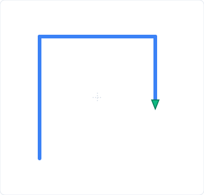
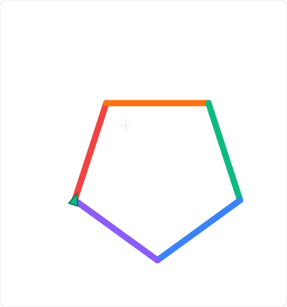
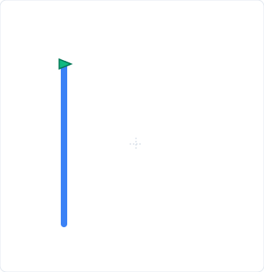

# Lesson `tape.0` — Meet the Memory Tape & Color Variables

- **Format:** 📖 Explanation (3 Runnable Demo Tabs)
- **Environment:** 🐢 Turtle LOGO (`Top-Dock TapeDock: 10,000 sparse cells, windowed 1..8`)
- **One-Concept Goal:** Read typed `number` and `color` values from indexed Tape cells using `TAPE_SEEK`, `TAPE_STEP [RIGHT]`, `$cellValue`, and `$cellColor` — and see why mixing a `color` into a `#` slot triggers a `TYPE_ERROR` bounce.

---

## Guided Co-Pilot Card

Tap **Play** on each tab and watch the **Tape Head** (`1..8`) and the **Watch Tray** (`[a: ...]`): cells can store **numbers** (`$cellValue`) or **color swatches** (`$cellColor`). If you pour a color swatch into a distance block expecting a number `#`, the box bounces safely with **`TYPE_ERROR`**!

---

## Capabilities & Tab Budget

```json
{
  "env": "turtle_logo",
  "mode": "explanation_3_tabs",
  "tape": { "length": 10000, "window": "1..8", "editable": false },
  "sensors": ["$cellValue", "$cellColor", "$headPos", "$tapeLength"],
  "actions": ["TELEPORT", "TAPE_SEEK", "TAPE_STEP", "SET_PEN_COLOR", "SET_PEN_WIDTH", "FORWARD", "TURN_RIGHT", "VAR_ASSIGN"],
  "slotCapPerTab": { "Tab 1": 14, "Tab 2": 10, "Tab 3": 11 }
}
```

---

## Demo 1 — Random-Access `TAPE_SEEK` & Numeric `$cellValue`

**Tape Cells:** `{ "1": 200, "2": 110, "3": 190 }` (`∅` from `4..10000`)

**Visual Output (`tape_0_demo1.svg`):**



- **Canvas Metrics (`render_stage2_frame_svg`):** `inkBounds: [-95..95, -100..100]`, `inkWidth: 190px`, `inkHeight: 200px`, `inkMaxSpan: 200px` (`scaleWarning: false`), `status: "OK"`.
- **Spotlight:** `TAPE_SEEK [1]`, `TAPE_SEEK [3]`, `TAPE_SEEK [2]` jump directly to cells out of order (`1 → 3 → 2`), feeding numeric `$cellValue` into `a` (`200 → 190 → 110`).

### Canonical Pseudocode (`MAIN` — `14` flat blocks)

```text
// MAIN (14 flat blocks)
TELEPORT [-95, 100, 0]
SET_PEN_COLOR [blue]
SET_PEN_WIDTH [6]
TAPE_SEEK [1]
a = $cellValue
FORWARD [a]
TURN_RIGHT [90]
TAPE_SEEK [3]
a = $cellValue
FORWARD [a]
TURN_RIGHT [90]
TAPE_SEEK [2]
a = $cellValue
FORWARD [a]
```

### Canonical JSON AST (`Tab 1`)

```json
{
  "slotCap": 14,
  "MAIN": [
    { "op": "TELEPORT", "x": -95, "y": 100, "heading": 0 },
    { "op": "SET_PEN_COLOR", "color": "blue" },
    { "op": "SET_PEN_WIDTH", "width": 6 },
    { "op": "TAPE_SEEK", "index": 1 },
    { "op": "VAR_ASSIGN", "var": "a", "value": "$cellValue" },
    { "op": "FORWARD", "length": "a" },
    { "op": "TURN_RIGHT", "angle": 90 },
    { "op": "TAPE_SEEK", "index": 3 },
    { "op": "VAR_ASSIGN", "var": "a", "value": "$cellValue" },
    { "op": "FORWARD", "length": "a" },
    { "op": "TURN_RIGHT", "angle": 90 },
    { "op": "TAPE_SEEK", "index": 2 },
    { "op": "VAR_ASSIGN", "var": "a", "value": "$cellValue" },
    { "op": "FORWARD", "length": "a" }
  ]
}
```

---

## Demo 2 — Sequential `TAPE_STEP [RIGHT]` & Color Swatches (`$cellColor`)

**Tape Cells:** `{ "1": "red", "2": "orange", "3": "green", "4": "blue", "5": "purple" }`

**Visual Output (`tape_0_demo2.svg`):**



- **Canvas Metrics (`render_stage2_frame_svg`):** `inkBounds: [-65..145, -29..171]`, `inkWidth: 210px`, `inkHeight: 200px`, `inkMaxSpan: 210px` (`scaleWarning: false`), `status: "OK"`.
- **Spotlight:** Watch Tray `[a: 🔴] → [a: 🟠] → [a: 🟢] → [a: 🔵] → [a: 🟣]` holds a **TypedValue::Color** swatch instead of a number while `TAPE_STEP [RIGHT]` walks `$headPos` from `1` to `6`.

### Canonical Pseudocode (`MAIN` — `10` flat blocks)

```text
// MAIN (10 flat blocks)
TELEPORT [-65, 95, 18]
SET_PEN_WIDTH [8]
TAPE_SEEK [1]
Loop [5]
  a = $cellColor
  SET_PEN_COLOR [a]
  FORWARD [130]
  TURN_RIGHT [72]
  TAPE_STEP [RIGHT]
End Loop
```

### Canonical JSON AST (`Tab 2`)

```json
{
  "slotCap": 10,
  "MAIN": [
    { "op": "TELEPORT", "x": -65, "y": 95, "heading": 18 },
    { "op": "SET_PEN_WIDTH", "width": 8 },
    { "op": "TAPE_SEEK", "index": 1 },
    {
      "op": "LOOP",
      "count": 5,
      "body": [
        { "op": "VAR_ASSIGN", "var": "a", "value": "$cellColor" },
        { "op": "SET_PEN_COLOR", "color": "a" },
        { "op": "FORWARD", "length": 130 },
        { "op": "TURN_RIGHT", "angle": 72 },
        { "op": "TAPE_STEP", "direction": "RIGHT" }
      ]
    }
  ]
}
```

---

## Demo 3 — `color` vs. `number` `TYPE_ERROR` Bounce

**Tape Cells:** `{ "1": 200, "2": "red" }`

**Visual Output (`tape_0_demo3.svg`):**



- **Canvas Metrics (`render_stage2_frame_svg`):** `inkBounds: [-90..-90, -100..100]`, `inkHeight: 200px`, `inkMaxSpan: 200px` (`scaleWarning: false`), `status: "TYPE_ERROR"` (`Expected numeric value, got "a" -> "#ef4444"`).
- **Spotlight:** After drawing a bold `200px` `Blue` bar from numeric cell `#1`, the Turtle steps to cell `#2`, paints its brush `Red`, and tries `FORWARD [a]`. Because `a` holds a `color` swatch (`🔴`) instead of a `number`, the Watch Tray bounces `[a: 🔴]` off the `#` numeric socket and halts safely on `TYPE_ERROR`.

### Canonical Pseudocode (`MAIN` — `11` flat blocks)

```text
// MAIN (11 flat blocks)
TELEPORT [-90, 100, 0]
SET_PEN_COLOR [blue]
SET_PEN_WIDTH [8]
TAPE_SEEK [1]
a = $cellValue
FORWARD [a]
TURN_RIGHT [90]
TAPE_STEP [RIGHT]
a = $cellColor
SET_PEN_COLOR [a]
FORWARD [a]
```

### Canonical JSON AST (`Tab 3`)

```json
{
  "slotCap": 11,
  "allowStatus": ["OK", "TYPE_ERROR"],
  "MAIN": [
    { "op": "TELEPORT", "x": -90, "y": 100, "heading": 0 },
    { "op": "SET_PEN_COLOR", "color": "blue" },
    { "op": "SET_PEN_WIDTH", "width": 8 },
    { "op": "TAPE_SEEK", "index": 1 },
    { "op": "VAR_ASSIGN", "var": "a", "value": "$cellValue" },
    { "op": "FORWARD", "length": "a" },
    { "op": "TURN_RIGHT", "angle": 90 },
    { "op": "TAPE_STEP", "direction": "RIGHT" },
    { "op": "VAR_ASSIGN", "var": "a", "value": "$cellColor" },
    { "op": "SET_PEN_COLOR", "color": "a" },
    { "op": "FORWARD", "length": "a" }
  ]
}
```

---

<details>
<summary>📖 Parent / Teacher Tip</summary>

- **Top-Dock Window:** In Creative Sandboxes (`tape.0`–`tape.4a`, `tape.B`–`tape.C`), the Tape holds `10,000` sparse cells while keeping `1..8` visible in the top dock (`[1]` / `[End]` / `[Jump #]` controls).
- **Strict Typed Runtime:** Reading `$cellValue` on a `color` or empty `∅` cell—or reading `$cellColor` on a `number` or empty `∅` cell—also raises `TYPE_ERROR`. Highlighting that `color` is a distinct `TypedValue` prevents guesswork when kids mix numeric and color data later in `tape.B`.

</details>
