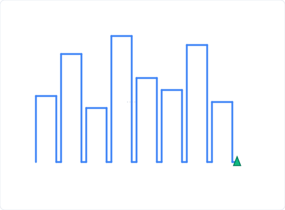
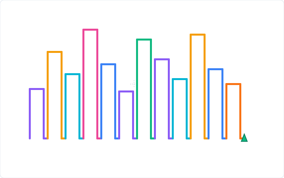
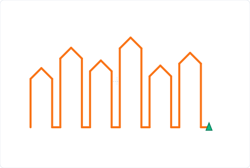
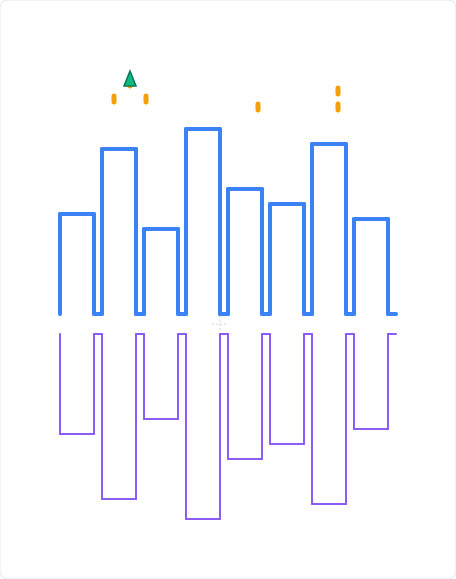

# Lesson `tape.1` — Skyline Generator

- **Format:** 🎨 Creative Sandbox
- **Environment:** 🐢 Turtle LOGO (`TapeDock: editable numeric cells`)
- **One-Concept Goal:** Turn a row of Tape numbers into a connected skyline by pairing a loop over `$cellValue` with a zero-net-turn helper `F1`.

---

## Guided Co-Pilot Card

Each number on the Tape becomes one skyscraper's height! Change numbers in the top **Tape Dock** and watch `F1` draw each tower straight up and finish facing **North (`0°`)** ready for the next building.

---

## Capabilities & Budget

```json
{
  "env": "turtle_logo",
  "mode": "creative_sandbox",
  "tape": { "length": 10000, "window": "1..8", "editable": true },
  "sensors": ["$cellValue", "$cellEmpty", "$randomColor", "$randD20", "$randD6"],
  "actions": ["TELEPORT", "SET_PEN_COLOR", "SET_PEN_WIDTH", "TAPE_SEEK", "TAPE_STEP", "FORWARD", "TURN_RIGHT", "TURN_LEFT", "CALL_FN", "VAR_ASSIGN", "VAR_OP"],
  "starterBudget": { "MAIN": 9, "F1": 8, "total": 17, "slotCap": 24 }
}
```

---

## Starter Workspace — Classic Blue Skyline

**Initial Tape (`1..8`):** `[110, 180, 90, 210, 140, 120, 195, 100]`



- **Canvas Metrics:** `inkBounds: [-160..176, -110..100]`, `inkWidth: 336px`, `inkHeight: 210px`, `inkMaxSpan: 336px` (`scaleWarning: false`), `status: "OK"`.
- **Geometry Invariant:** `F1` executes `+90° + 90° - 90° - 90° = 0°` net turn, returning cleanly to `0°` North (`-Y` upward on SVG canvas) after each `34px`-wide tower + `8px` sidewalk gap.

### Canonical Pseudocode (`MAIN` `9` + `F1` `8` = `17` flat blocks)

```text
// MAIN (9 flat blocks)
TELEPORT [-160, 100, 0]
SET_PEN_COLOR [blue]
SET_PEN_WIDTH [3]
TAPE_SEEK [1]
Loop [8]
  a = $cellValue
  Call F1
  TAPE_STEP [RIGHT]
End Loop

// F1 (8 flat blocks)
FORWARD [a]
TURN_RIGHT [90]
FORWARD [34]
TURN_RIGHT [90]
FORWARD [a]
TURN_LEFT [90]
FORWARD [8]
TURN_LEFT [90]
```

### Canonical JSON AST (`Starter`)

```json
{
  "slotCap": 24,
  "MAIN": [
    { "op": "TELEPORT", "x": -160, "y": 100, "heading": 0 },
    { "op": "SET_PEN_COLOR", "color": "blue" },
    { "op": "SET_PEN_WIDTH", "width": 3 },
    { "op": "TAPE_SEEK", "index": 1 },
    {
      "op": "LOOP",
      "count": 8,
      "body": [
        { "op": "VAR_ASSIGN", "var": "a", "value": "$cellValue" },
        { "op": "CALL_FN", "fn": "F1" },
        { "op": "TAPE_STEP", "direction": "RIGHT" }
      ]
    }
  ],
  "F1": [
    { "op": "FORWARD", "length": "a" },
    { "op": "TURN_RIGHT", "angle": 90 },
    { "op": "FORWARD", "length": 34 },
    { "op": "TURN_RIGHT", "angle": 90 },
    { "op": "FORWARD", "length": "a" },
    { "op": "TURN_LEFT", "angle": 90 },
    { "op": "FORWARD", "length": 8 },
    { "op": "TURN_LEFT", "angle": 90 }
  ]
}
```

---

## Variation Cards (`1..3`)

### Variation 1 — Neon 12-Tower Downtown (`> 8` Cells + `NOT $cellEmpty`)

**Tape (`1..12`):** `[100, 175, 130, 220, 150, 95, 200, 160, 120, 210, 140, 110]` (`seed: 42`)



- **Canvas Metrics:** `inkBounds: [-210..222, -110..110]`, `inkWidth: 432px`, `inkHeight: 220px`, `inkMaxSpan: 432px` (`scaleWarning: false`).

```text
// MAIN (9 flat blocks)
TELEPORT [-210, 110, 0]
SET_PEN_WIDTH [4]
TAPE_SEEK [1]
While (NOT $cellEmpty)
  SET_PEN_COLOR [$randomColor]
  a = $cellValue
  Call F1
  TAPE_STEP [RIGHT]
End While

// F1 (8 flat blocks)
FORWARD [a]
TURN_RIGHT [90]
FORWARD [28]
TURN_RIGHT [90]
FORWARD [a]
TURN_LEFT [90]
FORWARD [8]
TURN_LEFT [90]
```

```json
{
  "slotCap": 24,
  "seed": 42,
  "MAIN": [
    { "op": "TELEPORT", "x": -210, "y": 110, "heading": 0 },
    { "op": "SET_PEN_WIDTH", "width": 4 },
    { "op": "TAPE_SEEK", "index": 1 },
    {
      "op": "WHILE",
      "cond": { "op": "NOT", "expr": { "op": "SENSOR", "sensor": "$cellEmpty" } },
      "body": [
        { "op": "SET_PEN_COLOR", "color": "$randomColor" },
        { "op": "VAR_ASSIGN", "var": "a", "value": "$cellValue" },
        { "op": "CALL_FN", "fn": "F1" },
        { "op": "TAPE_STEP", "direction": "RIGHT" }
      ]
    }
  ],
  "F1": [
    { "op": "FORWARD", "length": "a" },
    { "op": "TURN_RIGHT", "angle": 90 },
    { "op": "FORWARD", "length": 28 },
    { "op": "TURN_RIGHT", "angle": 90 },
    { "op": "FORWARD", "length": "a" },
    { "op": "TURN_LEFT", "angle": 90 },
    { "op": "FORWARD", "length": 8 },
    { "op": "TURN_LEFT", "angle": 90 }
  ]
}
```

### Variation 2 — Pitched-Roof Cozy Village (`45°/90°` Gables + `16px` Yards)

**Tape (`1..6`):** `[95, 135, 110, 155, 100, 125]`



- **Canvas Metrics:** `inkBounds: [-170..181, -86..90]`, `inkWidth: 351px`, `inkHeight: 176px`, `inkMaxSpan: 351px` (`scaleWarning: false`).

```text
// MAIN (9 flat blocks)
TELEPORT [-170, 90, 0]
SET_PEN_COLOR [orange]
SET_PEN_WIDTH [4]
TAPE_SEEK [1]
While (NOT $cellEmpty)
  a = $cellValue
  Call F1
  TAPE_STEP [RIGHT]
End While

// F1 (10 flat blocks)
FORWARD [a]
TURN_RIGHT [45]
FORWARD [30]
TURN_RIGHT [90]
FORWARD [30]
TURN_RIGHT [45]
FORWARD [a]
TURN_LEFT [90]
FORWARD [16]
TURN_LEFT [90]
```

```json
{
  "slotCap": 24,
  "MAIN": [
    { "op": "TELEPORT", "x": -170, "y": 90, "heading": 0 },
    { "op": "SET_PEN_COLOR", "color": "orange" },
    { "op": "SET_PEN_WIDTH", "width": 4 },
    { "op": "TAPE_SEEK", "index": 1 },
    {
      "op": "WHILE",
      "cond": { "op": "NOT", "expr": { "op": "SENSOR", "sensor": "$cellEmpty" } },
      "body": [
        { "op": "VAR_ASSIGN", "var": "a", "value": "$cellValue" },
        { "op": "CALL_FN", "fn": "F1" },
        { "op": "TAPE_STEP", "direction": "RIGHT" }
      ]
    }
  ],
  "F1": [
    { "op": "FORWARD", "length": "a" },
    { "op": "TURN_RIGHT", "angle": 45 },
    { "op": "FORWARD", "length": 30 },
    { "op": "TURN_RIGHT", "angle": 90 },
    { "op": "FORWARD", "length": 30 },
    { "op": "TURN_RIGHT", "angle": 45 },
    { "op": "FORWARD", "length": "a" },
    { "op": "TURN_LEFT", "angle": 90 },
    { "op": "FORWARD", "length": 16 },
    { "op": "TURN_LEFT", "angle": 90 }
  ]
}
```

### Variation 3 — Mirror Lake City Reflection (Two-Pass + `🎲` Stars)

**Tape (`1..8`):** `[100, 165, 85, 185, 125, 110, 170, 95]` (`seed: 42`)



- **Canvas Metrics:** `inkBounds: [-160..176, -244..195]`, `inkWidth: 336px`, `inkHeight: 439px`, `inkMaxSpan: 439px` (`scaleWarning: false`).

```text
// MAIN (31 flat blocks)
TELEPORT [-160, -10, 0]
SET_PEN_COLOR [blue]
SET_PEN_WIDTH [4]
TAPE_SEEK [1]
Loop [8]
  a = $cellValue
  Call F1(a)
  TAPE_STEP [RIGHT]
End Loop
TELEPORT [-160, 10, 0]
SET_PEN_COLOR [purple]
SET_PEN_WIDTH [2]
TAPE_SEEK [1]
Loop [8]
  a = $cellValue
  b = 0 - a
  Call F1(b)
  TAPE_STEP [RIGHT]
End Loop
SET_PEN_COLOR [yellow]
SET_PEN_WIDTH [5]
Loop [6]
  x = $randD20
  x = x * 16
  x = x - 170
  y = $randD6
  y = y * 8
  y = -190 - y
  TELEPORT [x, y, 0]
  FORWARD [6]
End Loop

// F1(●) (8 flat blocks)
FORWARD [●]
TURN_RIGHT [90]
FORWARD [34]
TURN_RIGHT [90]
FORWARD [●]
TURN_LEFT [90]
FORWARD [8]
TURN_LEFT [90]
```

```json
{
  "slotCap": 42,
  "seed": 42,
  "MAIN": [
    { "op": "TELEPORT", "x": -160, "y": -10, "heading": 0 },
    { "op": "SET_PEN_COLOR", "color": "blue" },
    { "op": "SET_PEN_WIDTH", "width": 4 },
    { "op": "TAPE_SEEK", "index": 1 },
    {
      "op": "LOOP",
      "count": 8,
      "body": [
        { "op": "VAR_ASSIGN", "var": "a", "value": "$cellValue" },
        { "op": "CALL_FN", "fn": "F1", "args": ["a"] },
        { "op": "TAPE_STEP", "direction": "RIGHT" }
      ]
    },
    { "op": "TELEPORT", "x": -160, "y": 10, "heading": 0 },
    { "op": "SET_PEN_COLOR", "color": "purple" },
    { "op": "SET_PEN_WIDTH", "width": 2 },
    { "op": "TAPE_SEEK", "index": 1 },
    {
      "op": "LOOP",
      "count": 8,
      "body": [
        { "op": "VAR_ASSIGN", "var": "a", "value": "$cellValue" },
        { "op": "VAR_OP", "target": "b", "left": 0, "operator": "-", "right": "a" },
        { "op": "CALL_FN", "fn": "F1", "args": ["b"] },
        { "op": "TAPE_STEP", "direction": "RIGHT" }
      ]
    },
    { "op": "SET_PEN_COLOR", "color": "yellow" },
    { "op": "SET_PEN_WIDTH", "width": 5 },
    {
      "op": "LOOP",
      "count": 6,
      "body": [
        { "op": "VAR_ASSIGN", "var": "x", "value": "$randD20" },
        { "op": "VAR_OP", "target": "x", "left": "x", "operator": "*", "right": 16 },
        { "op": "VAR_OP", "target": "x", "left": "x", "operator": "-", "right": 170 },
        { "op": "VAR_ASSIGN", "var": "y", "value": "$randD6" },
        { "op": "VAR_OP", "target": "y", "left": "y", "operator": "*", "right": 8 },
        { "op": "VAR_OP", "target": "y", "left": -190, "operator": "-", "right": "y" },
        { "op": "TELEPORT", "x": "x", "y": "y", "heading": 0 },
        { "op": "FORWARD", "length": 6 }
      ]
    }
  ],
  "F1": [
    { "op": "FORWARD", "length": "$p0" },
    { "op": "TURN_RIGHT", "angle": 90 },
    { "op": "FORWARD", "length": 34 },
    { "op": "TURN_RIGHT", "angle": 90 },
    { "op": "FORWARD", "length": "$p0" },
    { "op": "TURN_LEFT", "angle": 90 },
    { "op": "FORWARD", "length": 8 },
    { "op": "TURN_LEFT", "angle": 90 }
  ]
}
```

---

<details>
<summary>📖 Parent / Teacher Tip</summary>

- **Zero-Net-Turn Check:** Ask learners to trace `F1`'s turns (`+90 + 90 - 90 - 90 = 0°`). If one `TURN_LEFT [90]` is missing, the city spirals into a pinwheel!
- **Pass-Once Data Reuse:** Variation 3 rewinds the Tape (`TAPE_SEEK [1]`) and negates each height (`b = 0 - a`) to call the *exact same* parameterized `F1(●)` upside down—previewing data reuse before sorting algorithms.

</details>
