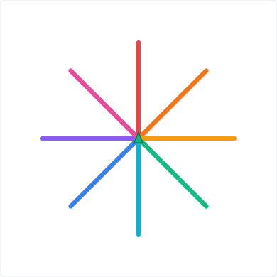
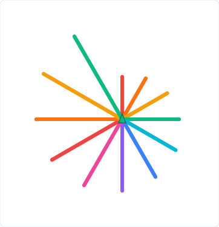
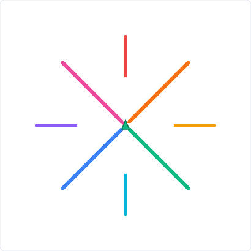
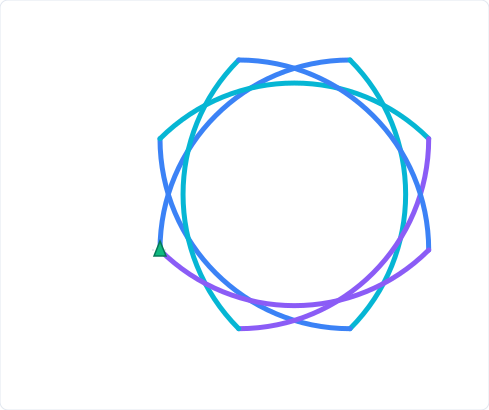

# Lesson `tape.2` — Rainbow Burst

- **Format:** 🎨 Creative Sandbox
- **Environment:** 🐢 Turtle LOGO (`TapeDock: editable color swatches`)
- **One-Concept Goal:** Store a palette of `color` swatches in the Memory Tape and step through them with `$cellColor` (`SET_PEN_COLOR [a]`)—including explicit-width `White` cutout strokes.

---

## Guided Co-Pilot Card

Each cell in the **Tape Dock** holds a paint color! Swap swatches around, try `White` (`⚪`) erasers, or bend spokes with `ARC_RIGHT` to invent your own starburst.

---

## Capabilities & Budget

```json
{
  "env": "turtle_logo",
  "mode": "creative_sandbox",
  "tape": { "length": 10000, "window": "1..8", "editable": true },
  "sensors": ["$cellColor"],
  "actions": ["SET_PEN_WIDTH", "SET_PEN_COLOR", "TAPE_SEEK", "TAPE_STEP", "FORWARD", "BACKWARD", "TURN_RIGHT", "ARC_RIGHT", "WAIT", "VAR_ASSIGN", "VAR_OP"],
  "starterBudget": { "MAIN": 10, "slotCap": 30 }
}
```

---

## Starter Workspace — 8-Spoke Rainbow Burst

**Initial Tape (`1..8`):** `["red", "orange", "yellow", "green", "cyan", "blue", "purple", "pink"]`



- **Canvas Metrics:** `inkBounds: [-135..135, -135..135]`, `inkWidth: 270px`, `inkHeight: 270px`, `inkMaxSpan: 270px` (`scaleWarning: false`), `status: "OK"`.

### Canonical Pseudocode (`MAIN` — `10` flat blocks)

```text
// MAIN (10 flat blocks)
SET_PEN_WIDTH [6]
TAPE_SEEK [1]
Loop [8]
  a = $cellColor
  SET_PEN_COLOR [a]
  FORWARD [135]
  BACKWARD [135]
  TURN_RIGHT [45]
  TAPE_STEP [RIGHT]
End Loop
```

### Canonical JSON AST (`Starter`)

```json
{
  "slotCap": 14,
  "MAIN": [
    { "op": "SET_PEN_WIDTH", "width": 6 },
    { "op": "TAPE_SEEK", "index": 1 },
    {
      "op": "LOOP",
      "count": 8,
      "body": [
        { "op": "VAR_ASSIGN", "var": "a", "value": "$cellColor" },
        { "op": "SET_PEN_COLOR", "color": "a" },
        { "op": "FORWARD", "length": 135 },
        { "op": "BACKWARD", "length": 135 },
        { "op": "TURN_RIGHT", "angle": 45 },
        { "op": "TAPE_STEP", "direction": "RIGHT" }
      ]
    }
  ]
}
```

---

## Variation Cards (`1..3`)

### Variation 1 — 12-Ray Rainbow Nautilus (`12` Cells + Growing Length)

**Tape (`1..12`):** `["red", "orange", "yellow", "green", "cyan", "blue", "purple", "pink", "red", "orange", "yellow", "green"]`



- **Canvas Metrics:** `inkBounds: [-142..94, -137..118]`, `inkWidth: 236px`, `inkHeight: 255px`, `inkMaxSpan: 255px` (`scaleWarning: false`).

```text
// MAIN (12 flat blocks)
SET_PEN_WIDTH [6]
l = 70
TAPE_SEEK [1]
Loop [12]
  a = $cellColor
  SET_PEN_COLOR [a]
  FORWARD [l]
  BACKWARD [l]
  TURN_RIGHT [30]
  l = l + 8
  TAPE_STEP [RIGHT]
End Loop
```

```json
{
  "slotCap": 16,
  "MAIN": [
    { "op": "SET_PEN_WIDTH", "width": 6 },
    { "op": "VAR_ASSIGN", "var": "l", "value": 70 },
    { "op": "TAPE_SEEK", "index": 1 },
    {
      "op": "LOOP",
      "count": 12,
      "body": [
        { "op": "VAR_ASSIGN", "var": "a", "value": "$cellColor" },
        { "op": "SET_PEN_COLOR", "color": "a" },
        { "op": "FORWARD", "length": "l" },
        { "op": "BACKWARD", "length": "l" },
        { "op": "TURN_RIGHT", "angle": 30 },
        { "op": "VAR_OP", "target": "l", "left": "l", "operator": "+", "right": 8 },
        { "op": "TAPE_STEP", "direction": "RIGHT" }
      ]
    }
  ]
}
```

### Variation 2 — `White` Cutout Donut Burst (Two-Pass `1..8` & `9..16`)

**Tape (`1..16`):** Pass 1 `["red", "orange", "yellow", "green", "cyan", "blue", "purple", "pink"]` (`width = 6`) · Pass 2 `["white", "orange", "white", "green", "white", "blue", "white", "pink"]` (explicit `SET_PEN_WIDTH [8]` on `White`)



- **Canvas Metrics:** `inkBounds: [-145..145, -145..145]`, `inkWidth: 290px`, `inkHeight: 290px`, `inkMaxSpan: 290px` (`scaleWarning: false`).

```text
// MAIN (28 flat blocks)
SET_PEN_WIDTH [6]
TAPE_SEEK [1]
Loop [8]
  a = $cellColor
  SET_PEN_COLOR [a]
  FORWARD [145]
  BACKWARD [145]
  TURN_RIGHT [45]
  TAPE_STEP [RIGHT]
End Loop
WAIT [0.4]
TAPE_SEEK [9]
Loop [8]
  If ($cellColor == white)
    SET_PEN_WIDTH [8]
    SET_PEN_COLOR [white]
    FORWARD [75]
    BACKWARD [75]
  Else
    SET_PEN_WIDTH [4]
    a = $cellColor
    SET_PEN_COLOR [a]
    FORWARD [110]
    BACKWARD [110]
  End If
  TURN_RIGHT [45]
  TAPE_STEP [RIGHT]
End Loop
```

```json
{
  "slotCap": 30,
  "MAIN": [
    { "op": "SET_PEN_WIDTH", "width": 6 },
    { "op": "TAPE_SEEK", "index": 1 },
    {
      "op": "LOOP",
      "count": 8,
      "body": [
        { "op": "VAR_ASSIGN", "var": "a", "value": "$cellColor" },
        { "op": "SET_PEN_COLOR", "color": "a" },
        { "op": "FORWARD", "length": 145 },
        { "op": "BACKWARD", "length": 145 },
        { "op": "TURN_RIGHT", "angle": 45 },
        { "op": "TAPE_STEP", "direction": "RIGHT" }
      ]
    },
    { "op": "WAIT", "beats": 0.4 },
    { "op": "TAPE_SEEK", "index": 9 },
    {
      "op": "LOOP",
      "count": 8,
      "body": [
        {
          "op": "IF",
          "cond": { "op": "CMP", "operator": "==", "left": "$cellColor", "right": "white" },
          "then": [
            { "op": "SET_PEN_WIDTH", "width": 8 },
            { "op": "SET_PEN_COLOR", "color": "white" },
            { "op": "FORWARD", "length": 75 },
            { "op": "BACKWARD", "length": 75 }
          ],
          "else": [
            { "op": "SET_PEN_WIDTH", "width": 4 },
            { "op": "VAR_ASSIGN", "var": "a", "value": "$cellColor" },
            { "op": "SET_PEN_COLOR", "color": "a" },
            { "op": "FORWARD", "length": 110 },
            { "op": "BACKWARD", "length": 110 }
          ]
        },
        { "op": "TURN_RIGHT", "angle": 45 },
        { "op": "TAPE_STEP", "direction": "RIGHT" }
      ]
    }
  ]
}
```

### Variation 3 — Ocean Curved Pinwheel (`ARC_RIGHT [190, 90]`)

**Tape (`1..8`):** `["blue", "cyan", "blue", "cyan", "purple", "cyan", "blue", "purple"]`



- **Canvas Metrics:** `inkBounds: [0..269, -190..79]`, `inkWidth: 269px`, `inkHeight: 269px`, `inkMaxSpan: 269px` (`scaleWarning: false`).

```text
// MAIN (9 flat blocks)
SET_PEN_WIDTH [5]
TAPE_SEEK [1]
Loop [8]
  a = $cellColor
  SET_PEN_COLOR [a]
  ARC_RIGHT [190, 90]
  TURN_RIGHT [45]
  TAPE_STEP [RIGHT]
End Loop
```

```json
{
  "slotCap": 14,
  "MAIN": [
    { "op": "SET_PEN_WIDTH", "width": 5 },
    { "op": "TAPE_SEEK", "index": 1 },
    {
      "op": "LOOP",
      "count": 8,
      "body": [
        { "op": "VAR_ASSIGN", "var": "a", "value": "$cellColor" },
        { "op": "SET_PEN_COLOR", "color": "a" },
        { "op": "ARC_RIGHT", "radius": 190, "angle": 90 },
        { "op": "TURN_RIGHT", "angle": 45 },
        { "op": "TAPE_STEP", "direction": "RIGHT" }
      ]
    }
  ]
}
```

---

<details>
<summary>📖 Parent / Teacher Tip</summary>

- **Pass 1 vs. Pass 2 Separation:** Reading `1..8` to paint rainbow spokes and `9..16` to carve `White` (`8px` wide) or layer `4px` inner accents avoids any conflict on cells `1..8`.
- **Clean Ink-Layer Compositing:** `White` does *not* silently add `+2px` width inside the VM; Variation 2 demonstrates explicit `SET_PEN_WIDTH [8]` when carving over a `6px` stroke so thin patterns like `tape.B` never bleed.

</details>
