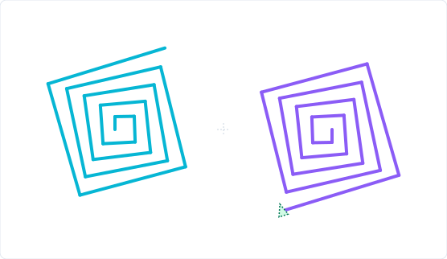
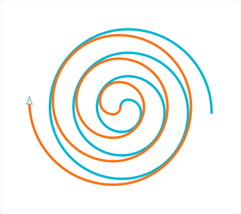
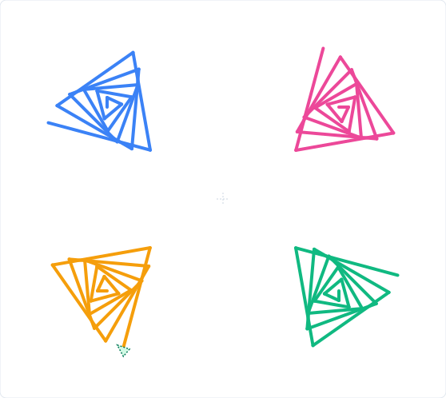

# Capstone `var.B` — Spiral, Wave & Telemetry Studio

| Field | Value |
| :--- | :--- |
| **ID** | `var.B` |
| **Module** | `var` (Variables, Sensors & Arithmetic) |
| **Title** | Spiral, Wave & Telemetry Studio |
| **Format** | `🎨` Creative LOGO Capstone (`Starter + 3 Playable Variations`) |
| **Environment** | Turtle LOGO (`🐢`) |
| **Legacy ID** | `6B` |
| **Slot Cap** | `30` per tab / `60` total (Starter `15`, Var 1 `14`, Var 2 `37`, Var 3 `21`) |
| **Edit Delta** | Open-ended Creative Capstone |
| **Variables Allowed** | `["a", "x", "y"]` |
| **Sensors / Operators** | Full `var` turtle toolkit (`TELEPORT`, `$x`, `$y`, `$heading`, `🎲`, `$randomColor`, `+`, `-`, `*`) |

---

## One-Concept Goal

Synthesize **`TELEPORT` positioning**, **reusable helper subroutines (`F1..F3`)**, **`a = a ± k` growing/shrinking geometry**, and **`$x` / `$y` pose bookmarking** into bold multi-part mathematical tapestries.

<details>
<summary>📖 Parent / Teacher Tip</summary>

- **Zero-Reading Rule:** No learner prose in UI! Kids start with clean Twin Mirror Galaxies (`15` blocks total) and explore `3` Showcase Variations demonstrating `ARC_RIGHT` spirals (`Var 1`), ascending/descending mountain waves with a live `$x/$y` crest star (`Var 2`), and 4-corner kaleidoscope gardens (`Var 3`).
- Notice how `Var 2` proves telemetry: `x = $x`, `y = $y` bookmarks the mid-wave anchor right where Cyan meets Pink, letting `F3` fly back to plant the crowning Amber star (`y = y - 135`, `x = x - 22`) above the crest!

</details>

---

## Palette & Capabilities

```json
{
  "allowedSimBlocks": [
    "FORWARD",
    "BACKWARD",
    "TURN_LEFT",
    "TURN_RIGHT",
    "ARC_LEFT",
    "ARC_RIGHT",
    "PEN_UP",
    "PEN_DOWN",
    "SET_PEN_COLOR",
    "SET_PEN_WIDTH",
    "TELEPORT"
  ],
  "allowedControlBlocks": ["LOOP_START", "LOOP_END", "CALL_FN", "VAR_ASSIGN", "VAR_OP"],
  "allowedFunctions": ["F1", "F2", "F3"],
  "allowedVariableNames": ["a", "x", "y"],
  "allowedValueSensors": ["$x", "$y", "$heading", "$randCoin", "$randD4", "$randD6", "$randD8", "$randD20", "$rand01", "$randomColor"],
  "allowedVarOps": ["+", "-", "*"],
  "allowRepeatBadges": false,
  "allowActionParams": true,
  "startPose": { "x": 0, "y": 0, "heading": 0, "penDown": true, "penColor": "black", "penWidth": 6 }
}
```

---

## Starter — Twin Mirror Galaxies (`MAIN: 7`, `F1: 8`, Total `15`)



```json
{
  "F1": [
    { "op": "VAR_ASSIGN", "var": "a", "value": 16 },
    { "op": "PEN_DOWN" },
    {
      "op": "LOOP_START",
      "count": 18,
      "body": [
        { "op": "FORWARD", "length": "a" },
        { "op": "TURN_RIGHT", "angle": 89 },
        { "op": "VAR_OP", "target": "a", "operator": "+", "left": "a", "right": 8 }
      ]
    },
    { "op": "PEN_UP" }
  ],
  "MAIN": [
    { "op": "SET_PEN_WIDTH", "width": 4 },
    { "op": "TELEPORT", "x": -135, "y": 0, "heading": 0 },
    { "op": "SET_PEN_COLOR", "color": "cyan" },
    { "op": "CALL_FN", "fn": "F1" },
    { "op": "TELEPORT", "x": 135, "y": 0, "heading": 180 },
    { "op": "SET_PEN_COLOR", "color": "purple" },
    { "op": "CALL_FN", "fn": "F1" }
  ]
}
```

*Metrics: Symmetric non-overlapping Cyan (`-135, 0, 0°`) & Purple (`135, 0, 180°`) galaxies (`inkBounds = [-218..218] × [-101..101]`, `inkMaxSpan = 437px`, `scaleWarning = false`).*

---

## Playable Variation Cards (`3` Inspirations)

### Variation 1 — Twin Dragon Nautilus Scroll (`MAIN: 7`, `F1: 7`, Total `14`)



```json
{
  "F1": [
    { "op": "VAR_ASSIGN", "var": "a", "value": 15 },
    { "op": "PEN_DOWN" },
    {
      "op": "LOOP_START",
      "count": 14,
      "body": [
        { "op": "ARC_RIGHT", "radius": "a", "angle": 90 },
        { "op": "VAR_OP", "target": "a", "operator": "+", "left": "a", "right": 12 }
      ]
    },
    { "op": "PEN_UP" }
  ],
  "MAIN": [
    { "op": "SET_PEN_WIDTH", "width": 5 },
    { "op": "TELEPORT", "x": 0, "y": 0, "heading": 0 },
    { "op": "SET_PEN_COLOR", "color": "cyan" },
    { "op": "CALL_FN", "fn": "F1" },
    { "op": "TELEPORT", "x": 0, "y": 0, "heading": 180 },
    { "op": "SET_PEN_COLOR", "color": "orange" },
    { "op": "CALL_FN", "fn": "F1" }
  ]
}
```

*Metrics: Interlocking Cyan & Orange `ARC_RIGHT` scroll (`15 -> 171px`, `inkBounds = [-186..186] × [-159..159]`, `inkMaxSpan = 372px`, `scaleWarning = false`).*

---

### Variation 2 — Rainbow Pyramid Wave + `$x / $y` Star Crest (`MAIN: 18`, `F1: 6`, `F2: 6`, `F3: 7`, Total `37`)


```json
{
  "F1": [
    { "op": "TURN_RIGHT", "angle": 30 },
    { "op": "FORWARD", "length": "a" },
    { "op": "TURN_RIGHT", "angle": 120 },
    { "op": "FORWARD", "length": "a" },
    { "op": "TURN_LEFT", "angle": 150 },
    { "op": "VAR_OP", "target": "a", "operator": "+", "left": "a", "right": 24 }
  ],
  "F2": [
    { "op": "VAR_OP", "target": "a", "operator": "-", "left": "a", "right": 24 },
    { "op": "TURN_RIGHT", "angle": 30 },
    { "op": "FORWARD", "length": "a" },
    { "op": "TURN_RIGHT", "angle": 120 },
    { "op": "FORWARD", "length": "a" },
    { "op": "TURN_LEFT", "angle": 150 }
  ],
  "F3": [
    { "op": "PEN_DOWN" },
    { "op": "SET_PEN_COLOR", "color": "amber" },
    {
      "op": "LOOP_START",
      "count": 5,
      "body": [
        { "op": "FORWARD", "length": 65 },
        { "op": "TURN_RIGHT", "angle": 144 }
      ]
    },
    { "op": "PEN_UP" }
  ],
  "MAIN": [
    { "op": "VAR_ASSIGN", "var": "a", "value": 40 },
    { "op": "TELEPORT", "x": -320, "y": 80, "heading": 0 },
    { "op": "PEN_DOWN" },
    { "op": "SET_PEN_COLOR", "color": "cyan" },
    { "op": "LOOP_START", "count": 4, "body": [{ "op": "CALL_FN", "fn": "F1" }] },
    { "op": "VAR_ASSIGN", "var": "x", "value": "$x" },
    { "op": "VAR_ASSIGN", "var": "y", "value": "$y" },
    { "op": "SET_PEN_COLOR", "color": "pink" },
    { "op": "LOOP_START", "count": 4, "body": [{ "op": "CALL_FN", "fn": "F2" }] },
    { "op": "PEN_UP" },
    { "op": "VAR_OP", "target": "y", "operator": "-", "left": "y", "right": 135 },
    { "op": "VAR_OP", "target": "x", "operator": "-", "left": "x", "right": 22 },
    { "op": "TELEPORT", "x": "x", "y": "y", "heading": 18 },
    { "op": "CALL_FN", "fn": "F3" }
  ]
}
```

*Metrics: Ascending Cyan peaks (`40..112px`), descending Pink peaks (`112..40px`), Amber crest star via `$x/$y` bookmark (`inkBounds = [-320..288] × [-117..80]`, `inkMaxSpan = 608px`, `scaleWarning = false`).*

---

### Variation 3 — Four-Corner Spiro-Garden (`MAIN: 13`, `F1: 8`, Total `21`)



```json
{
  "F1": [
    { "op": "VAR_ASSIGN", "var": "a", "value": 12 },
    { "op": "PEN_DOWN" },
    {
      "op": "LOOP_START",
      "count": 16,
      "body": [
        { "op": "FORWARD", "length": "a" },
        { "op": "TURN_RIGHT", "angle": 115 },
        { "op": "VAR_OP", "target": "a", "operator": "+", "left": "a", "right": 8 }
      ]
    },
    { "op": "PEN_UP" }
  ],
  "MAIN": [
    { "op": "SET_PEN_WIDTH", "width": 4 },
    { "op": "TELEPORT", "x": -145, "y": -115, "heading": 0 },
    { "op": "SET_PEN_COLOR", "color": "blue" },
    { "op": "CALL_FN", "fn": "F1" },
    { "op": "TELEPORT", "x": 145, "y": -115, "heading": 90 },
    { "op": "SET_PEN_COLOR", "color": "pink" },
    { "op": "CALL_FN", "fn": "F1" },
    { "op": "TELEPORT", "x": 145, "y": 115, "heading": 180 },
    { "op": "SET_PEN_COLOR", "color": "green" },
    { "op": "CALL_FN", "fn": "F1" },
    { "op": "TELEPORT", "x": -145, "y": 115, "heading": 270 },
    { "op": "SET_PEN_COLOR", "color": "amber" },
    { "op": "CALL_FN", "fn": "F1" }
  ]
}
```

*Metrics: `4` non-overlapping rotated spiro-rosettes (`64` segments, `inkBounds = [-219..219] × [-189..189]`, `inkMaxSpan = 437px`, `scaleWarning = false`).*
