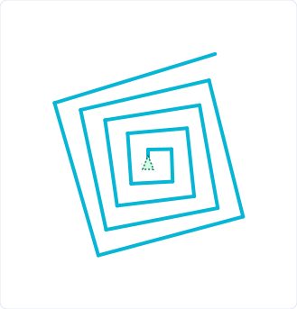
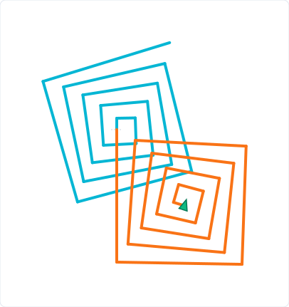
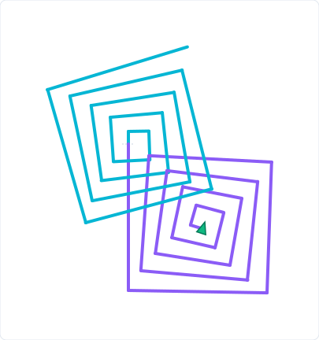
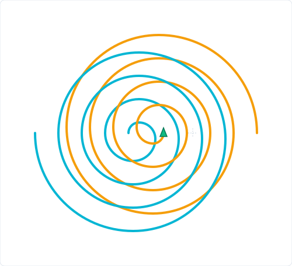

# Mastery Challenge `var.M2` — Counter-Rotating Opposing Spirals

| Field | Value |
| :--- | :--- |
| **ID** | `var.M2` |
| **Module** | `var` (Variables, Sensors & Arithmetic) |
| **Title** | Counter-Rotating Opposing Spirals |
| **Format** | `🔥` LOGO Mastery Challenge (`Starter` + `3 Target Tapestries` + `Partial ?` & `Full Solutions`) |
| **Environment** | Turtle LOGO (`🐢`) |
| **Legacy ID** | `C6.2` |
| **Slot Cap** | `20` per tab / `50` total (Starter `10`, Target 1 `18`, Target 2 `33`, Target 3 `31`) |
| **Edit Delta** | Mastery (`10` starter -> `18..33` complete target weaves) |
| **Variables Allowed** | `["a", "b", "h", "u", "v", "w", "x", "y"]` |
| **Sensors / Operators** | Full `var` toolkit (`TELEPORT`, `$x`, `$y`, `$heading`, `F1`, `F2`, `+`, `-`, `*`) |

---

## One-Concept Goal

Complete the **Starter** clockwise growing spiral (`a = 16 -> 186`, `TURN_RIGHT 89°`) with an opposing **counter-clockwise shrinking spiral (`b = 186 -> 16`, `TURN_LEFT 89°`)**, progressing from sequential twin helices to **simultaneous live-interleaved braids** tracked by two `$x/$y/$heading` pose bookmarks.

<details>
<summary>📖 Parent / Teacher Tip</summary>

- **Mastery Progression (`Starter` -> `Target 1`..`3`):** Learners begin with the finished Cyan CW spiral ending cleanly back at `TELEPORT [0, 0, 0]`, plus an optional `?` Hint structure (`partialHelp`).
- **Target 1 (`18` flat blocks):** Draws Cyan CW (`+10`) first, warps `TELEPORT [0, 0, 180]`, then draws Orange CCW (`-10`).
- **Target 2 (`MAIN: 13, F1: 10, F2: 10 = 33` total):** Uses two complete pose bookmarks (`(x, y, h)` for Cyan CW and `(u, v, w)` for Purple CCW) to interleave **1 arm of Cyan, 1 arm of Purple** per loop turn — true single-turtle coroutining!
- **Target 3 (`MAIN: 13, F1: 9, F2: 9 = 31` total):** Applies the same `(x, y, h)` + `(u, v, w)` dual-bookmark technique to smooth opposing `ARC_RIGHT` (`a + 10`) vs `ARC_LEFT` (`b - 10`) tapestries.

</details>

---

## Palette & Capabilities

```json
{
  "allowedSimBlocks": [
    "FORWARD",
    "BACKWARD",
    "TURN_LEFT",
    "TURN_RIGHT",
    "ARC_LEFT",
    "ARC_RIGHT",
    "PEN_UP",
    "PEN_DOWN",
    "SET_PEN_COLOR",
    "SET_PEN_WIDTH",
    "TELEPORT"
  ],
  "allowedControlBlocks": ["LOOP_START", "LOOP_END", "CALL_FN", "VAR_ASSIGN", "VAR_OP"],
  "allowedFunctions": ["F1", "F2"],
  "allowedVariableNames": ["a", "b", "h", "u", "v", "w", "x", "y"],
  "allowedValueSensors": ["$x", "$y", "$heading"],
  "allowedVarOps": ["+", "-", "*"],
  "allowRepeatBadges": false,
  "allowActionParams": true,
  "slotCapPerTab": 20,
  "slotCapTotal": 50,
  "startPose": { "x": 0, "y": 0, "heading": 0, "penDown": true, "penColor": "black", "penWidth": 4 }
}
```

---

## Starter & Partial `?` Hint Structure

### Starter (`10` Flat Blocks — Clockwise Cyan Spiral Ready for Opposing Twin)



```json
{
  "MAIN": [
    { "op": "VAR_ASSIGN", "var": "a", "value": 16 },
    { "op": "SET_PEN_WIDTH", "width": 4 },
    { "op": "SET_PEN_COLOR", "color": "cyan" },
    {
      "op": "LOOP_START",
      "count": 18,
      "body": [
        { "op": "FORWARD", "length": "a" },
        { "op": "TURN_RIGHT", "angle": 89 },
        { "op": "VAR_OP", "target": "a", "operator": "+", "left": "a", "right": 10 }
      ]
    },
    { "op": "PEN_UP" },
    { "op": "TELEPORT", "x": 0, "y": 0, "heading": 0 }
  ]
}
```

*Starter metrics: `inkBounds = [-104..105] × [-122..101]`, `inkMaxSpan = 224px`, `scaleWarning = false`, final pose `(0, 0, 0°)`.*

---

### Partial Help (`?` Hint Form for Target 1, `18` Flat Blocks)

```json
{
  "MAIN": [
    { "op": "VAR_ASSIGN", "var": "a", "value": 16 },
    { "op": "VAR_ASSIGN", "var": "b", "value": "?" },
    { "op": "SET_PEN_WIDTH", "width": 4 },
    { "op": "SET_PEN_COLOR", "color": "cyan" },
    {
      "op": "LOOP_START",
      "count": 18,
      "body": [
        { "op": "FORWARD", "length": "a" },
        { "op": "TURN_RIGHT", "angle": 89 },
        { "op": "VAR_OP", "target": "a", "operator": "+", "left": "a", "right": 10 }
      ]
    },
    { "op": "PEN_UP" },
    { "op": "TELEPORT", "x": 0, "y": 0, "heading": "?" },
    { "op": "PEN_DOWN" },
    { "op": "SET_PEN_COLOR", "color": "orange" },
    {
      "op": "LOOP_START",
      "count": 18,
      "body": [
        { "op": "FORWARD", "length": "?" },
        { "op": "TURN_LEFT", "angle": "?" },
        { "op": "VAR_OP", "target": "b", "operator": "-", "left": "b", "right": "?" }
      ]
    }
  ]
}
```

---

## Three Reference Target Tapestries (`Full Solutions`)

### Target 1 — Sequential Double Helix (`MAIN: 18` Flat Blocks)



```json
{
  "MAIN": [
    { "op": "VAR_ASSIGN", "var": "a", "value": 16 },
    { "op": "VAR_ASSIGN", "var": "b", "value": 186 },
    { "op": "SET_PEN_WIDTH", "width": 4 },
    { "op": "SET_PEN_COLOR", "color": "cyan" },
    {
      "op": "LOOP_START",
      "count": 18,
      "body": [
        { "op": "FORWARD", "length": "a" },
        { "op": "TURN_RIGHT", "angle": 89 },
        { "op": "VAR_OP", "target": "a", "operator": "+", "left": "a", "right": 10 }
      ]
    },
    { "op": "PEN_UP" },
    { "op": "TELEPORT", "x": 0, "y": 0, "heading": 180 },
    { "op": "PEN_DOWN" },
    { "op": "SET_PEN_COLOR", "color": "orange" },
    {
      "op": "LOOP_START",
      "count": 18,
      "body": [
        { "op": "FORWARD", "length": "b" },
        { "op": "TURN_LEFT", "angle": 89 },
        { "op": "VAR_OP", "target": "b", "operator": "-", "left": "b", "right": 10 }
      ]
    }
  ]
}
```

*Metrics: `36` paths (`16 -> 186` CW Cyan vs `186 -> 16` CCW Orange), `inkBounds = [-104..182] × [-122..189]`, `inkMaxSpan = 311px`, `scaleWarning = false`.*

---

### Target 2 — Simultaneous Braided Pinwheel (`MAIN: 13`, `F1: 10`, `F2: 10`, Total `33`)



```json
{
  "F1": [
    { "op": "PEN_UP" },
    { "op": "TELEPORT", "x": "x", "y": "y", "heading": "h" },
    { "op": "PEN_DOWN" },
    { "op": "SET_PEN_COLOR", "color": "cyan" },
    { "op": "FORWARD", "length": "a" },
    { "op": "TURN_RIGHT", "angle": 89 },
    { "op": "VAR_OP", "target": "a", "operator": "+", "left": "a", "right": 10 },
    { "op": "VAR_ASSIGN", "var": "x", "value": "$x" },
    { "op": "VAR_ASSIGN", "var": "y", "value": "$y" },
    { "op": "VAR_ASSIGN", "var": "h", "value": "$heading" }
  ],
  "F2": [
    { "op": "PEN_UP" },
    { "op": "TELEPORT", "x": "u", "y": "v", "heading": "w" },
    { "op": "PEN_DOWN" },
    { "op": "SET_PEN_COLOR", "color": "purple" },
    { "op": "FORWARD", "length": "b" },
    { "op": "TURN_LEFT", "angle": 89 },
    { "op": "VAR_OP", "target": "b", "operator": "-", "left": "b", "right": 10 },
    { "op": "VAR_ASSIGN", "var": "u", "value": "$x" },
    { "op": "VAR_ASSIGN", "var": "v", "value": "$y" },
    { "op": "VAR_ASSIGN", "var": "w", "value": "$heading" }
  ],
  "MAIN": [
    { "op": "VAR_ASSIGN", "var": "a", "value": 16 },
    { "op": "VAR_ASSIGN", "var": "b", "value": 186 },
    { "op": "VAR_ASSIGN", "var": "x", "value": 0 },
    { "op": "VAR_ASSIGN", "var": "y", "value": 0 },
    { "op": "VAR_ASSIGN", "var": "h", "value": 0 },
    { "op": "VAR_ASSIGN", "var": "u", "value": 0 },
    { "op": "VAR_ASSIGN", "var": "v", "value": 0 },
    { "op": "VAR_ASSIGN", "var": "w", "value": 180 },
    { "op": "SET_PEN_WIDTH", "width": 4 },
    {
      "op": "LOOP_START",
      "count": 18,
      "body": [
        { "op": "CALL_FN", "fn": "F1" },
        { "op": "CALL_FN", "fn": "F2" }
      ]
    }
  ]
}
```

*Metrics: Interleaves CW & CCW segments live via dual `$x/$y/$heading` bookmarks (`inkBounds = [-103..182] × [-123..189]`, `inkMaxSpan = 312px`, `scaleWarning = false`).*

---

### Target 3 — Twin Bookmark Arc Tapestry (`MAIN: 13`, `F1: 9`, `F2: 9`, Total `31`)



```json
{
  "F1": [
    { "op": "PEN_UP" },
    { "op": "TELEPORT", "x": "x", "y": "y", "heading": "h" },
    { "op": "PEN_DOWN" },
    { "op": "SET_PEN_COLOR", "color": "cyan" },
    { "op": "ARC_RIGHT", "radius": "a", "angle": 90 },
    { "op": "VAR_OP", "target": "a", "operator": "+", "left": "a", "right": 10 },
    { "op": "VAR_ASSIGN", "var": "x", "value": "$x" },
    { "op": "VAR_ASSIGN", "var": "y", "value": "$y" },
    { "op": "VAR_ASSIGN", "var": "h", "value": "$heading" }
  ],
  "F2": [
    { "op": "PEN_UP" },
    { "op": "TELEPORT", "x": "u", "y": "v", "heading": "w" },
    { "op": "PEN_DOWN" },
    { "op": "SET_PEN_COLOR", "color": "amber" },
    { "op": "ARC_LEFT", "radius": "b", "angle": 90 },
    { "op": "VAR_OP", "target": "b", "operator": "-", "left": "b", "right": 10 },
    { "op": "VAR_ASSIGN", "var": "u", "value": "$x" },
    { "op": "VAR_ASSIGN", "var": "v", "value": "$y" },
    { "op": "VAR_ASSIGN", "var": "w", "value": "$heading" }
  ],
  "MAIN": [
    { "op": "VAR_ASSIGN", "var": "a", "value": 18 },
    { "op": "VAR_ASSIGN", "var": "b", "value": 168 },
    { "op": "VAR_ASSIGN", "var": "x", "value": -110 },
    { "op": "VAR_ASSIGN", "var": "y", "value": 0 },
    { "op": "VAR_ASSIGN", "var": "h", "value": 0 },
    { "op": "VAR_ASSIGN", "var": "u", "value": 110 },
    { "op": "VAR_ASSIGN", "var": "v", "value": 0 },
    { "op": "VAR_ASSIGN", "var": "w", "value": 0 },
    { "op": "SET_PEN_WIDTH", "width": 4 },
    {
      "op": "LOOP_START",
      "count": 16,
      "body": [
        { "op": "CALL_FN", "fn": "F1" },
        { "op": "CALL_FN", "fn": "F2" }
      ]
    }
  ]
}
```

*Metrics: `32` mirrored counter-rotating quarter arcs (`ARC_RIGHT 18->168` vs `ARC_LEFT 168->18`), `inkBounds = [-270..110] × [-168..168]`, `inkMaxSpan = 380px`, `scaleWarning = false`.*
