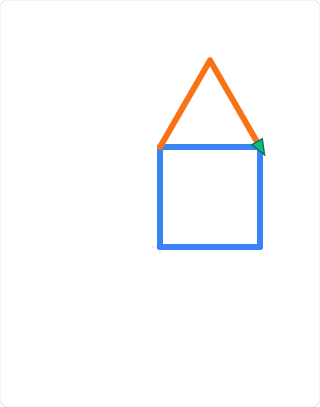

# Lesson `var.0` — Variable Memory Boxes

| Field | Value |
| :--- | :--- |
| **ID** | `var.0` |
| **Module** | `var` (Variables, Sensors & Arithmetic) |
| **Title** | Variable Memory Boxes |
| **Format** | `📖` Interactive Read-Only Explanation (`2` Tabs: Turtle `🐢` + Grid `🤖`) |
| **Environments** | Tab 1: Turtle LOGO (`🐢`), Tab 2: Robot Grid (`🤖`) |
| **Legacy ID** | `6.0` |
| **Slot Cap** | Read-only demo (`12` flat blocks Tab 1; `3` flat blocks Tab 2) |
| **Edit Delta** | `0` (Read-Only Interactive Demo) |
| **Variables Allowed** | `["s", "d"]` (`VAR_ASSIGN` ONLY; `VAR_OP` locked) |
| **Sensors / Operators** | Tab 1: literal assignment; Tab 2: `["$tileDial"]` (circular floor dial `1..20`, `0` if none) |

---

## One-Concept Goal

Introduce a **variable** (`s = 100`, `d = $tileDial`) as a labeled memory box (`0x07 OP_VAR_ASSIGN`) that remembers a number so multiple movement blocks can share or reuse that value without hardcoding.

---

## Guided Co-Pilot Explanation Cards

> Visible inside the collapsible `📖 Explanation` banner above the workspace (`<= 2` sentences per tab).

- **Tab 1 (`🐢` Variable House):** `Put a number inside a named box like s = 100, and every block wearing [s] uses that number!` `Change [s] once, and the walls and roof resize together.`
- **Tab 2 (`🤖` Reading a Floor Dial):** `Step onto a spinning dial and save d = $tileDial to lock its number into box [d].` `Then MOVE_FWD [×d] walks the exact dial count to the goal!`

<details>
<summary>📖 Parent / Teacher Tip</summary>

- Keep Tab 1 & Tab 2 **read-only** for `5–7` year olds, or let learners scrub the numeric pill (`s = 100` -> `140`) and watch the live Memory Tray (`Variables: s = 100`) highlight as each `[s]` slot reads the box.
- Emphasize that `VAR_ASSIGN` (`=`) **stores** a value into the box; arithmetic operators (`+`, `-`, `*`) stay hidden until `var.3` so learners grasp single-point storage first.
- On Tab 2, point out that stepping OFF the dial tile (`(2, 1)`) leaves `d` safely remembered in the Memory Tray even though `$tileDial` becomes `0` on empty floor tiles.

</details>

---

## Tab 1 — `🐢` Memory Box House (`s = 100`)

### Palette & Capabilities (Tab 1)

```json
{
  "readOnly": true,
  "allowedSimBlocks": ["FORWARD", "TURN_RIGHT", "SET_PEN_COLOR"],
  "allowedControlBlocks": ["LOOP_START", "LOOP_END", "VAR_ASSIGN"],
  "allowedVariableNames": ["s"],
  "allowedValueSensors": [],
  "allowedVarOps": [],
  "allowRepeatBadges": false,
  "allowActionParams": true,
  "slotCap": 14,
  "initialVars": { "s": 0 },
  "startPose": { "x": 0, "y": 0, "heading": 0, "penDown": true, "penColor": "black", "penWidth": 6 }
}
```

### Program (`12` Flat Blocks)

```json
{
  "MAIN": [
    { "op": "VAR_ASSIGN", "var": "s", "value": 100 },
    { "op": "SET_PEN_COLOR", "color": "blue" },
    {
      "op": "LOOP_START",
      "count": 4,
      "body": [
        { "op": "FORWARD", "length": "s" },
        { "op": "TURN_RIGHT", "angle": 90 }
      ]
    },
    { "op": "FORWARD", "length": "s" },
    { "op": "SET_PEN_COLOR", "color": "orange" },
    { "op": "TURN_RIGHT", "angle": 30 },
    { "op": "FORWARD", "length": "s" },
    { "op": "TURN_RIGHT", "angle": 120 },
    { "op": "FORWARD", "length": "s" }
  ]
}
```

### Visual Render & Execution Trace (Tab 1)



| Step | Instruction | Variable `s` | Robot Pose `(x, y, heading)` | Drawing Action |
| :--- | :--- | :---: | :--- | :--- |
| Init | — | `0` | `(0, 0, 0°)` | Pen down (`Black`, width `6px`) |
| 1 | `s = 100` | `100` | `(0, 0, 0°)` | Memory tray updates `s: 100` |
| 2–6 | `SET_PEN_COLOR [Blue]` + `LOOP ×4 { FWD [s], RIGHT [90] }` | `100` | `(0, 0, 0°)` | Blue `100×100` wall square (`(0,0)->(0,-100)->(100,-100)->(100,0)->(0,0)`) |
| 7 | `FORWARD [s]` | `100` | `(0, -100, 0°)` | Climbs left wall to eaves |
| 8–12 | `SET_PEN_COLOR [Orange]` + `RIGHT [30]`, `FWD [s]`, `RIGHT [120]`, `FWD [s]` | `100` | `(100, -100, 150°)` | Orange equilateral roof peak `(0,-100)->(50,-187)->(100,-100)` (`inkMaxSpan = 187px`) |

---

## Tab 2 — `🤖` Dial Corridor Demo (`d = $tileDial`)

### Environment Setup (`8×3` Grid, `2` Preview Dial Variants)

```text
Variant 1 (tileDial = 4):
0 1 2 3 4 5 6 7
0 # # # # # # # #
1 # > D . . . F #    > Start (1,1) E | D Dial (2,1) = 4 | F Goal (6,1)
2 # # # # # # # #

Variant 2 (tileDial = 2):
0 1 2 3 4 5 6 7
0 # # # # # # # #
1 # > D . F # # #    > Start (1,1) E | D Dial (2,1) = 2 | F Goal (4,1)
2 # # # # # # # #
```

```json
{
  "width": 8,
  "height": 3,
  "variants": [
    {
      "id": "v1_dial4",
      "start": { "x": 1, "y": 1, "facing": "E" },
      "dials": [{ "x": 2, "y": 1, "value": 4 }],
      "goal": { "x": 6, "y": 1 },
      "walls": [
        [0,0],[1,0],[2,0],[3,0],[4,0],[5,0],[6,0],[7,0],
        [0,1],[7,1],
        [0,2],[1,2],[2,2],[3,2],[4,2],[5,2],[6,2],[7,2]
      ]
    },
    {
      "id": "v2_dial2",
      "start": { "x": 1, "y": 1, "facing": "E" },
      "dials": [{ "x": 2, "y": 1, "value": 2 }],
      "goal": { "x": 4, "y": 1 },
      "walls": [
        [0,0],[1,0],[2,0],[3,0],[4,0],[5,0],[6,0],[7,0],
        [0,1],[5,1],[6,1],[7,1],
        [0,2],[1,2],[2,2],[3,2],[4,2],[5,2],[6,2],[7,2]
      ]
    }
  ]
}
```

### Palette & Capabilities (Tab 2)

```json
{
  "readOnly": true,
  "allowedSimBlocks": ["MOVE_FWD"],
  "allowedControlBlocks": ["VAR_ASSIGN"],
  "allowedVariableNames": ["d"],
  "allowedValueSensors": ["$tileDial"],
  "allowedVarOps": [],
  "allowRepeatBadges": true,
  "allowActionParams": false,
  "slotCap": 6
}
```

### Program (`3` Flat Blocks)

```json
{
  "MAIN": [
    { "op": "MOVE_FWD" },
    { "op": "VAR_ASSIGN", "var": "d", "value": "$tileDial" },
    { "op": "MOVE_FWD", "repeat": "d" }
  ]
}
```

### Execution Trace (Tab 2)

| Tick | Instruction | Variant 1 (`dial = 4`) | Variant 2 (`dial = 2`) |
| :---: | :--- | :--- | :--- |
| 0 | Init | `(1, 1, E)`, `d = 0` | `(1, 1, E)`, `d = 0` |
| 1 | `MOVE_FWD` | `(2, 1, E)` — standing on Dial `4` | `(2, 1, E)` — standing on Dial `2` |
| 2 | `d = $tileDial` | `d = 4` (`Memory Tray` highlights `d: 4`) | `d = 2` (`Memory Tray` highlights `d: 2`) |
| 3 | `MOVE_FWD [×d]` | Steps `(3,1)->(4,1)->(5,1)->(6,1)` (`🏁` Victory) | Steps `(3,1)->(4,1)` (`🏁` Victory) |
