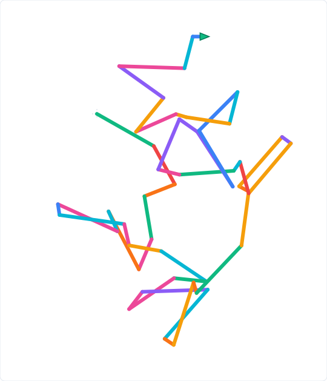
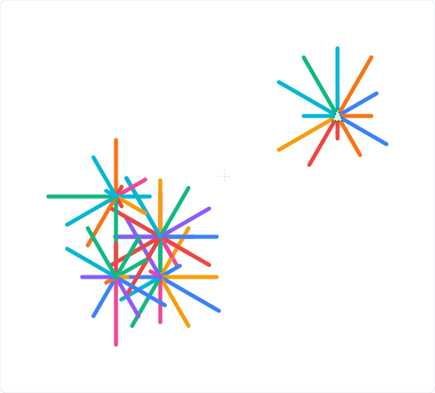
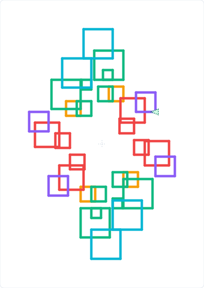

# Lesson `var.10` — Confetti, Fireworks & Random Walkers

| Field | Value |
| :--- | :--- |
| **ID** | `var.10` |
| **Module** | `var` (Variables, Sensors & Arithmetic) |
| **Title** | Confetti, `TELEPORT` Fireworks & Random Walkers |
| **Format** | `🐢` Creative LOGO Sandbox (`Starter + 3 Playable Variations`) |
| **Environment** | Turtle LOGO (`🐢`) |
| **Legacy ID** | `6.7a` *(turtle)* |
| **Slot Cap** | `30` per tab / `60` total (Starter `18`, Var 1 `10`, Var 2 `21`, Var 3 `26`) |
| **Edit Delta** | Open-ended Generative Sandbox (`Starter` + `3` Variations) |
| **Variables Allowed** | `["a", "d", "r", "s", "u", "v", "x", "y"]` |
| **Sensors / Operators** | `["$randCoin", "$randD4", "$randD6", "$randD8", "$randD20", "$rand01", "$randomColor"]`, `["+", "-", "*"]` |

---

## One-Concept Goal

Combine **`TELEPORT [x, y, heading]`**, **3-address dice math** (`x = $randD20 * 20 - 210`, `d = $randD6 * 18`), and **`$randomColor`** to craft confetti skies, organic random walkers, bursting fireworks, and mirrored kaleidoscopes.

<details>
<summary>📖 Parent / Teacher Tip</summary>

- **Zero-Reading Rule:** No learner instructions inside the sandbox UI. Each card showcases a distinct way kids can remix random dice: random positions (`Starter`), random turns & steps (`Var 1`), random ray lengths (`Var 2`), and mirrored `0 - x` kaleidoscope symmetry (`Var 3`).
- **Deterministic Documentation Seeds:** Each preview SVG uses an explicit seed (`77`, `24`, `99`, `15`) so specs remain 100% reproducible; in interactive play, clicking Run generates a new celebratory explosion every time!
- Notice strict 3-address `VAR_OP`: e.g. `u = 0 - x` computes negated coordinates safely before passing `[u, y, 90]` into `TELEPORT`.

</details>

---

## Palette & Capabilities

```json
{
  "allowedSimBlocks": [
    "FORWARD",
    "BACKWARD",
    "TURN_LEFT",
    "TURN_RIGHT",
    "ARC_LEFT",
    "ARC_RIGHT",
    "PEN_UP",
    "PEN_DOWN",
    "SET_PEN_COLOR",
    "SET_PEN_WIDTH",
    "TELEPORT"
  ],
  "allowedControlBlocks": ["LOOP_START", "LOOP_END", "CALL_FN", "VAR_ASSIGN", "VAR_OP"],
  "allowedFunctions": ["F1", "F2"],
  "allowedVariableNames": ["a", "d", "r", "s", "u", "v", "x", "y"],
  "allowedValueSensors": ["$x", "$y", "$heading", "$randCoin", "$randD4", "$randD6", "$randD8", "$randD20", "$rand01", "$randomColor"],
  "allowedVarOps": ["+", "-", "*"],
  "allowRepeatBadges": false,
  "allowActionParams": true,
  "startPose": { "x": 0, "y": 0, "heading": 0, "penDown": true, "penColor": "black", "penWidth": 6 }
}
```

---

## Starter — Confetti Starfield (`seed = 77`, `MAIN: 12`, `F1: 6`, Total `18`)


```json
{
  "seed": 77,
  "F1": [
    { "op": "PEN_DOWN" },
    {
      "op": "LOOP_START",
      "count": 5,
      "body": [
        { "op": "FORWARD", "length": 60 },
        { "op": "TURN_RIGHT", "angle": 144 }
      ]
    },
    { "op": "PEN_UP" }
  ],
  "MAIN": [
    { "op": "SET_PEN_WIDTH", "width": 5 },
    {
      "op": "LOOP_START",
      "count": 14,
      "body": [
        { "op": "VAR_ASSIGN", "var": "x", "value": "$randD20" },
        { "op": "VAR_OP", "target": "x", "operator": "*", "left": "x", "right": 20 },
        { "op": "VAR_OP", "target": "x", "operator": "-", "left": "x", "right": 210 },
        { "op": "VAR_ASSIGN", "var": "y", "value": "$randD20" },
        { "op": "VAR_OP", "target": "y", "operator": "*", "left": "y", "right": 15 },
        { "op": "VAR_OP", "target": "y", "operator": "-", "left": "y", "right": 155 },
        { "op": "TELEPORT", "x": "x", "y": "y", "heading": 18 },
        { "op": "SET_PEN_COLOR", "color": "$randomColor" },
        { "op": "CALL_FN", "fn": "F1" }
      ]
    }
  ]
}
```

*Metrics: `14` stars (`60px` legs), `70` line paths, `inkBounds = [-201..199] × [-197..130]`, `inkMaxSpan = 400px`, `scaleWarning = false`.*

---

## Playable Variation Cards (`3` Inspirations)

### Variation 1 — Cosmic Random Walker (`seed = 24`, `MAIN: 10` Flat Blocks)



```json
{
  "seed": 24,
  "MAIN": [
    { "op": "SET_PEN_WIDTH", "width": 6 },
    {
      "op": "LOOP_START",
      "count": 45,
      "body": [
        { "op": "VAR_ASSIGN", "var": "a", "value": "$rand01" },
        { "op": "VAR_OP", "target": "a", "operator": "*", "left": "a", "right": 360 },
        { "op": "TURN_RIGHT", "angle": "a" },
        { "op": "VAR_ASSIGN", "var": "d", "value": "$randD6" },
        { "op": "VAR_OP", "target": "d", "operator": "*", "left": "d", "right": 18 },
        { "op": "SET_PEN_COLOR", "color": "$randomColor" },
        { "op": "FORWARD", "length": "d" }
      ]
    }
  ]
}
```

*Metrics: `45` multi-color steps (`18..108px`, `[0,360°)` heading), `inkBounds = [-64..320] × [-128..381]`, `inkMaxSpan = 509px`, `scaleWarning = false`.*

---

### Variation 2 — Neon Fireworks Night (`seed = 99`, `MAIN: 11`, `F1: 10`, Total `21`)



```json
{
  "seed": 99,
  "F1": [
    {
      "op": "LOOP_START",
      "count": 12,
      "body": [
        { "op": "VAR_ASSIGN", "var": "r", "value": "$randD6" },
        { "op": "VAR_OP", "target": "r", "operator": "*", "left": "r", "right": 14 },
        { "op": "SET_PEN_COLOR", "color": "$randomColor" },
        { "op": "PEN_DOWN" },
        { "op": "FORWARD", "length": "r" },
        { "op": "PEN_UP" },
        { "op": "BACKWARD", "length": "r" },
        { "op": "TURN_RIGHT", "angle": 30 }
      ]
    }
  ],
  "MAIN": [
    { "op": "SET_PEN_WIDTH", "width": 5 },
    {
      "op": "LOOP_START",
      "count": 6,
      "body": [
        { "op": "VAR_ASSIGN", "var": "x", "value": "$randD8" },
        { "op": "VAR_OP", "target": "x", "operator": "*", "left": "x", "right": 55 },
        { "op": "VAR_OP", "target": "x", "operator": "-", "left": "x", "right": 245 },
        { "op": "VAR_ASSIGN", "var": "y", "value": "$randD6" },
        { "op": "VAR_OP", "target": "y", "operator": "*", "left": "y", "right": 50 },
        { "op": "VAR_OP", "target": "y", "operator": "-", "left": "y", "right": 175 },
        { "op": "TELEPORT", "x": "x", "y": "y", "heading": 0 },
        { "op": "CALL_FN", "fn": "F1" }
      ]
    }
  ]
}
```

*Metrics: `6` fireworks × `12` random rays (`14..84px`), `72` segments, `inkBounds = [-219..201] × [-159..209]`, `inkMaxSpan = 420px`, `scaleWarning = false`.*

---

### Variation 3 — Confetti Kaleidoscope Quilt (`seed = 15`, `MAIN: 20`, `F1: 6`, Total `26`)



```json
{
  "seed": 15,
  "F1": [
    { "op": "PEN_DOWN" },
    {
      "op": "LOOP_START",
      "count": 4,
      "body": [
        { "op": "FORWARD", "length": "s" },
        { "op": "TURN_RIGHT", "angle": 90 }
      ]
    },
    { "op": "PEN_UP" }
  ],
  "MAIN": [
    { "op": "SET_PEN_WIDTH", "width": 5 },
    {
      "op": "LOOP_START",
      "count": 8,
      "body": [
        { "op": "VAR_ASSIGN", "var": "x", "value": "$randD8" },
        { "op": "VAR_OP", "target": "x", "operator": "*", "left": "x", "right": 22 },
        { "op": "VAR_ASSIGN", "var": "y", "value": "$randD8" },
        { "op": "VAR_OP", "target": "y", "operator": "*", "left": "y", "right": 22 },
        { "op": "VAR_OP", "target": "u", "operator": "-", "left": 0, "right": "x" },
        { "op": "VAR_OP", "target": "v", "operator": "-", "left": 0, "right": "y" },
        { "op": "VAR_ASSIGN", "var": "s", "value": "$randD6" },
        { "op": "VAR_OP", "target": "s", "operator": "*", "left": "s", "right": 10 },
        { "op": "SET_PEN_COLOR", "color": "$randomColor" },
        { "op": "TELEPORT", "x": "x", "y": "y", "heading": 0 },
        { "op": "CALL_FN", "fn": "F1" },
        { "op": "TELEPORT", "x": "u", "y": "y", "heading": 90 },
        { "op": "CALL_FN", "fn": "F1" },
        { "op": "TELEPORT", "x": "u", "y": "v", "heading": 180 },
        { "op": "CALL_FN", "fn": "F1" },
        { "op": "TELEPORT", "x": "x", "y": "v", "heading": 270 },
        { "op": "CALL_FN", "fn": "F1" }
      ]
    }
  ]
}
```

*Metrics: `8` four-way mirrored square petals (`128` paths), `inkBounds = [-150..150] × [-236..236]`, `inkMaxSpan = 472px`, `scaleWarning = false`.*
