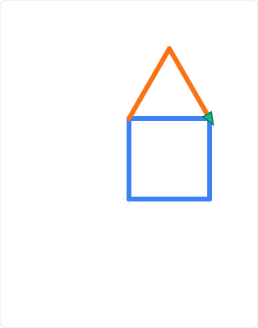
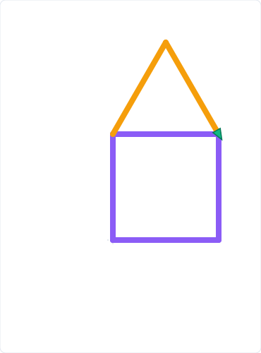
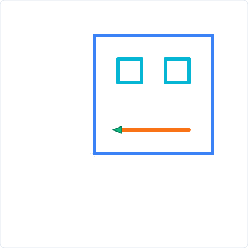
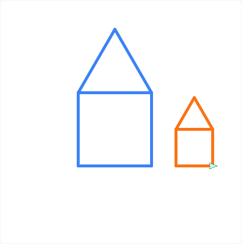

# Lesson `var.1` — Variables as Single-Point Constants

| Field | Value |
| :--- | :--- |
| **ID** | `var.1` |
| **Module** | `var` (Variables, Sensors & Arithmetic) |
| **Title** | Variables as Single-Point Constants |
| **Format** | `🐢` Creative LOGO Sandbox (`Starter + 3 Playable Variations`) |
| **Environment** | Turtle LOGO (`🐢`) |
| **Legacy ID** | `6.1` |
| **Slot Cap** | `30` per tab / `60` total (Starter `12`, Var 1 `13`, Var 2 `30`, Var 3 `24`) |
| **Edit Delta** | Open-ended Creative Sandbox (`Starter` -> `1`-number constant tweak `Var 1`) |
| **Variables Allowed** | `["a", "b", "e", "s"]` (`VAR_ASSIGN` ONLY; `VAR_OP` locked) |
| **Sensors / Operators** | Literal numbers and variable-to-variable assignment (`a = s`) ONLY — zero inline math |

---

## One-Concept Goal

Experience the **"Single-Point Constant"** superpower: define `s` once at the top of `MAIN` (`s = 100` -> `s = 150`), reuse `[s]` (or two constants `s, e` / `s, b`) across multiple shapes and `F1`, and watch the entire blueprint resize cleanly without overlap.

<details>
<summary>📖 Parent / Teacher Tip</summary>

- **Zero-Reading Rule:** Keep the workspace completely free of prose for `5–7` year olds! Kids explore by editing `s = 100` in Starter -> `150`, `80`, or `200`, or picking one of the `3` visual Variation Cards.
- **No Inline Math Here:** `VAR_OP` (`+`, `-`, `*`) stays locked until `var.3`. In `Var 3 (Twin Blueprints)`, kids see that reassigning `a = s` then later `a = b` lets `F1` draw two non-overlapping scaled houses cleanly side by side without `s + 40` inline math!
- Every drawing maintains `inkMaxSpan >= 187px` (`scaleWarning: false`) so strokes tower over the `40×45px` turtle.

</details>

---

## Palette & Capabilities

```json
{
  "allowedSimBlocks": [
    "FORWARD",
    "BACKWARD",
    "TURN_LEFT",
    "TURN_RIGHT",
    "ARC_LEFT",
    "ARC_RIGHT",
    "PEN_UP",
    "PEN_DOWN",
    "SET_PEN_COLOR",
    "SET_PEN_WIDTH"
  ],
  "allowedControlBlocks": ["LOOP_START", "LOOP_END", "CALL_FN", "VAR_ASSIGN"],
  "allowedFunctions": ["F1"],
  "allowedVariableNames": ["a", "b", "e", "s"],
  "allowedValueSensors": [],
  "allowedVarOps": [],
  "allowRepeatBadges": true,
  "allowActionParams": true,
  "startPose": { "x": 0, "y": 0, "heading": 0, "penDown": true, "penColor": "black", "penWidth": 6 }
}
```

---

## Starter — Variable House (`s = 100`, `MAIN: 12` Flat Blocks)



```json
{
  "MAIN": [
    { "op": "VAR_ASSIGN", "var": "s", "value": 100 },
    { "op": "SET_PEN_COLOR", "color": "blue" },
    {
      "op": "LOOP_START",
      "count": 4,
      "body": [
        { "op": "FORWARD", "length": "s" },
        { "op": "TURN_RIGHT", "angle": 90 }
      ]
    },
    { "op": "FORWARD", "length": "s" },
    { "op": "SET_PEN_COLOR", "color": "orange" },
    { "op": "TURN_RIGHT", "angle": 30 },
    { "op": "FORWARD", "length": "s" },
    { "op": "TURN_RIGHT", "angle": 120 },
    { "op": "FORWARD", "length": "s" }
  ]
}
```

*Rendered metrics: `inkBounds = [0..100] × [-187..0]`, `inkMaxSpan = 187px`, `scaleWarning = false`, final pose `(100, -100, 150°)`.*

---

## Playable Variation Cards (`3` Inspirations)

### Variation 1 — Giant Neon Mansion (`s = 150`, `MAIN: 13` Flat Blocks)



```json
{
  "MAIN": [
    { "op": "VAR_ASSIGN", "var": "s", "value": 150 },
    { "op": "SET_PEN_WIDTH", "width": 8 },
    { "op": "SET_PEN_COLOR", "color": "purple" },
    {
      "op": "LOOP_START",
      "count": 4,
      "body": [
        { "op": "FORWARD", "length": "s" },
        { "op": "TURN_RIGHT", "angle": 90 }
      ]
    },
    { "op": "FORWARD", "length": "s" },
    { "op": "SET_PEN_COLOR", "color": "amber" },
    { "op": "TURN_RIGHT", "angle": 30 },
    { "op": "FORWARD", "length": "s" },
    { "op": "TURN_RIGHT", "angle": 120 },
    { "op": "FORWARD", "length": "s" }
  ]
}
```

*Metrics: `inkBounds = [0..150] × [-280..0]`, `inkMaxSpan = 280px`, `scaleWarning = false`.*

---

### Variation 2 — Variable Pixel Bot Face (`s = 200`, `e = 40`, `MAIN: 20`, `F1: 10`, Total `30`)



```json
{
  "F1": [
    { "op": "PEN_DOWN" },
    { "op": "SET_PEN_COLOR", "color": "cyan" },
    {
      "op": "LOOP_START",
      "count": 4,
      "body": [
        { "op": "FORWARD", "length": "e" },
        { "op": "TURN_RIGHT", "angle": 90 }
      ]
    },
    { "op": "PEN_UP" },
    { "op": "TURN_RIGHT", "angle": 90 },
    { "op": "FORWARD", "length": "e", "repeat": 2 },
    { "op": "TURN_LEFT", "angle": 90 }
  ],
  "MAIN": [
    { "op": "VAR_ASSIGN", "var": "s", "value": 200 },
    { "op": "VAR_ASSIGN", "var": "e", "value": 40 },
    { "op": "SET_PEN_COLOR", "color": "blue" },
    {
      "op": "LOOP_START",
      "count": 4,
      "body": [
        { "op": "FORWARD", "length": "s" },
        { "op": "TURN_RIGHT", "angle": 90 }
      ]
    },
    { "op": "PEN_UP" },
    { "op": "FORWARD", "length": "e", "repeat": 3 },
    { "op": "TURN_RIGHT", "angle": 90 },
    { "op": "FORWARD", "length": "e" },
    { "op": "TURN_LEFT", "angle": 90 },
    { "op": "CALL_FN", "fn": "F1" },
    { "op": "CALL_FN", "fn": "F1" },
    { "op": "BACKWARD", "length": "e", "repeat": 2 },
    { "op": "TURN_LEFT", "angle": 90 },
    { "op": "FORWARD", "length": "e" },
    { "op": "PEN_DOWN" },
    { "op": "SET_PEN_COLOR", "color": "orange" },
    { "op": "FORWARD", "length": "e", "repeat": 3 }
  ]
}
```

*Metrics: `200×200px` outer head with symmetric `40×40px` Cyan eyes and `120px` Orange smile (`inkMaxSpan = 200px`, `scaleWarning = false`, final pose `(40, -40, 270°)`).*

---

### Variation 3 — Twin Scaled Blueprints (`s = 150`, `b = 75`, `MAIN: 10`, `F1: 14`, Total `24`)



```json
{
  "F1": [
    { "op": "PEN_DOWN" },
    {
      "op": "LOOP_START",
      "count": 4,
      "body": [
        { "op": "FORWARD", "length": "a" },
        { "op": "TURN_RIGHT", "angle": 90 }
      ]
    },
    { "op": "FORWARD", "length": "a" },
    { "op": "TURN_RIGHT", "angle": 30 },
    { "op": "FORWARD", "length": "a" },
    { "op": "TURN_RIGHT", "angle": 120 },
    { "op": "FORWARD", "length": "a" },
    { "op": "PEN_UP" },
    { "op": "TURN_RIGHT", "angle": 30 },
    { "op": "FORWARD", "length": "a" },
    { "op": "TURN_LEFT", "angle": 90 }
  ],
  "MAIN": [
    { "op": "VAR_ASSIGN", "var": "s", "value": 150 },
    { "op": "VAR_ASSIGN", "var": "b", "value": 75 },
    { "op": "VAR_ASSIGN", "var": "a", "value": "s" },
    { "op": "SET_PEN_COLOR", "color": "blue" },
    { "op": "CALL_FN", "fn": "F1" },
    { "op": "FORWARD", "length": 50 },
    { "op": "TURN_LEFT", "angle": 90 },
    { "op": "VAR_ASSIGN", "var": "a", "value": "b" },
    { "op": "SET_PEN_COLOR", "color": "orange" },
    { "op": "CALL_FN", "fn": "F1" }
  ]
}
```

*Metrics: Non-overlapping Big (`150px`) Blue House + Small (`75px`) Orange Cottage separated by a clean `50px` gap (`inkBounds = [0..275] × [-280..0]`, `inkMaxSpan = 280px`, `scaleWarning = false`).*
