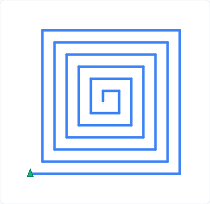
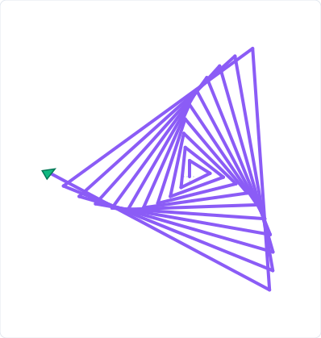
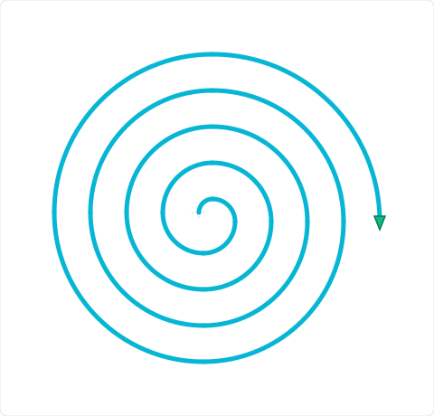
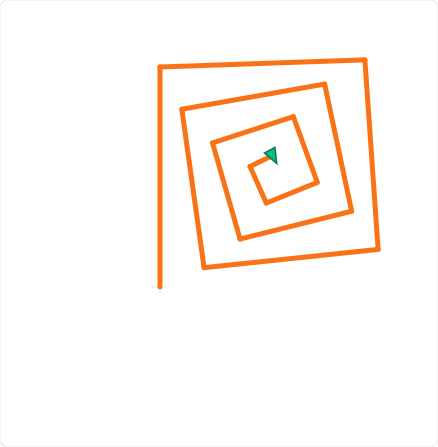
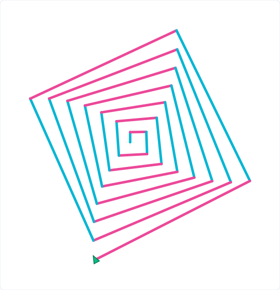

# Lesson `var.5` — Growing & Shrinking Loops — Spirals

| Field | Value |
| :--- | :--- |
| **ID** | `var.5` |
| **Module** | `var` (Variables, Sensors & Arithmetic) |
| **Title** | Growing & Shrinking Loops — Spirals |
| **Format** | `🐢` Creative LOGO Sandbox (`Starter + 4 Playable Variations`) |
| **Environment** | Turtle LOGO (`🐢`) |
| **Legacy ID** | `6.5` |
| **Slot Cap** | `14` per tab / `24` total (Starter `8`, Var 1 `8`, Var 2 `7`, Var 3 `8`, Var 4 `13`) |
| **Edit Delta** | Open-ended Creative Sandbox (`a = a + k` / `a = a - k` spiral play) |
| **Variables Allowed** | `["a"]` |
| **Sensors / Operators** | `["+", "-", "*"]` ONLY (`TELEPORT` and `🎲` remain locked until `var.6` / `var.8`) |

---

## One-Concept Goal

Put a self-updating variable (`a = a + 12` or `a = a - 15`) inside a `Loop` so every repeat automatically grows or shrinks the turtle's `FORWARD` leg or `ARC_RIGHT` curve into spirals, vortices, shells, and two-tone galaxies.

<details>
<summary>📖 Parent / Teacher Tip</summary>

- **Zero-Reading Rule:** Kids pick up the visual pattern by playing Starter and peeking at the `4` Variation thumbnails — changing the turn angle (`90°` -> `122°` -> `88°`) or the `+12` / `-15` step transforms the entire geometry.
- **Note on `Var 3` (Shrinking Gravity Wormhole):** Start `a = 220` and subtract `a = a - 15` over `14` turns so length ends safely at `25px` (always positive, never hitting `0` or going backward).
- **Curriculum Boundary:** Both `TELEPORT` (`var.6`) and `$randomColor` (`var.8`) remain hidden here; **`Var 4`** achieves a vibrant Cyan/Pink dual-color galaxy using `F1`!

</details>

---

## Palette & Capabilities

```json
{
  "allowedSimBlocks": [
    "FORWARD",
    "BACKWARD",
    "TURN_LEFT",
    "TURN_RIGHT",
    "ARC_LEFT",
    "ARC_RIGHT",
    "PEN_UP",
    "PEN_DOWN",
    "SET_PEN_COLOR",
    "SET_PEN_WIDTH"
  ],
  "allowedControlBlocks": ["LOOP_START", "LOOP_END", "CALL_FN", "VAR_ASSIGN", "VAR_OP"],
  "allowedFunctions": ["F1"],
  "allowedVariableNames": ["a"],
  "allowedValueSensors": [],
  "allowedVarOps": ["+", "-", "*"],
  "allowRepeatBadges": false,
  "allowActionParams": true,
  "startPose": { "x": 0, "y": 0, "heading": 0, "penDown": true, "penColor": "black", "penWidth": 6 }
}
```

---

## Starter — Classic Square Spiral (`MAIN: 8` Flat Blocks)



```json
{
  "MAIN": [
    { "op": "VAR_ASSIGN", "var": "a", "value": 20 },
    { "op": "SET_PEN_COLOR", "color": "blue" },
    { "op": "SET_PEN_WIDTH", "width": 5 },
    {
      "op": "LOOP_START",
      "count": 24,
      "body": [
        { "op": "FORWARD", "length": "a" },
        { "op": "TURN_RIGHT", "angle": 90 },
        { "op": "VAR_OP", "target": "a", "operator": "+", "left": "a", "right": 12 }
      ]
    }
  ]
}
```

*Metrics: `24` legs growing `20 -> 296px`, `inkBounds = [-144..152] × [-140..144]`, `inkMaxSpan = 296px`, `scaleWarning = false`, final pose `(-144, 144, 0°)`.*

---

## Playable Variation Cards (`4` Inspirations)

### Variation 1 — Hypnotic Skewed Vortex (`122°` Triangle Twist, `MAIN: 8` Flat Blocks)



```json
{
  "MAIN": [
    { "op": "VAR_ASSIGN", "var": "a", "value": 20 },
    { "op": "SET_PEN_COLOR", "color": "purple" },
    { "op": "SET_PEN_WIDTH", "width": 4 },
    {
      "op": "LOOP_START",
      "count": 30,
      "body": [
        { "op": "FORWARD", "length": "a" },
        { "op": "TURN_RIGHT", "angle": 122 },
        { "op": "VAR_OP", "target": "a", "operator": "+", "left": "a", "right": 10 }
      ]
    }
  ]
}
```

*Metrics: `30` legs (`20 -> 310px`), `inkBounds = [-175..103] × [-159..140]`, `inkMaxSpan = 299px`, `scaleWarning = false`.*

---

### Variation 2 — Nautilus Curved Shell (`ARC_RIGHT`, `MAIN: 7` Flat Blocks)



```json
{
  "MAIN": [
    { "op": "VAR_ASSIGN", "var": "a", "value": 15 },
    { "op": "SET_PEN_COLOR", "color": "cyan" },
    { "op": "SET_PEN_WIDTH", "width": 5 },
    {
      "op": "LOOP_START",
      "count": 18,
      "body": [
        { "op": "ARC_RIGHT", "radius": "a", "angle": 90 },
        { "op": "VAR_OP", "target": "a", "operator": "+", "left": "a", "right": 10 }
      ]
    }
  ]
}
```

*Metrics: Smooth expanding `90°` radii (`15 -> 185px`), `inkBounds = [-160..200] × [-175..165]`, `inkMaxSpan = 360px`, `scaleWarning = false`.*

---

### Variation 3 — Shrinking Gravity Wormhole (`a = a - 15`, `MAIN: 8` Flat Blocks)



```json
{
  "MAIN": [
    { "op": "VAR_ASSIGN", "var": "a", "value": 220 },
    { "op": "SET_PEN_COLOR", "color": "orange" },
    { "op": "SET_PEN_WIDTH", "width": 5 },
    {
      "op": "LOOP_START",
      "count": 14,
      "body": [
        { "op": "FORWARD", "length": "a" },
        { "op": "TURN_RIGHT", "angle": 88 },
        { "op": "VAR_OP", "target": "a", "operator": "-", "left": "a", "right": 15 }
      ]
    }
  ]
}
```

*Metrics: `14` inward-coiling legs (`220 -> 25px`), `inkBounds = [0..218] × [-227..0]`, `inkMaxSpan = 227px`, `scaleWarning = false`.*

---

### Variation 4 — Two-Tone Rainbow Galaxy Arm (`F1`, `MAIN: 5`, `F1: 8`, Total `13`)



```json
{
  "F1": [
    { "op": "SET_PEN_COLOR", "color": "cyan" },
    { "op": "FORWARD", "length": "a" },
    { "op": "TURN_RIGHT", "angle": 89 },
    { "op": "VAR_OP", "target": "a", "operator": "+", "left": "a", "right": 12 },
    { "op": "SET_PEN_COLOR", "color": "pink" },
    { "op": "FORWARD", "length": "a" },
    { "op": "TURN_RIGHT", "angle": 89 },
    { "op": "VAR_OP", "target": "a", "operator": "+", "left": "a", "right": 12 }
  ],
  "MAIN": [
    { "op": "VAR_ASSIGN", "var": "a", "value": 20 },
    { "op": "SET_PEN_WIDTH", "width": 5 },
    {
      "op": "LOOP_START",
      "count": 14,
      "body": [
        { "op": "CALL_FN", "fn": "F1" }
      ]
    }
  ]
}
```

*Metrics: `28` alternating Cyan & Pink `89°` arms (`20 -> 344px`), `inkBounds = [-198..237] × [-222..233]`, `inkMaxSpan = 455px`, `scaleWarning = false`.*
