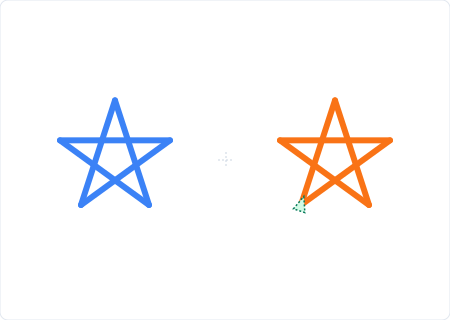
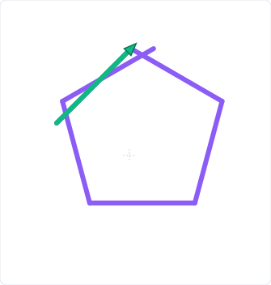

# Lesson `var.6` — `TELEPORT` & Pose Sensors (`$x`, `$y`, `$heading`)

| Field | Value |
| :--- | :--- |
| **ID** | `var.6` *(replaces legacy `var.5a`)* |
| **Module** | `var` (Variables, Sensors & Arithmetic) |
| **Title** | `TELEPORT` & Pose Sensors (`$x`, `$y`, `$heading`) |
| **Format** | `📖` Interactive Read-Only Explanation (`2` Tabs) |
| **Environment** | Turtle LOGO (`🐢`) |
| **Legacy ID** | `5a` / `6.5a` |
| **Slot Cap** | Read-only demo (Tab 1: `MAIN 6`, `F1 6`; Tab 2: `MAIN 15`) |
| **Edit Delta** | `0` (Read-Only Interactive Demo) |
| **Variables Allowed** | `["a", "b", "c"]` |
| **Sensors / Operators** | **Unlocks `TELEPORT [x, y, h]` (`0x1F`)** and pose sensors **`["$x", "$y", "$heading"]`** (`0x80..0x82`) |

---

## One-Concept Goal

Introduce **`TELEPORT [x, y, heading]`** (`0x1F`) for instant jumps across the LOGO canvas (paired cleanly with `PEN_UP` / `PEN_DOWN`) and **pose sensors `$x`, `$y`, `$heading`** (`0x80..0x82`) to bookmark a location, wander away, and warp straight back with heading preserved.

---

## Guided Co-Pilot Explanation Cards

- **Tab 1 (`TELEPORT` Twin Stars):** `TELEPORT [x, y, heading] warps the turtle instantly to any spot and direction you type!` `Wrap jumps with PEN_UP and PEN_DOWN so no travel streaks connect separate shapes.`
- **Tab 2 (`$x`, `$y`, `$heading` Pose Bookmark):** `Save a = $x, b = $y, and c = $heading before wandering away.` `Later, TELEPORT [a, b, c] beams the turtle straight back to its exact spot and angle!`

<details>
<summary>📖 Parent / Teacher Tip</summary>

- Notice how `TELEPORT` preserves whatever pen state was active beforehand (`PEN_UP` stays up, `PEN_DOWN` drags a straight jump line!). Keeping `PEN_UP` / `PEN_DOWN` inside `F1` (`Tab 1`) and explicitly around `TELEPORT` (`Tab 2`) models clean pen hygiene.
- On Tab 2, make sure learners notice **all three** pose sensors (`a = $x`, `b = $y`, `c = $heading`): restoring `(a, b, c)` after the `Loop ×6` wander brings the turtle right back to `(-90, -40, 45°)` so its final Green line shoots cleanly northeast at `45°`!
- Coordinate check: `0°` points straight Up (`dy < 0` in screen-space SVG coordinates), `90°` points Right (`+x`), `180°` Down (`+y`), `270°` Left (`-x`).

</details>

---

## Palette & Capabilities

```json
{
  "readOnly": true,
  "allowedSimBlocks": [
    "FORWARD",
    "BACKWARD",
    "TURN_LEFT",
    "TURN_RIGHT",
    "ARC_LEFT",
    "ARC_RIGHT",
    "PEN_UP",
    "PEN_DOWN",
    "SET_PEN_COLOR",
    "SET_PEN_WIDTH",
    "TELEPORT"
  ],
  "allowedControlBlocks": ["LOOP_START", "LOOP_END", "CALL_FN", "VAR_ASSIGN", "VAR_OP"],
  "allowedFunctions": ["F1"],
  "allowedVariableNames": ["a", "b", "c"],
  "allowedValueSensors": ["$x", "$y", "$heading"],
  "allowedVarOps": ["+", "-", "*"],
  "allowRepeatBadges": false,
  "allowActionParams": true,
  "startPose": { "x": 0, "y": 0, "heading": 0, "penDown": true, "penColor": "black", "penWidth": 6 }
}
```

---

## Tab 1 — Remote Twin Stars (`MAIN: 6`, `F1: 6`, Total `12` Flat Blocks)

```json
{
  "F1": [
    { "op": "PEN_DOWN" },
    {
      "op": "LOOP_START",
      "count": 5,
      "body": [
        { "op": "FORWARD", "length": 110 },
        { "op": "TURN_RIGHT", "angle": 144 }
      ]
    },
    { "op": "PEN_UP" }
  ],
  "MAIN": [
    { "op": "TELEPORT", "x": -145, "y": 45, "heading": 18 },
    { "op": "SET_PEN_COLOR", "color": "blue" },
    { "op": "CALL_FN", "fn": "F1" },
    { "op": "TELEPORT", "x": 75, "y": 45, "heading": 18 },
    { "op": "SET_PEN_COLOR", "color": "orange" },
    { "op": "CALL_FN", "fn": "F1" }
  ]
}
```

### Visual Render & Execution Trace (Tab 1)



| Step | Scope | Pose After Step | Pen State & Drawing |
| :---: | :--- | :--- | :--- |
| 1–3 | `MAIN` | `(-145, 45, 18°)` -> `CALL F1` -> `(-145, 45, 18°)` | Blue `110px`-leg 5-point upright star on left (`F1` puts pen down then up) |
| 4–6 | `MAIN` | `(75, 45, 18°)` -> `CALL F1` -> `(75, 45, 18°)` | Instant warp to `(75, 45, 18°)` with zero connecting streak, Orange star on right (`inkWidth = 330px`, `scaleWarning = false`) |

---

## Tab 2 — Pose Bookmark & Heading Restore (`MAIN: 15` Flat Blocks)

```json
{
  "MAIN": [
    { "op": "TELEPORT", "x": -90, "y": -40, "heading": 45 },
    { "op": "VAR_ASSIGN", "var": "a", "value": "$x" },
    { "op": "VAR_ASSIGN", "var": "b", "value": "$y" },
    { "op": "VAR_ASSIGN", "var": "c", "value": "$heading" },
    { "op": "PEN_DOWN" },
    { "op": "SET_PEN_COLOR", "color": "purple" },
    {
      "op": "LOOP_START",
      "count": 6,
      "body": [
        { "op": "FORWARD", "length": 130 },
        { "op": "TURN_RIGHT", "angle": 75 }
      ]
    },
    { "op": "PEN_UP" },
    { "op": "TELEPORT", "x": "a", "y": "b", "heading": "c" },
    { "op": "PEN_DOWN" },
    { "op": "SET_PEN_COLOR", "color": "green" },
    { "op": "FORWARD", "length": 130 }
  ]
}
```

### Visual Render & Execution Trace (Tab 2)



| Step | Action | `a, b, c` Memory | Robot Pose `(x, y, heading)` | Notes |
| :---: | :--- | :--- | :--- | :--- |
| 1 | `TELEPORT [-90, -40, 45]` | `0, 0, 0` | `(-90, -40, 45°)` | Warps to anchor point at `45°` |
| 2–4 | `a = $x`, `b = $y`, `c = $heading` | `-90, -40, 45` | `(-90, -40, 45°)` | Captures full `3`-part pose bookmark |
| 5–10 | `PEN_DOWN [Purple]` + `LOOP ×6 { FWD 130, RIGHT 75 }` | `-90, -40, 45` | `(-90, -40, 135°)` *(or wandered offset)* | Purple geometric polygon wanders away (`6` segments, `130px` legs) |
| 11–12 | `PEN_UP`, `TELEPORT [a, b, c]` | `-90, -40, 45` | `(-90, -40, 45°)` | Restores exact `(x, y)` AND original `45°` heading |
| 13–15 | `PEN_DOWN [Green]`, `FORWARD [130]` | `-90, -40, 45` | `(1.92, -131.92, 45°)` | Green proof beam fires NE along exact saved `45°` angle (`inkMaxSpan = 205px`) |
