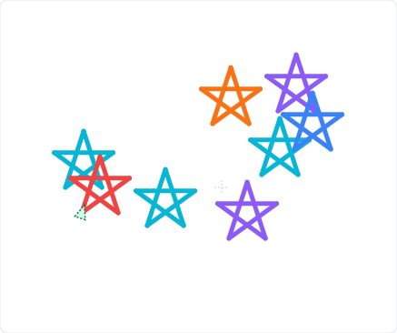

# Lesson `var.8` — Random Dice (`🎲`) & `$randomColor`

| Field | Value |
| :--- | :--- |
| **ID** | `var.8` |
| **Module** | `var` (Variables, Sensors & Arithmetic) |
| **Title** | Random Dice (`🎲`) & `$randomColor` |
| **Format** | `📖` Interactive Read-Only Explanation (`2` Tabs: Beat `🎵` + Turtle `🐢`) |
| **Environments** | Tab 1: Beat Matrix (`🎵`), Tab 2: Turtle LOGO (`🐢`) |
| **Legacy ID** | `6.6b` *(new)* |
| **Slot Cap** | Read-only demo (`9` flat blocks Tab 1; `18` total Tab 2) |
| **Edit Delta** | `0` (Read-Only Interactive Demo) |
| **Variables Allowed** | Tab 1: `["p", "r", "c"]`; Tab 2: `["x", "y"]` |
| **Sensors / Operators** | **Unlocks `🎲` (`$randCoin, $randD4, $randD6, $randD8, $randD20, $rand01`) & `$randomColor`** + `["+", "-", "*"]` |

---

## One-Concept Goal

Introduce **pseudo-random dice sensors** (`🎲`: `Coin 0..1`, `D4 1..4`, `D6 1..6`, `D8 1..8`, `D20 1..20`, `[0,1)`) and **`$randomColor`** (plugged directly into `SET_PEN_COLOR` / `SET_LED_COLOR`) to generate lively generative melodies and artwork on every run.

---

## Guided Co-Pilot Explanation Cards

- **Tab 1 (`🎵` Beat Dice DJ):** `Pick a die like D8 (1..8) to roll a random C Major note and a random pad row/column!` `Plug [$randomColor] right into the paint block for instant confetti lights.`
- **Tab 2 (`🐢` Seeded Random Starburst Sky):** `Roll D20 dice and multiply to scatter stars anywhere across the sky!` `Re-run to deal a fresh sky, or lock a seed number to replay the exact same art.`

<details>
<summary>📖 Parent / Teacher Tip</summary>

- Every `🎲` reporter yields an integer except **`$rand01`** (which returns a float in `[0, 1)` used with `* 360` for random angles in `var.10`).
- Strict typing rule in `var`: **`$randomColor` goes ONLY directly into `SET_PEN_COLOR [$randomColor]` or `SET_LED_COLOR [$randomColor]`** — never into a numeric variable (`c = $randomColor` is disallowed until `tape.0` color arrays).
- Note on Tab 1: Beat cursor reticle (`visible: false`) stays hidden because no cursor movement blocks exist; notes `1..8` map cleanly to **C Major** (`C4` through `C5`).
- Note on Tab 2: `seed = 42` reproduces the deterministic SVG preview below (`8` colorful `65px` stars across `317×202px`); in live Play, pressing Play generates a fresh seeded roll each run.

</details>

---

## Tab 1 — `🎵` Beat Matrix: Random `D8` C Major Light Show

### Palette & Capabilities (Tab 1)

```json
{
  "readOnly": true,
  "allowedSimBlocks": ["LIGHT_PIXEL", "SET_LED_COLOR", "PLAY_NOTE", "SET_BEAT_DELAY"],
  "allowedControlBlocks": ["LOOP_START", "LOOP_END", "VAR_ASSIGN"],
  "allowedVariableNames": ["p", "r", "c"],
  "allowedValueSensors": ["$randCoin", "$randD4", "$randD6", "$randD8", "$randD20", "$rand01", "$randomColor"],
  "allowedVarOps": ["+", "-", "*"],
  "cursorReticleVisible": false,
  "noteScale": "C Major (1..8 = C4..C5, extended 1..16 = C4..D6)",
  "slotCap": 12
}
```

### Program (`9` Flat Blocks)

```json
{
  "seed": 42,
  "MAIN": [
    { "op": "SET_BEAT_DELAY", "multiplier": 0.5 },
    {
      "op": "LOOP_START",
      "count": 8,
      "body": [
        { "op": "VAR_ASSIGN", "var": "p", "value": "$randD8" },
        { "op": "VAR_ASSIGN", "var": "r", "value": "$randD8" },
        { "op": "VAR_ASSIGN", "var": "c", "value": "$randD8" },
        { "op": "SET_LED_COLOR", "color": "$randomColor" },
        { "op": "LIGHT_PIXEL", "row": "r", "col": "c" },
        { "op": "PLAY_NOTE", "pitch": "p", "beats": 0.5 }
      ]
    }
  ]
}
```

### Sample Seeded Sequence (`8` Beats, `0.5×` Tempo)

| Beat | `p = $randD8` | `Note (C Major)` | `(r, c)` Pad | `$randomColor` |
| :---: | :---: | :--- | :---: | :--- |
| 1 | `6` | `A4` (`6`) | `(3, 7)` | `Cyan` |
| 2 | `2` | `D4` (`2`) | `(8, 4)` | `Pink` |
| 3 | `5` | `G4` (`5`) | `(1, 6)` | `Amber` |
| 4 | `8` | `C5` (`8`) | `(5, 2)` | `Purple` |
| 5–8 | `D8 ∈ 1..8` | `C4..C5` | `(1..8, 1..8)` | Vibrant random swatch |

---

## Tab 2 — `🐢` Turtle LOGO: Random `D20` Sky + `$randomColor` (`MAIN: 12`, `F1: 6`, Total `18`)

### Palette & Capabilities (Tab 2)

```json
{
  "readOnly": true,
  "allowedSimBlocks": ["FORWARD", "TURN_RIGHT", "PEN_UP", "PEN_DOWN", "SET_PEN_COLOR", "SET_PEN_WIDTH", "TELEPORT"],
  "allowedControlBlocks": ["LOOP_START", "LOOP_END", "CALL_FN", "VAR_ASSIGN", "VAR_OP"],
  "allowedFunctions": ["F1"],
  "allowedVariableNames": ["x", "y"],
  "allowedValueSensors": ["$randCoin", "$randD4", "$randD6", "$randD8", "$randD20", "$rand01", "$randomColor"],
  "allowedVarOps": ["+", "-", "*"],
  "seed": 42
}
```

### Program (`MAIN: 12`, `F1: 6`, Total `18` Flat Blocks)

```json
{
  "seed": 42,
  "F1": [
    { "op": "PEN_DOWN" },
    {
      "op": "LOOP_START",
      "count": 5,
      "body": [
        { "op": "FORWARD", "length": 65 },
        { "op": "TURN_RIGHT", "angle": 144 }
      ]
    },
    { "op": "PEN_UP" }
  ],
  "MAIN": [
    { "op": "SET_PEN_WIDTH", "width": 5 },
    {
      "op": "LOOP_START",
      "count": 8,
      "body": [
        { "op": "VAR_ASSIGN", "var": "x", "value": "$randD20" },
        { "op": "VAR_OP", "target": "x", "operator": "*", "left": "x", "right": 18 },
        { "op": "VAR_OP", "target": "x", "operator": "-", "left": "x", "right": 190 },
        { "op": "VAR_ASSIGN", "var": "y", "value": "$randD20" },
        { "op": "VAR_OP", "target": "y", "operator": "*", "left": "y", "right": 14 },
        { "op": "VAR_OP", "target": "y", "operator": "-", "left": "y", "right": 140 },
        { "op": "TELEPORT", "x": "x", "y": "y", "heading": 18 },
        { "op": "SET_PEN_COLOR", "color": "$randomColor" },
        { "op": "CALL_FN", "fn": "F1" }
      ]
    }
  ]
}
```

### Visual Render & Execution Trace (`seed = 42`)



| Metric | Value |
| :--- | :--- |
| **Flat Blocks** | `MAIN: 12`, `F1: 6`, `Total: 18` (`<= 14/tab`) |
| **Seeded Span (`seed = 42`)** | `inkBounds: [-184..133] × [-146..56]` (`317 × 202px`, `inkMaxSpan = 317`, `scaleWarning: false`) |
| **Path Count / Final Pose** | `40` line segments (`8` 5-point stars), final pose `(-154, 28, 18°)`, pen up |
