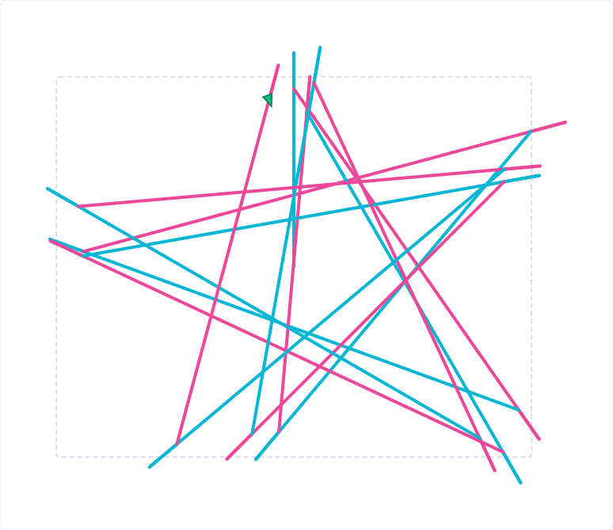
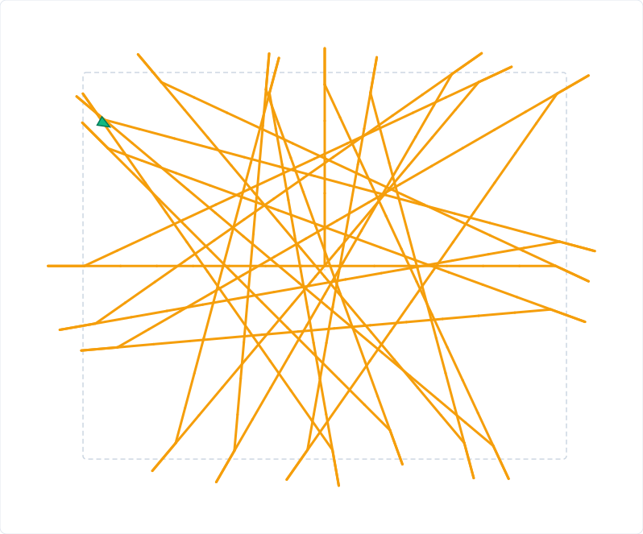
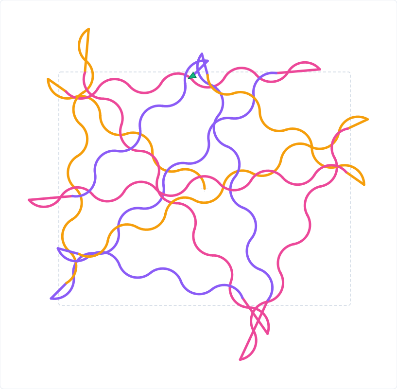
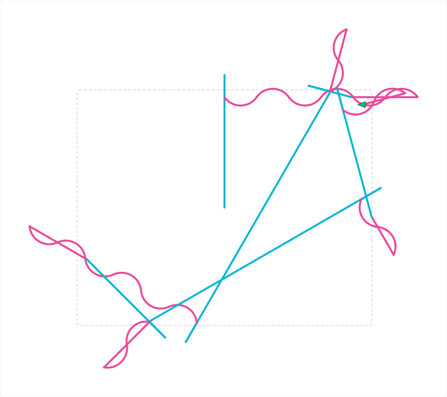

# Capstone while.B: Laser Frame & Wave Gallery

**ID:** `while.B` · **Format:** 🎨 Creative Synthesis Capstone (`Starter + 3 Variation Cards`) · **Env:** [Turtle LOGO](../../envs/turtle_logo.md)
**One-Concept Goal:** Synthesize `While (insideCanvas)` + `While (NOT insideCanvas)` boundary loops, opposing `ARC_LEFT / ARC_RIGHT` ribbons, `F1–F3` functions, and the `🎛️ $input` gallery dial into edge-aware geometric art—without variables or `TELEPORT`.

<details>
<summary>📖 Parent / Teacher Tip (Adult-Only <code>explanationText</code>)</summary>

> Every stroke here uses the `600×480` dashed sketchbook frame (`insideCanvas`) instead of fixed step counts! In **Variation 2** (`Double-Wave Sunset`), notice the second loop **`While (NOT insideCanvas) { BACKWARD [45] }`**: curved waves can jump further past the dashed border than straight lines, so looping backwards until `insideCanvas` returns true brings the turtle cleanly inside the frame every single bounce! In **Variation 3**, tap the **`🎛️ $input` dial (`1–4`)** to switch live between 4 whole-canvas laser & wave shows!
> *(Learner Workspace Rule: **0** learner-facing words — dashed `600×480` bounds, `VisualParamBadges`, and `🎛️` auto-rerun communicate everything visually.)*

</details>

---

## 1. Env Setup & Constraints ([Turtle LOGO](../../envs/turtle_logo.md))

- **Start Pose:** `(x: 0, y: 0, heading: 0° North)`, `penDown: true`, `penColor: #0f172a`, `penWidth: 6`.
- **Canvas Frame:** `canvasBounds: { halfWidth: 300, halfHeight: 240 }`, `showCanvasBounds: true` (dashed `#cbd5e1` frame, inclusive `1e-6` epsilon).
- **Scale & Pre-`var` Compliance:** Strictly **no `TELEPORT`** and **no variables `a–z`**; `inkMaxSpan >= 654` (`scaleWarning: false`).

| Property | Specification |
| :--- | :--- |
| **`allowedSimBlocks`** | `FORWARD`, `BACKWARD`, `TURN_LEFT`, `TURN_RIGHT`, `ARC_LEFT`, `ARC_RIGHT`, `PEN_UP`, `PEN_DOWN`, `SET_PEN_COLOR` (`0..9`), `SET_PEN_WIDTH`, `CALL_FN` (`F1`, `F2`, `F3`) |
| **`allowedControlBlocks`** | `LOOP_START` (+ `END_LOOP`), `WHILE` (+ `END_WHILE`), `IF`, `ELSE_IF`, `ELSE`, `END_IF` |
| **`allowedSensors`** | `insideCanvas` (`0x28`), `$input` (`🎛️` `1..4`) |
| **`allowedCombinators`** | `[NOT]` |
| **`allowRepeatBadges` / `allowActionParams`** | `true` / `true` |
| **`allowedScopes` / `allowVariables` / `allowRecursion`** | `MAIN`, `F1`, `F2`, `F3` / `false` / `false` |
| **`slotCap`** | `Starter / Var 1`: `<= 14/tab`; `Var 2`: `<= 20/tab`; `Var 3 Showcase`: `<= 26/tab` |

---

## 2. Starter & 3 Creative Variation Cards (Static Verified Previews)

### Starter — **Twin-Laser Bounce Frame** (`MAIN: 7 + F1: 5 = 12` flat blocks)



```text
// MAIN (7 flat blocks — stepsExecuted: 466, pathCount: 208, inkMaxSpan: 654)
SET_PEN_WIDTH [4]
Loop [8]
  SET_PEN_COLOR [Cyan]
  CALL_FN [F1]
  SET_PEN_COLOR [Pink]
  CALL_FN [F1]
End Loop

// F1 (5 flat blocks)
While (insideCanvas)
  FORWARD [45]
End While
BACKWARD [45]
TURN_RIGHT [145]
```

### Variation 1 — **Neon Starburst Frame (`155°` Weave)** (`MAIN: 5 + F1: 5 = 10` flat blocks)



```text
// MAIN (5 flat blocks — stepsExecuted: 699, pathCount: 324, inkMaxSpan: 678)
SET_PEN_WIDTH [3]
SET_PEN_COLOR [Amber]
Loop [24]
  CALL_FN [F1]
End Loop

// F1 (5 flat blocks)
While (insideCanvas)
  FORWARD [45]
End While
BACKWARD [45]
TURN_RIGHT [155]
```

### Variation 2 — **Double-Wave Sunset (`While (NOT insideCanvas)` Return)** (`MAIN: 9 + F1: 9 = 18`)



```text
// MAIN (9 flat blocks — stepsExecuted: 254, pathCount: 114, inkMaxSpan: 697)
SET_PEN_WIDTH [5]
Loop [4]
  SET_PEN_COLOR [Amber]
  CALL_FN [F1]
  SET_PEN_COLOR [Pink]
  CALL_FN [F1]
  SET_PEN_COLOR [Purple]
  CALL_FN [F1]
End Loop

// F1 (9 flat blocks)
While (insideCanvas)
  ARC_LEFT [40, 110]
  ARC_RIGHT [40, 110]
End While
TURN_LEFT [55]
While (NOT insideCanvas)
  BACKWARD [45]
End While
TURN_RIGHT [195]
```

### Variation 3 (Showcase) — **`🎛️ $input` Frame Studio (`1..4`)** (`MAIN: 24 + F1: 5 + F2: 11 + F3: 9`)

*(Preview below shows **`$input = 4`** Combo Cyan Star Web + Pink Sunset Waves; verified for all 4 inputs: `1` = `452` steps/`inkMaxSpan 654`; `2` = `430` steps/`665`; `3` = `204` steps/`680`; `4` = `219` steps/`790`.)*



```text
// MAIN (24 flat blocks)
SET_PEN_WIDTH [4]
If ($input == 1)
  SET_PEN_COLOR [Cyan]
  Loop [16]
    CALL_FN [F1]
  End Loop
Else If ($input == 2)
  SET_PEN_COLOR [Amber]
  Loop [10]
    CALL_FN [F2]
  End Loop
Else If ($input == 3)
  SET_PEN_COLOR [Pink]
  Loop [10]
    CALL_FN [F3]
  End Loop
Else
  Loop [6]
    SET_PEN_COLOR [Cyan]
    CALL_FN [F1]
    SET_PEN_COLOR [Pink]
    CALL_FN [F3]
  End Loop
End If

// F1 (5 flat blocks — Laser Chord)
While (insideCanvas)
  FORWARD [45]
End While
BACKWARD [45]
TURN_RIGHT [145]

// F2 (11 flat blocks — Lightning Bounce)
While (insideCanvas)
  FORWARD [45]
  TURN_RIGHT [60]
  FORWARD [45]
  TURN_LEFT [60]
End While
TURN_RIGHT [30]
While (NOT insideCanvas)
  BACKWARD [45]
End While
TURN_RIGHT [115]

// F3 (9 flat blocks — Wave Bounce)
While (insideCanvas)
  ARC_LEFT [40, 110]
  ARC_RIGHT [40, 110]
End While
TURN_LEFT [55]
While (NOT insideCanvas)
  BACKWARD [45]
End While
TURN_RIGHT [195]
```
