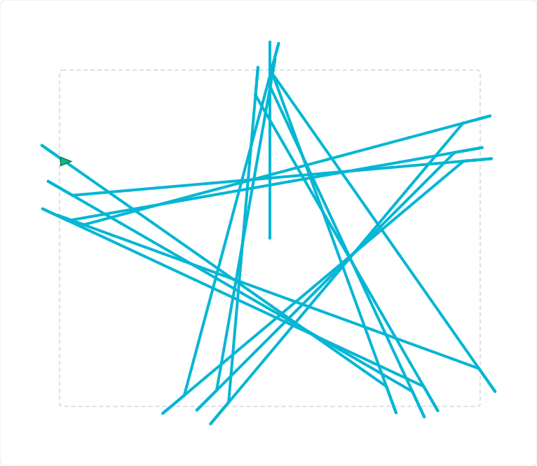
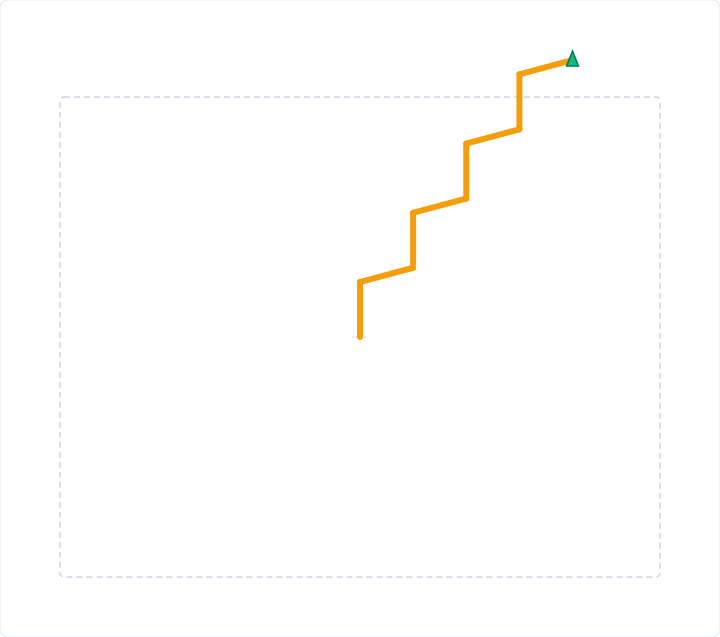
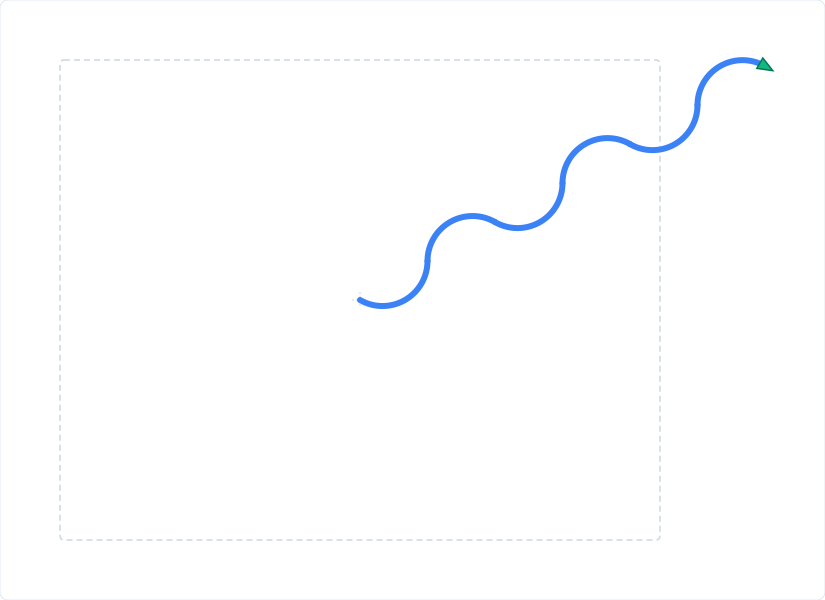
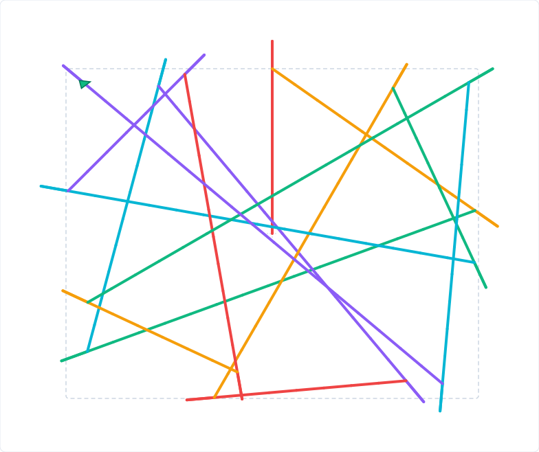

# Lesson while.6: Adaptive Canvas Bounds (`While (insideCanvas)`)

**ID:** `while.6` · **Format:** 🎨 Creative Open Sandbox (`Starter + 3 Variation Cards`) · **Env:** [Turtle LOGO](../../envs/turtle_logo.md)
**One-Concept Goal:** Draw rays, lightning zig-zags, and braided ocean waves that grow automatically until hitting the dashed **`600×480`** canvas border using `While (insideCanvas)`—without counting steps, without variables, and without `TELEPORT`.

<details>
<summary>📖 Parent / Teacher Tip (Adult-Only <code>explanationText</code>)</summary>

> Notice the faint dashed rectangle framing the sketchbook (`600×480` around center `(0, 0)`): `insideCanvas` stays true while the turtle is inside or on that frame! Because we haven't unlocked `TELEPORT` or variables (`a–z`) yet, the secret to multi-ray laser art is **`BACKWARD [40]`** right after `End While`—stepping one stride back inside the dashed box so the turtle can turn and bounce across the canvas again!
> *(Learner Workspace Rule: **0** learner-facing words — dashed border frame pulse on `insideCanvas`, visual `VisualParamBadges`, and playable Starter + Variation cards guide exploration.)*

</details>

---

## 1. Env Setup, Bounds & Strict Constraints

- **Start Pose:** `(x: 0, y: 0, heading: 0° North)`, `penDown: true`, `penColor: #0f172a`, `penWidth: 6`.
- **Canvas Frame Contract (`specs/v2/logo_canvas_and_drawing_scale_plan.md`):** `canvasBounds: { halfWidth: 300, halfHeight: 240 }` (`600×480px`), `showCanvasBounds: true` (renders subtle `#cbd5e1` dashed border frame); `insideCanvas` (`0x28`) uses inclusive `1e-6` epsilon (`Math.abs(x) <= 300 + 1e-6 && Math.abs(y) <= 240 + 1e-6`) so `BACKWARD [40]` after one outbound `FORWARD [40]` reliably returns strictly inside bounds.
- **Scale Compliance:** All stroke sizes (`40–55px` steps, `45px` arc radius) dwarf the `40×45px` turtle (`inkMaxSpan >= 277`, `scaleWarning: false`).
- **Pre-`var` Guardrail:** Strictly **no `TELEPORT`** (unlocks `var.5a`) and **no variables `a–z`** (unlock `var.0`). Fixed-angle closed loops inside `While (insideCanvas)` are avoided so learners never loop indefinitely inside bounds into `⏳🔁 STEP_LIMIT`.

| Property | Specification |
| :--- | :--- |
| **`allowedSimBlocks`** | `FORWARD`, `BACKWARD`, `TURN_LEFT`, `TURN_RIGHT`, `ARC_LEFT`, `ARC_RIGHT`, `PEN_UP`, `PEN_DOWN`, `SET_PEN_COLOR` (`0..9`), `SET_PEN_WIDTH`, `CALL_FN` (`F1`, `F2`) |
| **`allowedControlBlocks`** | `LOOP_START` (+ `END_LOOP`), `WHILE` (+ `END_WHILE`) |
| **`allowedSensors`** | `insideCanvas` (`0x28`) |
| **`allowedCombinators`** | `[NOT]` |
| **`allowRepeatBadges` / `allowActionParams`** | `true` / `true` |
| **`allowedScopes` / `allowVariables` / `allowRecursion`** | `MAIN`, `F1`, `F2` / `false` / `false` |
| **`slotCap` (Starter & Vars)** | `perScope: 14`, `maxTotal: 20` |

---

## 2. Starter & 3 Creative Variation Cards (Static Verified Previews)

### Starter — **Neon Laser Star Web** (`MAIN: 9` flat blocks)



```text
// MAIN (9 flat blocks — stepsExecuted: 545, pathCount: 262, inkMaxSpan: 646)
SET_PEN_WIDTH [4]
SET_PEN_COLOR [Cyan]
Loop [18]
  While (insideCanvas)
    FORWARD [40]
  End While
  BACKWARD [40]
  TURN_RIGHT [145]
End Loop
```

### Variation 1 — **Electric Lightning Zig-Zag** (`MAIN: 8` flat blocks)



```text
// MAIN (8 flat blocks — stepsExecuted: 23, pathCount: 8, inkMaxSpan: 277)
SET_PEN_WIDTH [6]
SET_PEN_COLOR [Amber]
While (insideCanvas)
  FORWARD [55]
  TURN_RIGHT [75]
  FORWARD [55]
  TURN_LEFT [75]
End While
```

### Variation 2 — **Ocean Ribbon Wave** (`MAIN: 7` flat blocks)



```text
// MAIN (7 flat blocks — stepsExecuted: 13, pathCount: 6, inkMaxSpan: 405)
SET_PEN_WIDTH [6]
SET_PEN_COLOR [Blue]
TURN_RIGHT [120]
While (insideCanvas)
  ARC_LEFT [45, 120]
  ARC_RIGHT [45, 120]
End While
```

### Variation 3 — **Rainbow Spiderweb Pinwheel** (`MAIN: 13 + F1: 5 = 18` flat blocks)



```text
// MAIN (13 flat blocks)
SET_PEN_WIDTH [4]
Loop [3]
  SET_PEN_COLOR [Red]
  CALL_FN [F1]
  SET_PEN_COLOR [Amber]
  CALL_FN [F1]
  SET_PEN_COLOR [Green]
  CALL_FN [F1]
  SET_PEN_COLOR [Cyan]
  CALL_FN [F1]
  SET_PEN_COLOR [Purple]
  CALL_FN [F1]
End Loop

// F1 (5 flat blocks — total 18; stepsExecuted: 433, pathCount: 193, inkMaxSpan: 664)
While (insideCanvas)
  FORWARD [40]
End While
BACKWARD [40]
TURN_RIGHT [125]
```
