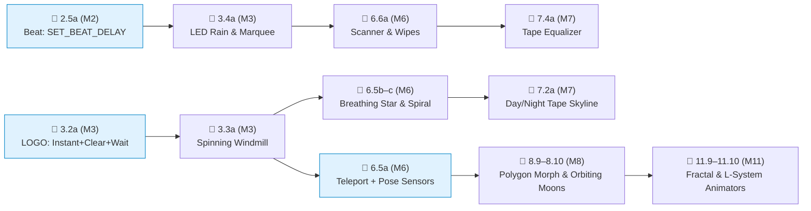

# Animation Features Integration — Lessons & Creative Sandboxes

This document specifies new curriculum explanation demos, open creative sandboxes, and existing lesson enhancements powered by the **Beat & Turtle LOGO animation controls** — integrated cleanly into the 11-module [Depot & Sparse Memory Tape curriculum (`env_depot_and_tape.md`)](./env_depot_and_tape.md) and compliant with [`docs/curriculum.md`](./curriculum.md) and [`docs/ui_guidelines.md`](./ui_guidelines.md).

---

## 1. Animation Features & Runtime Contracts

### 🐢 LOGO Animation Blocks & Sensors

| Block / Sensor | Icon | Engine Behavior |
|:---|:---|:---|
| `SET_INSTANT` | ⚡ `ON` / `OFF` | Bypasses per-segment animation — executes drawing blocks in a pure-JS fast batch until hitting `WAIT`, `SET_INSTANT [OFF]`, or program end |
| `CLEAR_CANVAS` | 🧹 Eraser | Clears all drawn `paths` (`paths = []`) while preserving turtle `(x, y, heading)`, `penDown`, `penColor`, and `penWidth` |
| `WAIT` | ⏱️ Hourglass | Pauses for `0.25`, `0.5`, `1`, `2`, or `4` beats (scaled by global speed) so an instantly assembled frame stays visible |
| `TELEPORT` | 🎯 Crosshair | Jumps directly to `(x, y, heading)` without drawing a line, playing a shrink/reappear animation when not in instant mode |
| `$x`, `$y`, `$heading` | `📍X`, `📍Y`, `🧭∠` | Read-only numeric pose sensors (`Math.round` coordinates and degrees; introduced in **Module 6** alongside variables) |

### 🎵 Beat & Light Animation Blocks

| Block | Icon | Engine Behavior |
|:---|:---|:---|
| `SET_BEAT_DELAY` | ⚡ Gauge | Controls step delay for non-sound, non-wait blocks (`0` = Instant batching for crisp LED frames; `0.25×`–`4×` = paced stepping) |
| `WAIT_BEAT` | ⏱️ Hourglass | Parameterized beat hold (`0.25`, `0.5`, `1`, `2`, `4` beats) that displays an assembled LED frame |

### Shared Playback Features

| Feature | Engine Behavior |
|:---|:---|
| **Loop Mode (`∞`)** | Replays `MAIN` from the start when execution completes (`isLoopPlayback` in `useAppStore.ts`). Resets turtle pose to `(0, 0, 0°)` and resets runtime variables on each wrap. |
| **Hide Turtle (`👁️`)** | Hides the turtle SVG avatar so multi-frame animations and mandalas can be admired cleanly. |
| **`MAX_TOTAL_STEPS = 10000`** | High interpreter step ceiling supporting multi-frame and recursive animations. |
| **Selective Color Erasing** | Drawing with `White` in LOGO (on `#ffffff` canvas) or `Black` in Beat (on `#020617` LED pad) selectively erases strokes/pixels without wiping the whole frame! |

### Mandatory Frame-Loop Authoring Pattern (`CLEAR` First, Never Last!)

Every frame-by-frame starter and variation card **must** place `CLEAR_CANVAS` (or `CLEAR_LEDS`) at the **start** of the frame loop — never at the end:

```
// ✅ CORRECT: Clear at START of frame loop
// (Animation sandboxes set defaultLoopPlayback: true)
SET_INSTANT [ON]
Loop ×N
  CLEAR_CANVAS               // 1. Erase previous frame (no-op on frame 1)
  ... draw frame ...         // 2. Assemble entire frame in 0ms
  WAIT [0.5]                 // 3. Hold frame visibly on screen
  ... step angle / var ...   // 4. Advance parameter for next frame
Loop End
// When Loop Mode ∞ is OFF (or when Variation Cards auto-render static thumbnails!),
// execution finishes WITH THE FINAL FRAME STILL VISIBLE on canvas!
```

> **Why never put `CLEAR_CANVAS` at the end?**
> 1. If a child turns `Loop Mode ∞` off (or runs Step-by-Step to the end), a trailing `CLEAR_CANVAS` wipes their artwork to a blank white screen on the final block.
> 2. Variation Cards auto-render static thumbnails from `state.paths` after running the program once; a trailing `CLEAR_CANVAS` produces a completely blank thumbnail!
> 3. Because `Loop Mode ∞` resets `robot.heading` to `0°` and clears variables when `MAIN` wraps around, multi-frame state changes (like rotating a windmill by `15°` per frame) **must** sit inside an explicit `Loop ×N` within the program rather than relying on `Loop Mode ∞` to carry state across runs.

---

## 2. Introductory `📖 Explanation` Lessons

Each new animation capability is introduced in its own zero-pressure `📖 Explanation` lesson in the module where its prerequisite concepts already exist:

### Lesson `2.5a` [📖 Explanation — 🎵 Beat] Speed Control & `SET_BEAT_DELAY`
*Placed in **Module 2** (Action Parameters), immediately after `2.5` (Pitch, Duration & Colored LED Rows). Uses **action parameters only — zero loops and zero variables**.*

**Two runnable demos:**

1. **"Slow vs. Instant LEDs"** — Side-by-side comparison of lighting 3 colored LED rows:
   - *Tab 1a (Default `SET_BEAT_DELAY [1]`):* Rows light up one after another visibly.
   - *Tab 1b (`SET_BEAT_DELAY [0]`):* All 3 rows flash onto the 8×8 pad simultaneously, held by `WAIT_BEAT [1]`:
     ```
     SET_BEAT_DELAY [0]       // ← spotlight: instant batching!
     SET_LED_COLOR [Red]
     LIGHT_ROW [2]
     SET_LED_COLOR [Yellow]
     LIGHT_ROW [4]
     SET_LED_COLOR [Blue]
     LIGHT_ROW [6]
     WAIT_BEAT [1]            // ← spotlight: hold to admire the frame!
     ```

2. **"Building & Carving a Frame"** — Shows assembling two frames sequentially (`CLEAR_LEDS` before frame 2) and using `Black` to carve selective dark cutouts inside a stamp:
   ```
   SET_BEAT_DELAY [0]
   STAMP_HEART                // Frame 1: full pink heart
   WAIT_BEAT [1]
   CLEAR_LEDS                 // ← spotlight: clear at start of Frame 2!
   STAMP_HEART
   SET_LED_COLOR [Black]      // ← spotlight: Black turns off selected LEDs!
   LIGHT_ROW [4]              // carves a dark stripe across the heart
   WAIT_BEAT [1]
   ```

---

### Lesson `3.2a` [📖 Explanation — 🐢 LOGO] Instant Drawing, Clear & Wait
*Placed in **Module 3** (Loops), after `3.2` and before `3.3` (Closed Polygons & Star Loops). Uses **loops only — zero variables**.*

**Three runnable demos:**

1. **"`SET_INSTANT` — Zero-Delay Shapes"** — Compares drawing a square normally (`SET_INSTANT [OFF]`, watching the turtle walk each side) vs. `SET_INSTANT [ON]` (all 4 sides appear at once).
2. **"`CLEAR_CANVAS` + `WAIT` — Two-Shape Flip"** — Draws a triangle, holds with `WAIT [1]`, clears at the start of frame 2 (`CLEAR_CANVAS`), and draws a square:
   ```
   SET_INSTANT [ON]
   Loop ×3
     FORWARD [75]
     TURN_RIGHT [120]
   Loop End
   WAIT [1]                   // show triangle
   CLEAR_CANVAS               // clear right before drawing frame 2
   Loop ×4
     FORWARD [75]
     TURN_RIGHT [90]
   Loop End
   WAIT [1]                   // show square (stays visible at end!)
   ```
3. **"Continuous Animation with Loop Mode `∞`"** — Enables `defaultLoopPlayback: true` on Demo 2's program, spotlighting the `∞` button so the child sees the triangle ↔ square flip run forever.

---

### Lesson `6.5a` [📖 Explanation — 🐢 LOGO] `TELEPORT` & Pose Sensors (`$x`, `$y`, `$heading`)
*Placed in **Module 6** (Variables & Counters), after `6.5` (Growing & Shrinking Loops), where `VAR_ASSIGN` (`a = $x`) is already familiar.*

**Two runnable demos:**

1. **"`TELEPORT` — Jump Without Drawing"** — Turtle draws a star at `(-75, 0, 0)`, then `TELEPORT [75, 0, 0]` shrinks/reappears at `(75, 0)` and draws a second star — spotlighting that no line connects them even though the pen stayed down!
2. **"Pose Sensors — Bookmarking Home"** — Saves the turtle's starting coordinates into Watch Boxes (`a = $x`, `b = $y`), wanders along an off-center spiral, and runs `TELEPORT [a, b, 0]` to jump straight back to its bookmarked home:
   ```
   TELEPORT [-60, -40, 0]
   a = $x                     // ← spotlight: -60 flies into Watch Box [a]
   b = $y                     // ← spotlight: -40 flies into Watch Box [b]
   Loop ×6
     FORWARD [50]
     TURN_RIGHT [75]
   Loop End
   TELEPORT [a, b, 0]         // ← spotlight: snaps right back to (-60, -40)!
   ```

---

## 3. Beat & Light Animation Sandboxes (Full Starters & Variation Cards)

All Beat animation sandboxes set `defaultLoopPlayback: true`, obey `SET_LED_COLOR` before `LIGHT_ROW`/`LIGHT_COL`/`LIGHT_PIXEL`, and keep every workspace tab **≤ 14 blocks** (factoring multi-pass loops into `F1`/`F2` in M4+ for readability).

### `3.4a` [🎵 Beat Sandbox] "LED Rain & Smooth Frame Loops" (Module 3 — Loops Only)
*Placed right after `3.4` (Rhythm Loops & Chasing Border LEDs). Uses `SET_BEAT_DELAY [0]`, `Loop`, `CURSOR_STEP`, `CURSOR_TURN`, and `SET_LED_COLOR` (**zero variables**).*

**Starter (`defaultLoopPlayback: true`, 8 blocks in `MAIN`):** An animated 4-edge neon marquee where each entire 7-LED edge flashes instantly in sync with a snare groove:
```
// MAIN (8 blocks)
SET_BEAT_DELAY [0]
Loop ×4
  CLEAR_LEDS                 // clear at start of frame!
  CURSOR_STEP ×7             // lights 7 cursor cells instantly
  CURSOR_TURN [RIGHT]
  DRUM_SNARE
  WAIT_BEAT [0.5]
Loop End
```
- **Variation Cards:**
  - `[Preview 1]` **Matrix Rain Columns:** Turns cursor `SOUTH` (`CURSOR_TURN [RIGHT]`), steps streaks down columns with `SET_LED_COLOR [Green]` and `WAIT_BEAT [0.25]`.
  - `[Preview 2]` **Blinking Carved Heart (`Black` Cutout):** Alternates Frame 1 (`STAMP_HEART` + `WAIT_BEAT [0.5]`) with Frame 2 (`STAMP_HEART` + `SET_LED_COLOR [Black]` + `LIGHT_ROW [3]` + `WAIT_BEAT [0.5]`) for a winking/shutter heart effect!
  - `[Preview 3]` **Star & Smile Flipbook:** Alternates `CLEAR_LEDS → STAMP_STAR → DRUM_KICK → WAIT_BEAT [0.5]` with `CLEAR_LEDS → STAMP_SMILE → DRUM_CLAP → WAIT_BEAT [0.5]`.

---

### `6.6a` [🎵 Beat Sandbox] "Scanner Bar & Wipe Transitions" (Module 6 — Variables + Helpers)
*Placed after `6.6` (Sweeping Coordinates & Scales), where `r = r + 1`, `r = r - 1`, and helper tabs `F1`/`F2` are available.*

**Starter (`defaultLoopPlayback: true`):** A bright emerald scanner bar sweeps smoothly down and back up the 8×8 matrix:
```
// MAIN (6 blocks)
SET_BEAT_DELAY [0]
SET_LED_COLOR [Green]
r = 1
Call F1                      // sweep down rows 1 -> 7
Call F2                      // sweep up rows 8 -> 2
LIGHT_ROW [1]

// F1: Sweep down (6 blocks)
Loop ×7
  CLEAR_LEDS
  LIGHT_ROW [r]
  WAIT_BEAT [0.25]
  r = r + 1
Loop End

// F2: Sweep up (6 blocks)
Loop ×7
  CLEAR_LEDS
  LIGHT_ROW [r]
  WAIT_BEAT [0.25]
  r = r - 1
Loop End
```
- **Variation Cards:**
  - `[Preview 1]` **Left-to-Right Color Wipe:** Accumulates columns `1..8` without clearing (`LIGHT_COL [c]`, `WAIT_BEAT [0.25]`, `c = c + 1`), punctuating column 8 with `DRUM_KICK`.
  - `[Preview 2]` **Curtain Reveal (Both Edges Inward):** Lights left column `c` and right mirror column `m = 9 - c` simultaneously (`c = 1..4`) so curtains meet in the center!
  - `[Preview 3]` **Diagonal Bouncing Pixel:** Sweeps `LIGHT_PIXEL [c, r]` diagonally across the 8×8 pad and bounces back.
  - `[Preview 4]` **`Black` Eraser Wipe:** Stamps `STAMP_STAR`, holds `1` beat, then sweeps `SET_LED_COLOR [Black]` + `LIGHT_COL [c]` across `1..8` to wipe the star away column by column!

---

### `7.4a` [🎵 Beat Sandbox] "Animated Tape Equalizer" (Module 7 — Sparse Tape + Animation)
*Paired with `7.4` (Scale Melody & LED Stripes) in Module 7 of [`env_depot_and_tape.md`](./env_depot_and_tape.md).*

**Initial Sparse Tape (`1..11`):** `[2, 5, 7, 4, 6, 3, 8, 2, 5, 7, 4]` — bar heights (`1..8`)

**Starter (`defaultLoopPlayback: true`):** 4 animated equalizer frames; each frame shifts the starting tape offset `f` by `1` so the 8 bars ripple across the matrix to a beat!
```
// MAIN (8 blocks)
SET_BEAT_DELAY [0]
f = 1
Loop ×4                      // 4 ripple frames
  CLEAR_LEDS                 // clear at start of frame!
  Call F1                    // draw all 8 columns starting from tape cell f
  DRUM_KICK
  WAIT_BEAT [0.5]
  f = f + 1
Loop End

// F1: Draw 8 columns from tape[f .. f+7] (7 blocks)
TAPE_SEEK [f]
x = 1
Loop ×8
  a = $cellValue
  Call F2                    // draw vertical bar of height a in column x
  TAPE_STEP [RIGHT]
  x = x + 1
Loop End

// F2: Draw column x from bottom (row 8) upward a pixels (7 blocks)
y = 8
Loop [a]
  LIGHT_PIXEL [x, y]
  y = y - 1
Loop End
```
- **Variation Cards:**
  - `[Preview 1]` **Tape-Driven Rainbow Stripes:** Tape cells `1..8` hold colors (`a = $cellColor`); `F1` paints all 8 rows instantly (`SET_LED_COLOR [a]`, `LIGHT_ROW [r]`), flashing and shifting colors each beat.
  - `[Preview 2]` **Center-Mirrored Bass Visualizer:** Bars grow symmetrically up and down from center rows `4` & `5`.
  - `[Preview 3]` **Peak-Hold Meter (with `Black` Decay):** Draws full bar in `Cyan`, then erases lower segments with `Black` leaving floating peak dots!

---

## 4. LOGO Animation Sandboxes (Full Starters & Variation Cards)

All LOGO animation sandboxes set `defaultLoopPlayback: true`, put `CLEAR_CANVAS` at the **start** of the frame loop, and obey the **≤ 14 blocks/tab** Sandbox guardrail (factoring multi-pass loops into `F1`/`F2` in M4+).

### `3.3a` [🐢 LOGO Sandbox] "Spinning Windmill" (Module 3 — Loops Only)
*Placed right after `3.3` (Closed Polygons & Star Loops). Uses **loops only** — zero variables!*

> **Crucial Engine Note:** Because `Loop Mode ∞` resets `robot.heading` to `0°` when `MAIN` finishes, a 1-frame program ending in `TURN_RIGHT [15]` would stay frozen at `0°`! Placing an outer `Loop ×6` inside `MAIN` steps through `0°, 15°, 30°, 45°, 60°, 75°` (`6 × 15° = 90°`, matching the 4-blade symmetry), so when `Loop Mode ∞` wraps back to `0°`, the rotation is 100% continuous!

**Starter (`defaultLoopPlayback: true`, 11 blocks in `MAIN`):**
```
// MAIN (11 blocks — within 14-block Sandbox per-tab guardrail)
SET_INSTANT [ON]
Loop ×6                      // 6 frames × 15° = 90° seamless 4-blade cycle
  CLEAR_CANVAS               // clear at START so final frame & thumbnail stay visible!
  Loop ×4                    // draw 4 blades
    FORWARD [75]
    BACKWARD [75]
    TURN_RIGHT [90]
  Loop End
  WAIT [0.25]                // display frame
  TURN_RIGHT [15]            // advance heading for next frame
Loop End
```
- **Variation Cards:**
  - `[Img 1]` **6-Blade Turbo Fan:** Outer `Loop ×4` (`TURN_RIGHT [15]`), inner `Loop ×6` (`TURN_RIGHT [60]`) — smoother 6-spoke spin.
  - `[Img 2]` **Spinning 5-Pointed Star:** Outer `Loop ×6` (`TURN_RIGHT [12]`, `6 × 12° = 72°`), inner `Loop ×5` (`FORWARD [100]`, `TURN_RIGHT [144]`).
  - `[Img 3]` **`White`-Cutout Radar Wheel:** Draws a thick colored disk/ring and uses `SET_PEN_COLOR [White]` blades to carve rotating negative-space spokes!

---

### `6.5b` [🐢 LOGO Sandbox] "Breathing Star" (Module 6 — Variables + Helpers)
*Placed in **Module 6** after `6.5a`, where variable `s` (`s = s + 15` / `s = s - 15`) and helpers `F1`–`F3` exist.*

**Starter (`defaultLoopPlayback: true`):** A 5-pointed star smoothly expands and contracts in an endless pulse:
```
// MAIN (4 blocks)
SET_INSTANT [ON]
s = 25
Call F1                      // expand 6 frames
Call F2                      // contract 6 frames

// F1: Grow pass (6 blocks)
Loop ×6
  CLEAR_CANVAS               // clear at start of frame!
  Call F3
  WAIT [0.25]
  s = s + 15
Loop End

// F2: Shrink pass (6 blocks)
Loop ×6
  CLEAR_CANVAS               // clear at start of frame!
  Call F3
  WAIT [0.25]
  s = s - 15
Loop End

// F3: Draw 5-pointed star of side s (4 blocks)
Loop ×5
  FORWARD [s]
  TURN_RIGHT [144]
Loop End
```
- **Variation Cards:**
  - `[Img 1]` **Breathing Hexagon:** `F3` uses `Loop ×6 { FORWARD [s], TURN_RIGHT [60] }`.
  - `[Img 2]` **Heartbeat Pulse (Asymmetric Timing):** Fast expansion (`WAIT [0.25]` in `F1`), slow relaxation (`WAIT [0.5]` in `F2`) in `Red` ink (`SET_PEN_WIDTH [8]`).
  - `[Img 3]` **Expanding Sunburst Rays:** `F3` draws 8 radiating spokes (`FORWARD [s]`, `BACKWARD [s]`, `TURN_RIGHT [45]`).

---

### `6.5c` [🐢 LOGO Sandbox] "Spiral Builder — Paced Drawing" (Module 6 — Variables)
*Shows when **turning OFF instant mode** (`SET_INSTANT [OFF]`) is the star of the show: watching a geometric spiral grow segment-by-segment with rhythmic `WAIT` beats.*

**Starter (`defaultLoopPlayback: true`, 8 blocks in `MAIN`):**
```
// MAIN (8 blocks — no CLEAR_CANVAS because segments accumulate!)
SET_INSTANT [OFF]
s = 15
Loop ×14
  FORWARD [s]
  TURN_RIGHT [90]
  WAIT [0.25]
  s = s + 10
Loop End
```
- **Variation Cards:**
  - `[Img 1]` **Skewed `92°` Vortex:** `TURN_RIGHT [92]` creates a twisting optical tunnel.
  - `[Img 2]` **Growing Nautilus Shell:** Uses `ARC_RIGHT [s, 90]` with growing radius `s`.
  - `[Img 3]` **Draw-Then-Unwind (`White` Eraser):** `F1` draws the spiral outward in `Blue`; `F2` retraces the exact spiral inward in `White` (`SET_PEN_COLOR [White]`), erasing every line until vanishing cleanly!

---

### `7.2a` [🐢 LOGO Sandbox] "Animated Skyline — Day to Night" (Module 7 — Sparse Tape + Color Variables)
*Uses **only** Module 7 tools (color tape + number tape, zero numeric `If` comparisons!).*

**Initial Sparse Tape (`1..10`):**
- Cells `1..2`: Theme colors `[🔵 Blue, 🟡 Yellow]` (Day blueprint vs. Night lit towers)
- Cells `3..10`: 8 building heights `[30, 55, 25, 70, 45, 35, 60, 30]`

```
// MAIN (8 blocks)
SET_INSTANT [ON]
t = 1
Loop ×2                      // Frame 1: Day (cell 1), Frame 2: Night (cell 2)
  CLEAR_CANVAS               // clear at start of frame!
  TAPE_SEEK [t]
  c = $cellColor
  Call F1                    // set color c & draw all 8 buildings from cells 3..10
  t = t + 1
Loop End

// F1 (8 blocks)
SET_PEN_COLOR [c]
TELEPORT [-140, -40, 0]
TAPE_SEEK [3]
Loop ×8
  Call F2                    // draw 1 building of height $cellValue & step tape
Loop End
WAIT [2]

// F2 (8 blocks)
a = $cellValue
FORWARD [a]
TURN_RIGHT [90]
FORWARD [30]
TURN_RIGHT [90]
FORWARD [a]
TURN_LEFT [90]
TAPE_STEP [RIGHT]
```
- **Variation Cards:**
  - `[Img 1]` **4-Phase Dawn → Noon → Sunset → Midnight:** Cells `1..4` hold `[🩷 Pink, 🩵 Cyan, 🟠 Orange, 🟣 Purple]`, `Loop ×4` in `MAIN`.
  - `[Img 2]` **Rising Construction Time-Lapse:** Animates `k = 1..8` buildings appearing one by one from left to right.
  - `[Img 3]` **Equalizer Towers:** Same building heights animate growing taller/shorter by adding a frame offset.

---

### `8.9` [🐢 LOGO Sandbox] "Polygon Morphing (`3 → 12` Sides) & Tape Flipbook" (Module 8 — Division `/`)
*Placed in **Module 8** where division (`a = 360 / n`) is taught — combining former `6.L1` and `7.L2` with zero premature operators.*

**Starter (`defaultLoopPlayback: true`):** A triangle smoothly gains one side per frame (`3, 4, 5 ... 12`), morphing visually toward a circle:
```
// MAIN (8 blocks)
SET_INSTANT [ON]
n = 3
Loop ×10                     // 3 sides -> 12 sides
  CLEAR_CANVAS               // clear at start of frame!
  Call F1
  WAIT [0.5]
  n = n + 1
Loop End

// F1: Draw regular n-gon (6 blocks)
TELEPORT [-25, -40, 90]
a = 360 / n
Loop [n]
  FORWARD [45]
  TURN_RIGHT [a]
Loop End
```
- **Variation Cards:**
  - `[Img 1]` **Tape Shape Flipbook (`(length, angle)` Pairs):** Sparse Tape holds `[75, 120, 75, 90, 60, 72, 50, 60]` (triangle, square, pentagon, hexagon); each frame reads `l = $cellValue`, `a = $cellValue`, computes `s = 360 / a`, and draws `Loop [s]`! Editing the tape edits the flipbook frames!
  - `[Img 2]` **Constant-Perimeter Morph:** Scales side length `l = 240 / n` so the polygon stays the exact same overall diameter from triangle (`80px` sides) to 12-gon (`20px` sides)!
  - `[Img 3]` **Star Morph (`720 / n`):** Sweeps odd/star polygons (`5, 7, 9, 11` points) using `a = 720 / n`.

---

### `8.10` [🐢 LOGO Sandbox] "Orbiting Moons" (Module 8 — `TELEPORT` + Pose Sensors)
*Teaches polar-to-Cartesian multi-object scene animation using turtle heading + `$x`/`$y` sensors.*

**Starter (`defaultLoopPlayback: true`):** A bright yellow sun stays anchored at `(0, 0)` while a blue moon orbits smoothly around it across 24 frames (`15°` per frame = `360°`):
```
// MAIN (8 blocks)
SET_INSTANT [ON]
a = 0
Loop ×24                     // 24 × 15° = full 360° orbit!
  CLEAR_CANVAS               // clear at start of frame!
  Call F1                    // draw sun at (0, 0)
  Call F2                    // position & draw moon at orbit angle a
  WAIT [0.25]
  a = a + 15
Loop End

// F1: Draw 8-ray Sun at origin (7 blocks)
TELEPORT [0, 0, 0]
SET_PEN_COLOR [Yellow]
Loop ×8
  FORWARD [18]
  BACKWARD [18]
  TURN_RIGHT [45]
Loop End

// F2: Polar jump to radius 90 at angle a, read $x/$y, draw Moon (8 blocks)
TELEPORT [0, 0, a]
PEN_UP
FORWARD [90]
x = $x
y = $y
Call F3                      // F3 puts PEN_DOWN, sets Blue, draws 6-step mini-circle at (x, y)
```
- **Variation Cards:**
  - `[Img 1]` **Twin Binary Moons:** Draws Moon 1 at angle `a` and Moon 2 opposite at `b = a + 180`.
  - `[Img 2]` **Inner & Outer Planets (2× Speed):** Fast inner planet orbits at radius `55` (`b = a * 2`), slow outer planet at radius `105` (`a`).
  - `[Img 3]` **Spirograph Epicycle Trace:** Omits `CLEAR_CANVAS` and draws a rotating arm from `(x, y)` so the moon leaves a hypnotic geometric flower trail!

---

### `11.9` [🐢 LOGO Sandbox] "Fractal Tree Depth Slideshow" (Module 11 — Recursion)
*Placed in **Module 11** where branching recursion (`Call F1(● - 1)`) is taught.*

**Starter (`defaultLoopPlayback: true`):** Watch a single sprout blossom into a 32-branch canopy, one recursion level at a time (`d = 1 .. 5`):
```
// MAIN (8 blocks)
SET_INSTANT [ON]
d = 1
Loop ×5                      // depths 1 -> 5
  CLEAR_CANVAS               // clear at start of frame!
  TELEPORT [0, -110, 0]
  Call F1(d)
  WAIT [2]                   // admire each generation!
  d = d + 1
Loop End

// F1(●): Recursive binary tree branch (10 blocks)
If (● == 0)
  FORWARD [10]
  BACKWARD [10]
Else
  FORWARD [35]
  TURN_LEFT [30]
  Call F1(● - 1)             // native socket - 1 preserves caller state!
  TURN_RIGHT [60]
  Call F1(● - 1)
  TURN_LEFT [30]
  BACKWARD [35]
End If
```
- **Variation Cards:**
  - `[Img 1]` **Green Leaf Tips:** Base case `● == 0` switches `SET_PEN_COLOR [Green]` for leaves and restores `Black` bark on unwind!
  - `[Img 2]` **Wind-Swept Bonsai:** Asymmetric angles (`TURN_LEFT [20]`, `TURN_RIGHT [65]`, restore `TURN_LEFT [45]`).
  - `[Img 3]` **Snowflake Crystal Slideshow (`0 → 3`):** Calls `F1(d)` 3 times around a `120°` triangle to morph an equilateral triangle into a full Koch Snowflake!

---

### `11.10` [🐢 LOGO Sandbox] "Koch L-System Depth Animator" (Module 11 — Recursion)
*Animates L-system rule rewriting (`F → F + F − F`) across depths `0..4`, shrinking segment step `s` each generation so the curve fits the viewport cleanly.*

**Starter (`defaultLoopPlayback: true`):**
```
// MAIN (8 blocks)
SET_INSTANT [ON]
d = 0
s = 180
Loop ×4                      // depths 0, 1, 2, 3
  CLEAR_CANVAS               // clear at start of frame!
  TELEPORT [-90, -30, 90]
  Call F1(d)
  WAIT [2]
  d = d + 1
  s = s / 3                  // each Koch generation triples segment count -> 1/3 length!
Loop End

// F1(●): Recursive Koch rule F -> F +60° F -120° F +60° F (10 blocks)
If (● == 0)
  FORWARD [s]
Else
  Call F1(● - 1)
  TURN_LEFT [60]
  Call F1(● - 1)
  TURN_RIGHT [120]
  Call F1(● - 1)
  TURN_LEFT [60]
  Call F1(● - 1)
End If
```
- **Variation Cards:**
  - `[Img 1]` **Quadratic Box Fractal (`90°` turns):** Square wave rule `F → F - F + F + F - F` (`s = s / 3`).
  - `[Img 2]` **Sierpinski Triangle Sweep (`d = 0..5`):** Halves `s = s / 2` each frame, carving recursive inner triangles.
  - `[Img 3]` **Rainbow Depth Highlighting:** Sets pen color from sparse tape cell `d + 1` before each generation!

---

## 5. Curriculum Skill Flow & Module Placement Summary



| ID | Mod | Fmt | Env | Title | Key Prerequisites Used |
|:---|:---:|:---:|:---:|:---|:---|
| **`2.5a`** | M2 | 📖 | 🎵 | Speed Control & `SET_BEAT_DELAY` | Action params, `Black` selective LED erase |
| **`3.2a`** | M3 | 📖 | 🐢 | Instant Drawing, Clear & Wait | `Loop`, `CLEAR_CANVAS` at frame start, `Loop Mode ∞` |
| **`3.3a`** | M3 | 🐢 | 🐢 | Spinning Windmill | Nested `Loop` (`6 × 15°` outer + `4 × 90°` inner) |
| **`3.4a`** | M3 | 🎵 | 🎵 | LED Rain & Smooth Frame Loops | `Loop`, `SET_BEAT_DELAY [0]`, cursor blocks |
| **`6.5a`** | M6 | 📖 | 🐢 | `TELEPORT` & Pose Sensors (`$x`, `$y`, `$heading`) | `VAR_ASSIGN` (`a = $x`, `b = $y`) |
| **`6.5b`** | M6 | 🐢 | 🐢 | Breathing Star | Variables (`s = s ± 15`), `F1`/`F2`/`F3` |
| **`6.5c`** | M6 | 🐢 | 🐢 | Spiral Builder — Paced Drawing | `SET_INSTANT [OFF]`, `WAIT`, `White` unwind variation |
| **`6.6a`** | M6 | 🎵 | 🎵 | Scanner Bar & Wipe Transitions | Variables (`r = r ± 1`), `F1`/`F2`, `Black` eraser wipe |
| **`7.2a`** | M7 | 🐢 | 🐢 | Animated Skyline — Day to Night | Sparse Tape, `$cellColor`, `$cellValue` |
| **`7.4a`** | M7 | 🎵 | 🎵 | Animated Tape Equalizer | Sparse Tape, nested `LIGHT_PIXEL [x, y]` bars |
| **`8.9`** | M8 | 🐢 | 🐢 | Polygon Morph (`3→12`) & Shape Flipbook | Division (`360 / n`), Sparse Tape pairs |
| **`8.10`** | M8 | 🐢 | 🐢 | Orbiting Moons | `TELEPORT`, `$x`/`$y` polar positioning |
| **`11.9`** | M11 | 🐢 | 🐢 | Fractal Tree Depth Slideshow | Branching recursion (`Call F1(● - 1)`) |
| **`11.10`** | M11 | 🐢 | 🐢 | Koch L-System Depth Animator | 4-way recursion, `s = s / 3` scaling |

---

## 6. Integration with Existing Module 3 Lessons & Versioning

### Complete Module 3 Sequence (Compact & Ordered)

`3.0` → `3.1` → `3.2` → **`3.2a` 📖** → `3.3` → **`3.3a` 🐢** → `3.4` → **`3.4a` 🎵** → `3.5` → `3.6` → `3.7` → **`3.8` 📖** → **`3.9` 🏗️** → **`3.10` 🏗️** → `3A` 🏆 → `3B` 🎨 → `3C` 🎨.

### Enhancements to Existing Shipped Module 3 Sandboxes (`version: 1 → 2`)

Per [`docs/platform_requirements.md`](./platform_requirements.md) §3, modifying any already-shipped activity **must increment `version: 2` and retain `historicalVersions[1]`**:

| Existing Activity | Palette Additions (`v2`) | New Animated Variation Card (`CLEAR` at Start!) |
|:---|:---|:---|
| **`3.3`** Closed Polygons & Star Loops | `SET_INSTANT`, `CLEAR_CANVAS`, `WAIT` | **"Twinkling 2-Size Star"** — alternates small & large star frames |
| **`3.4`** Rhythm Loops & Chasing LEDs | `SET_BEAT_DELAY` | **"Instant Edge Flash"** — `SET_BEAT_DELAY [0]` flashes full border sides per beat |
| **`3.7`** Nested Loop Rosettes | `SET_INSTANT`, `CLEAR_CANVAS`, `WAIT` | **"Spinning Pinwheel Rosette"** — outer frame loop rotates the entire rosette by `10°` |
| **`Capstone 3B`** Kaleidoscope Medallion | `SET_INSTANT`, `CLEAR_CANVAS`, `WAIT` | **"Rotating Kaleidoscope"** — 2-layer colored mandala spinning smoothly |
| **`Capstone 3C`** Looping Lightshow | `SET_BEAT_DELAY` | **"Frame-by-Frame Arcade Show"** — zero-delay multi-row wave sweep |

---

## 7. Key Design Principles for Animation Lessons

1. **Dedicated `📖 Explanation` Intro First:** `2.5a`, `3.2a`, and `6.5a` introduce every timing, clear, teleport, and sensor block before any sandbox relies on it.
2. **Strict Prerequisite Discipline:** M3 animations use only loops (`3.3a`, `3.4a`); variables wait for M6 (`6.5a`–`6.6a`); tape animations wait for M7 (`7.2a`, `7.4a`); division waits for M8 (`8.9`); recursion waits for M11 (`11.9`, `11.10`).
3. **`CLEAR` Always Starts the Frame:** Guarantees non-blank end states when `Loop Mode ∞` is off and ensures Variation Card auto-thumbnails render crisp artwork.
4. **Inner Loops Drive Frame Progression:** Because `Loop Mode ∞` resets turtle heading and variables on program wrap, frame-to-frame changes (`TURN_RIGHT [15]`, `s = s + 15`, `d = d + 1`) always run inside an explicit program `Loop`.
5. **Selective Erasing with `White` & `Black`:** Teaches children that background-matching colors (`White` on LOGO canvas, `Black` on Beat LEDs) double as surgical erasers for cutouts, wipes, and self-unwinding trails.
6. **`defaultLoopPlayback: true`:** Animation sandboxes start with `∞` enabled so pressing `▶ Play` immediately produces continuous motion.
7. **Paced Drawing vs. Instant Batching:** Contrasting `6.5c` (`SET_INSTANT [OFF]`) with `3.3a`/`6.5b` (`SET_INSTANT [ON]`) helps learners choose intentionally between watching the stroke unfold and displaying finished frames.
