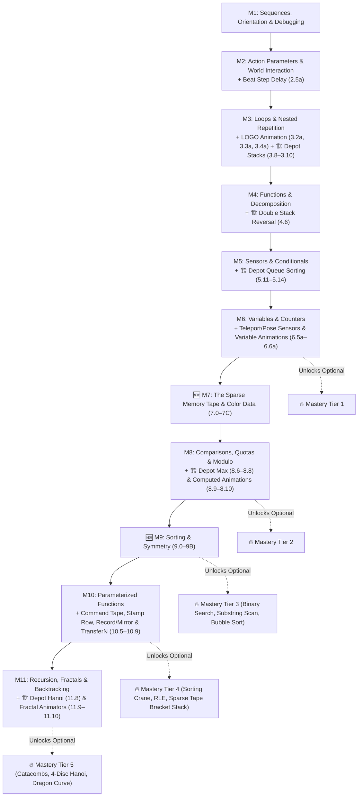

# 🏗️ Depot Environment, 📼 Sparse Memory Tape & Typed Variables — Design Specification

> **Status:** Approved specification — aligned with engine runtime, binary serialization, curriculum guardrails, and kid-friendly UI guidelines.
>
> This document specifies the **🏗️ Depot environment** (stacks + queues), the **📼 Sparse Memory Tape** (shared cross-environment indexed data up to `10,000` cells), the **typed variable system** (`number` vs `color` with runtime type checking), the restructured **11-module curriculum**, complete reference solutions for every DS&A puzzle, and full starter + variation specs for every creative sandbox activity. See also [Animation Features Integration (`env_animation_lessons.md`)](./env_animation_lessons.md).

---

## 1. Executive Summary

| Dimension | Design Decision |
|:---|:---|
| **Core idea** | Teach data structures through **physical environment metaphors**, not new programming syntax |
| **Memory Tape** | A **shared cross-environment feature** (like variables) — a sparse, 1-indexed rail of cells (`8`–`16` cells in guided puzzles; up to **`10,000` cells** in Sandboxes and Mastery Challenges) with a seekable head and windowed UI viewport. Out-of-bounds access triggers a runtime collision error. |
| **Depot environment** | New 🏗️ side-view warehouse (`ENV_ID_DEPOT = 0x07`) with **stacks** (crate towers, LIFO), **queues** (conveyor belts, FIFO), and the **Memory Tape** as physical stations |
| **Typed variables** | Single-letter variables (`a`–`z`) hold `number` or `color` — type mismatch or reading an empty cell is a visual runtime error (block pauses + shakes). Both `white` and `black` remain in the shared palette so learners can selectively "erase" on Turtle's white canvas or Beat's dark LED pad. |
| **New shared blocks** | 3 (`TAPE_SEEK`, `TAPE_STEP`, `TAPE_WRITE`) + 5 shared sensors (`$cellValue`, `$cellColor`, `$cellEmpty`, `$headPos`, `$tapeLength`) |
| **New Depot blocks** | 4 (`DEPOT_MOVE_TO`, `DEPOT_GRAB`, `DEPOT_PLACE`, `DEPOT_SEND_OUT`) + 6 Depot sensors (including `$topColor`) |
| **Curriculum** | Restructured from 9 → **11 modules**: new **M7** (Memory Tape & Color Data) and **M9** (Sorting & Symmetry), using canonical `M.N` / `M.Na` IDs compatible with `sortCurriculumActivities` |

---

## 2. What's Already Covered (Implicitly) vs. Made Explicit

| CS Concept | Where Previously | How It Happened Implicitly | How This Spec Makes It Explicit |
|:---|:---|:---|:---|
| Sequences | M1 ordered execution | Blocks run top-to-bottom, flags visited 1→2→3 | Unchanged foundation |
| Stack (LIFO) | M9→M11 recursion | Watching `CallStack` frames pile up and unwind | **M3 Depot crate towers** (`3.8`–`3.10`) + **M10 sparse tape-as-stack** (`Challenge 10.3`) |
| Queue (FIFO) | Switchyard stream | First item scanned → first processed | **M5 Depot conveyor station** (`5.11`–`5.14`) contrasted directly beside LIFO stacks |
| Indexed Array | *Missing* | Only 1–3 scalar variables (`a, b, c`) existed | **M7 Sparse Memory Tape** (`1..10,000`) across all 5 environments |
| Data Types | *Missing* | Every variable was silently a float `number` | **M7 Typed Variables** (`number` vs `color`) with visual shape-mismatch shake |
| Sorting | Challenge 8.1→10.1 | Robot swaps adjacent corridor crates | **M9 Depot sorting arc** (Insert `9.2`, Selection `9.3`, Merge `9.4`, Capstone `9A`, Bubble `Challenge 9.3`) |
| Search | M9→M11 cave DFS | Recursive probing with `unvisitedAhead` | **M7 Linear Search** (`7.6`), **M9 Mastery Binary Search** (`9.1`), **Backtracking Substring Scan** (`9.2`) |

---

## 3. Design Philosophy

```
   "The ENVIRONMENT teaches data structures.
    The BLOCKS stay simple.
    The TAPE connects everything.
    The TYPES & BOUNDS catch mistakes visually."
```

- Data structures are **world objects** with physical rules the child discovers visually.
- The **Memory Tape** is a shared language feature available in every environment, rendered through a **7–9 cell sliding viewport** around `headPos` inside a non-overlapping simulation dock.
- **Typed variables** (`number` vs `color`) and **strict tape bounds** (`1..tapeLength`) make invalid operations immediate, self-explanatory visual errors.
- Experiencing all three containers side by side in the Depot teaches **why different data structures exist**:

| Entity | Physical Constraint | What the Child Discovers |
|:---|:---|:---|
| 🏗️ **Stack** (crate tower) | Only the top crate glows; lower crates are locked | "I can only grab the top one — and they come out backwards!" → **LIFO** |
| 📦 **Queue** (conveyor belt) | Items enter at the back, exit only at the front | "First in line goes out first!" → **FIFO** |
| 📼 **Tape** (numbered rail) | Sliding head can jump directly to any index `1..N` | "I can jump straight to cell #50 or #500!" → **Random access** |

---

## 4. Typed Variable System: Number vs Color

### 4.1 Backward-Compatible 10-Swatch Color Model (Keeping `white` & `black`)

Variables (`a`–`z`) and non-empty tape cells hold either a `number` or a `PaletteColor` from a unified 10-swatch palette. **Crucially, indices `0..7` preserve the exact existing `TURTLE_COLOR_PALETTE` byte order in `src/engine/serialization/types.ts`**, appending only the 2 new colors (`orange = 8`, `white = 9`) at the end so zero existing saved programs break:

```typescript
// Canonical PaletteColor index order (0..7 match TURTLE_COLOR_PALETTE byte-for-byte!)
export const PALETTE_COLORS = [
  'black',   // 0: #0f172a — existing Turtle index 0; dark ink in LOGO, turns OFF ("erases") LEDs on Beat's dark #020617 pad
  'red',     // 1: #ef4444 — existing Turtle index 1 (maps to Beat Rose #f43f5e)
  'blue',    // 2: #3b82f6 — existing Turtle index 2
  'green',   // 3: #10b981 — existing Turtle index 3 (maps to Beat Emerald #10b981)
  'yellow',  // 4: #f59e0b — existing Turtle index 4 Amber (maps to Beat Amber #fbbf24)
  'purple',  // 5: #8b5cf6 — existing Turtle index 5 (maps to Beat Purple #a855f7)
  'pink',    // 6: #ec4899 — existing Turtle index 6
  'cyan',    // 7: #06b6d4 — existing Turtle index 7
  'orange',  // 8: #f97316 — NEW appended index 8
  'white',   // 9: #ffffff — NEW appended index 9; bright white LED in Beat, selectively "erases" strokes on LOGO's #ffffff canvas
] as const;

export type PaletteColor = (typeof PALETTE_COLORS)[number];

export type TypedValue =
  | { type: 'number'; value: number }
  | { type: 'color'; value: PaletteColor };

export interface InterpreterRuntimeState {
  // ...existing fields...
  variables: Record<VariableName, TypedValue>;
}
```

> **Beat Serializer Backward Compatibility (`BEAT_LED_PALETTE`):**
> `OP_BEAT_SET_LED_COLOR` (`0x18`) already serializes immediate Beat color swatches using `BEAT_LED_PALETTE` indices `0..7` (`0=Cyan, 1=Rose, 2=Amber, 3=Emerald, 4=Purple, 5=Blue, 6=Orange, 7=Pink`). To avoid breaking any saved Beat programs, `BEAT_LED_PALETTE` keeps `0..7` untouched and appends `8 = Black (#0f172a)` and `9 = White (#ffffff)`, while shared `VAR_ASSIGN` / `VAR_OP` / `Tape` color literals always use the canonical `PALETTE_COLORS` indices `0..9` above.

> **Creative Selective Erasing (`white` & `black`):**
> - In **🐢 Turtle LOGO**, drawing over an earlier path with `SET_PEN_COLOR [White]` acts as a precision eraser on the white `#ffffff` canvas without wiping the whole drawing via `CLEAR_CANVAS`.
> - In **🎵 Beat & Light**, setting `SET_LED_COLOR [Black]` before `LIGHT_PIXEL`, `LIGHT_ROW`, `LIGHT_COL`, or `CURSOR_STEP` clears those specific LEDs back to `null` (unlit) against the dark `#020617` pad — letting kids carve eyes, stripes, or moving dark cutouts inside stamps without `CLEAR_LEDS`.

### 4.2 Type Rules

| Expression / Block | Required Operand Types | On Type Mismatch or Empty Cell |
|:---|:---|:---|
| `a + b`, `a - b`, `a * b`, `a / b`, `a % b` | Both **number** | ⚠️ `TYPE_ERROR` |
| `a == b`, `a != b` | Both **same type** (`number == number` or `color == color`) | ⚠️ `TYPE_ERROR` |
| `a < b`, `a > b`, `a <= b`, `a >= b` | Both **number** | ⚠️ `TYPE_ERROR` |
| `a && b`, `a \|\| b` | Both **number** (truthy `!= 0`) | ⚠️ `TYPE_ERROR` |
| `FORWARD [a]`, `TURN [a]`, `Loop [a]`, `TAPE_SEEK [a]`, `LIGHT_ROW [a]` | **number** | ⚠️ `TYPE_ERROR` |
| `SET_PEN_COLOR [a]`, `SET_LED_COLOR [a]` | **color** | ⚠️ `TYPE_ERROR` |
| `a = $cellValue` | Cell at `headPos` holds **number** | ⚠️ `TYPE_ERROR` if cell holds color or is empty |
| `a = $cellColor` | Cell at `headPos` holds **color** | ⚠️ `TYPE_ERROR` if cell holds number or is empty |
| `a = 5` / `a = Red` | Stores **number** / **color** | Always OK |
| `a = b` / `TAPE_WRITE [a]` | Copies `TypedValue` of `b` / `a` (unset variable defaults to `{ type: 'number', value: 0 }`) | Always OK |

### 4.3 Interpreter Type Checking

```typescript
export function resolveOperand(
  op: OperandValue | PaletteColor | string,
  vars: Record<string, TypedValue>,
  simEnv?: SimulationEnvironment<any>,
  simState?: any,
  tape?: TapeState
): TypedValue | 'TYPE_ERROR' {
  if (typeof op === 'number') {
    return { type: 'number', value: Number.isFinite(op) ? op : 0 };
  }
  if (isPaletteColor(op)) {
    return { type: 'color', value: op };
  }
  if (op === '$cellValue') {
    const cell = tape?.cells[tape.headPos];
    return cell?.type === 'number' ? cell : 'TYPE_ERROR';
  }
  if (op === '$cellColor') {
    const cell = tape?.cells[tape.headPos];
    return cell?.type === 'color' ? cell : 'TYPE_ERROR';
  }
  if (typeof op === 'string' && isSensorToken(op)) {
    // Numeric/boolean world & tape sensors ($x, $y, $heading, $headPos, $tapeLength, $topValue, $heldValue)
    const sensed = readTypedSensor(op, simEnv, simState, tape);
    return sensed;
  }
  if (typeof op === 'string' && /^[a-z]$/.test(op)) {
    return vars[op] ?? { type: 'number', value: 0 };
  }
  return { type: 'number', value: 0 };
}

export function requireNumber(v: TypedValue | 'TYPE_ERROR'): number | 'TYPE_ERROR' {
  if (v === 'TYPE_ERROR' || v.type !== 'number') return 'TYPE_ERROR';
  return v.value;
}

export function requireColor(v: TypedValue | 'TYPE_ERROR'): PaletteColor | 'TYPE_ERROR' {
  if (v === 'TYPE_ERROR' || v.type !== 'color') return 'TYPE_ERROR';
  return v.value;
}
```

### 4.4 Zero-Reading Type Error & Watch Tray Visualization

When `TYPE_ERROR` occurs:
1. Execution **halts** on the offending block (`status: 'TYPE_ERROR'`, treated as a non-passing terminal error like `'COLLISION'`).
2. The offending block **shakes** with an amber/red outline.
3. In the Watch Tray (`toolbar-variables`), a round color swatch visibly bounces off a square `#` number slot (or vice versa) while pulsing the offending variable and block — communicating *"a color doesn't fit in a distance slot"* with zero reading.

| Variable State | Watch Box Display (`toolbar-variables`) |
|:---|:---|
| **Number** | `[a: 42]` — monospace numeric badge |
| **Color** | `[a: 🔴]` — filled circular swatch (high-contrast ring around `white` and `black`) |
| **Unset** | Hidden until referenced; animates digits or color dot flying in on `VAR_ASSIGN` |

---

## 5. The 📼 Sparse Memory Tape — Shared Language Feature

### 5.1 Sparse Data Model, 10,000-Cell Capacity & Strict Bounds

To scale cleanly from 8-cell beginner puzzles to **10,000-cell** sandboxes and Mastery Challenges without memory bloat or bloated save payloads, the tape stores **only non-empty cells**:

```typescript
export const DEFAULT_PUZZLE_TAPE_LENGTH = 8;
export const SANDBOX_MAX_TAPE_LENGTH = 10_000;

export interface TapeState {
  /** Valid index range is 1 .. length (e.g. 8 in guided puzzles; 10,000 in Sandboxes & Mastery) */
  length: number;
  /** Current 1-based read/write head index (starts at 1) */
  headPos: number;
  /** Sparse dictionary of non-empty cells keyed by 1-based index. Empty cells are omitted! */
  cells: Record<number, TypedValue>;
}
```

- **Zero Default-Value Storage:** Unset cells are absent from `cells` (`$cellEmpty` evaluates to `1`). Clearing a cell deletes `cells[index]`. Even on a `10,000`-cell tape, an empty tape uses `0` cell entries in memory and `1` byte (`count = 0`) on disk.
- **Strict Out-of-Bounds Collision (`status = 'COLLISION'`):**
  - Valid cell positions are strictly `1 .. tape.length`.
  - **`TAPE_SEEK [target]`:** Evaluates `target` as a number and truncates fractional parts via `Math.trunc(target)` (so floating-point midpoint math like `(1 + 8) / 2 = 4.5` seeks cleanly to cell `4`). If the resulting integer is `< 1` or `> tape.length`, execution **errors out immediately** (`status = 'COLLISION'`), pausing on the block and shaking the tape head against the rail's end-bumper.
  - **`TAPE_STEP [→ / ←]`:** Stepping right from `headPos == tape.length` or stepping left from `headPos == 1` likewise **errors out immediately** (`status = 'COLLISION'`) with the end-bumper shake animation.

### 5.2 Windowed Viewport UI & Non-Overlapping `pane-simulation` Dock

The UI **never** renders `10,000` DOM elements. Instead, it renders a **7-to-9 cell sliding window** centered around `headPos` (or around the user's manual inspection offset while paused):

```
  ┌─ 📼 Tape (10,000) ────────────────────────── [Jump #] ──┐
  │ ◀ [1] … ┌─────┬─────┬─────╦═════╦─────┬─────┬─────┐ … ▶ │
  │         │  40 │  60 │  ·  ║ 🔴  ║  25 │  ·  │  90 │     │
  │         ├─────┼─────┼─────╫─────╫─────┼─────┼─────┤     │
  │         │ #47 │ #48 │ #49 ║ #50 ║ #51 │ #52 │ #53 │     │
  │         └─────┴─────┴─────╩══▲══╩─────┴─────┴─────┘     │
  └───────────────────────────── Head ──────────────────────┘
```

- **Follows Seek Point Automatically:** Whenever `TAPE_SEEK` or `TAPE_STEP` executes, the viewport smoothly slides/snaps so `headPos` stays centered in view.
- **Sandbox Cell Editor Popover:** In Turtle LOGO, Beat & Light, Depot Sandbox, and Free-Play Grid, tapping any visible cell opens a compact zero-reading popover with:
  1. **10 Color Swatches** (`black`, `white`, `red`, `orange`, `yellow`, `green`, `cyan`, `blue`, `purple`, `pink`)
  2. **Number Keypad / Stepper** (`-10`, `-1`, `+1`, `+10`, or quick presets)
  3. **Eraser (`∅`)** — deletes `cells[idx]`, returning the cell to empty (`·`).
- **Non-Overlapping `pane-simulation` Slot ([`docs/ui_guidelines.md`](./ui_guidelines.md) §3):**
  - Placed in a dedicated **`shrink-0` Tape Dock flex row** above the canvas (never floating over `Top-Left` Watch/Backpack/CallStack, `Top-Center` multi-run pips, or `Top-Right` badges).
  - Visible cells maintain `≥ 36×36px` touch targets on `<640px` phones (~7 visible cells across `360px`) and `≥ 44×44px` on `≥768px` tablets (~9 visible cells).
  - In **🏗️ Depot**, the windowed Tape rail renders directly inside the warehouse floor as a physical station.

| Environment | Tape `length` | Rendering Slot | Interactive Cell Editing? |
|:---|:---|:---|:---|
| 🏗️ **Depot** | `8`–`16` (Puzzles) · `10,000` (Mastery / Sandbox) | **Physical floor rail** inside Depot scene | Puzzle/Mastery: read-only · Sandbox: ✅ editable |
| 🐢 **Turtle LOGO** | `10,000` | **`shrink-0` Tape Dock** above SVG canvas | ✅ Editable (saved sparsely per creative workspace) |
| 🎵 **Beat & Light** | `10,000` | **`shrink-0` Tape Dock** below Beat header bar | ✅ Editable (saved sparsely per creative workspace) |
| 🤖 **Robot Grid** | `8`–`16` (Puzzles) · `10,000` (Mastery / Sandbox) | **`shrink-0` Tape Dock** (collapsible) | Puzzle/Mastery: read-only · Free-Play: ✅ editable |
| 🚂 **Switchyard** | `8`–`16` (Puzzles) · `10,000` (Mastery) | **`shrink-0` Tape Dock** (collapsible) | Read-only |

### 5.3 Shared Tape Blocks (3 New) & Shared Sensors (5 New)

| Block | Icon | Parameters | Behavior |
|:---|:---|:---|:---|
| `TAPE_SEEK` | Head → `[N]` | Index `N`: literal, variable (`a`–`z`), or socket (`●`, `▲`, `■`) | Truncates `N` via `Math.trunc(N)`. Moves head to `N` (1 tick). Errors (`COLLISION`) if `N < 1` or `N > tape.length`. |
| `TAPE_STEP` | Head `→` / `←` | Direction (`RIGHT` / `LEFT`), optional `×N` repeat badge | Steps head `+1` or `-1` per sub-tick. Errors (`COLLISION`) if stepping `< 1` or `> tape.length`. |
| `TAPE_WRITE` | ✏️ → cell | Value: number, color swatch, variable, socket, or `CLEAR` (`∅`) | Writes `TypedValue` into `cells[headPos]` (or deletes `cells[headPos]` when `CLEAR`). |

| Sensor | Badge | Return Type | Meaning |
|:---|:---|:---|:---|
| `$cellValue` | Head + `#` | `number` | Numeric value at `cells[headPos]` (`TYPE_ERROR` if cell holds color or is empty) |
| `$cellColor` | Head + 🎨 | `color` | Color at `cells[headPos]` (`TYPE_ERROR` if cell holds number or is empty); used in `a = $cellColor` or `If ($cellColor == [Swatch])` |
| `$cellEmpty` | Head + `∅` | `boolean` | `1` if `cells[headPos]` is unset, `0` otherwise |
| `$headPos` | Head `@#` | `number` | Current 1-based head index (`1..tape.length`) |
| `$tapeLength` | Rail `⇥#` | `number` | Capacity `tape.length` (enables bounds-safe conditions like `While ($headPos < $tapeLength)`) |

---

## 6. The 🏗️ Depot Environment

### 6.1 Side-View Warehouse Scene

Visually distinct side-view factory floor where vertical **LIFO stacks**, a horizontal **FIFO conveyor queue**, and the **windowed Memory Tape** sit side by side:

```
   ┌── INPUT ──┐                                        ┌─ OUTPUT ─┐
   │ 📦📦📦📦  │                                        │  ✅ ✅   │
   └─────┬─────┘                                        └──────────┘
  ╔══════╧══════════════════════════════════════════════════════════╗
  ║   Stack 1       Stack 2       Stack 3                           ║
  ║   ┌──────┐     ┌──────┐     ┌──────┐                           ║
  ║   │  🟥  │     │      │     │      │   ← Only top crate glows   ║
  ║   │  🟦  │     │      │     │      │   ← Lower crates dimmed    ║
  ║   │  🟩  │     │      │     │      │                           ║
  ║   │  🟨  │     │      │     │      │                           ║
  ║   ╞══════╡     ╞══════╡     ╞══════╡                           ║
  ║   [ 1 🔴 ]     [ 2 🔵 ]     [ 3 🟢 ]                           ║
  ║                                                                 ║
  ║   Queue   ◄── 📦 📦 📦 ───── (back)                            ║
  ║         (front)                                                 ║
  ║                                                                 ║
  ║   Tape   ◀ [1] … [1:·][2:·][3:·][4:·][5:·][6:·][7:·] … [N] ▶    ║
  ║                       ▲ head                                    ║
  ║                                                                 ║
  ║            🤖 Worker (holds 1 item in claw)                     ║
  ╚═════════════════════════════════════════════════════════════════╝
```

### 6.2 Depot Action Blocks (4 New)

| Block | Icon | Parameters | Behavior |
|:---|:---|:---|:---|
| `DEPOT_MOVE_TO` | Arrow → station | `STACK_1` (`1`), `STACK_2` (`2`), `STACK_3` (`3`), `QUEUE`, `TAPE`, `INPUT` — stacks `1..3` also accept a numeric variable (`a`–`z`) or shape socket (`●`, `▲`, `■`) | Slides worker to station (1 tick). Errors (`COLLISION`) if dynamic stack number `< 1` or `> 3`. |
| `DEPOT_GRAB` | Claw ↑ | None | **Destructive physical pickup:** lifts accessible item into claw (pops top of stack, dequeues front of queue, **takes & clears peg at `cells[headPos]` on Tape**, or pulls next from Input), conserving physical items across stations. *(Use `$cellValue`/`$cellColor` for non-destructive Tape reads.)* Errors (`COLLISION`) if empty or claw full. |
| `DEPOT_PLACE` | Claw ↓ | None | Places held item at worker's station (pushes onto stack, enqueues at back of queue, writes peg into `cells[headPos]` on Tape). Errors (`COLLISION`) if claw empty or Hanoi size-order rule (`heldValue > topValue`) is violated. |
| `DEPOT_SEND_OUT` | Arrow → ✅ | Gate (`OUT` default, or `ACCEPT` / `REJECT` / `SCRAP` when dock gates are active) | Sends held item (or verdict token) to Output/Scrap dock. Errors (`COLLISION`) if claw empty when item required. |

### 6.3 Depot Sensors (6 New)

| Sensor | Badge | Parameters | Type | Meaning |
|:---|:---|:---|:---|:---|
| `stationEmpty` | Container + `∅` | Station (`CURRENT` default, `STACK_1`/`2`/`3`, `QUEUE`, `INPUT`) | `boolean` | `1` when target station has zero items (parameterized so merge loops can test `NOT stationEmpty [Stack 1]` from anywhere) |
| `hasItem` | Claw + `✓` | None | `boolean` | `1` when worker's claw holds an item |
| `$heldColor` | Claw + 🎨 | None | `color` | Color of held item (`TYPE_ERROR` if empty claw or number-only crate) |
| `$heldValue` | Claw + `#` | None | `number` | Number on held item (`TYPE_ERROR` if empty claw or color-only crate) |
| `$topColor` | Top + 🎨 | None | `color` | **Non-destructive peek:** color of glowing top/front item at worker's current station (`TYPE_ERROR` if empty or number-only crate) |
| `$topValue` | Top + `#` | None | `number` | **Non-destructive peek:** number on glowing top/front item at worker's current station (`TYPE_ERROR` if empty or color-only crate) |

### 6.4 Depot Victory Conditions

- **Output sequence match:** Items delivered via `DEPOT_SEND_OUT` match target sequence (or sorted ascending order).
- **Station target match:** Stacks and/or Tape hold the expected items in exact bottom-to-top / index order.
- **No leftover items:** Input/Queue drained and worker's claw empty (when required by puzzle).
- **Verdict gate match:** On decision puzzles (e.g., Palindrome Gate `9.1`), the worker delivers the verdict token to `ACCEPT` on valid runs and `REJECT` on invalid runs across **4 simultaneous multi-run variants** (so hardcoded `ACCEPT` fails).

---

## 7. Binary Serialization & Save Architecture

1. **Environment & Universal Opcode Allocation (`src/engine/serialization/types.ts`):**
   - `ENV_ID_DEPOT = 0x07` (`0x05` is Switchyard, `0x06` is `ENV_ID_PROFILE`).
   - Universal opcodes (`0x00..0x0F`): `0x0A = OP_WHILE`, `0x0B = OP_END_WHILE`, `0x0C = OP_TAPE_SEEK`, `0x0D = OP_TAPE_STEP`, `0x0E = OP_TAPE_WRITE` (`0x0F` reserved).
   - `OP_CALL_FN` (`0x03`) argument tags include `socket`, `socket - 1`, and `socket + 1` so recursive calls (`Call F1(● - 1)`) never clobber global variables `a`–`z`.
2. **Color Literal Encoding in `VAR_ASSIGN` & `VAR_OP`:**
   - Because all four 2-bit `OPERAND_TYPE_*` values (`0..3`) are already occupied, `PaletteColor` literals (`0..9`) encode inside `OPERAND_TYPE_VAR` (`0b00`) using `COLOR_LITERAL_FLAG = 0x40` (`0x40 | colorIdx`), disjoint from variables `a`–`z` (`0x00..0x19`) and sensors (`0x80 | sensorIdx`).
3. **Sparse Tape Persistence (Zero Default-Value Storage):**
   - **Puzzles & Mastery Challenges:** Tape initial cells come from the versioned lesson definition; user saves remain **strictly code-only** per [`docs/platform_requirements.md`](./platform_requirements.md) §3.
   - **Creative Sandboxes & Free-Play:** Only non-empty edited cells serialize: `VLE(nonEmptyCount)` followed by `[VLE(index), tagAndValue]` pairs sorted by `index`. Unset cells (`null`) are never written, so a `10,000`-cell sandbox tape with 8 user values takes ~18 bytes.

---

## 8. Restructured 11-Module Curriculum

### 8.1 Progression Architecture



> **Canonical Ordering & Slot-Cap Rule:** Every activity ID uses `M.N` or `M.Na` format (`3.8`, `7.2a`, `10.5`) so `parseCurriculumActivityId` (`/^(\d+)\.(\d+)(.*)$/`) sorts all lessons inline **before** Module Capstones (`1A`–`11B`). Constrained puzzle tabs stay **≤ 8 blocks/tab** (`≤ 11` on 3-way `Else If`), while open Sandbox Examples & Variations allow up to **14 blocks/tab** per [`docs/curriculum.md`](./curriculum.md) §3 (counting `LOOP_END`, `ELSE`, `END_IF`, and `END_WHILE` `1:1`).

---

### Module 3 & Module 4 — 🏗️ Depot Stack Additions

| Lesson | Mod | Fmt | Env | Concept Taught | Description |
|:---|:---:|:---:|:---:|:---|:---|
| **3.8** | M3 | 📖 | 🏗️ | Meet the Depot | Two demos: (1) `DEPOT_GRAB` / `DEPOT_PLACE` on Stack 1 — only the top crate glows; (2) `DEPOT_MOVE_TO` slides worker between Stacks and Output |
| **3.9** | M3 | 🏗️ | 🏗️ | Stack Transfer (LIFO Discovery) | Move 4 crates `[🟨 🟩 🟦 🟥]` from Stack 1 to Stack 2 (`6 blocks`). **"Wait — they flipped!"** |
| **3.10** | M3 | 🏗️ | 🏗️ | Alternating Stack Unpack | Interleave top crates from Stack 1 and Stack 2 into Output (`8 blocks`). |
| **4.6** | M4 | 🏗️ | 🏗️ | Double Reversal = Original Order | Use `F1` (`6 blocks`) + `MAIN` (`7 blocks`) to reverse Stack 1 → Stack 2, then reverse Stack 2 → Output to restore original order while keeping every tab ≤ 8 blocks! |

---

### Module 5 — 🏗️ Depot Queue Additions

| Lesson | Fmt | Env | Concept Taught | Description |
|:---|:---:|:---:|:---|:---|
| **5.11** | 📖 | 🏗️ | Queue (FIFO) + `If/Else` | Demo: items enter Queue at back and exit front-first; worker inspects `$heldColor` and routes to Stack 1 or Stack 2 |
| **5.12** | 🏗️ | 🏗️ | Binary Color Sort | Queue has randomized 🔴/🔵 crates. Route to Stack 1 / Stack 2 (`9 blocks`). Multi-run validated. |
| **5.13** | 🏗️ | 🏗️ | 3-Way Cargo Sort | Queue has 🔴/🔵/🟢 crates. Route to Stacks 1 / 2 / 3 (`11 blocks` w/ `Else If`). Multi-run validated. |
| **5.14** | 🏗️ | 🏗️ | Filter & Route | `MAIN` drains Queue (`5 blocks`); `F1` (`7 blocks`) sends damaged crates to `SCRAP` and valid ones to color stacks. |

---

### Module 7 (NEW): 📼 The Sparse Memory Tape & Color Data

*Cognitive Goal: Understand indexed memory cells (`TAPE_SEEK`, `TAPE_STEP`, `TAPE_WRITE`), out-of-bounds safety (`$tapeLength`), `color` as a storable variable type distinct from `number`, and data-driven creative programs. Introduces **color `==` only** — numeric `<`, `>`, `/`, `%` wait for M8. Pure-tape puzzles run in **🏗️ Depot** where the Tape is a primary physical station.*

| Lesson | Fmt | Env | Concept | Description |
|:---|:---:|:---:|:---|:---|
| **7.0** | 📖 | 🐢 | Meet the Memory Tape & Color Variables | Three runnable demos: (1) reading numbers (`a = $cellValue`) to scale drawing; (2) reading colors (`a = $cellColor` → `SET_PEN_COLOR [a]`); (3) type-error bounce when passing a color variable into `FORWARD [a]`. |
| **7.1** | 🐢 | 🐢 | **Skyline Generator** (sandbox) | Sparse tape holds building heights (`1..8` pre-filled, `10,000` editable). Edit heights → new city! |
| **7.2** | 🐢 | 🐢 | **Rainbow Burst** (sandbox) | Sparse tape holds spoke colors (`a = $cellColor`), including `White` to selectively erase spokes. |
| **7.2a** | 🐢 | 🐢 | **Animated Skyline — Day to Night** (sandbox) | Theme colors + building heights on tape animated with `SET_INSTANT [ON]` + `WAIT` (see [`env_animation_lessons.md`](./env_animation_lessons.md)). |
| **7.3** | 🎵 | 🎵 | **Color Drum Sequencer** (sandbox) | Tape holds color-coded drum pads (`🔴`=Kick, `🟠`=Snare, `🟣`=Clap, `⚫`=Rest) using color `==`. |
| **7.4** | 🎵 | 🎵 | **Scale Melody & LED Stripes** (sandbox) | Tape holds scale degrees (`1..8`) for `PLAY_NOTE [a]`, plus row-color stripe variations. |
| **7.4a** | 🎵 | 🎵 | **Animated Tape Equalizer** (sandbox) | Tape holds 8 bar heights (`1..8`) rendered frame-by-frame with `SET_BEAT_DELAY [0]` (see [`env_animation_lessons.md`](./env_animation_lessons.md)). |
| **7.5** | 📖 | 🏗️ | Scanning & Tape Bounds | Two demos on the Depot rail: (1) `While (NOT $cellColor == Green)` stopping on target; (2) stepping past cell `8` triggering an end-bumper `COLLISION` shake, fixed with `$headPos < $tapeLength`. |
| **7.6** | 🏗️ | 🏗️ | **Find the Green Beacon** (puzzle) | Stop the tape head on the single 🟢 cell across 4 randomized 8-cell tapes (`4 blocks`). |
| **7.7** | 🏗️ | 🏗️ | **Count the Reds** (puzzle) | Scan an 8-cell tape and count 🔴 cells into `c`, then provision `c` crates (`MAIN` + `F1`, `≤ 8 blocks/tab`). |
| **7.8** | 🏗️ | 🏗️ | **Record Queue to Tape** (puzzle) | Drain 6 colored crates from the FIFO Queue onto Tape cells `1..6` in arrival order (`8 blocks`). |
| **🏆 7A** | 🏗️ | 🏗️ | **The Color Histogram** (capstone) | Scan an 8-cell color tape and stack matching crates onto Stacks 1/2/3 (`12 blocks` across `MAIN` + `F1`). |
| **🎨 7B** | 🐢 | 🐢 | **Tape Art Studio** (sandbox capstone) | Starter: Shape from Recipe (length + angle pairs). Variations: Mountain Range, White-Cutout Barcode, Zigzag Wave. |
| **🎨 7C** | 🎵 | 🎵 | **Step Sequencer Studio** (sandbox capstone) | Starter: Combined drum + melody + pixel row art read from two regions of the sparse tape (`1..8` and `9..16`). |

---

### Module 8 — Comparisons, Quotas & Modulo (+ Depot Max & Computed Animations)

*Renumbered from previous M7 (`8.0`–`8.5`, Capstones `8A`–`8C`), plus Depot numeric comparisons (`8.6`–`8.8`) and LOGO computed animations (`8.9`–`8.10`, detailed in [`env_animation_lessons.md`](./env_animation_lessons.md)):*

| Lesson | Fmt | Env | Concept | Description |
|:---|:---:|:---:|:---|:---|
| **8.6** | 📖 | 🏗️ | Comparing Stack Tops | Demo: `$topValue` reads glowing top crate; `$heldValue > $topValue` routes heavier vs lighter crates |
| **8.7** | 🏗️ | 🏗️ | Count & Provision | Count Stack 1 crates into `c`, then move `c` crates from Input to Output (`MAIN` + `F1`, `≤ 7 blocks/tab`) |
| **8.8** | 🏗️ | 🏗️ | Maximum Crate Hunter | Scan Input crates, keeping the largest on Stack 1 (`$heldValue > $topValue`) and sending it to Output at the end |

---

### Module 9 (NEW): 🔍 Sorting & Symmetry

*Cognitive Goal: Combine numeric/color comparisons with converging tape pointers and Depot stacks to check symmetry and sort sequences. Uses `F1`/`F2` helpers so every tab stays **≤ 8 blocks**. Unlocks **🔥 Mastery Tier 3**.*

| Lesson | Fmt | Env | Concept | Description |
|:---|:---:|:---:|:---|:---|
| **9.0** | 📖 | 🏗️ | Converging Pointers & Sorted Tops | Two demos: (1) `l` and `h` stepping inward (`1↔8, 2↔7...`) on the Tape rail; (2) comparing glowing tops of two sorted stacks |
| **9.1** | 🏗️ | 🏗️ | **Palindrome Gate** (puzzle) | Check if an 8-number tape reads the same forwards & backwards; route verdict token to `ACCEPT` or `REJECT` across 4 multi-run tapes. |
| **9.2** | 🏗️ | 🏗️ | **Insert into Sorted Stack** | Stack 1 is pre-sorted ascending (smallest on top); insert 1 new crate from Input in sorted order using Stack 2 as temp. |
| **9.3** | 🏗️ | 🏗️ | **Selection Sort** | Sort 4 randomized crates from Stack 1 to Output by calling `F1` (extract-min pass via Stack 2). |
| **9.4** | 🏗️ | 🏗️ | **Merge Two Sorted Stacks** | Stacks 1 and 2 are pre-sorted ascending; `F1` merges smaller top into Output using `stationEmpty [Stack 1]` / `[Stack 2]`. |
| **🏆 9A** | 🏗️ | 🏗️ | **The Sorting Depot** (capstone) | Drain 6 randomized Queue crates onto Stack 1 and sort ascending into Output across `MAIN` + `F1` + `F2` (`≤ 8 blocks/tab`). |
| **🏆 9B** | 🏗️ | 🏗️ | **Symmetric Dedup Filter** (capstone) | Copy a sorted Queue onto the Tape skipping consecutive duplicates, then send unique count to Output. |

---

### Module 10 — Parameterized Functions (+ Command Tape, Serialization & `TransferN`)

*Renumbered from previous M8 (`10.0`–`10.4`, Capstones `10A`–`10B`), plus parameterized Tape & Depot sandboxes/puzzles:*

| Lesson | Fmt | Env | Concept | Description |
|:---|:---:|:---:|:---|:---|
| **10.5** | 🐢 | 🐢 | **Turtle Command Tape** (sandbox) | Sparse `10,000`-cell tape holds instruction codes (`1`=Fwd, `2`=Left, `3`=Right, `4`=PenUp, `5`=PenDown); `F1(●)` interprets them! |
| **10.6** | 🐢 | 🐢 | **Multi-Shape Stamp Row** (sandbox) | Tape holds polygon side counts; `F1(●)` draws a regular `●`-gon (`a = 360 / ●`). |
| **10.7** | 🐢 | 🐢 | **Record & Mirror** (sandbox) | Record turtle segment lengths onto the sparse tape, then read backwards to draw a mirrored twin (or erase in `White`). |
| **10.8** | 🎵 | 🎵 | **Tape Arpeggiator** (sandbox) | Tape holds chord roots (`1..4`); `F1(●)` plays `●`, `● + 2`, `● + 4` triad arpeggios with matching LED columns. |
| **10.9** | 🏗️ | 🏗️ | **`TransferN(●, ▲, ■)` Helper** (puzzle) | `F1(●, ▲, ■)` moves `●` crates from stack `▲` (`1..3`) to stack `■` (`1..3`). Direct building block for Hanoi! |

---

### Module 11 — Recursion, Fractals & Backtracking (+ Depot Hanoi & Fractal Animators)

*Renumbered from previous M9 (`11.0`–`11.7`, Capstones `11A`–`11B`), plus Depot Hanoi (`11.8`) and recursive fractal animators (`11.9`–`11.10`, detailed in [`env_animation_lessons.md`](./env_animation_lessons.md)):*

| Lesson | Fmt | Env | Concept | Description |
|:---|:---:|:---:|:---|:---|
| **11.8** | 🏗️ | 🏗️ | **Tower of Hanoi (3 Discs)** | Stacks `1, 2, 3` enforce size-ordering on `DEPOT_PLACE`. `F1(●, ▲, ■)` recursively moves `●` discs from peg `▲` to peg `■`. |

---

## 9. DS&A Puzzle Reference Solutions (Verified Block Counts & Bounds Safety)

Every puzzle reference solution below counts delimiter blocks (`Loop End`, `Else`, `End If`, `End While`) `1:1` and uses flat single-operator `VAR_OP` statements.

### 9.1 Stack Transfer — LIFO Discovery (`3.9`, M3)
**Setup:** Stack 1 holds `[🟨, 🟩, 🟦, 🟥]` bottom-to-top. Move all 4 to Stack 2.
```
// MAIN (6 blocks)
Loop ×4
  DEPOT_MOVE_TO [Stack 1]
  DEPOT_GRAB
  DEPOT_MOVE_TO [Stack 2]
  DEPOT_PLACE
Loop End
```
Stack 2 ends up `[🟥, 🟦, 🟩, 🟨]` — the child visually discovers **LIFO reversal** in 6 blocks.

---

### 9.2 Double Reversal = Identity (`4.6`, M4)
**Setup:** Stack 1 holds 4 ordered crates `[🟨, 🟩, 🟦, 🟥]` (`🟥` on top). Move them onto Stack 3 in their **exact original** bottom-to-top order (`[🟨, 🟩, 🟦, 🟥]`) by reversing twice (`Stack 1 → Stack 2` flips, then `Stack 2 → Stack 3` restores the original order):
```
// F1: Reverse Stack 1 onto Stack 2 (6 blocks)
Loop ×4
  DEPOT_MOVE_TO [Stack 1]
  DEPOT_GRAB
  DEPOT_MOVE_TO [Stack 2]
  DEPOT_PLACE
Loop End

// MAIN: Run F1, then reverse Stack 2 onto Stack 3 (7 blocks)
Call F1
Loop ×4
  DEPOT_MOVE_TO [Stack 2]
  DEPOT_GRAB
  DEPOT_MOVE_TO [Stack 3]
  DEPOT_PLACE
Loop End
```
**Blocks:** `6` in `F1`, `7` in `MAIN` (every tab ≤ 8 blocks).

---

### 9.3 Binary Queue Color Sort (`5.12`, M5)
**Setup:** Conveyor Queue holds randomized 🔴 and 🔵 crates across 4 multi-run streams.
```
// MAIN (9 blocks)
While (NOT stationEmpty [Queue])
  DEPOT_MOVE_TO [Queue]
  DEPOT_GRAB
  If ($heldColor == Red)
    DEPOT_MOVE_TO [Stack 1]
  Else
    DEPOT_MOVE_TO [Stack 2]
  End If
  DEPOT_PLACE
End While
```

---

### 9.4 Linear Search — "Find the Green Beacon" (`7.6`, M7)
**Setup:** 8-cell Depot tape has one 🟢 cell (guaranteed present at randomized index `1..8` across 4 variants).
```
// MAIN (4 blocks)
TAPE_SEEK [1]
While (NOT $cellColor == Green)
  TAPE_STEP [RIGHT]
End While
```
*(In `7.5` Explanation Demo 2, learners also see what happens when 🟢 is absent: `TAPE_STEP [RIGHT]` hits cell `8`'s bumper and errors out unless guarded by `While ($headPos < $tapeLength AND NOT $cellColor == Green)`.)*

---

### 9.5 Palindrome Gate (`9.1`, M9)
**Setup:** 8-number tape across 4 multi-run variants (2 palindromes, 2 non-palindromes) + 1 verdict token in Input.
```
// F1: Compare cells l and h, clear ok if different, converge pointers (8 blocks)
TAPE_SEEK [l]
a = $cellValue
TAPE_SEEK [h]
b = $cellValue
If (a != b)
  o = 0
End If
l = l + 1

// MAIN: Initialize pointers, run 4 symmetric checks, route verdict token (10 blocks — or 8 w/ h step)
l = 1
h = 8
o = 1
Loop ×4
  Call F1
  h = h - 1
Loop End
DEPOT_MOVE_TO [Input]
DEPOT_GRAB
If (o == 1)
  DEPOT_SEND_OUT [ACCEPT]
Else
  DEPOT_SEND_OUT [REJECT]
End If
```
*(Factoring the final `If/Else` verdict dispatch into `F2` keeps `MAIN = 8`, `F1 = 8`, `F2 = 7` — strictly ≤ 8 blocks in every tab!)*

---

### 9.6 Merge Two Sorted Stacks (`9.4`, M9)
**Setup:** Stack 1 (`[2, 5, 8]`, `2` on top) and Stack 2 (`[3, 6, 9]`, `3` on top) are pre-sorted ascending. Output all 6 in sorted order using parameterized `stationEmpty [Stack 1]` / `[Stack 2]`.
```
// MAIN (5 blocks)
While (NOT stationEmpty [Stack 1] OR NOT stationEmpty [Stack 2])
  If (stationEmpty [Stack 1])
    Call F2                  // take from Stack 2
  Else
    Call F1                  // compare or take from Stack 1
  End If
End While

// F1 (8 blocks): Stack 1 is non-empty; check if Stack 2 is empty or >= Stack 1
If (stationEmpty [Stack 2])
  DEPOT_MOVE_TO [Stack 1]
  DEPOT_GRAB
  DEPOT_SEND_OUT
Else
  Call F3                    // both non-empty: compare tops
End If

// F2 (3 blocks): Send top of Stack 2
DEPOT_MOVE_TO [Stack 2]
DEPOT_GRAB
DEPOT_SEND_OUT

// F3 (8 blocks): Compare Stack 1 top vs Stack 2 top
DEPOT_MOVE_TO [Stack 1]
a = $topValue
DEPOT_MOVE_TO [Stack 2]
If (a <= $topValue)
  DEPOT_MOVE_TO [Stack 1]
End If
DEPOT_GRAB
DEPOT_SEND_OUT
```
Every single tab is `≤ 8 blocks` (`MAIN: 6`, `F1: 7`, `F2: 3`, `F3: 8`).

---

### 9.7 Binary Search — "Halving Hunt" (`🔥 Mastery Challenge 9.1`)
**Setup:** Pre-sorted 16-cell (or sparse 64-cell) tape. Target value is stored in cell `1` of Input (`t = $topValue`), sorted array in cells `1..16`. Stop `headPos` on the matching cell in `≤ 5` seeks.
```
// MAIN (6 blocks)
DEPOT_MOVE_TO [Input]
t = $topValue
l = 1
h = $tapeLength
While (l <= h)
  Call F1
End While

// F1 (10 blocks — Mastery allows ≤ 10 blocks/tab)
m = l + h
m = m / 2                    // e.g. (1 + 16) / 2 = 8.5 -> TAPE_SEEK truncates to 8!
TAPE_SEEK [m]
If ($cellValue == t)
  l = h + 1                  // found! exit loop with headPos at m
Else
  If ($cellValue < t)
    l = $headPos + 1
  Else
    h = $headPos - 1
  End If
End If
```
*(Note: Using `$headPos` after `TAPE_SEEK [m]` gives the exact truncated integer midpoint `8` so `l` and `h` remain clean integers `[9..16]` or `[1..7]`!)*

---

### 9.8 Substring Pattern Scanner with Bounds-Safe Backtracking (`🔥 Mastery Challenge 9.2`)
**Setup:** 12-cell color tape. Find the first index `p` where `🔴, 🔵, 🟢` appears consecutively (without ever stepping past cell `12`!).
```
// MAIN (8 blocks)
p = 1
f = 0
e = $tapeLength - 2          // last valid 3-cell start position (10)
While (f == 0 AND p <= e)
  TAPE_SEEK [p]
  Call F1
  p = p + 1
End While
// Seek back to winning start index (p - 1) via helper or stop inside F1

// F1 (10 blocks): Check 3 consecutive cells starting at p
m = 0
If ($cellColor == Red)
  m = m + 1
End If
TAPE_STEP [RIGHT]
If ($cellColor == Blue)
  m = m + 1
End If
TAPE_STEP [RIGHT]
If ($cellColor == Green)
  m = m + 1
End If
```
Because `p <= $tapeLength - 2`, `TAPE_STEP [RIGHT]` twice from `p = 10` reaches at most cell `12`, **never** triggering an out-of-bounds error, while cleanly teaching backtracking (`TAPE_SEEK [p]` rewinds after partial matches).

---

### 9.9 Balanced Brackets via Sparse Tape-as-Stack (`🔥 Mastery Challenge 10.3`)
**Setup:** Queue delivers a stream of colored open/close crates on a **`10,000`-cell sparse tape** used as an explicit stack (`s` = stack pointer starting at `1`):
- `🔴 Red` = push `Blue` expected closer onto tape at `s`, `s = s + 1`
- `🟢 Green` = push `Yellow` expected closer onto tape at `s`, `s = s + 1`
- `🔵 Blue` / `🟡 Yellow` = pop (`s = s - 1`, `TAPE_SEEK [s]`, verify `$cellColor == $heldColor`; if `s < 1` before pop, `TAPE_SEEK [0]` or flag `v = 0` rejects unbalanced closer!).

---

### 9.10 Tower of Hanoi — 3 Discs (`11.8`, M11)
**Setup:** Stacks `1, 2, 3` hold 3 sized discs on Stack `1`. Move all 3 to Stack `3` using `F1(● = count, ▲ = fromPeg, ■ = toPeg)` and helper `F2(▲, ■)`. Since peg numbers sum to `1 + 2 + 3 = 6`, the spare peg is `6 - ▲ - ■` (recomputed before the second recursive call since `p` is a global variable while sockets `●, ▲, ■` are stack-local):
```
// MAIN (1 block)
Call F1(3, 1, 3)

// F2(▲, ■): Move 1 disc from peg ▲ to peg ■ (4 blocks)
DEPOT_MOVE_TO [▲]
DEPOT_GRAB
DEPOT_MOVE_TO [■]
DEPOT_PLACE

// F1(●, ▲, ■): Recursive 3-peg solver (9 blocks)
If (● > 0)
  p = 6 - ▲
  p = p - ■                  // spare peg in {1, 2, 3}
  Call F1(● - 1, ▲, p)
  Call F2(▲, ■)
  p = 6 - ▲
  p = p - ■                  // recompute spare peg after recursive call returns
  Call F1(● - 1, p, ■)
End If
```

---

## 10. Creative Sandbox Gallery (Full Starters & Variation Cards)

Every open creative sandbox pre-loads a working starter on a **`10,000`-cell sparse tape** (pre-populated in cells `1..8` or `1..16`) alongside **3 illustrated/playable Variation Cards** with Undo-protected **1-tap Load Code**.

---

### 🐢 LOGO + Sparse Tape Sandboxes

#### `7.1` Skyline Generator (Module 7 Sandbox)
**Initial Sparse Tape (`1..8`):** `[30, 50, 20, 60, 40, 35, 55, 25]` — building heights (`px`)

```
// MAIN (4 blocks)
TAPE_SEEK [1]
Loop ×8
  Call F1
Loop End

// F1: Read height & draw 1 building (8 blocks)
a = $cellValue
FORWARD [a]                  // up left wall
TURN_RIGHT [90]
FORWARD [20]                 // roof width
TURN_RIGHT [90]
FORWARD [a]                  // down right wall
TURN_LEFT [90]               // face east along ground
TAPE_STEP [RIGHT]
```
- **Variation Cards:**
  - `[Img 1]` **Downtown Skyscrapers:** Tape `[80, 60, 95, 40, 75, 85, 50, 100]` — tall dense skyline.
  - `[Img 2]` **Cozy Village:** Tape `[20, 15, 25, 20, 15, 30, 20, 15]` — low cottages with wide spacing.
  - `[Img 3]` **Stepped Pyramid City:** Tape `[15, 30, 50, 75, 75, 50, 30, 15]` — symmetric ziggurat silhouette.
- **Kid discovery:** *"Changing the numbers in the Tape Dock changes the city!"*

---

#### `7.2` Rainbow Burst (Module 7 Sandbox)
**Initial Sparse Tape (`1..8`):** `[🔴 Red, 🟠 Orange, 🟡 Yellow, 🟢 Green, 🩵 Cyan, 🔵 Blue, 🟣 Purple, 🩷 Pink]`

```
// MAIN (8 blocks)
TAPE_SEEK [1]
Loop ×8
  a = $cellColor             // color variable!
  SET_PEN_COLOR [a]
  FORWARD [75]
  BACKWARD [75]
  TURN_RIGHT [45]
  TAPE_STEP [RIGHT]
Loop End
```
- **Variation Cards:**
  - `[Img 1]` **Traffic Light Burst:** Tape `[🔴, 🟡, 🟢, 🔴, 🟡, 🟢, 🔴, 🟡]`.
  - `[Img 2]` **Selective `White` Spoke Eraser:** Draws a solid colored asterisk, then runs a second pass where `⚪ White` cells in the tape selectively **erase** every alternate spoke back to the canvas background!
  - `[Img 3]` **Ocean Pinwheel:** Tape `[🩵, 🔵, 🟢, 🩵, 🔵, 🟣, 🩵, 🔵]` with `ARC_RIGHT [50, 90]` curved rays.

---

#### `🎨 7B` Tape Art Studio (Module 7 Sandbox Capstone)
**Initial Sparse Tape (`1..8`):** `[80, 60, 80, 120, 80, 60, 80, 120]` — alternating `(length, angle)` recipe pairs (draws a diamond/rhombus)

```
// MAIN (8 blocks)
TAPE_SEEK [1]
Loop ×4
  a = $cellValue             // segment length
  TAPE_STEP [RIGHT]
  b = $cellValue             // exterior turn angle
  TAPE_STEP [RIGHT]
  FORWARD [a]
  TURN_RIGHT [b]
Loop End
```
- **Variation Cards:**
  - `[Img 1]` **Mountain Range:** Tape `[40, 60, 80, 90, 85, 70, 55, 30]` — `F1` draws `60°`/`120°` peaks of height `$cellValue` in `Green` ink.
  - `[Img 2]` **Barcode Ribbon (with `White` Gap Erasers):** Tape alternates bar widths and `Black` / `White` colors across 16 sparse tape cells.
  - `[Img 3]` **Lightning Zigzag:** Tape `[50, 60, 50, 300, 50, 60, 50, 300]` — sharp sawtooth bolt.
- **Kid discovery:** *"The tape is a shape recipe — pairs of cells control length and angle!"*

---

#### `10.5` Turtle Command Tape (Module 10 Sandbox — 10k Sparse Tape)
**Initial Sparse Tape (`1..12` of `10,000`):** `[1, 3, 1, 2, 1, 3, 1, 2, 1, 3, 1, 2]` — instruction codes: `1 = Forward 30`, `2 = Turn Left 90°`, `3 = Turn Right 90°`, `4 = Pen Up`, `5 = Pen Down`

```
// MAIN (6 blocks)
TAPE_SEEK [1]
While (NOT $cellEmpty)       // runs however many commands the kid puts on the 10k tape!
  a = $cellValue
  Call F1(a)
  TAPE_STEP [RIGHT]
End While

// F1(●): Instruction decoder (10 blocks — or split across F1/F2 ≤ 8 blocks/tab)
If (● == 1)
  FORWARD [30]
End If
If (● == 2)
  TURN_LEFT [90]
End If
If (● == 3)
  TURN_RIGHT [90]
End If
```
- **Variation Cards:**
  - `[Img 1]` **Staircase Climber:** `[1, 3, 1, 2, 1, 3, 1, 2, 1, 3, 1, 2]` (12 cells).
  - `[Img 2]` **Greek Key Meander:** 24-command program stored in cells `1..24` drawing an interlocking border.
  - `[Img 3]` **Dashed Secret Code (with `4`=PenUp / `5`=PenDown):** Uses `F2(●)` for pen codes `4` & `5` to draw Morse-style dot-dash art across 30+ cells.
- **Kid discovery:** *"My blocks built a tiny computer, and the Tape is its program!"*

---

#### `10.6` Multi-Shape Stamp Row (Module 10 Sandbox)
**Initial Sparse Tape (`1..6`):** `[3, 4, 5, 6, 8, 10]` — polygon side counts

```
// MAIN (8 blocks)
TELEPORT [-140, 0, 0]
TAPE_SEEK [1]
Loop ×6
  a = $cellValue
  Call F1(a)
  TAPE_STEP [RIGHT]
Loop End

// F1(●): Draw regular ●-gon and advance right (8 blocks)
b = 360 / ●
Loop [●]
  FORWARD [25]
  TURN_RIGHT [b]
Loop End
PEN_UP
TELEPORT [$x + 0, 0, 90]     // or TURN_RIGHT [90], FORWARD [55], TURN_LEFT [90], PEN_DOWN via F2
```
*(Clean `F2` step-right helper (`5 blocks`): `PEN_UP, TURN_RIGHT [90], FORWARD [55], TURN_LEFT [90], PEN_DOWN`; `F1(●)` is `7 blocks`.)*
- **Variation Cards:**
  - `[Img 1]` **Polygon Parade (`3 → 10` sides):** Shows shapes getting rounder from triangle to decagon.
  - `[Img 2]` **Concentric Nest:** Draws all tape polygons centered at `(0, 0)` without stepping sideways.
  - `[Img 3]` **Totem Stack:** Stacks shapes vertically (`y` stepping upward) with alternating tape colors.

---

#### `10.7` Record & Mirror (Module 10 Sandbox)
**Concept:** Phase 1 draws a path while **recording** every segment length onto the sparse tape (`TAPE_WRITE`); Phase 2 steps backwards down the tape to draw a symmetric mirror!

```
// F1(●): Move forward ● and record ● onto tape (4 blocks)
FORWARD [●]
TAPE_WRITE [●]
TAPE_STEP [RIGHT]
TURN_RIGHT [45]

// MAIN (8 blocks): Record 4 moves, then replay mirrored!
TAPE_SEEK [1]
Call F1(60)
Call F1(40)
Call F1(75)
Call F1(30)
Call F2                      // F2 steps tape left ×4, reading $cellValue & turning LEFT 45°!
```
- **Variation Cards:**
  - `[Img 1]` **Butterfly Wing Mirror:** Records a 6-segment curved wing, then replays mirrored across the Y-axis.
  - `[Img 2]` **Twin Mountain Reflection:** Draws skyline above `y = 0`, replays inverted below `y = 0` like a lake reflection.
  - `[Img 3]` **Self-Erasing Ghost Trail (`White` Replay):** Records an intricate path in `Blue`, pauses (`WAIT [1]`), then switches to `SET_PEN_COLOR [White]` and replays the tape backwards to erase its own trail segment by segment!

---

### 🎵 Beat & Light + Sparse Tape Sandboxes

#### `7.3` Color Drum Sequencer (Module 7 Sandbox)
**Initial Sparse Tape (`1..8`):** `[🔴 Red, ⚫ Black, 🟠 Orange, ⚫ Black, 🔴 Red, 🟣 Purple, 🟠 Orange, ⚫ Black]`
*(Uses color equality `==` so zero numeric comparisons are required in M7 — and colors match the actual drum block palette: Rose/Red Kick, Orange Snare, Purple/Fuchsia Clap, Black Rest!)*

```
// MAIN (6 blocks)
Loop ×4
  TAPE_SEEK [1]
  Loop ×8
    Call F1
  Loop End
Loop End

// F1: Trigger drum matching tape swatch, hold 0.5 beat, advance (8 blocks — split Kick/Snare + Clap in F2)
If ($cellColor == Red)
  DRUM_KICK
End If
If ($cellColor == Orange)
  DRUM_SNARE
End If
Call F2                      // F2 checks Purple -> DRUM_CLAP, lights step pixel, WAIT_BEAT [0.5], TAPE_STEP [RIGHT]
```
- **Variation Cards:**
  - `[Preview 1]` **Four-on-the-Floor:** `[🔴, ⚫, 🟠, ⚫, 🔴, ⚫, 🟠, ⚫]` — classic dance pulse.
  - `[Preview 2]` **Syncopated Breakbeat:** `[🔴, ⚫, ⚫, 🔴, 🟠, ⚫, 🟣, ⚫]` — off-beat kick groove.
  - `[Preview 3]` **16-Step Festival Fill:** Uses cells `1..16` on the sparse tape with a rapid snare/clap turnaround in cells `13..16`.

---

#### `7.4` Scale Melody & LED Stripes (Module 7 Sandbox)
**Initial Sparse Tape (`1..8`):** `[1, 2, 3, 1, 1, 2, 3, 1]` — *Frère Jacques* in Beat scale degrees (`1..8`)

```
// MAIN (7 blocks)
TAPE_SEEK [1]
Loop ×8
  a = $cellValue
  LIGHT_COL [a]              // lights column matching pitch 1..8!
  PLAY_NOTE [a, 0.5]
  TAPE_STEP [RIGHT]
Loop End
```
- **Variation Cards:**
  - `[Preview 1]` **Twinkle Twinkle (14 notes in cells `1..14`):** `[1, 1, 5, 5, 6, 6, 5, 4, 4, 3, 3, 2, 2, 1]` — demonstrates scrolling past cell 8 on the sparse tape!
  - `[Preview 2]` **Ode to Joy (`1..16`):** `[3, 3, 4, 5, 5, 4, 3, 2, 1, 1, 2, 3, 3, 2, 2, 1]`.
  - `[Preview 3]` **Selective `Black` LED Mask:** Lights a full colored rainbow, then reads row indices from tape with `SET_LED_COLOR [Black]` + `LIGHT_ROW [a]` to carve rhythmic dark Venetian-blind stripes.

---

#### `🎨 7C` Step Sequencer Studio (Module 7 Sandbox Capstone)
**Initial Sparse Tape (`1..16`):**
- Cells `1..8`: LED row colors `[🩵, 🩷, 🟡, 🟢, 🔵, 🟣, 🟠, ⚫]` (`Black` = off pixel!)
- Cells `9..16`: Bass/lead scale pitches `[1, 5, 3, 5, 2, 6, 4, 5]`

```
// MAIN (7 blocks)
SET_BEAT_DELAY [0]
x = 1
Loop ×8
  Call F1                    // draw pixel from color region (x) & play note from pitch region (x + 8)
  x = x + 1
Loop End

// F1 (8 blocks)
TAPE_SEEK [x]
c = $cellColor
SET_LED_COLOR [c]
LIGHT_PIXEL [x, 4]
n = x + 8
TAPE_SEEK [n]
p = $cellValue
PLAY_NOTE [p, 0.5]
```
- **Variation Cards:**
  - `[Preview 1]` **Chiptune Arpeggio + Color Bar:** Sweeps full `LIGHT_COL [x]` in color `c` with fast `0.5`-beat synth notes.
  - `[Preview 2]` **Pixel Art Unveil (64 cells `1..64`):** Stores an 8×8 custom sprite in cells `1..64` of the sparse tape (using `Black` for background pixels) and renders it row-by-row onto the LED grid!
  - `[Preview 3]` **Dual-Track Drum + Bass:** Cells `1..8` drive drum colors while cells `9..16` drive bassline pitches.

---

#### `10.8` Tape Arpeggiator (Module 10 Sandbox)
**Initial Sparse Tape (`1..4`):** `[1, 4, 5, 1]` — I–IV–V–I chord roots

```
// MAIN (6 blocks)
TAPE_SEEK [1]
Loop ×4
  a = $cellValue
  Call F1(a)
  TAPE_STEP [RIGHT]
Loop End

// F1(●): Play root, third (●+2), fifth (●+4) & light matching rows (7 blocks)
LIGHT_ROW [●]
PLAY_NOTE [●, 0.5]
b = ● + 2
LIGHT_ROW [b]
PLAY_NOTE [b, 0.5]
b = ● + 4
PLAY_NOTE [b, 0.5]
```
- **Variation Cards:**
  - `[Preview 1]` **Rising Triad Cascade:** Plays `●`, `● + 2`, `● + 4` across 8 chord changes in cells `1..8`.
  - `[Preview 2]` **Up-Down Harp Roll:** Plays `●`, `● + 2`, `● + 4`, `● + 2` with `SET_BEAT_DELAY [0]` column flashes.
  - `[Preview 3]` **Kick-Anchored Synth Pad:** Adds `DRUM_KICK` on the root `●` of each chord bar.

---

## 11. Concept Progression & Implementation Scope Summary

### 11.1 Concept Progression Across Modules

| Module | Programming Tools Used | DS&A / Type Concepts Taught | Key Environments |
|:---|:---|:---|:---|
| **M3** | Loops | **Stack (LIFO)**, reversal, alternating unpack | 🏗️ Depot (`3.8`–`3.10`) |
| **M4** | Helper functions (`F1`) | Double stack reversal = identity (`4.6`) | 🏗️ Depot |
| **M5** | `If/Else`, `While` | **Queue (FIFO)**, categorization, hazard filtering | 🏗️ Depot (`5.11`–`5.14`) |
| **M7** | Variables, color `==` | **Sparse Tape (`1..10,000`)**, **bounds errors**, **`number` vs `color` types**, `white`/`black` selective erasing, linear search | 📼 across 🐢🎵🏗️ |
| **M8** | Numeric `<` `>`, `/`, `%` | Stack top comparison, running maximum, computed angles | 🏗️🚂🤖🐢 |
| **M9** | Comparisons + Tape + Stacks | **Palindrome pointers**, **Insertion / Selection / Merge sort**, **Binary Search & Substring Mastery** | 🏗️📼 |
| **M10** | Parameterized `F1(●, ▲, ■)` | **Stored-program interpreter**, **serialization / replay**, **Sparse Tape-as-Stack Mastery** | 📼🐢🎵🏗️ |
| **M11** | Recursion | **Tower of Hanoi** (`11.8`, `11.2`), **recursive fractals & L-systems** | 🏗️🐢 |

### 11.2 Total Implementation Scope

| Area | Count | Items |
|:---|:---:|:---|
| **Shared blocks** | 3 | `TAPE_SEEK` (with `Math.trunc` + bounds `COLLISION`), `TAPE_STEP` (bounds `COLLISION`), `TAPE_WRITE` (sparse set/delete) |
| **Shared sensors** | 5 | `$cellValue`, `$cellColor`, `$cellEmpty`, `$headPos`, `$tapeLength` |
| **Depot blocks** | 4 | `DEPOT_MOVE_TO` (supports sockets `1..3`), `DEPOT_GRAB`, `DEPOT_PLACE` (Hanoi check), `DEPOT_SEND_OUT` |
| **Depot sensors** | 6 | `stationEmpty` (parameterized), `hasItem`, `$heldColor`, `$heldValue`, `$topColor`, `$topValue` |
| **Type system** | 1 | `TypedValue` (`number` \| 10-color `PaletteColor` incl. `white`/`black`), `TYPE_ERROR` status + Watch Tray bounce |
| **Tape UI** | 1 + 1 | Shared 7–9 cell windowed `TapeDock` (`shrink-0`) + physical Depot rail station |
| **Serializer** | 3 | `ENV_ID_DEPOT = 0x07`, `COLOR_LITERAL_FLAG = 0x40`, creative-only sparse `[VLE(idx), val]` tape section |

### 11.3 Phased Delivery Roadmap

| Phase | What Ships | Standalone Value |
|:---|:---|:---|
| **Phase 1** | Unified 10-color `PaletteColor` (`white` & `black` kept), `TypedValue` runtime checks, Watch Tray bounce, `0x40` serializer | ✅ Visual runtime types & selective color erasing in LOGO/Beat |
| **Phase 2** | Sparse `10,000`-cell `TapeState`, strict bounds `COLLISION`, windowed `shrink-0` `TapeDock`, sparse creative saves + M7 creative sandboxes (`7.0`–`7.4a`, `7B`, `7C`) | ✅ Data-driven skylines, drum machines, 64-cell sprites & melodies |
| **Phase 3** | 🏗️ Depot (`ENV_ID_DEPOT = 0x07`) with Stacks + physical Tape rail + M3 (`3.8`–`3.10`), M4 (`4.6`), M7 (`7.5`–`7A`) | ✅ Tactile LIFO discovery & linear tape search |
| **Phase 4** | Depot Queue station + M5 (`5.11`–`5.14`) & M8 (`8.6`–`8.8`) | ✅ FIFO conveyor routing & numeric max-finding |
| **Phase 5** | M9 Sorting & Symmetry (`9.0`–`9B`) + Mastery Tier 3 (`9.1`–`9.3`) | ✅ Palindromes, insertion/selection/merge sort, binary search & backtracking scan |
| **Phase 6** | M10–M11 additions (`10.5`–`10.9`, `11.8` Hanoi, Mastery `10.3` & `11.2`–`11.3`) | ✅ Command-tape interpreter, sparse tape-as-stack brackets, recursive Hanoi |
