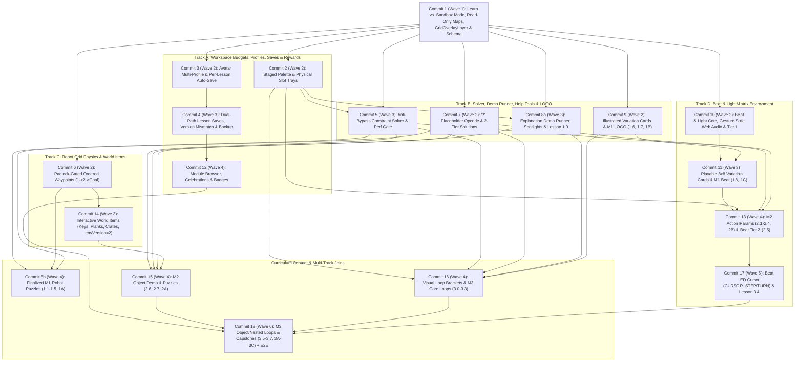

# Progressive Implementation Plan: Curriculum Platform & Modules 1–3

This document defines the progressive, commit-by-commit implementation plan for:
- [📚 Programming Curriculum (`docs/curriculum.md`)](../docs/curriculum.md) — focusing on **Module 1, Module 2, and Module 3** (32 activities total)
- [🛠️ Shared Language, Lesson Mechanics & Platform Requirements (`docs/platform_requirements.md`)](../docs/platform_requirements.md)
- [🎵 Beat & Light Matrix Environment (`docs/env_beat_light.md`)](../docs/env_beat_light.md)
- [🤖 Robot Grid Planned Extensions (`docs/env_robot_extensions.md`)](../docs/env_robot_extensions.md)
- [💾 Binary Serialization Format (`docs/binary_format.md`)](../docs/binary_format.md)

---

## 1. Engineering Principles & Commit Invariants

Every commit in this plan MUST satisfy all six invariants before merging/advancing:

1. **Standalone & Green CI:**
   - Compiles cleanly (`npm run build`) with zero TypeScript errors.
   - Passes all unit tests (`npm run test:unit`) and Playwright E2E tests (`npm run test:e2e`, executed outside the sandbox per `AGENTS.md`).
2. **Always in a Working State:**
   - No half-wired buttons, dead modals, or broken existing features (Grid, Turtle LOGO, Undo/Redo, Instant mode, QR Export/Import, Local Save/Load, PWA update restore, compact mobile layout).
3. **Humanly Testable:**
   - Every commit delivers a concrete, interactive capability in the live UI—never an invisible plumbing-only commit—accompanied by an explicit **"Human Verification"** checklist.
4. **Strict Save & Binary Compatibility:**
   - Every existing Base64URL string (v1 Grid, v1 Generic, v1 Turtle, multi-QR chunks), every existing `localStorage` entry in `robotemu_saved_programs`, and every PWA update snapshot (`robotemu_pending_update_state`) continues to load and run identically without data loss.
5. **Provably Constrained Validated Exercises (Anti-Bypass Gate):**
   - Every validated puzzle and puzzle capstone MUST pass automated **Anti-Bypass Constraint Checks** (within a `< 200 ms` CI performance budget per puzzle) proving two facts:
     1. The reference solution (and any filled partial `?` scaffold) solves the activity within all slot/palette limits.
     2. **Attempting to solve the activity *without* applying the lesson's target concept** (e.g., skipping `MOVE_BACK` by turning `180°`, spamming `3× Turn Right` instead of `Turn Left`, omitting `×N` badges, bypassing keys/planks, unrolling instead of using `Loop`, putting everything inside a single loop with no pre/post steps, or using flat sequential loops instead of nested loops) **yields zero valid solutions** within the lesson's palette and physical slot budget.
6. **Accessibility & Zero-Reading UX:**
   - **Keyboard Navigation:** All interactive elements (slot trays, `?` placeholder blocks, avatar profile cards, variation cards, modals, and demo tabs) maintain logical focus order and `Enter` / `Space` / `Escape` keyboard operation.
   - **Screen-Reader Announcements (`aria-live="polite"`):** Visual-only feedback events (padlock unlocked, slot tray full/capped, execution paused on `?`, badge unlocked) emit concise `aria-live` status updates without adding visual text clutter.

---

## 2. Scope Boundary: Modules 1–3 vs. Modules 4–9

| Capability Area | Included in Modules 1–3 Plan (Commits 1–18, incl. 8a/8b) | Deferred to Modules 4–9 (Designed for Clean Extension) |
| :--- | :--- | :--- |
| **Curriculum Content** | All **32 activities** in Modules 1–3 (`1.0`–`1C`, `2.1`–`2B`, `3.0`–`3C`) | Modules 4–9 lessons/capstones & Module 6+ `🔥 Mastery Challenges` drawer |
| **Environments** | **🤖 Robot Grid** (with M1–M2 extensions), **🐢 Turtle LOGO** (parameterless M1 + parameterized M2+), **🎵 Beat & Light Matrix** (Tier 1, Tier 2, LED Cursor) | **🚂 Switchyard / Conveyor Sorter** (introduced in Module 5.2) |
| **Pedagogical Mechanics** | Staged per-lesson palettes, Read-only curriculum maps vs. Free-Play Sandbox, Physical block-budget slot trays (`[■][■][□]`), `?` Placeholder blocks, Canvas Ghost-Step Preview, Partial + Full Visual Solutions (Undo-safe), `📖 Explanation` interactive demo tabs + spotlights, Illustrated LOGO & Playable Beat variation cards, **Automated Anti-Bypass Constraint Solver** | Simultaneous Multi-Map / Multi-Stream validation (`[1 ✓] [2 ·] [3 ·]`, Module 5+), Visual Memory Watch Tray (Module 6+), Call-Stack Recursion Visualizer (Module 9) |
| **Language & Control Flow** | Sequences, `×N` repeat badges (`2..9`), action parameters, `LOOP_START` / `LOOP_END` (single & nested visual brackets), `?` `PLACEHOLDER` block (`0x09`) | Curriculum lessons for `F1..F3` (M4; already active in Sandbox), `IF / ELSE / END_IF` & `WHILE` & boolean combinators (M5), Shape-socket function params `F1(●, ▲, ■)` (M8) |
| **Robot Grid Extensions** | Padlock-gated ordered waypoints (`1 → 2 → Goal`), Keys & Locked Gates, Planks & Water Gaps, Crates & Floor Switches, 1-slot backpack indicator, `PICK_UP` & `USE_DROP` | Sensors (`pathAhead`, `pathLeft`, `pathRight`, `itemHere`, `carryingItem`, `atGoal`, `tileColor`, `tileDial`, `unvisitedAhead`), Relics, Hanoi energy rings |
| **Profiles, Saves & Rewards** | Kid-friendly avatar multi-profile, per-profile/per-lesson auto-save & restore, Reset to Starter, multiple manual save slots per lesson, code-only versioned lesson saves + version-mismatch prompt, whole-profile export/import, standard & capstone celebrations, Module 1–3 Mastery Badges | Module 4–9 Mastery Badges & `🔥 Challenge Medals` |

---

## 3. Save & Binary Compatibility Architecture

### 3.1 Binary Serialization Compatibility (`formatVersion = 1`)

All binary extensions remain inside `FORMAT_VERSION = 1` without altering any existing byte layout:

1. **Existing Opcodes Untouched:**
   - Universal control opcodes `0x01..0x08` (`LOOP_START`, `LOOP_END`, `CALL_FN`, reserved `IF/ELSE/END_IF`, `VAR_ASSIGN`, `VAR_OP`), Grid opcodes `0x10..0x13`, and Turtle opcodes `0x10..0x1B` keep their exact current encodings.
2. **Universal `?` Placeholder Opcode (`OP_PLACEHOLDER = 0x09`):**
   - Uses free universal opcode `0x09` followed by `hintCategory: VLE`:
     - `0` = `any`, `1` = `motion`, `2` = `turn`, `3` = `item/action`, `4` = `loop`
     - `5..15` reserved for Modules 4–9 (`5` = `function`, `6` = `conditional`, `7` = `sensor`, `8` = `variable`, `9` = `operator`, `10` = `socket`), with `VLE` encoding allowing arbitrary future expansion without breaking saves.
3. **Backward-Compatible Grid `envVersion` (`1` vs. `2`):**
   - Classic Grid maps (containing only `width`, `height`, `robot`, `barriers`, `flags`) **still serialize with `envVersion = 1`**, producing byte-for-byte identical Base64URL strings (verified against `TODO.md` and `tests/codeSerializer.test.ts` fixtures).
   - Grid maps that use Module 2 interactive elements (`waterCells`, `lockedGates`, `floorSwitches`, `worldItems`) serialize with **`envVersion = 2`**: they write the exact `envVersion = 1` prefix first, followed by compact VLE tables for water tiles, gates, switches, and carryable items. `readGridState(reader, envVersion)` reads only the v1 block when `envVersion === 1` and reads the v2 extension block when `envVersion >= 2`.
   - New Grid action opcodes: `OP_GRID_PICK_UP = 0x14`, `OP_GRID_USE_DROP = 0x15` (both supporting `HasRep` for future Module 6+ depots).
4. **New `🎵 Beat & Light` Environment (`ENV_ID_BEAT = 0x03`, `ENV_VERSION_BEAT = 1`):**
   - Like Turtle (`0x02`), Beat & Light has no map payload in the binary stream; code scopes begin immediately at byte 3.
   - Opcodes `0x10..0x1D`:
     - Tier 1 (`1.8`): `0x10` `DRUM_KICK`, `0x11` `DRUM_SNARE`, `0x12` `DRUM_CLAP`, `0x13` `PLAY_CHIME`, `0x14` `STAMP_PRESET` (`presetId: uint8` for Heart/Star/Smile/etc.), `0x15` `WAIT_BEAT`, `0x16` `CLEAR_LEDS`.
     - Tier 2 (`2.5`): `0x17` `PLAY_NOTE` (`pitch`, `durationCode`), `0x18` `SET_LED_COLOR` (`colorId`), `0x19` `LIGHT_ROW` (`y`), `0x1A` `LIGHT_COL` (`x`), `0x1B` `LIGHT_PIXEL` (`x`, `y`).
     - Tier 3 Cursor (`3.4`): `0x1C` `CURSOR_STEP`, `0x1D` `CURSOR_TURN` (`dir: uint8`).
   - All numeric Beat parameters support `MASK_HAS_VAR_PARAM (0x80)` from day one so Module 6 variable sweeps (`p = p + 1`, `x = x + 1`) require zero binary format changes later.
5. **Dual-Path Code-Only Curriculum Lesson Serialization (Local Storage vs. Standalone QR/String):**
   - Curriculum saves intentionally avoid duplicating read-only map geometry via two complementary transport wrappers around the **exact same inner code payload**:
     - **Path A — Local Storage (`SavedProgramEntry` JSON):** Stores `{ lessonId, lessonVersion, simId, code }` in JSON where `code` is a standard code-only Base64URL string (`envId = 0x00` for Grid lessons, `0x02` for Turtle, `0x03` for Beat). Keeping `lessonId` and `lessonVersion` as top-level JSON fields lets `localSaveService` filter per-lesson slots without binary-decoding every entry on modal open.
     - **Path B — Standalone Share String / QR (`ENV_ID_LESSON = 0x04`):** Wraps `[FORMAT_VERSION = 1, 0x04, innerEnvByte, lessonIdLen:VLE + UTF8, lessonVersion:VLE, ...sameCodeScopes]` into a single self-contained Base64URL string so scanning a QR code or pasting a share code on another device carries `(lessonId, lessonVersion)` with zero external JSON wrapper.
   - Both paths delegate inner block encoding/decoding to the exact same `writeCodeScopes` / `readCodeScopes` routine, and `tests/codeSerializer.test.ts` asserts identical reconstructed `(lessonId, lessonVersion, workspace)` across both paths.

### 3.2 Local Storage, Multi-Profile & Lesson Versioning Strategy

- **Non-Destructive `robotemu_saved_programs` Migration:**
  - Existing v1 `SavedProgramEntry` objects (`simId: 'grid' | 'turtle'`, optional numeric `levelId`) remain valid in `migrateSavedEntry()`.
  - On first boot with Multi-Profile enabled, existing v1 saves associate automatically with the **Default Profile** (`id: 'default'`). Legacy saves without a curriculum `lessonId` open directly in **Free-Play Sandbox** with their embedded Grid/Turtle state intact.
- **Dedicated Versioned Storage Keys:**
  - `robotemu_profiles_v1`: Profile list (`id`, `avatarId`, `colorId`, `name`, `createdAt`) + `activeProfileId`.
  - `robotemu_curriculum_progress_v1`: Per-profile completion records, unlocked modules, and earned badges.
  - `robotemu_lesson_autosave_v1`: Per-profile working code per `(profileId, lessonId)` plus per-profile Free-Play Sandbox auto-saves per `simId`.
  - `robotemu_saved_programs` (v2-compatible): Manual save slots (both Free-Play saves and per-lesson manual slots via optional `profileId`, `lessonId`, `lessonVersion`, `slotIndex`).
- **Retained Historical Lesson Versions:**
  - Every `CurriculumActivity` defines `version: number` (`1` initially) and `historicalVersions?: Record<number, HistoricalActivityDefinition>`.
  - Loading a save where `saved.lessonVersion !== latestActivity.version` opens the visual **Version-Mismatch Modal** (*Load into Latest Version* vs. *Open in Original Lesson Version*).

---

## 4. Automated Anti-Bypass Constraint Solver Design

To guarantee Principle #3 (*"Constraint-Driven Discovery — No Brute Force"*), every validated puzzle (`format === 'puzzle'` and puzzle `'capstone'`) declares machine-checked **`antiBypassRules`** in its definition, verified automatically in Vitest (`tests/curriculumConstraintCheck.test.ts`) and inspectable visually in the UI (`SolutionModal` when `?dev=1`).

### 4.1 Solver Algorithms & Performance CI Gate (`src/engine/verification/constraintSolver.ts`)

Naive enumeration of `(blocks × repeatCounts)^10` would explode combinatorially. Instead, `constraintSolver.ts` uses two exact, mathematically complete search strategies:

1. **Exact State-Space Shortest-Path BFS (for all loop-free / restricted-palette checks):**
   - Models the Grid world as a finite state graph over canonical state keys:
     `(x, y, dir, collectedFlagsBitmask, bridgedWaterBitmask, unlockedGatesBitmask, activeSwitchesBitmask, carriedItemCode)`.
   - **1 graph edge = 1 workspace block** from the restricted palette (applying lossless repeat pruning: `TURN_LEFT`/`TURN_RIGHT` only need `×1` and `×2` since `×3 == opposite ×1` and `×4 == identity`; `MOVE_FWD`/`MOVE_BACK` only need `×1 .. max(width, height) - 1` since larger counts always hit the outer wall; 1-slot `PICK_UP`/`USE_DROP` only need `×1`; any move causing `COLLISION` is pruned immediately).
   - Finds the **exact minimum block count** to reach `SUCCESS` without loops (even for `slotCap = 15+` or unbounded searches!) in `< 10 ms`. If a winning path of length `≤ slotCap` exists under the restricted rule, the check fails and outputs the exact offending bypass program.

2. **Pruned Structural Template DFS (for flat-loop vs. nested-loop checks, `maxLoopNestingDepth <= 1`):**
   - Generates valid structural loop skeletons up to `slotCap` (`≤ 10`), e.g. `[Pre] + LOOP(2..9)[Body] + [Post]` or `[LOOP(n)[B1], LOOP(m)[B2]]` (note each `LOOP_START..LOOP_END` consumes 2 slots + ≥ 2 body blocks to beat an `×N` badge).
   - Memoizes deterministic block-sequence transitions `state -> nextState | COLLISION | SUCCESS` and prunes any prefix or loop body that collides on iteration `1..k`, is a state no-op (`nextState === startState`), or contains adjacent inverse actions (`MOVE_FWD` + `MOVE_BACK` with no flag/item change, `TURN_LEFT` + `TURN_RIGHT`).
   - Exhaustively proves whether **any** flat-loop (`depth ≤ 1`) or pure-single-loop (no pre/post blocks) program can beat the puzzle within `slotCap`.

3. **Enforced Solver Performance Budget (CI Gate):**
   - `tests/curriculumConstraintCheck.test.ts` asserts a hard runtime cap of **`< 200 ms` per puzzle** (`expect(elapsedMs).toBeLessThan(200)`) to account for CI runner variance, while logging a diagnostic warning whenever any puzzle exceeds **`50 ms`** so complex future M4–M9 puzzles never silently slow down the test suite.

### 4.2 Anti-Bypass Rule Types (`AntiBypassRule`)

Each puzzle specifies one or more rules that MUST produce **zero winning programs**:
- `forbidBlocks: string[]` — e.g., forbid `['MOVE_BACK']` on `1.3`, forbid `['TURN_LEFT']` / `['TURN_RIGHT']` on `1.2`, forbid `['PICK_UP', 'USE_DROP']` on `2.7`/`2A`, forbid `['LOOP_START', 'LOOP_END']` on `3.1`/`3.2`/`3.5`.
- `allowRepeatBadges: false` — forces `repeatCount = 1` on all action blocks (proves `×N` badges are required in `2.1`, `2.7`, `2A`).
- `maxLoopNestingDepth: 0 | 1` — `0` forbids loops; `1` allows unrolled blocks, `×2..×9` badges, and sequential flat loops while forbidding nested loops (proves true loop nesting `depth ≥ 2` is strictly required in `3.6` and `3A`).
- `pureSingleLoopOnly: true` — restricts programs to a single outer `LOOP_START ... LOOP_END` with zero blocks before or after it (proves pre-loop setup or post-loop cleanup is strictly required in `3.2`).
- `maxActionExecutions: Record<string, number>` — e.g., `{ USE_DROP: 1 }` on Capstone `2A` (proves the learner cannot skip *either* the locked gate *or* the water gap).
- `unmodifiedStarterMustFail: true` & `minStarterEditDistance: 1` — proves debug puzzles (`1.4`, `1A`) fail out-of-the-box and require fixing the bug rather than running as-is.
- `directToGoalMustFailLock: true` — proves ordered-waypoint maps (`1.5`, `1A`) allow reaching `(goal.x, goal.y)` in fewer steps if flags are ignored, and that doing so fails because the goal is padlocked.

### 4.3 Module 1–3 Anti-Bypass Verification Matrix (All 14 Validated Puzzles)

| ID | Target Concept | Slot Cap | Automated Anti-Bypass Proofs Enforced in `npm run test:unit` |
| :--- | :--- | :---: | :--- |
| **`1.1`** | Sequential `MOVE_FWD` | `4` | • `< 3` blocks cannot reach goal; `forbidBlocks: ['MOVE_FWD']` → **0 solutions** |
| **`1.2`** | Egocentric `TURN_LEFT` & `TURN_RIGHT` | `6` | • `forbidBlocks: ['TURN_LEFT', 'TURN_RIGHT']` (unbounded) → **0 solutions** • `forbidBlocks: ['TURN_LEFT']` (`≤ 6` slots) → **0 solutions** *(blocks `3× Right` workaround!)* • `forbidBlocks: ['TURN_RIGHT']` (`≤ 6` slots) → **0 solutions** *(blocks `3× Left` workaround!)* |
| **`1.3`** | Retreat from alcove via `MOVE_BACK` | `5` | • `forbidBlocks: ['MOVE_BACK']` (`≤ 5` slots) → **0 solutions** *(a `Turn + Turn + Fwd` `180°` turn-around requires ≥ 7 blocks, overflowing the 5-slot tray!)* |
| **`1.4`** | Step-debugging 1 wrong block | `6` | • `unmodifiedStarterMustFail: true` • Shortest from-scratch solution requires `≥ 5` blocks; 1-block replacement on starter succeeds |
| **`1.5`** | Ordered Waypoints (`1 → 2 → Goal`) | `6` | • `directToGoalMustFailLock: true` *(reaching Goal tile directly takes ≤ 3 blocks but stays padlocked)* • Visiting `2` before `1` then `Goal` → `status !== 'SUCCESS'` |
| **`1A`** | *Compact Labyrinth* (Turns + `Back` + 3 Flags + Debug) | `10` | • `unmodifiedStarterMustFail: true` • `forbidBlocks: ['MOVE_BACK']` (`≤ 10` slots) → **0 solutions** • `forbidBlocks: ['TURN_LEFT']` (`≤ 10`) → **0 solutions** & `forbidBlocks: ['TURN_RIGHT']` (`≤ 10`) → **0 solutions** • `directToGoalMustFailLock: true` |
| **`2.1`** | Action Repeat Badges (`×2..×9`) | `5` | • `allowRepeatBadges: false` (`≤ 5` slots) → **0 solutions** *(unrolled minimum is `≥ 9` blocks)* |
| **`2.7`** | `PICK_UP` & `USE_DROP` + `×N` | `8` | • `forbidBlocks: ['PICK_UP', 'USE_DROP']` (unbounded) → **0 solutions** • `allowRepeatBadges: false` (`≤ 8` slots) → **0 solutions** |
| **`2A`** | *The Supply Courier* (Key + Plank + `×N`) | `10` | • `forbidBlocks: ['PICK_UP', 'USE_DROP']` (unbounded) → **0 solutions** • `maxActionExecutions: { USE_DROP: 1 }` (unbounded) → **0 solutions** *(proves BOTH Key+Gate AND Plank+Water are mandatory!)* • `allowRepeatBadges: false` (`≤ 10` slots) → **0 solutions** |
| **`3.1`** | Simple Multi-Block `Loop(N)` | `5` | • `maxLoopNestingDepth: 0` (`×2..×9` badges **enabled**, `≤ 5` slots) → **0 solutions** |
| **`3.2`** | Setup / Cleanup Outside `Loop(N)` | `7` | • `maxLoopNestingDepth: 0` (`×2..×9` **enabled**, `≤ 7` slots) → **0 solutions** • `pureSingleLoopOnly: true` (`≤ 7` slots) → **0 solutions** *(proves pre/post steps outside the loop cannot be absorbed into the loop!)* |
| **`3.5`** | `Loop(N)` with Object Workflows | `8` | • `maxLoopNestingDepth: 0` (`PICK_UP`, `USE_DROP`, `×2..×9` **enabled**, `≤ 8` slots) → **0 solutions** • `forbidBlocks: ['PICK_UP', 'USE_DROP']` (with loops, unbounded) → **0 solutions** |
| **`3.6`** | Nested Loops (`Loop` inside `Loop`) | `8` | • `maxLoopNestingDepth: 1` (flat sequential loops + `×2..×9` **enabled**, `≤ 8` slots) → **0 solutions** *(mathematically proves nesting depth ≥ 2 is required!)* |
| **`3A`** | *Automated Greenhouse* (Nested Loops + Objects) | `10` | • `maxLoopNestingDepth: 1` (`PICK_UP`, `USE_DROP`, `×2..×9`, flat loops **enabled**, `≤ 10` slots) → **0 solutions** • `forbidBlocks: ['PICK_UP', 'USE_DROP']` (even with nested loops) → **0 solutions** |

### 4.4 Author Workflow When an Anti-Bypass Check Fails

Whenever a new or edited puzzle fails an `AntiBypassRule`:
1. **Inspect the Counterexample:** `curriculumConstraintCheck.test.ts` (and the `/?dev=1` Solution Modal inspector) prints the exact winning bypass `WorkspaceState` (e.g., `[MOVE_FWD ×3, TURN_RIGHT, MOVE_FWD ×2]`).
2. **Tighten Map or Budget:** Adjust map geometry to block the shortcut (add a wall edge, deepen an alcove by 1 cell, place a water/gate choke point, or separate flag coordinates) or reduce `slotCap` so the unintended workaround overflows the physical slot tray while the target concept still fits comfortably.
3. **Re-Verify (`< 200 ms`):** Re-run `npx vitest run tests/curriculumConstraintCheck.test.ts` until **0 bypasses** exist and the reference solution passes.
4. **Post-Release Versioning Rule:** If tightening a puzzle that was already shipped in a previous release/commit where users may have saves, preserve the prior map/slot definition inside `historicalVersions[oldVersion]` and increment `activity.version` so existing saves trigger the Version-Mismatch Modal rather than silently breaking.

---

## 5. Concurrency Plan & Parallel Worktracks

**Commit 1** establishes the shared `CurriculumActivity` types, `appMode`, and a `<GridOverlayLayer />` slot component so the remaining **18 commits** (`C2`–`C18`, with `C8` split into `C8a` and `C8b`) fan out across **4 parallel tracks** in **6 waves** without bottlenecking on a single mega-commit!

### 5.1 Parallel Dependency Graph (DAG)

*(Every edge below matches the exact `Depends On` list in §6; transitive edges from `C1` are omitted only where already implied through a Wave 2 parent, while direct `C1` type/slot dependencies are shown.)*

### 5.2 Wave-by-Wave Concurrent Execution Schedule

| Wave | Commits Runnable in Parallel | File-Ownership & Conflict Prevention Summary |
| :---: | :--- | :--- |
| **Wave 1** | **`C1`** *(Foundation)* | Establishes `src/data/curriculum/types.ts` (including static `badgeId`/`capstoneIds` per module), `appMode`, read-only Grid toggle, and `<GridOverlayLayer />` named slots. |
| **Wave 2** | **`C2`** + **`C3`** + **`C6`** + **`C7`** + **`C9`** + **`C10`** *(6-way parallel!)* | • `C2`: `BlockPalette.tsx`, `BlockSubpalette.tsx`, `WorkspaceCanvas.tsx` • `C3`: `profileService.ts`, `ProfileSwitcherModal.tsx` • `C6`: `physics.ts`, `FlagPadlockOverlay.tsx` • `C7`: `OP_PLACEHOLDER`, `GhostStepOverlay.tsx`, `SolutionModal.tsx` • `C9`: `VariationCardsPanel.tsx`, `turtleEnvironment.tsx`, `module1Logo.ts` • `C10`: `src/simulations/beat/*`, `beatSerializer.ts` |
| **Wave 3** | **`C4`** + **`C5`** + **`C8a`** + **`C11`** + **`C14`** *(5-way parallel!)* | • `C4`: `localSaveService.ts`, `SaveProgramModal`, `LoadProgramModal`, `LessonVersionMismatchModal` • `C5`: `src/engine/verification/constraintSolver.ts`, `curriculumConstraintCheck.test.ts` • `C8a`: `ExplanationDemoBar.tsx`, `DemoSpotlightOverlay.tsx`, `module1Demo.ts` (`1.0`) • `C11`: Beat `▶` preview in `VariationCardsPanel.tsx`, `module1Beat.ts` (`1.8`, `1C`) • `C14`: `physics.ts`, `WorldItemsLayer.tsx`, `gridSerializer.ts` (`envVersion = 2`) |
| **Wave 4** | **`C8b`** + **`C12`** + **`C13`** + **`C15`** + **`C16`** *(5-way parallel!)* | • `C8b`: `module1Robot.ts` (`1.1`–`1.5`, `1A`) • `C12`: `CurriculumBrowserModal.tsx`, `CelebrationOverlay.tsx`, `BadgeCollectionModal.tsx` (reacts automatically to static module `badgeId`s—decoupled from `C15`!) • `C13`: `src/simulations/beat/` Tier 2 + `module2Params.ts` (`2.1`–`2.5`, `2B`) • `C15`: `module2Objects.ts` (`2.6`, `2.7`, `2A`) • `C16`: Loop bracket bars in `WorkspaceCanvas.tsx` + `module3Part1.ts` (`3.0`–`3.3`) |
| **Wave 5** | **`C17`** *(+ optional early start on `3.5–3.7`)* | • `C17`: `src/simulations/beat/` LED cursor + `module3Beat.ts` (`3.4`) |
| **Wave 6** | **`C18`** *(Final Join)* | Authors `module3Part2.ts` (`3.5`–`3.7`, `3A`–`3C`), syncs `docs/binary_format.md`, and runs the full Playwright E2E + backward-compatibility + anti-bypass verification suite. |

### 5.3 File-Isolation Rules & Shared-Component Merge Protocol

1. **`<GridOverlayLayer />` Slot Isolation (Eliminating `GridCanvas.tsx` Conflicts):**
   - Because `C6` (padlocks), `C7` (ghost-step preview), `C8a` (demo spotlights), and `C14` (world items) all render visuals atop the grid, **Commit 1** extracts `src/simulations/grid/components/GridOverlayLayer.tsx` with dedicated pluggable child components (`FlagPadlockOverlay`, `GhostStepOverlay`, `DemoSpotlightOverlay`, `WorldItemsLayer`).
   - If `GridCanvas.tsx` itself needs minor prop wiring during Wave 2, merge in order **`C6 → C7`**, followed in Wave 3 by **`C8a → C14`**.
2. **Sequential Ownership of Stateful Services:**
   - `profileService.ts`: touched strictly sequentially across waves (`C3` W2 → `C4` W3 → `C12` W4).
   - `VariationCardsPanel.tsx`: touched strictly sequentially (`C9` W2 → `C11` W3).
   - `src/simulations/beat/*`: touched strictly sequentially (`C10` W2 → `C11` W3 → `C13` W4 → `C17` W5).
3. **One File per Curriculum Slice:**
   - Keep `module1Demo.ts`, `module1Robot.ts`, `module1Logo.ts`, `module1Beat.ts`, `module2Params.ts`, `module2Objects.ts`, `module3Part1.ts`, `module3Beat.ts`, and `module3Part2.ts` in separate files aggregated via 1-line spreads in `src/data/curriculum/index.ts`.
   - Module Mastery Badge metadata (`badgeId`, `capstoneIds`) is declared statically on `CurriculumModule` in `C1`, so `C15` (`M2` capstones) and `C12` (Badge ceremony UI) have **zero code dependency** on each other.

---

## 6. Detailed Commit-by-Commit Breakdown

### Commit 1: Curriculum (`🎓 Learn`) vs. Free-Play (`🛠️ Sandbox`) Mode, Read-Only Maps, `GridOverlayLayer` & Activity Schema
- **Wave:** 1 (Foundation) · **Depends On:** None · **Unlocks:** `C2`, `C3`, `C6`, `C7`, `C9`, `C10`
- **Goal:** Establish the split between **Curriculum Mode** (structured, read-only maps) and **Free-Play Sandbox Mode** (unrestricted editing & experimentation), extract `<GridOverlayLayer />` to prevent downstream canvas merge conflicts, and seed minimal **schema-validation draft fixtures** for `1.1`–`1.3` *(note: final pedagogical maps, scaffolds, and anti-bypass rules for `1.1`–`1.5` & `1A` are owned by Commit 8b)*.
- **Changes:**
  - **[NEW] `src/data/curriculum/types.ts` & `src/data/curriculum/index.ts`**: Define `CurriculumModule` (with static `badgeId` & `capstoneIds`), `CurriculumActivity`, `ActivityFormat`, `PaletteConfig`, `SlotCapConfig`, `AntiBypassRule`, and version helpers (`getActivityLatest`, `getActivityAtVersion`). Seed 3 minimal draft Robot fixtures (`1.1`, `1.2`, `1.3`) to exercise mode/activity switching immediately.
  - **[NEW] `src/simulations/grid/components/GridOverlayLayer.tsx`**: Pluggable SVG overlay container inside `GridCanvas.tsx` exposing isolated mount points for padlocks (`C6`), ghost preview (`C7`), demo spotlights (`C8a`), and world items (`C14`).
  - **[MODIFY] `src/store/useAppStore.ts`, `Toolbar.tsx`, `MobileDrawerMenu.tsx`, `GridCanvas.tsx`, `GridToolbarTools.tsx`, `pwaStateRestoreService.ts`**: Add `appMode: 'curriculum' | 'sandbox'`, `openCopyInSandbox()`, and strictly read-only Grid enforcement in Curriculum mode.
- **Save & Test Compatibility:** Keep `src/data/lessons.ts` intact for Sandbox presets and `tests/coursePlan.test.ts`; ensure existing Sandbox map-editing tests in `e2e/app.spec.ts` run cleanly in Sandbox mode.
- **Human Verification:**
  1. Toggle between **🎓 Learn** and **🛠️ Sandbox** on desktop and mobile; verify `1.1`–`1.3` draft fixtures are strictly read-only in Learn mode.
  2. Click **Open Copy in Sandbox** and confirm the cloned map & blocks become editable in **🛠️ Sandbox**.
  3. Verify keyboard focus order and ARIA labels on the new mode switcher and *"Open Copy in Sandbox"* controls.

---

### Commit 2: Staged Palette Filtering & Physical Block-Budget Slot Trays (`[■][■][■][□][□]`)
- **Wave:** 2 · **Depends On:** `C1` · **Concurrent With:** `C3`, `C6`, `C7`, `C9`, `C10`
- **Goal:** Prevent cognitive overload in early lessons via per-activity palette staging and communicate block limits non-verbally using physical workspace slot trays.
- **Changes:**
  - **[MODIFY] `src/components/BlockPalette.tsx` & `src/components/BlockSubpalette.tsx`**: Filter visible simulation blocks, core control blocks (`LOOP_START`, `LOOP_END`, `CALL_F1..F3`, `VAR_ASSIGN`, `VAR_OP`), repeat badges (`2..9`), variable badges (`a..n`), function scope tabs, and parameter popovers according to `PaletteConfig` (Sandbox shows everything).
  - **[MODIFY] `src/components/WorkspaceCanvas.tsx` & `src/store/useAppStore.ts`**:
    - Render physical slot outlines (`[□]`) alongside placed blocks (`[■]`) when `slotCap` is active (`maxTotal` or `perScope`).
    - Reject block insertion past the cap with a gentle CSS shake + amber highlight + `aria-live="polite"` slot-full status update.
- **Save & Test Compatibility:** Purely runtime/UI enforcement in Curriculum mode; binary serialization unchanged.
- **Human Verification:**
  1. Open `1.1` in **🎓 Learn** and confirm *only* allowed basic movement blocks appear (no `×N`, `Loop`, `F1`, or `Vars`).
  2. Fill all slots in a capped tray (`[■][■][■][■]`) and click one more block—watch the physical slot tray shake and cap cleanly.
  3. Verify keyboard focus order and screen-reader announcement when the slot tray reaches capacity.

---

### Commit 3: Kid-Friendly Multi-Profile System, Per-Lesson Auto-Save/Restore & Reset-to-Starter
- **Wave:** 2 · **Depends On:** `C1` · **Concurrent With:** `C2`, `C6`, `C7`, `C9`, `C10`
- **Goal:** Let multiple pre-reading learners share one device with isolated workspaces and automatic per-lesson state persistence.
- **Changes:**
  - **[NEW] `src/services/profileService.ts`**: Manage local profiles (`id`, kid-friendly animal/robot `avatarId`, shape/color `accentColor`, optional `name`), per-profile/per-lesson auto-saves (`robotemu_lesson_autosave_v1`), completion tracking (`robotemu_curriculum_progress_v1`), and automatic association of legacy `robotemu_saved_programs` entries with `'default'`.
  - **[NEW] `src/components/ProfileSwitcherModal.tsx`**: Visual avatar-first profile switcher & creator.
  - **[MODIFY] `src/store/useAppStore.ts` & `src/components/Toolbar.tsx`**: Auto-save workspace edits to `(activeProfileId, activeActivityId)`, auto-restore when switching back, and add Undo-protected **Reset to Starter (`↺`)**.
- **Save & Test Compatibility:** Existing `robotemu_saved_programs` v1 entries migrate losslessly to `'default'`.
- **Human Verification:**
  1. Edit blocks on `1.1`, switch to `1.2`, return to `1.1` (and reload page)—verify exact blocks restore.
  2. Create a second Avatar profile (e.g., 🐸), verify `1.1` starts fresh, and switch back to confirm Profile 1's work is intact.
  3. Click **Reset to Starter**, then click **Undo** to restore your blocks; verify keyboard navigation across avatar cards in `ProfileSwitcherModal`.

---

### Commit 4: Dual-Path Versioned Lesson Saves, Manual Save Slots, Version-Mismatch Modal & Whole-Profile Backup
- **Wave:** 3 · **Depends On:** `C3` · **Concurrent With:** `C5`, `C8a`, `C11`, `C14`
- **Goal:** Deliver multiple manual save slots per lesson, dual-path code-only lesson serialization (§3.1.5: `SavedProgramEntry` JSON for local storage + `ENV_ID_LESSON = 0x04` for standalone QR/strings), historical version playback, and whole-profile export/import.
- **Changes:**
  - **[MODIFY] `src/services/localSaveService.ts` & `src/engine/serialization/codeSerializer.ts`**: Add optional `profileId`, `lessonId`, `lessonVersion`, `slotIndex` on `SavedProgramEntry`, code-only save mode (`exportCode(false)`), and `ENV_ID_LESSON = 0x04` standalone QR/string envelope.
  - **[MODIFY] `src/components/SaveProgramModal.tsx` & `src/components/LoadProgramModal.tsx`**: Visual numbered **Lesson Save Slots (`Slot 1`, `Slot 2`...)** with SVG thumbnails scoped to the active profile.
  - **[NEW] `src/components/LessonVersionMismatchModal.tsx`**: Visual prompt (*Load into Latest Lesson* vs. *Open in Original Lesson Version*) when `saved.lessonVersion !== latest.version`.
  - **[MODIFY] `src/components/ExportImportModal.tsx` & `src/components/ProfileSwitcherModal.tsx`**: Whole-profile JSON/QR backup export & import (*Add as New Profile* vs. *Replace*).
- **Save & Test Compatibility:** Extend `tests/codeSerializer.test.ts` and `tests/lessonVersioningAndProfiles.test.ts` to verify round-tripping the exact same lesson attempt through **both** `SavedProgramEntry` and `ENV_ID_LESSON = 0x04` produces identical `(lessonId, lessonVersion, workspace)`, alongside v1 legacy saves and synthetic v1→v2 mismatch tests.
- **Human Verification:**
  1. Save two distinct attempts into **Slot 1** and **Slot 2** on `1.2`, load between them, and test QR string Export/Import of a lesson attempt.
  2. Export a full profile backup, import it as a new profile, and verify all slots/auto-saves transfer.
  3. Import a v1-versioned test save on a v2-bumped fixture lesson, test both mismatch dialog choices, and check modal keyboard focus trapping (`Tab` / `Escape`).

---

### Commit 5: Automated Anti-Bypass Constraint Solver, Performance Gate & Dev Proof Inspector
- **Wave:** 3 · **Depends On:** `C1`, `C2` · **Concurrent With:** `C4`, `C8a`, `C11`, `C14`
- **Goal:** Build the automated constraint-proving engine (§4) with a `< 200 ms` per-puzzle CI performance gate and a `/?dev=1` visual inspector so every subsequent puzzle commit (`C8b`, `C13`, `C15`, `C16`, `C18`) is mathematically proven non-bypassable.
- **Changes:**
  - **[NEW] `src/engine/verification/constraintSolver.ts`**:
    - Implement exact State-Space Shortest-Path BFS and Pruned Structural Loop DFS (§4.1), returning a structured `ConstraintCheckReport` (pass/fail per rule, elapsed ms, minimum restricted block count, and offending bypass `WorkspaceState` if any).
  - **[NEW] `tests/curriculumConstraintCheck.test.ts`**: Automated Vitest suite enforcing:
    1. Reference solutions pass within slot/palette caps.
    2. All `antiBypassRules` yield **0 winning programs**.
    3. Every puzzle's full check completes in **`< 200 ms`** (warning above `50 ms`).
  - **[MODIFY] `src/components/SolutionModal.tsx`**: When `?dev=1` is in the URL, render a collapsible **🛡️ Constraint Proofs** inspector showing live pass/fail proof badges and counterexamples.
- **Save & Test Compatibility:** Read-only verification engine; zero impact on saves.
- **Human Verification:**
  1. Open `/?dev=1`, open the Solution Modal on `1.1`–`1.3`, and inspect the live **🛡️ Constraint Proofs** panel and timing metrics.
  2. Run `npm run test:unit` and verify `curriculumConstraintCheck.test.ts` passes well under the `200 ms` budget; check keyboard toggle of the dev proof disclosure.

---

### Commit 6: Padlock-Gated Ordered Waypoints (`1 → 2 → Goal`) in Robot Grid
- **Wave:** 2 · **Depends On:** `C1` · **Concurrent With:** `C2`, `C3`, `C7`, `C9`, `C10`
- **Goal:** Enforce strict sequential waypoint collection (`1 → 2 → Goal`) with non-verbal padlock visuals (`docs/env_robot_extensions.md` §1) inside `<GridOverlayLayer />`.
- **Changes:**
  - **[MODIFY] `src/engine/physics.ts`**: Collect numbered flag `order = k` *only* when all non-goal flags with `order < k` are already collected; stepping onto a locked later flag or locked goal flag is safe (not a collision) and leaves it locked.
  - **[NEW] `src/simulations/grid/components/FlagPadlockOverlay.tsx`** & **[MODIFY] `mapThumbnailGenerator.ts`**: Render dimmed padlock rings + lock icons on locked later flags (`2`, `3`, `Goal`) with an unlock pop animation and `aria-live="polite"` announcement as each prerequisite flag is collected.
- **Save & Test Compatibility:** `FlagObjective.order` and `isGoal` already exist in `gridSerializer.ts` (`envVersion = 1`); all 20 classic `LESSONS` in `tests/coursePlan.test.ts` pass cleanly.
- **Human Verification:**
  1. On a multi-flag map, drive over Flag `2` and `Goal` *before* Flag `1`—confirm they display padlock rings and stay uncollected.
  2. Collect `1 → 2 → Goal` in order, watch each padlock unlock sequentially, and verify screen-reader status announcements.

---

### Commit 7: `?` Placeholder Blocks (`OP_PLACEHOLDER`) & Two-Tier Partial/Full Visual Solution System
- **Wave:** 2 · **Depends On:** `C1` · **Concurrent With:** `C2`, `C3`, `C6`, `C9`, `C10`
- **Goal:** Deliver non-spoiling Tier 1 Partial Help (Ghost-Step Preview + `?` Block Scaffolds) and Tier 2 Full Solutions with 1-tap Undo safety.
- **Changes:**
  - **[MODIFY] `src/types/index.ts`, `src/engine/serialization/types.ts`, `codeSerializer.ts`**: Add `PLACEHOLDER` block (`OP_PLACEHOLDER = 0x09` + `hintCategory: VLE` with `0..4` active and `5..15` reserved for M4–M9).
  - **[MODIFY] `src/components/BlockItem.tsx`, `BlockPalette.tsx`, `WorkspaceCanvas.tsx`**: Render dashed `?` block; selecting `?` and activating/clicking a palette block—or dropping a palette block onto `?`—replaces `?` in place.
  - **[MODIFY] `src/engine/interpreter.ts` & `src/store/useAppStore.ts`**: Reaching `PLACEHOLDER` pauses cleanly (`PAUSED`), pulses `?` amber, emits an `aria-live` pause cue, and highlights the hinted category in `BlockPalette`.
  - **[NEW] `src/simulations/grid/components/GhostStepOverlay.tsx`** & **[MODIFY] `SolutionModal.tsx`**: Render translucent ghost robot step preview inside `<GridOverlayLayer />` and upgrade `SolutionModal` into the **Two-Tier Help Modal** (Undo-protected).
- **Save & Test Compatibility:** `OP_PLACEHOLDER = 0x09` round-trips cleanly in binary saves/QR codes; existing opcodes untouched.
- **Human Verification:**
  1. Trigger **Tier 1 Ghost Preview** on `1.1` and watch the translucent ghost robot animate the first step without changing workspace blocks.
  2. Load a **`?` Partial Scaffold**, press **Play** (pauses cleanly on `?` with amber pulse!), replace `?` via both mouse/touch and keyboard (`Tab` + `Enter`), and click **Undo** to revert.

---

### Commit 8a: `📖 Explanation` Interactive Demo Runner, Spotlights & Lesson `1.0`
- **Wave:** 3 · **Depends On:** `C1`, `C2` · **Concurrent With:** `C4`, `C5`, `C11`, `C14` · **Unlocks:** `C15`, `C16`
- **Goal:** Deliver the reusable `📖 Explanation` interactive demo subsystem early on the critical path (decoupled from M1 puzzle authoring) along with Lesson `1.0`.
- **Changes:**
  - **[NEW] `src/components/ExplanationDemoBar.tsx` & `src/simulations/grid/components/DemoSpotlightOverlay.tsx`**:
    - Example switcher tabs (`[1] [2] [3]`), pre-loaded runnable/step-able demo workspaces, synchronized `<GridOverlayLayer />` spotlights (active block arrow + egocentric robot eye-heading cone showing North vs. South `Turn Left` / `Turn Right`), and a prominent 1-tap **Continue (`→`)** button once explored.
  - **[NEW] `src/data/curriculum/module1Demo.ts`**: Author Lesson `1.0` (*How Programs Run & Robot Point-of-View*, 2 visual demos).
- **Save & Test Compatibility:** Version `1` definition for `1.0`; unit test verifies demo tab stepping and completion state.
- **Human Verification:**
  1. Open Lesson `1.0`, step through Demo `[1]` and Demo `[2]`, verify the robot eye-cone spotlight clearly contrasts North-facing vs. South-facing turns, and click **Continue (`→`)**.
  2. Verify keyboard tab switching (`[1]`, `[2]`) and screen-reader labels on demo controls.

---

### Commit 8b: Finalized Module 1 Robot Puzzles (`1.1`–`1.5`, Capstone `1A`) with Anti-Bypass Proofs
- **Wave:** 4 · **Depends On:** `C5`, `C6`, `C7` · **Concurrent With:** `C12`, `C13`, `C15`, `C16`
- **Goal:** Replace the `C1` draft fixtures with the finalized, anti-bypass-verified Module 1 Robot puzzle track (`1.1`–`1.5` and Capstone `1A`).
- **Changes:**
  - **[NEW] `src/data/curriculum/module1Robot.ts`**: Finalize all 6 validated Module 1 Robot puzzles (`3×3`–`4×4` compact grids, Ghost-Step previews on `1.1`–`1.3`, `?` scaffolds on `1.4`–`1.5` & `1A`, 5-block buggy starter on `1.4`, padlocked flags on `1.5`, and broken starter leg + 3-flag maze on Capstone `1A` `≤ 10` slots), with every puzzle's `antiBypassRules` (§4.3) passing `curriculumConstraintCheck.test.ts`.
- **Save & Test Compatibility:** Finalizes `version: 1` definitions for `1.1`–`1.5` and `1A`.
- **Human Verification:**
  1. Play straight through `1.1` → `1.2` → `1.3` → `1.4` → `1.5` → `1A`, testing step-debugging on `1.4`, padlocks on `1.5`, and Tier 1/Tier 2 hints.
  2. Check `/?dev=1` Solution Modal on `1.2`, `1.3`, and `1A` to confirm `0` bypass solutions without `MOVE_BACK` or without both turn directions.

---

### Commit 9: Illustrated Creative Variation Cards & Module 1 Turtle LOGO Lessons (`1.6`, `1.7`, Capstone `1B`)
- **Wave:** 2 · **Depends On:** `C1` · **Concurrent With:** `C2`, `C3`, `C6`, `C7`, `C10`
- **Goal:** Deliver Illustrated Variation Cards (auto-rendered SVG thumbnails + Undo-safe 1-tap Load Code) and all parameterless Module 1 Turtle LOGO lessons.
- **Changes:**
  - **[NEW] `src/components/VariationCardsPanel.tsx`**: Displays 2–3 Variation Cards with memoized SVG thumbnails rendered directly from each variation's `WorkspaceState` via `runHeadlessSimulation` + `generateTurtleMapThumbnail`, plus Undo-protected **Load Code**.
  - **[MODIFY] `src/simulations/turtle/turtleEnvironment.tsx` & `src/components/BlockItem.tsx`**: Respect `PaletteConfig.allowActionParams === false` from `C1`'s activity schema so Module 1 LOGO blocks run clean `50px` steps and `90°` turns with parameter badges hidden.
  - **[NEW] `src/data/curriculum/module1Logo.ts`**: Author `1.6` (*First Continuous Line Drawings*), `1.7` (*Lifting & Lowering the Pen*), and Capstone `1B` (*Postcard Sketch*), each with starter + 3 illustrated variations (`≤ 12` blocks).
- **Save & Test Compatibility:** Serializes with standard `ENV_ID_TURTLE (0x02)` opcodes (`0x10`, `0x12`, `0x16`, `0x17`).
- **Human Verification:**
  1. Open `1.6`, `1.7`, and `1B`, confirm parameter badges are hidden on M1 LOGO blocks, run the starter, and inspect the 3 auto-rendered variation thumbnails.
  2. Click **Load Code** on any variation card, remix it, click **Undo** to restore prior work, and verify keyboard navigation across variation cards.

---

### Commit 10: `🎵 Beat & Light Matrix` Environment Core, Gesture-Safe Web Audio Synth & Tier 1 Blocks (`envId = 0x03`)
- **Wave:** 2 · **Depends On:** `C1` · **Concurrent With:** `C2`, `C3`, `C6`, `C7`, `C9`
- **Goal:** Ship the `🎵 Beat & Light Matrix` simulation environment (`docs/env_beat_light.md`) with an 8×8 RGB LED pad, beat-ring indicator, browser-autoplay-safe Web Audio synth, Tier 1 blocks, thumbnails, and binary serialization.
- **Changes:**
  - **[NEW] `src/simulations/beat/types.ts`, `presets.ts`, `beatSynth.ts`, `beatEnvironment.tsx`, `components/BeatCanvas.tsx`, `components/BeatToolbarTools.tsx`**:
    - `8×8` RGB LED matrix + synchronized visual **Beat-Ring Pulse** + Mute toggle.
    - **Autoplay-Policy-Safe `beatSynth.ts`:** Lazily creates/resumes a shared `AudioContext` inside synchronous user-gesture handlers (`Play`, `Step`, card `▶`), shows a subtle muted/tap-for-sound pill if the browser blocks audio, and **never** blocks or delays interpreter ticks if `AudioContext` is suspended or unavailable (headless Playwright / Vitest / muted iPads).
    - Tier 1 blocks: `DRUM_KICK`, `DRUM_SNARE`, `DRUM_CLAP`, `PLAY_CHIME`, `STAMP_HEART`, `STAMP_STAR`, `STAMP_SMILE`, `WAIT_BEAT`, `CLEAR_LEDS`.
  - **[NEW] `src/engine/serialization/env/beatSerializer.ts`** & thin dispatch hooks in `codeSerializer.ts`, `mapThumbnailGenerator.ts`, `useAppStore.ts`, `pwaStateRestoreService.ts`, `localSaveService.ts`.
- **Save & Test Compatibility:** Uses `ENV_ID_BEAT = 0x03`; `0x00..0x02` untouched. Unit tests in `tests/beatEnvironment.test.ts`.
- **Human Verification:**
  1. Open **🛠️ Sandbox → 🎵 Beat**, add Kick, Snare, Heart, Star, Chime, Clear blocks, and press **Play** / **Step** (testing both unmuted audio and muted visual beat-ring pulse).
  2. Test local Save/Load, QR Export/Import, and keyboard accessibility of `BeatToolbarTools`.

---

### Commit 11: Playable Animated Variation Cards & Module 1 Beat & Light Activities (`1.8`, Capstone `1C`)
- **Wave:** 3 · **Depends On:** `C9`, `C10` · **Concurrent With:** `C4`, `C5`, `C8a`, `C14`
- **Goal:** Add in-card animated 8×8 + audio preview (`▶`/`⏹`) to `VariationCardsPanel` and complete all Module 1 Beat & Light content.
- **Changes:**
  - **[MODIFY] `src/components/VariationCardsPanel.tsx`**: Render an interactive mini `8×8` LED preview with an in-card **Play/Listen (`▶`)** button on Beat variation cards that steps through synth audio + LED frames without touching the main workspace.
  - **[NEW] `src/data/curriculum/module1Beat.ts`**: Author `1.8` (*Drum Pads & Icon Stamps*) and Capstone `1C` (*Sticker & Beat Intro*), each with starter + 3 playable variations.
- **Save & Test Compatibility:** Uses `ENV_ID_BEAT = 0x03` Tier 1 opcodes.
- **Human Verification:**
  1. Open `1.8` and `1C`; tap (and keyboard-activate) `▶` inside Variation Cards 1–3 to hear and watch each pattern while your main workspace stays untouched.
  2. Tap **Load Code** on a card and remix it on the main 8×8 pad.

---

### Commit 12: Hierarchical Curriculum Browser, Victory Celebrations & Collectible Module Badges
- **Wave:** 4 · **Depends On:** `C4` · **Concurrent With:** `C8b`, `C13`, `C15`, `C16`
- **Goal:** Add visual chapter/activity browsing, completion fanfare, and collectible Module Mastery Badges (`docs/platform_requirements.md` §3), automatically honoring static `badgeId` / `capstoneIds` across all modules (`M1`–`M3`).
- **Changes:**
  - **[NEW] `src/components/CurriculumBrowserModal.tsx` & `src/components/BadgeCollectionModal.tsx`**: Visual module cards with format icons (`📖`, `🤖`, `🐢`, `🎵`, `🏆`, `🎨`), completion checkmarks, sequential module unlock (plus optional teacher/dev *"Unlock All"* toggle), and Badge/Trophy showcase.
  - **[NEW] `src/components/CelebrationOverlay.tsx` & `src/services/celebrationAudio.ts`**: Standard completion jingle + star burst + 1-tap **Next (`→`)**, and Capstone grand confetti/fireworks + **Module Mastery Badge** ceremony (`aria-live="polite"` badge announcement + `prefers-reduced-motion` support).
  - **[MODIFY] `src/services/profileService.ts`**: Persist earned badges per profile and include them in `C4`'s Whole-Profile Export/Import payload.
- **Save & Test Compatibility:** Stored in `robotemu_curriculum_progress_v1`; binary code saves untouched.
- **Human Verification:**
  1. Open the Curriculum Browser, navigate lessons via mouse and keyboard, and complete a standard lesson for the quick star burst + **Next (`→`)**.
  2. Complete a module's Capstones (`1A`, `1B`, `1C`) to trigger the grand confetti fanfare and **Module Mastery Badge** unlock ceremony!

---

### Commit 13: Module 2 Action Parameters (`2.1`–`2.4`, Capstone `2B`) & Beat & Light Tier 2 Blocks (`2.5`)
- **Wave:** 4 · **Depends On:** `C2`, `C5`, `C7`, `C11` · **Concurrent With:** `C8b`, `C12`, `C15`, `C16`
- **Goal:** Unlock visual action parameter badges across Robot (`×N`), Turtle LOGO (`Length`, `Angle`, `Pen Color`, `Pen Width`, `Arc`), and Beat & Light Tier 2 (`Pitch`, `Duration`, `LED Color`, `Row/Col/Pixel`).
- **Changes:**
  - **[MODIFY] `src/simulations/beat/` & `beatSerializer.ts`**: Add `PLAY_NOTE(pitch 1..8, duration ½|1|2)`, `SET_LED_COLOR`, `LIGHT_ROW(y)`, `LIGHT_COL(x)`, `LIGHT_PIXEL(x, y)`, grouped `STAMP_PRESET` badge, and `×N` repeat support (`0x17..0x1B` with `MASK_HAS_VAR_PARAM` support).
  - **[MODIFY] `src/components/params/VisualParamBadges.tsx`**: Visual Pitch Scale bar, Beat Duration badges, and clean color swatches.
  - **[NEW] `src/data/curriculum/module2Params.ts`**: Author `2.1` (`×2..×9` in 5-slot tray — proven unsolvable without `×N` by `constraintSolver`!), `2.2`–`2.4` (LOGO params), `2.5` (Beat Tier 2 with playable variation cards), and Capstone `2B` (*Emblem & Emoji Studio*).
- **Save & Test Compatibility:** Appends opcodes `0x17..0x1B` to `beatSerializer.ts`; all Tier 1 Beat saves decode identically.
- **Human Verification:**
  1. Solve `2.1` in 5 slots using `×N` badges (and verify in `/?dev=1` that unrolled minimum is ≥ 9 blocks).
  2. Explore `2.2`–`2.5` and `2B`, adjusting note pitches/durations and LOGO arcs/colors via pointer and keyboard, and verify Save/Load round-trips.

---

### Commit 14: Robot Grid Interactive World Items (`Pick Up`, `Use/Drop`, Keys/Gates, Planks/Water, Crates/Switches)
- **Wave:** 3 · **Depends On:** `C6` · **Concurrent With:** `C4`, `C5`, `C8a`, `C11`
- **Goal:** Implement stateful world interaction in Robot Grid (`docs/env_robot_extensions.md` §1–2) with color-blind safe item/gate shapes, Sandbox map-editor tools, and backward-compatible `envVersion = 2` serialization.
- **Changes:**
  - **[MODIFY] `src/types/index.ts` & `src/engine/physics.ts`**: Add `waterCells`, `lockedGates`, `floorSwitches`, `items` (`key`, `plank`, `crate`), 1-slot `robot.carriedItem`, and `PICK_UP` / `USE_DROP` contextual execution.
  - **[NEW] `src/simulations/grid/components/WorldItemsLayer.tsx`** & **[MODIFY] `GridToolbarTools.tsx`, `gridEnvironment.tsx`, `mapThumbnailGenerator.ts`**: Render water ripples, wooden plank bridges, shape+color-coded gates & keys (`● / ▲ / ◆`), recessed switches, crates, 1-slot backpack HUD indicator, and Sandbox placement tools inside `<GridOverlayLayer />`.
  - **[MODIFY] `src/engine/serialization/env/gridSerializer.ts` & `codeSerializer.ts`**: Add `OP_GRID_PICK_UP = 0x14`, `OP_GRID_USE_DROP = 0x15`; emit `envVersion = 1` on classic maps and `envVersion = 2` only when interactive world items/tiles exist.
- **Save & Test Compatibility:** Unit tests verify classic maps emit byte-identical `envVersion = 1` payloads while custom `envVersion = 2` maps round-trip losslessly.
- **Human Verification:**
  1. In **🛠️ Sandbox → 🤖 Grid**, place Water + Plank, Gate + Key, and Switch + Crate; solve with `Pick Up` & `Use/Drop` and verify shape+color distinguishability on keys/gates.
  2. Save/Load and QR-Export/Import the custom interactive map; check keyboard accessibility of new Sandbox tools.

---

### Commit 15: Module 2 Interactive Object Lessons (`2.6`, `2.7`) & Capstone `2A` (*The Supply Courier*)
- **Wave:** 4 · **Depends On:** `C5`, `C7`, `C8a`, `C14` · **Concurrent With:** `C8b`, `C12`, `C13`, `C16`
- **Goal:** Complete Module 2 content with `📖 Explanation` object demos and anti-bypass-verified object puzzles *(decoupled from `C12`: static `badgeId` declared in `C1` unlocks automatically once `C12` is present)*.
- **Changes:**
  - **[NEW] `src/data/curriculum/module2Objects.ts`**:
    - `2.6` [📖 Demo]: 3 runnable tabs (Key/Gate, Plank/Water, Crate/Switch + backpack spotlight).
    - `2.7` [🤖]: *Fetching, Carrying & Using Objects* (`8-slot` tray — proven unsolvable without `PICK_UP`/`USE_DROP` AND without `×N` badges).
    - `2A` [🏆 Capstone]: *The Supply Courier* (`10-slot` tray — proven unsolvable without `×N` badges AND proven to have `0` solutions with `≤ 1` `USE_DROP`, ensuring both Key+Gate and Plank+Water are mandatory!).
- **Save & Test Compatibility:** Uses `OP_GRID_PICK_UP` / `OP_GRID_USE_DROP` in code-only lesson saves.
- **Human Verification:**
  1. Run all 3 object demos in `2.6`.
  2. Solve `2.7` and `2A` within their slot trays and verify anti-bypass proofs in `/?dev=1`.

---

### Commit 16: Visual Loop Nesting Brackets & Module 3 Core Loop Lessons (`3.0`–`3.3`)
- **Wave:** 4 · **Depends On:** `C2`, `C5`, `C7`, `C8a`, `C9` *(needs `C9` for `3.3`'s LOGO `VariationCardsPanel`)* · **Concurrent With:** `C8b`, `C12`, `C13`, `C15`
- **Goal:** Make single and nested `Loop Start ... Loop End` scopes visually unmistakable (with distinct color-coded solid brackets by nesting depth) and deliver `3.0`–`3.3` with anti-bypass loop proofs.
- **Changes:**
  - **[MODIFY] `src/components/WorkspaceCanvas.tsx` & `src/components/BlockItem.tsx`**: Render loop group connectors/under-bars spanning `LOOP_START` to `LOOP_END` across nesting depths (differentiated by solid color per depth), plus `1/4..4/4` iteration counter spotlights for `3.0`.
  - **[NEW] `src/data/curriculum/module3Part1.ts`**:
    - `3.0` [📖 Demo]: 8 unrolled blocks vs. `Loop ×4 [2 blocks]`.
    - `3.1` [🤖]: *Simple Multi-Block Loops* (`5-slot` tray — proven unsolvable with `maxLoopNestingDepth: 0` even when `×2..×9` badges are enabled!).
    - `3.2` [🤖]: *Before, Inside, and After the Loop* (`7-slot` tray — proven unsolvable both without loops AND with `pureSingleLoopOnly: true`!).
    - `3.3` [🐢]: *Closed Polygons & Star Loops* (5-star starter + 6-star, 8-star, sun rays variations rendered via `VariationCardsPanel`).
- **Save & Test Compatibility:** Uses existing `OP_LOOP_START (0x01)` and `OP_LOOP_END (0x02)`.
- **Human Verification:**
  1. Step through `3.0`'s comparison demo, solve `3.1` and `3.2` checking nested/flat stroke styles and `/?dev=1` anti-bypass proofs, and remix `3.3`'s star variations.
  2. Verify loop nesting level is communicated via ARIA block labels as well as stroke pattern + color.

---

### Commit 17: Beat & Light LED Cursor Blocks (`CURSOR_STEP`, `CURSOR_TURN`) & Rhythm Loops (`3.4`)
- **Wave:** 5 · **Depends On:** `C13` · **Concurrent With:** Early prep for `C18`
- **Goal:** Add coordinate-free cursor-stepping LED blocks (`docs/env_beat_light.md` §2) for Module 3 border/wave lightshows.
- **Changes:**
  - **[MODIFY] `src/simulations/beat/` & `beatSerializer.ts`**: Implement `CURSOR_STEP` (`0x1C`, supports `×N`) and `CURSOR_TURN` (`0x1D`, Left/Right `90°`), corner cursor directional reticle on `BeatCanvas`, and Reset to `(1, 1)` East.
  - **[NEW] `src/data/curriculum/module3Beat.ts`**: Author `3.4` (*Rhythm Loops & Chasing Border LEDs* + 3 playable variations).
- **Save & Test Compatibility:** Appends `0x1C` and `0x1D` to `beatSerializer.ts`; prior Beat saves unaffected.
- **Human Verification:**
  1. Play `3.4` and watch the directional LED cursor reticle step and turn around the 8×8 perimeter in sync with the drum loop; preview all 3 playable variation cards via pointer and keyboard.

---

### Commit 18: Module 3 Object Loops, Nested Loops & Capstones (`3.5`–`3.7`, `3A`, `3B`, `3C`) + Full M1–M3 E2E & Docs Sync
- **Wave:** 6 (Final Join) · **Depends On:** `C12`, `C15`, `C16`, `C17`
- **Goal:** Complete all 32 Module 1–3 activities (proving true loop nesting on `3.6` and `3A`), update `docs/binary_format.md`, and run full E2E + save-compatibility + anti-bypass + accessibility suites.
- **Changes:**
  - **[NEW] `src/data/curriculum/module3Part2.ts`**:
    - `3.5` [🤖]: *Loops with Object Workflows* (`8-slot` tray — proven unsolvable without loops or without objects).
    - `3.6` [🤖]: *Nested Loops* (`8-slot` tray — proven unsolvable with `maxLoopNestingDepth: 1`!).
    - `3.7` [🐢]: *Nested Loop Rosettes & Spirographs* (6 rotated squares + 3 variations).
    - `3A` [🏆 Capstone]: *The Automated Greenhouse* (`10-slot` tray — proven unsolvable with `maxLoopNestingDepth: 1` and proven to require objects!).
    - `3B` [🎨 Capstone]: *Kaleidoscope Medallion* (mandala + 3 variations).
    - `3C` [🎨 Capstone]: *Looping Lightshow* (beat loop + nested 8×8 wave sweep + 3 playable variations).
  - **[MODIFY] `docs/binary_format.md`**: Document `OP_PLACEHOLDER (0x09)`, Grid `envVersion = 2` (`0x14..0x15` + world items), Beat `envId = 0x03` (`0x10..0x1D`), and `ENV_ID_LESSON = 0x04`.
  - **[NEW] `e2e/curriculumM1M3.spec.ts`**: Playwright E2E suite (`BypassSandbox: true` per `AGENTS.md`) covering profiles, auto-save, read-only maps, slot trays, `?` scaffolds, Beat & Light playback (including headless suspended-AudioContext resilience), Grid keys/planks, nested loops, Module 1–3 badge ceremonies, keyboard navigation, and legacy v1 save migration.
- **Save & Test Compatibility:** Full 32-activity validation + `< 200 ms` per-puzzle anti-bypass check + v1 binary/storage regression matrix.
- **Human Verification:**
  1. Solve `3.5`, `3.6`, and `3A` (verifying in `/?dev=1` that flat loops `depth ≤ 1` cannot solve `3.6` or `3A`), explore `3.7`, `3B`, `3C`, and unlock the **Module 3 Mastery Badge**!
  2. Verify keyboard focus traversal and `aria-live` announcements across all three environments.

---

## 7. Complete Module 1–3 Activity & Guardrail Verification Matrix

*(Note: Draft fixtures for `1.1`–`1.3` appear in `C1`, solver infrastructure lands in `C5`, and finalized M1 Robot maps + anti-bypass rules are owned by `C8b`.)*

| ID | Env & Format | Title | Final Commit (Wave) | Allowed Palette Stage | Map / Canvas & Slot Cap | Ref Blocks |
| :--- | :---: | :--- | :---: | :--- | :--- | :---: |
| `1.0` | 📖 🤖 Demo | How Programs Run & Robot POV | C8a (W3) | `Fwd`, `Left`, `Right` (demo) | 2 tabs (`3×3`) | 3–4 / tab |
| `1.1` | 🤖 Puzzle | Moving Forward & Execution Order | C8b (W4) *(stub C1, solver C5)* | `Fwd` | `4×3` grid, **4-slot tray** | 3 |
| `1.2` | 🤖 Puzzle | Turning in Place (Egocentric) | C8b (W4) *(stub C1, solver C5)* | `Fwd`, `Left`, `Right` | `4×4` grid, **6-slot tray** | 5–6 |
| `1.3` | 🤖 Puzzle | Stepping Backward | C8b (W4) *(stub C1, solver C5)* | `Fwd`, `Back`, `Left`, `Right` | `4×3` alcove, **5-slot tray** | 5 |
| `1.4` | 🤖 Puzzle | Visual Step-Debugging | C8b (W4) | `Fwd`, `Back`, `Left`, `Right` (buggy starter) | `4×4` grid, **6-slot tray** | 5 |
| `1.5` | 🤖 Puzzle | Ordered Waypoints (`1 → 2 → Goal`) | C8b (W4) *(padlock C6)* | `Fwd`, `Back`, `Left`, `Right` | `4×4` padlocked, **6-slot tray** | 6 |
| `1.6` | 🐢 Sandbox | First Continuous Line Drawings | C9 (W2) | `Fwd`, `Back`, `Left 90°`, `Right 90°` (no params) | Unbounded + 3 img cards | 6–8 |
| `1.7` | 🐢 Sandbox | Lifting & Lowering the Pen | C9 (W2) | + `Pen Up`, `Pen Down` (no params) | Unbounded + 3 img cards | 5–10 |
| `1.8` | 🎵 Sandbox | Meet Beat & Light — Drums & Stamps | C11 (W3) | Tier 1 (`Kick`, `Snare`, `Clap`, `Chime`, `Stamps`, `Wait`, `Clear`) | 8×8 LED + 3 playable cards | 6–8 |
| `1A` | 🏆 🤖 Cap | *The Compact Labyrinth* | C8b (W4) | `Fwd`, `Back`, `Left`, `Right` (broken starter leg) | `4×4` 3-flag maze, **10-slot tray** | 8–10 |
| `1B` | 🎨 🐢 Cap | *Postcard Sketch* | C9 (W2) | Parameterless LOGO + `Pen Up/Down` | Unbounded + 3 img cards | 10–12 |
| `1C` | 🎨 🎵 Cap | *Sticker & Beat Intro* | C11 (W3) | All Tier 1 Beat & Light blocks | 8×8 LED + 3 playable cards | 8–12 |
| `2.1` | 🤖 Puzzle | Action Repeat Badges (`×2`..`×9`) | C13 (W4) | M1 Robot + `×2..×9` badges | `6×5` grid, **5-slot tray** | 4–5 |
| `2.2` | 🐢 Sandbox | Length & Turn Angle Parameters | C13 (W4) | `Fwd(len)`, `Back(len)`, `Turn(angle)` + `Pen Up/Down` + `×N` | Unbounded + 3 img cards | 6–8 |
| `2.3` | 🐢 Sandbox | Persistent Style State (`Color` & `Width`) | C13 (W4) | + `Pen Color`, `Pen Width` | Unbounded + 3 img cards | 6–10 |
| `2.4` | 🐢 Sandbox | Multi-Parameter Actions (`Arc`) | C13 (W4) | + `Arc Left(r, a)`, `Arc Right(r, a)` | Unbounded + 3 img cards | 6–10 |
| `2.5` | 🎵 Sandbox | Pitch, Duration & Colored LED Rows | C13 (W4) | Tier 1 + `Play Note`, `LED Color`, `Row`, `Col`, `Pixel`, `×N` | 8×8 LED + 3 playable cards | 6–10 |
| `2.6` | 📖 🤖 Demo | Interactive World Items (`Pick Up` & `Use`) | C15 (W4) | 3 runnable tabs: Key/Gate, Plank/Water, Crate/Switch | 3 tabs (`4×3`–`5×3`) | 4–5 / tab |
| `2.7` | 🤖 Puzzle | Fetching, Carrying & Using Objects | C15 (W4) | M2 Robot + `Pick Up`, `Use/Drop` + `×N` | `5×5` gate+water, **8-slot tray** | 6–8 |
| `2A` | 🏆 🤖 Cap | *The Supply Courier* | C15 (W4) | M2 Robot + `Pick Up`, `Use/Drop` + `×N` | `6×5` key+plank, **10-slot tray** | 9–10 |
| `2B` | 🎨 🐢 Cap | *Emblem & Emoji Studio* | C13 (W4) | Full parameterized LOGO (no loops/vars yet) | Unbounded + 3 img cards | 10–14 |
| `3.0` | 📖 🤖 Demo | How `Loop Start` & `Loop End` Work | C16 (W4) | Side-by-side 8 unrolled vs `Loop ×4` demo | 2 tabs (`6×5`) | 4–8 |
| `3.1` | 🤖 Puzzle | Simple Multi-Block Loops | C16 (W4) | M2 Robot + `Loop Start/End` | `5×5` stairs, **5-slot tray** | 5 |
| `3.2` | 🤖 Puzzle | Before, Inside, and After the Loop | C16 (W4) | M2 Robot + `Loop Start/End` | `6×5` setup+stairs, **7-slot tray** | 6–7 |
| `3.3` | 🐢 Sandbox | Closed Polygons & Star Loops | C16 (W4) | M2 LOGO + `Loop Start/End` | Unbounded + 3 img cards | 4–8 |
| `3.4` | 🎵 Sandbox | Rhythm Loops & Chasing Border LEDs | C17 (W5) | M2 Beat + `Loop Start/End` + `Cursor Step/Turn` | 8×8 LED + 3 playable cards | 6–10 |
| `3.5` | 🤖 Puzzle | Loops with Object Workflows | C18 (W6) | M2 Object Robot + `Loop Start/End` | `6×5` uniform gaps, **8-slot tray** | 7–8 |
| `3.6` | 🤖 Puzzle | Nested Loops (Loop Inside a Loop) | C18 (W6) | M2 Robot + `Loop Start/End` | `5×5` 4-wing hub, **8-slot tray** | 7–8 |
| `3.7` | 🐢 Sandbox | Nested Loop Rosettes & Spirographs | C18 (W6) | M2 LOGO + `Loop Start/End` | Unbounded + 3 img cards | 6–10 |
| `3A` | 🏆 🤖 Cap | *The Automated Greenhouse* | C18 (W6) | M2 Object Robot + Nested `Loop Start/End` | `6×6` multi-row harvest, **10-slot tray** | 9–10 |
| `3B` | 🎨 🐢 Cap | *Kaleidoscope Medallion* | C18 (W6) | M2 LOGO + Nested `Loop Start/End` | Unbounded + 3 img cards | 10–14 |
| `3C` | 🎨 🎵 Cap | *Looping Lightshow* | C18 (W6) | Full Beat & Light + Nested `Loop Start/End` + Cursor | 8×8 LED + 3 playable cards | 10–14 |

---

## 8. Forward-Compatibility Hooks for Modules 4–9

Building Commits 1–18 as designed ensures zero rework when proceeding to Modules 4–9:
- **Module 4 (`F1..F3` Functions):** `PaletteConfig.allowedScopes`, `SlotCapConfig.perScope`, `OP_PLACEHOLDER` `hintCategory = 5`, and `constraintSolver.ts` extend directly to prove Capstone `4A` (`5-slot` trays per tab) is unsolvable in `Main` alone (`forbidBlocks: ['CALL_F1', 'CALL_F2']` → **0 solutions**).
- **Module 5 (Sensors, `IF/ELSE`, `WHILE` & `🚂 Switchyard`):** Universal opcodes `0x04`–`0x06` (`IF/ELSE/END_IF`) are already reserved; `constraintSolver.ts` directly verifies that **zero conditional-free programs (`forbidBlocks: ['IF', 'WHILE']`) pass all 3–4 simultaneous variant maps/streams**!
- **Modules 6–7 (Variables, Watch Tray & `🔥 Mastery Challenges`):** `beatSerializer.ts` already supports `MASK_HAS_VAR_PARAM` on pitch/row/col/pixel; `CurriculumBrowserModal` reserves a clean slot for the optional Mastery Challenges drawer unlocked at Module 6+.
- **Modules 8–9 (Shape-Socket Parameters & Recursion):** `StackFrame` in `src/types/index.ts` can add `localSockets?: [number, number, number]` without breaking non-parameterized `CALL_FN` (`0x03`), and `GridState.trace` already records visited coordinates ready for `unvisitedAhead` in Lesson `9.6`.
